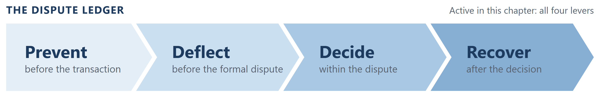
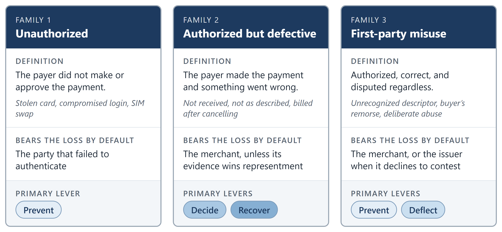
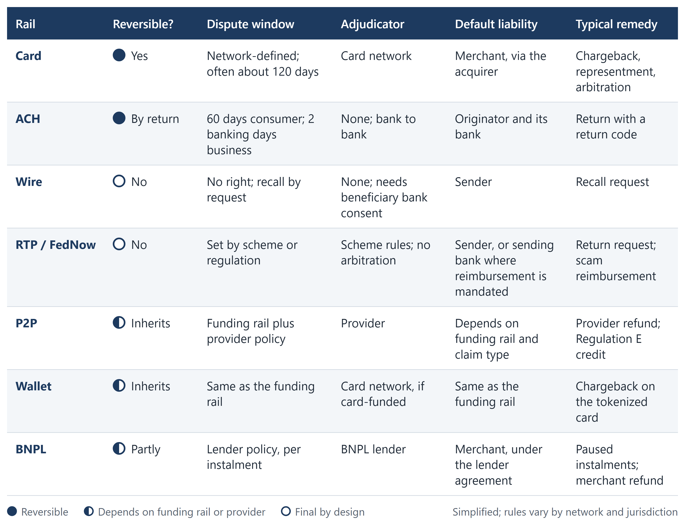
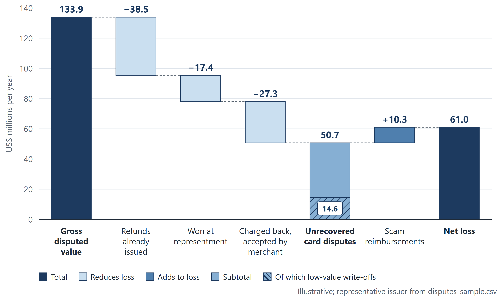
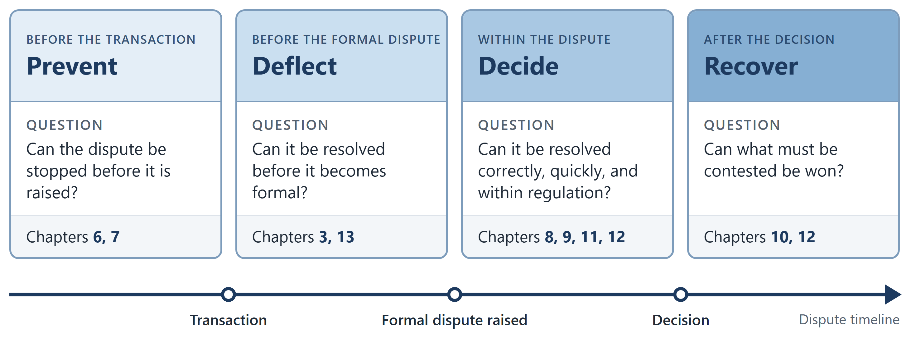
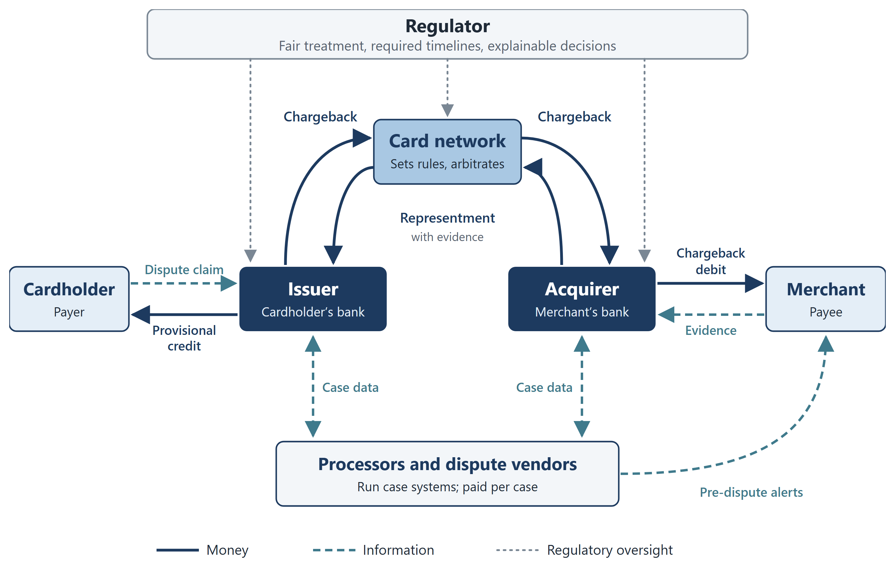
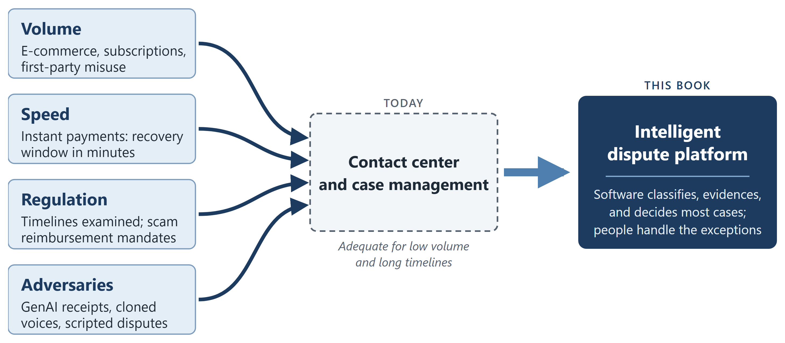
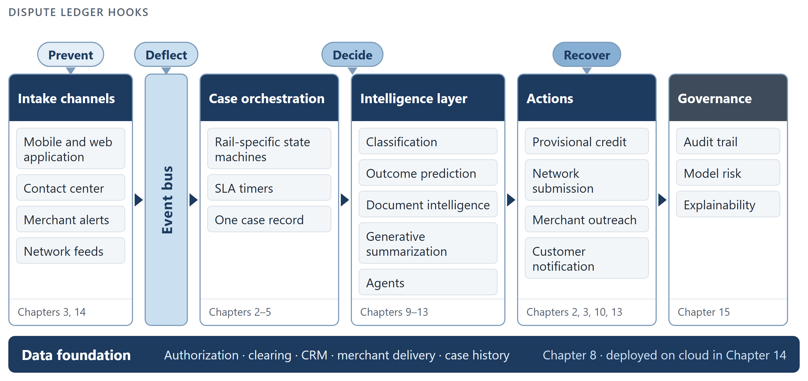

[⬅ Back to all chapters](../README.md) · [Code and data for this chapter](README.md)

# Chapter 1: Understanding the Dispute Landscape in Modern Payments

*This chapter introduces the Dispute Ledger; each later chapter pulls one or two of its levers.*

> **Worked example.** A cardholder opens a mobile banking application, selects a card-not-present purchase from an online retailer and reports that the goods were not received. Within seconds the issuer must acknowledge the claim, start a regulatory clock, decide whether to credit the account immediately, retrieve the authorization and clearing records, determine whether the merchant has already issued a refund and begin assembling the evidence it may need at the card network several weeks later. A mid-sized issuer processes thousands of such claims each day. *This chapter answers the question: what has the cardholder started and why is it so costly to resolve?*

Disputes sit at the intersection of fraud, customer service, regulation and money movement. Most organizations manage them as a back-office cost to be contained. This book treats them as a system to be engineered and builds that system chapter by chapter until a claim like the one above can be resolved correctly, within regulation, by software, with people supervising rather than processing.

This chapter is the foundation. You will learn what a dispute is and the three families it falls into, how disputes behave across payment rails, what they cost and who pays, who the participants are and what each wants and why the operating model most institutions still run is failing. By the end you will be able to describe any dispute function in terms of the four levers of the Dispute Ledger, the framework that organizes the rest of the book.

In this chapter, we will cover the following topics:

- Defining a dispute and its three families
- How disputes behave across cards, ACH, wires, instant payments, wallets and BNPL
- The economics of disputes and the Dispute Ledger
- The participants and their incentives
- The four forces reshaping the dispute function
- A first look at the intelligent dispute platform built in this book

## Technical requirements

Clone the companion repository and open chapter01/. It contains disputes\_sample.csv, a synthetic dataset of 5,000 card disputes scaled to a mid-sized US issuer and explore.ipynb, which reproduces every table and figure in this chapter. Python 3.11 and pandas 2.x are sufficient; no cloud account is needed yet. By the end of this chapter you will have loaded the dataset and computed the baseline Dispute Ledger, the first chapter artifact of the book.

## Defining a dispute and its three families

A dispute is a claim by a payer, or occasionally a payee, that a completed payment was wrong, together with a request that the funds be returned. The definition is simple. The error most organizations make is to treat all disputes as one kind of work; there are three families and each has a different economic answer.

**Unauthorized transactions.** The payer states that they did not make or approve the payment: a stolen card, a compromised login, a SIM swap. Liability rests with the party that failed to authenticate and consumer regulation protects the payer. These are fraud-prevention problems presented as disputes.

**Authorized but defective transactions.** The payer made the payment and something went wrong: goods not received, service not as described, a cancelled subscription still billed, an incorrect amount. The worked example above belongs here. The contest is about evidence and is conducted between the issuer and the acquirer under network rules.

**Authorized, correct and disputed regardless.** The payer made the purchase, received it and disputes it anyway: confusion over an unrecognized merchant descriptor, buyer’s remorse, or deliberate abuse. The industry terms this friendly fraud or first-party misuse. At many issuers it is now the largest family by volume. Figure 1.1 summarizes the three families.

***Figure 1.1:** The three families of disputes*

| **Business impact.** Unauthorized disputes are cheapest to stop at authorization. Defective-transaction disputes are won or lost on the speed of evidence assembly. First-party misuse is a customer-treatment decision: contesting a low-value claim from a profitable customer can cost more in handling and attrition than the claim itself. One budget line, three different strategies. |
|---|
| **Under the hood.** The first model built in Chapter 9 assigns an incoming claim to one of these families before a person sees it. Provisional credit, evidence collection, routing and the decision to contest all branch on that label. A taxonomy fixed correctly here is inherited by every model downstream. |

### The vocabulary you need

The dispute domain has a precise vocabulary whose terms are not interchangeable. Table 1.1 is the minimum; Chapter 3 treats cards in depth and Chapter 4 the other rails.

| **Term** | **Meaning** | **Rail** |
|---|---|---|
| Inquiry / retrieval request | The issuer requests transaction details from the merchant before deciding whether to dispute | Cards |
| Chargeback | The issuer reverses a card transaction and debits the acquirer | Cards |
| Reason code | A network-defined code stating the basis of the chargeback (for example, Visa 13.1, merchandise or services not received) | Cards |
| Representment | The merchant, through the acquirer, resubmits the transaction with supporting evidence | Cards |
| Pre-arbitration / arbitration | Escalation to the network for a ruling | Cards |
| Return | Reversal of an ACH debit by the receiving bank, identified by a return code (for example, R10, unauthorized) | ACH |
| Recall | A request to return a settled wire; requires the beneficiary’s consent | Wires |
| Error claim | A consumer’s assertion under Regulation E that an electronic fund transfer was incorrect | US consumer EFTs |
| Provisional credit | Temporary credit to the consumer while the investigation proceeds | Regulation E, Regulation Z |
| Authorized push payment (APP) fraud | The payer was deceived into authorizing a payment to a fraudster | Instant payments, P2P |

***Table 1.1:** Core dispute vocabulary and the rails it applies to*

With the families and vocabulary established, we can examine why the same term, dispute, behaves differently on each payment rail.

## How disputes behave across payment rails

The most common architectural failure in dispute platforms is to design for cards and extend to other rails afterward. Rails differ on four dimensions that drive design: whether a payment can be reversed, the length of the dispute window, who adjudicates and who bears the loss by default. Figure 1.2 compares the rails on these dimensions.

***Figure 1.2:** Dispute characteristics by rail*

**Cards** have the most mature machinery. The networks define reason codes, timelines, evidence standards and arbitration. Cardholders receive strong protection and merchants carry most of the loss. Because the process is rules-based, it is the first place where automation returns value.

**ACH** is a batch rail with a return mechanism rather than a dispute process. A consumer may trigger an unauthorized return within 60 days; a business has two banking days. There is no network arbitration; matters beyond a return are resolved between the institutions or through legal process.

**Wires** are designed for finality. A recall is a request rather than a right and recovery depends on the beneficiary institution’s cooperation and whether the funds remain. Wire disputes are predominantly fraud or scam cases and speed of recall is the only effective lever.

**Instant payments** (RTP, FedNow, UK Faster Payments, UPI) settle in seconds and are irrevocable by design. The remedy shifts from reversing the payment to reimbursing the victim. Mandatory APP-fraud reimbursement in the UK and comparable proposals elsewhere, have converted an operational problem into a balance-sheet one.

**P2P and wallets** inherit the dispute rights of the underlying funding rail together with the provider’s own policy. A bank-app transfer behaves like ACH or an instant payment; a wallet purchase on a tokenized card behaves like a card.

**BNPL** divides one purchase into several instalments. A merchant dispute can arise after some instalments are paid and others remain owed, with a lender who is neither issuer nor acquirer in the conventional sense.

| **Business impact.** The rails an institution supports determine its loss profile. A card-focused issuer loses primarily through chargebacks it cannot win; an institution with large instant-payment flows loses primarily through scam reimbursement it cannot recover. The investment case for automation differs accordingly. |
|---|
| **Under the hood.** The platform in Chapter 14 treats each rail as a plug-in with its own state machine, timers and evidence schema beneath a single shared case model. Expressing ACH returns in card reason codes, or wire recalls on chargeback timelines, is the design error most frequently found in legacy systems, which is why rail adapters are written in Chapter 4 before any model. |
| **Case study: a wire recall delayed by a card-centric case model.** A customer of a regional bank was deceived by a spoofed email into wiring a large sum to a fraudulent account and reported it within hours. The bank’s dispute queue was designed for cards; the wire claim was logged as a generic case, assigned the following day and the recall request was sent two days after that. By then the beneficiary account had been emptied. No component had failed; the case model simply had no representation of a rail whose only lever is speed. Chapter 4 gives wires a state machine whose first transition is *recall sent*, measured in minutes. |

The rails determine how a dispute behaves. The next section determines what it costs, which is the figure that decides whether any of this is funded.

## The economics of disputes and the Dispute Ledger

Dispute costs are obscured because they fall into three budgets: fraud losses, operations and customer experience. No single function owns the total, so no single function funds the remedy. The first step of any transformation is to assemble one figure; the second is to attach every proposed initiative to one of four levers.

### The four cost buckets

- **Direct loss**: chargebacks the issuer or merchant could not recover, plus scam reimbursements.
- **Operating cost**: staff, systems and network fees. Illustratively, issuers report handling costs per card dispute in the range of $15–40 before any loss and merchants commonly report a total cost of two to three times the transaction value once fees, goods and labor are included.
- **Regulatory cost**: penalties, remediation programs and the engineering effort required to pass examination. Timing failures under Regulation E are among the most frequently cited findings in US consumer-compliance examinations.
- **Customer cost**: attrition following a poor dispute experience and revenue lost to false declines when fraud rules are tightened to suppress disputes.

### A representative issuer, by the numbers

The synthetic dataset is scaled to a mid-sized US issuer with approximately 4 million active cards. Table 1.2 shows the annual picture that explore.ipynb reproduces. All figures are illustrative and derived from the dataset.

| **Metric** | **Value** |
|---|---|
| Dispute cases per year | 720,000 |
| Share classified as first-party misuse | 38% |
| Average handling cost per case | $28 |
| Cases contested through representment | 31% |
| Win rate on contested cases | 42% |
| Average disputed amount | $186 |
| Net annual dispute loss (unrecovered) | $61 million |
| Annual operating cost | $20 million |

***Table 1.2:** Annual dispute profile of the representative issuer (illustrative)*

Two figures matter most. Operating cost is one third of losses, so reducing headcount alone cannot solve the problem. And 38% of cases are first-party misuse, which no improvement in authorization-time fraud prevention will stop. These two facts recur at most issuers and explain why the remainder of this book concerns intelligence rather than staffing.

The first cell of the notebook loads the data and reproduces the headline figures:

> import pandas as pd
>
> disputes = pd.read\_csv("disputes\_sample.csv",
>
> parse\_dates=\["opened\_at", "closed\_at"\])
>
> summary = {
>
> "cases": len(disputes),
>
> "first\_party\_share": (disputes\["family"\] == "first\_party").mean(),
>
> "contested\_share": disputes\["represented"\].mean(),
>
> "win\_rate": disputes.loc\[disputes\["represented"\],
>
> "outcome"\].eq("won").mean(),
>
> "avg\_amount": disputes\["amount"\].mean(),
>
> }
>
> print(summary)

The family column holds the three-way classification from the first section. In production that column does not exist when a case is opened; producing it is the work of Part III. Here it is given, so that the value of accurate labeling can be seen before the model that produces it is built. The notebook’s second cell then traces where the money goes, as shown in Figure 1.3.

***Figure 1.3:** Where the money goes: from gross disputed value to net loss (illustrative)*

### The Dispute Ledger

Every dollar of dispute cost can be addressed by exactly one of four levers. We call the set the Dispute Ledger and use it to classify every initiative in this book and, we recommend, every initiative in a dispute program. Figure 1.4 places the four levers along the dispute timeline and Table 1.3 summarizes them.

***Figure 1.4:** The Dispute Ledger along the dispute timeline*

| **Lever** | **Question** | **Example initiatives** | **Chapters** |
|---|---|---|---|
| Prevent | Can the dispute be stopped before it is raised? | Clear descriptors, delivery confirmation, fraud model tuning | 6, 7 |
| Deflect | Can it be resolved before it becomes formal? | Pre-dispute alerts, instant refunds, merchant collaboration | 3, 13 |
| Decide | Can it be resolved correctly, quickly and within regulation? | Classification, auto-decisioning, evidence automation, generative AI | 8, 9, 11, 12 |
| Recover | Can what must be contested be won? | Outcome prediction, representment quality, contest-or-accept rules | 10, 12 |

***Table 1.3:** The four levers of the Dispute Ledger*

The notebook’s third cell computes the baseline Ledger for the representative issuer: the share of the $81 million of combined loss and operating cost addressable by each lever. That baseline is this chapter’s artifact and is updated at the end of every chapter that pulls a lever.

| **Business impact.** The Ledger converts a technology roadmap into a finance conversation. A finance function cannot evaluate “deploy a language model for case summarization”; it can evaluate “Decide: reduce handling cost per case from $28 to $19 on 62% of volume”. |
|---|
| **Under the hood.** Architecturally, the four levers correspond to four points in the event stream: authorization time, post-settlement monitoring, case orchestration and network submission. The reference platform in Chapter 14 exposes a hook at each. |

With the economics established, we turn to the participants.

## The participants and their incentives

Six parties are involved in almost every card dispute and their incentives conflict. A platform that ignores those conflicts optimizes for the wrong objective. Figure 1.5 maps the parties and the flows between them.

***Figure 1.5:** The dispute ecosystem: parties, money, information and oversight*

- **The cardholder** wants the funds returned promptly and is indifferent to reason codes.
- **The issuer** wants to satisfy the cardholder, remain within Regulation E and Z and avoid losses on cases it cannot win. It carries the regulatory exposure.
- **The acquirer** wants to protect its merchants and its own chargeback ratios, which the networks monitor.
- **The merchant** wants to retain the sale and avoid the networks’ excessive-chargeback programs, which carry penalties and can end in loss of acceptance.
- **The network** wants finality and volume and sets the rules.
- **The processor or vendor** wants cases to flow through its systems and is compensated per case.

Above all of them is the regulator, whose interest is that the consumer is treated fairly, within the required timelines, with a decision that can be explained.

| **Business impact.** Be explicit about which party you are. An issuer’s win is frequently an acquirer’s loss and a vendor serving both must be careful which metrics it promises. In the worked example, the issuer and the merchant both act in good faith and still occupy opposite sides. |
|---|
| **Under the hood.** Available data depends on position. Issuers see the cardholder and the authorization; merchants see the order, delivery and customer history; neither sees everything. Chapter 8 assembles a case record from partial views and Chapter 13 builds agents that negotiate across the gap. |

## The four forces reshaping the dispute function

For two decades the dispute operating model was a contact center supported by a case-management tool. It was adequate while volumes were manageable and timelines long. Four forces have made it inadequate. Figure 1.6 shows them converging on that model.

**Volume.** E-commerce and subscription billing have raised dispute counts faster than transaction counts and first-party misuse has normalized the act of disputing. Industry estimates place global chargebacks in the hundreds of millions per year with double-digit growth; treat any specific figure as approximate and benchmark your own institution in Chapter 7.

**Speed.** Instant payments compress the recovery window from days to minutes. A scam payment over RTP is gone before a nightly batch runs.

**Regulation.** Supervisors examine timelines, provisional credit and investigation quality. Scam-reimbursement mandates transfer losses onto institutional balance sheets.

**Adversaries.** Generative AI provides fraudsters with fabricated receipts, cloned voices and scripts for serial disputing at scale. The tools that summarize a case can also manufacture one.

***Figure 1.6:** Four forces on the dispute function*

The response is not additional staff. It is a platform in which most cases are classified, evidenced and decided by software and people handle the ambiguous, the high-value and the regulatory edge cases.

## A first look at the intelligent dispute platform

The remainder of this book builds one system. Figure 1.7 is the map; each subsequent chapter completes one region of it.

***Figure 1.7:** The intelligent dispute platform, reference view*

The platform is built in the order a real program would follow:

- **Establish the rules** (Chapters 2–4), because every automated decision must remain within them.
- **Fix the operating model and business case** (Chapters 5–7), because technology without a target metric has no owner.
- **Build the data foundation and models** (Chapters 8–10) that classify, prioritize and predict.
- **Add generative and agentic AI** (Chapters 11–13) for evidence, drafting and autonomous resolution.
- **Deploy on cloud with governance** (Chapters 14–16) so that it scales and passes examination.

| **Worked example revisited.** The not-received claim from the opening of this chapter is now classifiable: it is a defective-transaction dispute on the card rail, subject to a Regulation E clock and to the network’s chargeback timeline and it will be addressed by the Decide and Recover levers. Nothing has yet been automated; the claim is in a queue and the clock is running. Chapter 2 gives that clock a name and a deadline and Chapter 3 follows the claim to the merchant. |
|---|
| **Key principle.** *Name the lever before committing the budget.* |

### What you now have

- chapter01/disputes\_sample.csv: the synthetic issuer dataset used throughout the book
- chapter01/explore.ipynb: headline metrics, the money waterfall and the baseline Dispute Ledger

## Summary

In this chapter we defined a dispute and separated it into three families, unauthorized, defective and first-party, each with a different economic answer. We saw that payment rails differ in reversibility, timelines, adjudication and liability and that a platform must model each rail on its own terms. We built the economic picture of a representative issuer and introduced the Dispute Ledger, the four levers, Prevent, Deflect, Decide and Recover, that classify every initiative in the book. We identified the six participants and the regulator, examined the four forces reshaping the dispute function and previewed the platform built in the chapters that follow.

Chapter 2 pulls the Decide lever first: Regulation E, Regulation Z, Nacha rules, the card networks’ dispute frameworks and the scam-reimbursement regimes that define the boundaries every automated decision must respect.

## Questions

- A customer disputes a gym membership charge after cancelling. Which family does it belong to and which lever reduces such cases most cheaply?
- Why can an RTP payment not be charged back and what replaces the chargeback as the remedy?
- Using the figures in Table 1.2, what is the annual value of raising the representment win rate from 42% to 50% with no change in the number of cases contested?
- Which party carries the Regulation E timing obligation and how should that shape the platform’s SLA design?
- Identify two ways generative AI increases dispute volume and two ways it reduces handling cost.

## Further reading

- Consumer Financial Protection Bureau, Regulation E (12 CFR 1005) and Regulation Z (12 CFR 1026), with official interpretations
- Nacha Operating Rules and Guidelines, current edition
- Visa Core Rules and Visa Product and Service Rules, dispute resolution section
- Mastercard Chargeback Guide, current edition
- UK Payment Systems Regulator, APP fraud reimbursement policy statements
- Federal Reserve, FedNow Service operating procedures
- The Clearing House, RTP network operating rules
