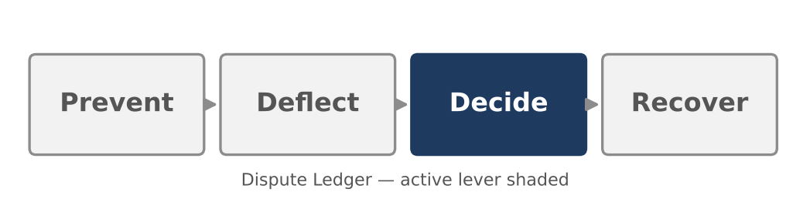
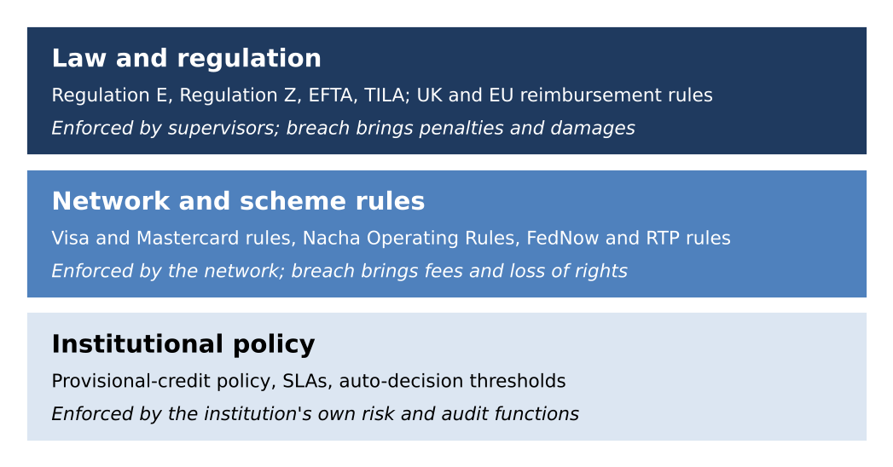
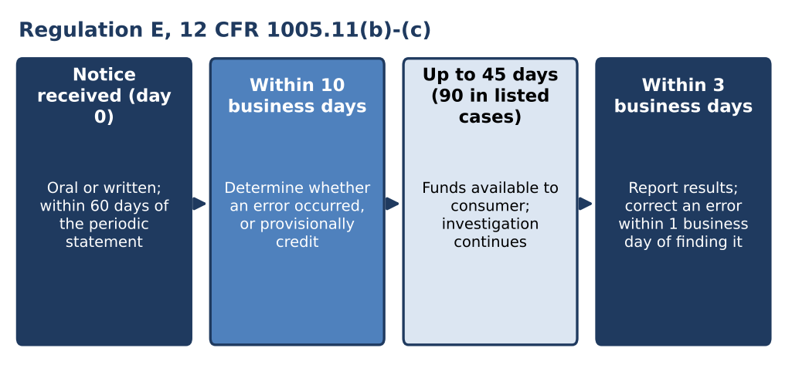
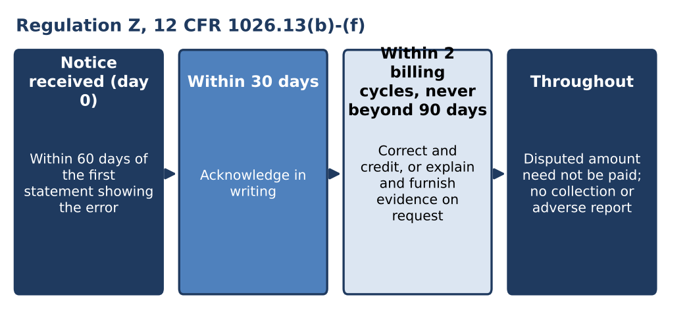
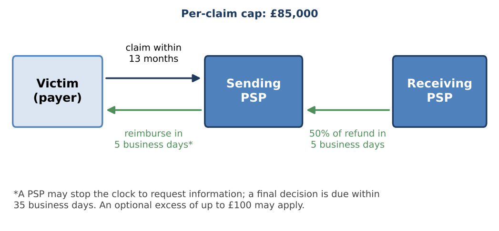
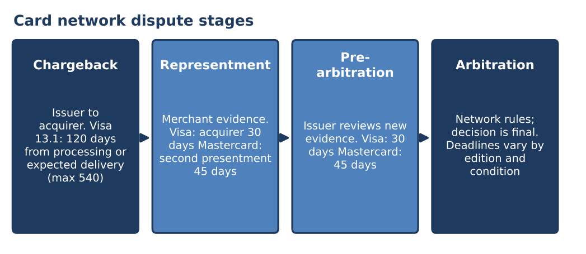
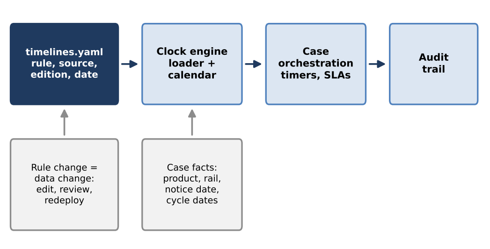
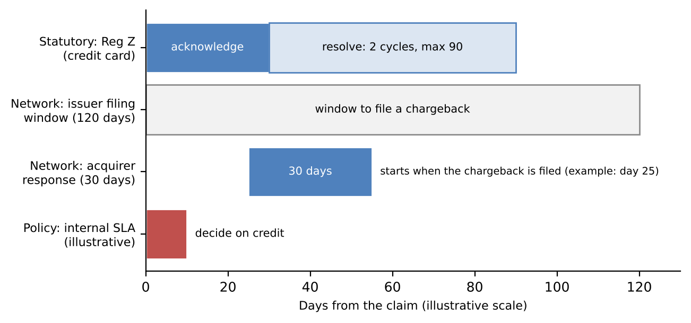

[⬅ Back to all chapters](../README.md) · [Code and data for this chapter](README.md)

# Chapter 2: Understanding the Rules of the Game: Regulation and Network Frameworks

*This chapter pulls the Decide lever: every automated decision in the book must stay inside the rules set out here.*

> **Worked example.** The not-received claim from the first chapter arrives in the issuer’s system and two sets of rules read it at once. The regulatory reading depends on the card. On a credit card, non-delivery is a billing error and a written acknowledgement and a resolution deadline begin to run. On a debit card, a merchant’s failure to deliver is not among the errors the regulation lists, so no statutory investigation clock starts unless the cardholder’s account changes to an unauthorized transaction. The network reading is the same for both: the claim falls under a merchandise-or-services-not-received dispute condition, with a filing window measured from the transaction and a response period for the acquirer after a chargeback is filed. Beside both runs the issuer’s own policy clock, usually shorter than either. *This chapter answers the question: which clocks are running on this claim, who set each one and what happens when one expires?*

A dispute platform does not decide what is fair. It decides what is permitted, how quickly and with what evidence and the answer comes from three sources written by different bodies for different purposes. A platform that treats them as one list of deadlines will eventually miss one.

This chapter is the rulebook. You will learn how the three layers of rules fit together, how Regulation E and Regulation Z define errors and set clocks, how Nacha rules, wire law and instant-payment schemes treat disputes, how the Visa and Mastercard frameworks structure a chargeback and how scam-reimbursement regimes change who pays. By the end you will be able to express any claim as a set of dated obligations and hold those obligations as data rather than as code.

In this chapter, we will cover the following topics:

- Three layers of rules and three kinds of clock
- Regulation E and the debit clock
- Regulation Z and the credit clock
- Beyond cards: Nacha rules, wires, instant payments and scam reimbursement
- The card networks’ dispute frameworks
- Turning the rules into data

## Technical requirements

Open chapter02/ in the companion repository. It contains timelines.yaml, a file that records each regulatory and network deadline discussed in this chapter together with its source and the date it was last checked and clocks.py, a short loader that turns a claim into a dated list of obligations. Python 3.11, pandas 2.x and PyYAML 6.x are sufficient; no cloud account is needed. By the end of this chapter you will have run the loader against a debit-card claim and a credit-card claim, which produces the second chapter artifact of the book: the rules as data.

Rules change and this chapter states them as of October 2026. Each rule is cited to its source and the repository file carries an edition and a verification date for every entry. Treat the file, not the page, as the version to maintain.

## Three layers of rules and three kinds of clock

Figure 2.1 shows the three layers. Law sits at the top because it cannot be waived by contract, network rules sit beneath it as a condition of participation and institutional policy sits at the base, where it may be stricter than the layers above but never looser.

***Figure 2.1:** The three layers of rules. When layers conflict, the stricter obligation governs the case.*

Each layer produces a different kind of clock, with a different consequence at expiry.

- A **statutory clock** is set by regulation. Missing it can create supervisory findings, restitution and statutory damages.
- A **network clock** is set by a card network or payment scheme. Missing it usually forfeits the right to dispute or to defend, which is a loss of money but not a violation of law.
- A **policy clock** is set by the institution. Missing it breaches a service commitment and is the only clock the institution may change on its own.

Table 2.1 summarizes the layers for the rails covered in this chapter.

| **Layer** | **Examples** | **Who enforces** | **Consequence of a miss** |
|---|---|---|---|
| Law | Regulation E (12 CFR 1005), Regulation Z (12 CFR 1026), UK APP reimbursement requirement | Supervisors, courts | Findings, restitution, damages |
| Network or scheme rules | Visa Core Rules, Mastercard rules, Nacha Operating Rules, FedNow and RTP rules | The network or association | Lost rights, fees, assessments |
| Institutional policy | Provisional-credit practice, SLAs, auto-decision limits | Risk and audit | Internal breach, customer harm |

***Table 2.1:** Rule layers and their consequences.*

| **Business impact.** Regulatory exposure is the one cost in the Dispute Ledger that cannot be negotiated. Examiners ask whether the institution met the deadline, not whether the case was hard. A clock miss on a statutory obligation costs more than the claim it concerns, because it is a finding about the process and can affect every case handled the same way. |
|---|
| **Under the hood.** Each obligation is a tuple: a rule identifier, a start event, a duration, a unit and a consequence. The start event is a fact about the case, not about the workflow, such as the date the notice was received. Keeping the start event separate from the duration is what allows the same engine to serve every rail. |

With the layers defined, we can read the first and most frequently examined rule, which governs debit.

## Regulation E and the debit clock

Regulation E implements the Electronic Fund Transfer Act and protects consumers who use electronic fund transfers from their accounts: debit cards, ACH debits, peer-to-peer transfers and consumer payments over instant rails. Its error-resolution procedures are in 12 CFR 1005.11 and its limits on consumer liability are in 1005.6.

### What counts as an error

The regulation lists seven kinds of error in 1005.11(a)(1): an unauthorized transfer, an incorrect transfer, an omitted transfer on a statement, a bookkeeping error by the institution, an incorrect amount from an electronic terminal, a transfer not properly identified on a statement or receipt and a request for documentation or clarification. The list is closed and routine balance inquiries are excluded (1005.11(a)(2)).

Two consequences follow. First, a merchant’s failure to deliver goods is not on the list. A debit-card claim of non-delivery therefore starts no Regulation E investigation clock by itself and the network dispute is the only formal route. Second, the definition of an unauthorized transfer in 1005.2(m) includes, under official comment 2(m)-3, a transfer initiated by a person who obtained the access device from the consumer through fraud or robbery. The label the cardholder attaches to a claim in the first minute can therefore move it from outside the regulation to inside it. Classification is a regulatory act, which is why the first model built later in the book assigns a family before anything else happens.

### The clock

Figure 2.2 shows the sequence once a notice of error is received. The notice may be oral, although the institution may require written confirmation within 10 business days if it told the consumer so (1005.11(b)(2)).

***Figure 2.2:** The Regulation E sequence. The start event is receipt of notice by the institution through any channel.*

The institution must determine whether an error occurred within 10 business days of receiving notice and report the results to the consumer within three business days after completing its investigation (1005.11(c)(1)). If it cannot finish in 10 business days, it may take up to 45 days, but only if it provisionally credits the amount of the alleged error within those 10 business days, tells the consumer within two business days of the credit and gives the consumer full use of the funds (1005.11(c)(2)). The periods extend to 20 business days and 90 days for new accounts and to 90 days for point-of-sale debit transactions and transfers initiated outside a state (1005.11(c)(3)). If the institution finds no error, it must explain its findings in writing and provide the documents it relied on on request (1005.11(d)).

A business day is a day on which the institution’s offices are open for substantially all business functions (1005.2(d)), so the business-day count depends on the institution’s own calendar.

### Liability tiers

Regulation E also caps what a consumer can lose to unauthorized transfers, under 1005.6(b). Liability is limited to the lesser of $50 or the unauthorized transfers made before notice if the consumer notifies the institution within two business days of learning of a loss or theft. Later notice raises the limit to the lesser of $500 or the $50 amount plus transfers that timely notice would have prevented. A consumer who fails to report an unauthorized transfer within 60 days of the statement’s transmittal faces unlimited liability for later transfers, as official comment 6(b)(3) explains.

| **Business impact.** Treble damages are available under section 915 of the Electronic Fund Transfer Act (15 U.S.C. 1693m) where an institution fails to provisionally credit on time or does not investigate in good faith. The exposure sits in the process, not the amount: a late credit on a small claim is the same violation as a late credit on a large one. |
|---|
| **Under the hood.** Four Regulation E obligations hang from one start event: determine within 10 business days, credit within 10 business days if the investigation runs on, notify within two business days of the credit and report within three business days of completion. The engine in this chapter computes each as a separate dated row so that any one can alert independently. |
| **Case study: a deadline measured from the wrong event.** An issuer’s dispute system began its investigation timer when an analyst opened the case. Claims arrived through several channels: the mobile application, the contact center and branch staff who forwarded paper forms to a central team. Cases from the central team were opened days after the consumer first gave notice, so the system believed it had more time than the regulation allowed. No analyst missed an internal target and no component failed, yet a review of case timestamps against channel receipt records found cases that had passed the 10-business-day period before an analyst ever saw them. The remediation was a change of definition rather than staffing: the clock starts when any channel receives the notice and the intake event carries that timestamp into the case. The approach in this chapter makes the start event an explicit, auditable field. |

Regulation E governs the debit side of the consumer’s wallet. The credit side runs on a different regulation with a different shape.

## Regulation Z and the credit clock

Regulation Z implements the Truth in Lending Act and its billing-error procedures are in 12 CFR 1026.13. Where Regulation E is built around a closed list of electronic-transfer errors, Regulation Z’s billing-error definition is broader and includes, in 1026.13(a)(3), an extension of credit for property or services not accepted by the consumer or not delivered as agreed. A credit-card claim of non-delivery is therefore a billing error from the first moment and the statutory clock starts.

The consumer must give notice no later than 60 days after the creditor transmitted the first periodic statement that reflects the alleged error (1026.13(b)(1)). Figure 2.3 shows what follows: the creditor must acknowledge the notice in writing within 30 days (1026.13(c)(1)) and resolve it within two complete billing cycles and in no event later than 90 days (1026.13(c)(2)). While the dispute is open, the consumer need not pay the disputed amount and the creditor may not try to collect it, make or threaten an adverse credit report, or accelerate the debt (1026.13(d)). If the creditor finds the error occurred, it corrects the account and credits the disputed amount (1026.13(e)); if it finds no error or a different one, it explains its reasons and furnishes documentary evidence on request (1026.13(f)).

***Figure 2.3:** The Regulation Z sequence. Resolution is bounded by the earlier of two billing cycles and 90 days.*

Unauthorized use is treated separately. Under 1026.12(b), a cardholder’s liability for unauthorized use of a credit card is limited to $50 and an unauthorized charge is also a billing error under 1026.13(a)(1).

Table 2.2 sets the two regulations side by side, since the platform must choose between them from the first event.

| **Feature** | **Regulation E (debit and electronic transfers)** | **Regulation Z (credit cards)** |
|---|---|---|
| Notice window | 60 days after the statement is sent | 60 days after the first statement showing the error |
| Non-delivery of goods | Not a listed error | A billing error (1026.13(a)(3)) |
| First obligation | Determine within 10 business days | Acknowledge within 30 days |
| Outer limit | 45 days, or 90 in listed cases | Two billing cycles, never beyond 90 days |
| Money while pending | Provisional credit if past 10 business days | No payment or collection of the disputed amount |
| Unauthorized liability | $50, $500, or uncapped by timing | $50 |

***Table 2.2:** Regulation E and Regulation Z compared.*

The comparison corrects a simplification in the first chapter’s vocabulary table, which lists provisional credit under both regulations. Provisional credit is a Regulation E device. Regulation Z achieves a similar effect by suspending the obligation to pay, not by crediting the account.

| **Business impact.** The rule that a non-delivery claim triggers Regulation Z but not Regulation E means that identical customer behavior has different regulatory weight by product. Many institutions apply one procedure to both, which raises the standard for debit. That is a policy choice and should be made deliberately. |
|---|
| **Under the hood.** The Regulation Z resolution deadline depends on billing-cycle dates, which are account data, not constants. The loader later in this chapter returns the 90-day outer bound and leaves the two-cycle test to the case record, because the engine should never guess at data it does not hold. |

Cards are only one rail a claim can arrive on and the others are governed differently.

## Beyond cards: Nacha rules, wires, instant payments and scam reimbursement

Table 2.3 shows how the rules differ by rail.

| **Rail** | **Primary rule source** | **Dispute mechanism** | **Clock the platform tracks** |
|---|---|---|---|
| ACH | Nacha Operating Rules; Regulation E for consumers | Return of the entry | 60 days for consumer unauthorized returns; two banking days for corporate returns |
| Wires | Article 4A of the Uniform Commercial Code; Regulation J for Fedwire | Recall request | Speed only; no right to recovery |
| Instant payments | Scheme rules (FedNow, RTP); Regulation E for consumers | Reimbursement, not reversal | Regulation E clocks on consumer accounts |
| UK Faster Payments | PSR reimbursement requirement | Mandatory reimbursement of APP fraud | Five business days, with a stop-the-clock |

***Table 2.3:** Governing rules by rail.*

### ACH

The Nacha Operating Rules govern ACH returns. A consumer’s claim that an entry was unauthorized is returned under reason code R10 and since April 2020 R11 covers an entry that was authorized but not in accordance with the terms of the authorization, both within 60 calendar days of settlement of the original entry and supported by a written statement of unauthorized debit from the consumer. Returns of corporate entries under R29 are due within two banking days. Regulation E runs alongside: the Nacha return is the inter-bank mechanism and the Regulation E clock is the duty owed to the consumer and the platform tracks both.

Nacha’s fraud-monitoring rules add a process obligation. Phase 1 took effect on 20 March 2026 for originating banks, for originators and service providers above a 2023 volume threshold and for large receiving banks. Phase 2 followed on 22 June 2026 for the remaining participants. Each must maintain risk-based processes to identify entries suspected of being unauthorized or authorized under false pretenses and review them at least annually; screening every entry before processing is not required.

### Wires and instant payments

Wire transfers are final by design. Article 4A of the Uniform Commercial Code and Regulation J for Fedwire, allocate responsibility for erroneous and unauthorized orders, but recalling an executed wire depends on the beneficiary bank’s consent. Instant payments on FedNow and RTP have no chargeback either. On a consumer account, however, Regulation E still applies, so an unauthorized instant payment carries the same investigation clock as a debit-card claim. The rail is irrevocable; the consumer’s regulatory rights are not.

### Scam reimbursement

The last category is the payment the consumer authorized under deception. Regulation E treats it as unauthorized only if it meets the definition in 1005.2(m), so in the United States the remedy often rests on institutional policy, while the United Kingdom and the European Union have moved the obligation into law.

| **Regime** | **Status** | **Key terms** |
|---|---|---|
| UK, PSR requirement for Faster Payments | In force from 7 October 2024 | Reimbursement within five business days, with a stop-the-clock and a final decision within 35 business days; cap of £85,000 per claim; optional excess of up to £100; claims within 13 months; cost split 50:50 between sending and receiving firms |
| EU, Payment Services Regulation | Provisional agreement November 2025; final texts published April 2026; formal adoption and application dates to be confirmed | Refund right for impersonation of a payment provider, payee-name verification, provider liability for failed monitoring |
| United States | No federal reimbursement scheme for authorized payments | Regulation E applies only if the transfer meets the unauthorized definition |

***Table 2.4:** Scam-reimbursement regimes as of October 2026.*

Figure 2.4 shows the UK flow, in which the sending firm reimburses the victim and then recovers half from the receiving firm.

***Figure 2.4:** UK reimbursement flow for Faster Payments. The sending firm pays first; the receiving firm funds half.*

| **Business impact.** Mandatory reimbursement converts scam losses from a customer’s problem to a balance-sheet line. The 50:50 split also makes the receiving firm a stakeholder in the quality of its account opening and mule-account detection, so recovery now depends on counterparties as well as controls. |
|---|
| **Under the hood.** Reimbursement duties are clocks with a stop condition. The five-business-day period can be paused to request information and a final decision is bounded at 35 business days. The engine models a pause as an event that moves the deadline, not as an edit to the rule. |

The card networks remain the most elaborate of these frameworks and they are where most disputes travel.

## The card networks’ dispute frameworks

Each network publishes its own framework: the Visa Core Rules and Visa Product and Service Rules and Mastercard’s rules and chargeback guidance. Both organize a dispute into the stages shown in Figure 2.5: a chargeback by the issuer, a response by the merchant through the acquirer, a further review of new evidence and arbitration by the network as the last step.

***Figure 2.5:** The stages of a card dispute and the limits that bound them. Time limits differ by condition and by edition of the rules.*

### Reason codes and time limits

Every chargeback carries a code stating its basis. In the Visa framework, the claim from our worked example falls under Dispute Condition 13.1, merchandise or services not received, set out in Section 11.10.2 of the Visa Core Rules (18 April 2026 edition). The issuer’s filing window is 120 days from the transaction processing date or the last date the cardholder expected delivery and never more than 540 days from processing. In the Mastercard framework, the equivalents are message reason codes 4853, for cardholder disputes and 4837, for no cardholder authorization.

Table 2.5 compares the two frameworks at the level a platform needs.

| **Feature** | **Visa** | **Mastercard** |
|---|---|---|
| Not-received dispute | Condition 13.1 | Reason code 4853 |
| Unauthorized, card-absent | Condition 10.4 | Reason code 4837 (no cardholder authorization) |
| Issuer filing window | 120 days (13.1: 540 days maximum) | Generally 120 days |
| Acquirer or merchant response | 30 days | 45 days (second presentment) |
| Pre-arbitration | 30 days | 45 days |
| Last stage | Arbitration | Arbitration |

***Table 2.5:** Visa and Mastercard frameworks compared. Confirm each value against the edition in force before relying on it.*

### Evidence standards

The networks also set what counts as evidence and the standards change. Visa’s Compelling Evidence 3.0 applies only to Condition 10.4, not to non-delivery claims. It lets an acquirer show that a disputed transaction resembles at least two earlier undisputed ones on the same card, matching on a device identifier or IP address plus another element such as an account login or delivery address. Under the rules dated 18 April 2026, those prior transactions may come from more than one merchant for disputes processed on or after 24 October 2026. An evidence pipeline should treat the standard as a versioned rule with an effective date.

| **Business impact.** Network time limits are the cheapest losses to prevent. A merchant that misses a response period forfeits the defense and an issuer that misses a filing window forfeits the chargeback, in both cases for the full amount and without any appeal. The wins are in timeliness before they are in argument. |
|---|
| **Under the hood.** Network rules are published in editions and conditions carry sub-rules with their own limits. The rule file therefore stores the edition, the effective date and the condition for each entry, so that a case is judged against the rules in force on the date it was processed, not on the date it is reviewed. |

The rules are now defined, which leaves the task of holding them in a form a platform can use.

## Turning the rules into data

The design question is where the rules should live. If deadlines are written into workflow code, every rule change is a software release and nobody can say what the deadline was on a given date. If deadlines are data, a rule change is a reviewed edit and the history is the audit trail. This follows the event-driven structures described in Jaime Buelta’s Python Architecture Patterns (Packt, 2022), in which timers and rules are handled as events rather than as hard-wired logic.

***Figure 2.6:** Rules as data. The engine reads the rule file and the case facts and emits dated obligations that the case system tracks.*

Figure 2.6 shows the architecture. The rule file holds the obligations, the case record supplies the facts and the engine combines them. Each rule records where it came from. The excerpt below, from timelines.yaml, shows a Regulation E rule and a network rule:

> edition: "2026-10"
>
> rules:
>
> - id: reg\_e\_determine
>
> source: "12 CFR 1005.11(c)(1)"
>
> applies\_to: \[debit\_card, ach\_consumer, p2p, instant\_consumer\]
>
> starts\_on: notice\_received
>
> amount: 10
>
> unit: business\_days
>
> last\_verified: "2026-10-10"
>
> - id: visa\_13\_1\_filing
>
> source: "Visa Core Rules, 11.10.2"
>
> applies\_to: \[credit\_card, debit\_card\]
>
> starts\_on: processing\_date
>
> amount: 120
>
> unit: calendar\_days
>
> effective\_from: "2026-04-18"
>
> last\_verified: "2026-10-10"

The source field names the provision, applies\_to limits the rule to products and starts\_on names the case fact from which time is counted. The unit field separates business days, which depend on a calendar, from calendar days, which do not and last\_verified makes a stale entry visible. The repository file holds every rule in this chapter.

The loader turns a claim into dated obligations:

> from datetime import date, timedelta
>
> import yaml
>
> from pandas.tseries.offsets import CustomBusinessDay
>
> from pandas.tseries.holiday import USFederalHolidayCalendar
>
> BDAY = CustomBusinessDay(calendar=USFederalHolidayCalendar())
>
> def add\_time(start: date, amount: int, unit: str) -\> date:
>
> if unit == "business\_days":
>
> return (start + amount \* BDAY).date()
>
> return start + timedelta(days=amount)
>
> def deadlines(product, events, path="timelines.yaml"):
>
> rules = yaml.safe\_load(open(path))\["rules"\]
>
> out = \[\]
>
> for r in rules:
>
> if product in r\["applies\_to"\] and r\["starts\_on"\] in events:
>
> due = add\_time(events\[r\["starts\_on"\]\], r\["amount"\], r\["unit"\])
>
> out.append((r\["id"\], r\["source"\], due))
>
> return sorted(out, key=lambda t: t\[2\])

The constant BDAY defines a business day with the pandas federal holiday calendar; in production the institution’s own calendar replaces it. The function add\_time branches on the unit, because adding 10 business days and 10 calendar days are different operations. The function deadlines keeps only the rules that apply to the product and whose start event is known, computes each due date and returns them in date order; a rule with a missing start event is skipped rather than guessed. Running the module on a claim received on Monday, 5 January 2026, for a transaction processed on 20 December 2025, prints:

> credit\_card
>
> 2026-02-04  reg\_z\_acknowledge    12 CFR 1026.13(c)(1)
>
> 2026-04-05  reg\_z\_resolve        12 CFR 1026.13(c)(2)
>
> 2026-04-19  visa\_13\_1\_filing     Visa Core Rules, 11.10.2
>
> debit\_card
>
> 2026-01-20  reg\_e\_determine      12 CFR 1005.11(c)(1)
>
> 2026-02-19  reg\_e\_extended       12 CFR 1005.11(c)(2)
>
> 2026-04-19  visa\_13\_1\_filing     Visa Core Rules, 11.10.2

The Regulation E determination falls on 20 January, not 19 January, because the third Monday of January is a federal holiday and is not counted. This is the arithmetic that humans miscount and that the engine does not. Operationally, the change is that the claim now carries a dated list of obligations from the moment it is opened and the case system sets one timer per row.

Figure 2.7 shows the same claim as the worked example described it: the statutory, network and policy clocks laid on one axis. The scale is illustrative.

***Figure 2.7:** Three kinds of clock on one claim. The policy clock is typically the shortest and the only one the institution controls.*

| **Business impact.** Rules held as data shorten the time between a rule change and its enforcement from a release cycle to a review. They also give compliance a file it can read, which turns an examiner’s question about a past deadline into a lookup instead of an investigation. |
|---|
| **Under the hood.** The rule file is versioned like code, but its changes are reviewed by compliance, not engineering. Each entry’s effective\_from and last\_verified fields let a case be replayed against the rules that applied on any date, which is the property that makes an automated decision defensible later. |
| **Worked example revisited.** The not-received claim now has a dated list of obligations. On a credit card it carries a Regulation Z acknowledgement within 30 days, a resolution within two billing cycles and no later than 90 days, a 120-day Visa filing window and the issuer’s own policy clock. On a debit card it carries no Regulation E investigation clock unless the claim is reclassified as unauthorized, in which case the 10-business-day clock starts from the original notice, not from the reclassification. Nothing has yet been decided; the claim is classified and the clocks are running. The next step follows the claim into the card lifecycle and out to the merchant. |
| **Key principle.** *Automate within the regulatory deadlines, never around them.* |

### What you now have

- chapter01/disputes\_sample.csv: the synthetic issuer dataset used throughout the book
- chapter01/explore.ipynb: headline metrics, the money waterfall and the baseline Dispute Ledger
- chapter02/timelines.yaml: regulatory and network deadlines as data, with source, edition and verification date
- chapter02/clocks.py: the loader that turns a claim into dated obligations

## Summary

In this chapter we separated the rules governing a dispute into three layers, law, network rules and institutional policy and the three kinds of clock they produce. We read Regulation E and found that its closed list of errors excludes merchant non-delivery, while Regulation Z treats non-delivery as a billing error with its own acknowledgement and resolution deadlines. We saw how Nacha rules, wire law and instant-payment schemes handle disputes and how the UK and EU have written scam reimbursement into law. We compared the Visa and Mastercard frameworks and their evidence standards and we recorded the deadlines as data in timelines.yaml, the second chapter artifact. The lever is Decide: every automated decision must stay within these boundaries.

With the rules fixed, the next step is to follow a single card claim through the life of a dispute: the pre-dispute inquiry, the chargeback and the merchant’s response, where the clocks defined here start to interact with real queues and real evidence.

## Questions

- A consumer loses a debit card and reports it on the third business day after learning of the loss. Unauthorized transfers total $120 in the first two business days and $400 after that, all of which timely notice would have prevented. What is the consumer’s maximum liability under 1005.6(b)?
- A debit-card claim is received on a Monday and the institution cannot finish in 10 business days. By when must provisional credit be made and what is the latest end of the investigation if the transaction was a point-of-sale debit?
- Design a timelines.yaml entry for a rule whose duration changes on a stated date. Which fields would you add and how would the engine choose between the two versions for a case processed before the change?
- An issuer applies Regulation E procedures to all debit non-delivery claims, although the regulation does not require it. Identify two costs and two benefits of the policy.
- Why does Regulation Z’s resolution deadline need data that the rule file does not contain and where should that data come from?

## Further reading

- Consumer Financial Protection Bureau, Regulation E (12 CFR 1005) and Regulation Z (12 CFR 1026), with official interpretations
- Nacha Operating Rules and the fraud-monitoring rule pages
- Visa Core Rules and Visa Product and Service Rules, dispute resolution section
- Mastercard rules and compliance programs, including the Chargeback Guide for members
- UK Payment Systems Regulator, APP scams and the reimbursement requirement
- Arthur Cox, PSD3 and PSR final compromise texts published (a law-firm summary of the Council’s April 2026 texts)
- Federal Reserve, FedNow Service and The Clearing House, RTP network
- Jaime Buelta, Python Architecture Patterns, Packt, 2022
