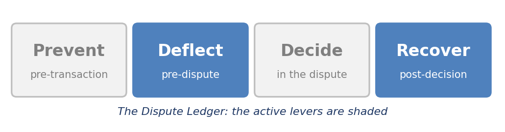
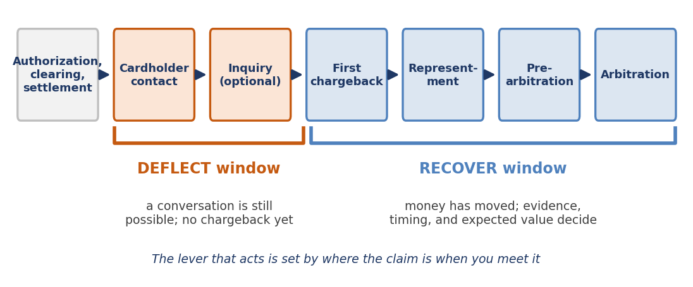
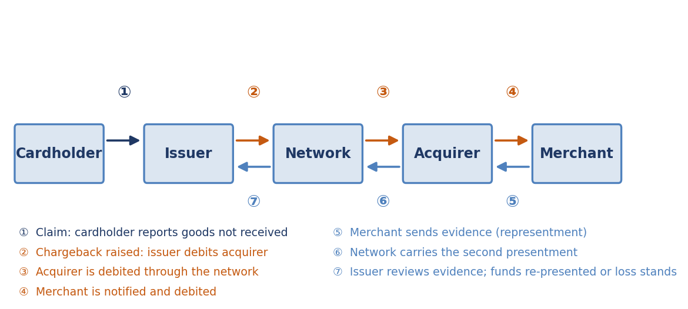
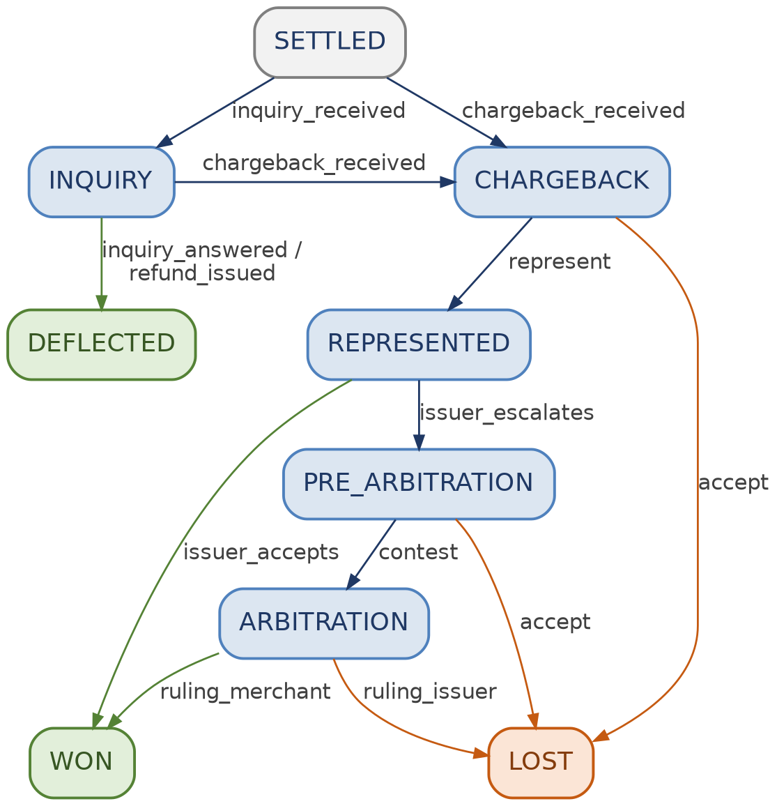
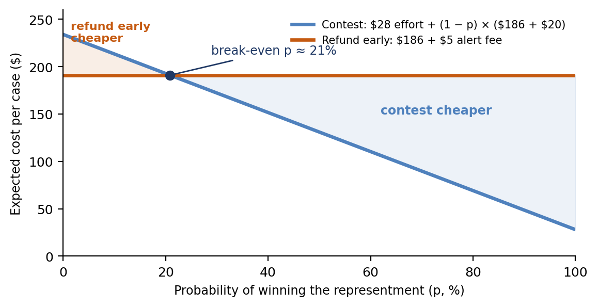

[⬅ Back to all chapters](../README.md) · [Code and data for this chapter](README.md)

# Chapter 3: Anatomy of the Card Dispute Lifecycle



*This chapter pulls the Deflect and Recover levers: the conversation before the chargeback and the contest after it.*

> **Worked example.** An online merchant’s payment provider forwards a pre-dispute inquiry: the cardholder’s bank asks for the order details behind a purchase the cardholder says was never received. The merchant holds the order record and the carrier’s tracking data, but no one owns inquiries and the request sits in a shared inbox. Several weeks later a chargeback arrives under the not-received reason code, the amount is debited from the merchant’s settlement and a response window starts. The tracking shows delivery to the address on the order, the cardholder maintains the parcel never arrived and the amount at stake is an illustrative $186. *This chapter answers the question: at which stage could this claim have been resolved most cheaply and what must the merchant’s systems know in order to find out?*

Chapter 2 gave the claim its clocks. This chapter follows the claim along the card rail from the first question to the last ruling and it does so from the merchant’s seat as well as the issuer’s, because a dispute is a conversation between both and the economics change at every step.

Most organizations treat a chargeback as an event. It is better understood as one stage in a sequence of states, each with an owner, a clock, a set of permitted actions and a cost. The earlier the claim is met, the more options remain and the less each option costs; the later it is met, the more the outcome depends on evidence that either exists or does not.

You will learn to name each stage of the card dispute lifecycle, who holds the clock and what can be done there. You will see how deflection instruments work, what moves when a chargeback is raised, what evidence wins a not-received claim and how to decide between refunding early and contesting. By the end you will have built the lifecycle as a state machine that refuses actions the rules do not allow.

In this chapter, we will cover the following topics:

- The card dispute lifecycle on one page
- The Deflect window: the conversation before the chargeback
- The chargeback: reason codes, money movement and the first decision
- Representment and the evidence file
- The lifecycle as a state machine
- Measuring the lifecycle: ratios, break-even and the value of an earlier conversation

## Technical requirements

Open chapter03/ in the companion repository. It contains card\_state\_machine.py, a table-driven model of the card dispute lifecycle and demo.py, a short script that drives it through three paths. Python 3.11 and its standard library are sufficient. The exercises reuse chapter01/disputes\_sample.csv and chapter02/timelines.yaml. By the end of this chapter you will have built the third chapter artifact of the book; every dollar amount and fee in it is illustrative.

## The card dispute lifecycle on one page

A card dispute is the last chapter of a longer story. Four parties handle every card payment: the cardholder, the issuer who holds the cardholder’s account, the merchant and the acquirer who holds the merchant’s. The card network connects the two banks and sets the rules, as we saw in Chapter 1.

The payment itself has three steps. At authorization the issuer approves the purchase and holds the funds. At clearing the merchant submits the transaction through the acquirer and the network to the issuer. At settlement the banks exchange net funds and the acquirer pays the merchant, usually after deducting its fees. The dispute begins afterwards, when the cardholder contacts the issuer.

Figure 3.1 lays the stages on one line and marks where the two levers of this chapter act. Table 3.1 gives the trigger, the clock holder and what the merchant sees at each stage.



*Figure 3.1: The card dispute lifecycle. Deflect acts before the first chargeback; Recover acts after it.*

| Stage | Trigger | Clock held by | What the merchant sees | Lever |
|---|---|---|---|---|
| Authorization, clearing, settlement | A purchase | Merchant and acquirer | A sale and a payout | Prevent |
| Cardholder contact | The cardholder questions or disputes a charge | Issuer | Nothing yet | Deflect |
| Inquiry or pre-dispute request | The issuer, or a tool acting for it, asks for order details | Merchant | A request for information | Deflect |
| Pre-dispute alert | An alert service warns that a dispute is imminent | Merchant | An alert with an option to refund | Deflect |
| First chargeback | The issuer raises a reason code | Merchant, through the acquirer | A debit and a notice | Recover |
| Representment | The merchant answers with evidence | Issuer | Evidence sent; funds re-presented | Recover |
| Pre-arbitration and arbitration | The issuer disagrees and escalates | Both parties, then the network | A request for more evidence, then a ruling | Recover |

*Table 3.1: The stages of a card dispute*

> **Business impact.** The same $186 costs a different amount depending on where it is resolved. A merchant that sees only chargebacks sees the most expensive and least flexible stage and misses the two stages before it, where a refund, an explanation, or a shipping update would have ended the matter.
>
> **Under the hood.** Each stage is a state with an owner, a clock and a list of permitted actions. A platform should emit one event for each transition, so that cycle time, cost and outcome can be measured by stage. The state machine you build later in this chapter encodes exactly this table.

The first two stages of the dispute are the cheapest, so we begin there.

## The Deflect window: the conversation before the chargeback

Deflection works because many disputes are not disagreements about facts but gaps in information. The cardholder does not recognize the merchant descriptor, a family member made the purchase, the parcel is with a neighbor, or a promised refund has not yet posted. A conversation resolves these cheaply; a chargeback resolves them expensively and sometimes unfairly.

Four instruments serve this window, summarized in Table 3.2. Network-affiliated services such as Visa Order Insight and Mastercard’s Ethoca Consumer Clarity share order details so that the cardholder can recognize the purchase in the banking application. Alert services such as Ethoca Alerts and Verifi’s Cardholder Dispute Resolution Network warn the merchant before a chargeback is raised and Visa Rapid Dispute Resolution lets a merchant or acquirer pre-agree rules for resolving disputes automatically. Program terms, fees and availability differ by network and provider and change, so the appendices track them.

| Instrument | What happens | Who acts | Works best for |
|---|---|---|---|
| Order data sharing at inquiry | Order, delivery and descriptor details reach the issuer or the cardholder’s application | Merchant, in advance | Unrecognized charges; not-received claims with clear delivery data |
| Pre-dispute alerts | The merchant is told a dispute is coming and may refund so that no chargeback is raised | Merchant, within a short program window | Cases the merchant would lose anyway |
| Rapid resolution rules | Pre-agreed criteria refund or accept qualifying disputes automatically | Merchant or acquirer, once | Low-value or clear-cut cases |
| Proactive messaging and easy refunds | Shipping updates, delivery-exception notices, self-service cancellation and refund | Merchant, continuously | Not-received claims; cancelled subscriptions |

*Table 3.2: Deflection instruments (illustrative; program terms change)*

Deflection is not free. Refunding a claim that could have been won gives away revenue and a merchant that refunds every alert invites repeat use by customers who dispute as a habit. Chapter 6 examines that behavior and Chapter 13 builds an agent that applies a decision rule within a budget.

> **Case study: a refund offered after the chargeback.** Described in general terms, a merchant experienced a delivery problem in one fulfillment region. Order-detail requests from issuers reached an integration no one monitored and chargebacks followed. Customer service, unaware that the finance team had already received the chargebacks, refunded many of the same customers directly. The cardholders were credited twice, the merchant lost each amount twice and the dispute ratio rose even though every customer had been made whole. No person acted unreasonably; the support tool simply could not see the state of the claim. This chapter’s state machine has no refund transition out of the chargeback state, so the second payment is refused at the point of entry.
>
> **Business impact.** Deflection has the best ratio of return to effort in the lifecycle and the worst visibility, because its costs and benefits land in different teams. Support spends, finance saves and no report shows both. Measuring the stage that nobody currently owns is the first step.
>
> **Under the hood.** A deflection decision needs three inputs within hours: the order and delivery record, the customer’s dispute history and the current state of the claim. The third is the one most often missing. Chapter 8 assembles all three into the case record.

When deflection fails, or never starts, the claim becomes a chargeback.

## The chargeback: reason codes, money movement and the first decision

The chargeback is the issuer’s formal assertion that a transaction should be reversed, expressed as a reason code. The networks group reason codes into families, broadly fraud, authorization, processing errors and consumer disputes. The claim in our worked example falls in the last family: Visa 13.1, merchandise or services not received and the Mastercard cardholder-dispute family that includes goods or services not provided.

Figure 3.2 shows what moves. The issuer debits the acquirer through the network and the acquirer debits the merchant, usually from settlement or a reserve, together with a fee. The money moves before any ruling is made, so a merchant is out of pocket from the day the chargeback lands and recovers the funds only by winning.



*Figure 3.2: Money and information in a chargeback. Funds move before any ruling; evidence moves back.*

At the end of the chargeback notice the merchant faces its first decision and there are only two real choices. Accept the loss, which is also what happens if no response is made by the deadline set in the rules, or contest by sending a representment. A refund is no longer a third option, because the money has already been taken and a refund would pay the customer twice.

The notice is the platform’s first and best source of structure and Table 3.3 lists the fields it must capture. The most common failure is not a missing field but a missing join: the chargeback cannot be matched to the original order.

| Field | Why it matters |
|---|---|
| Reason code | Selects the evidence required and the rules that apply |
| Amount and currency | Drives the contest-or-accept decision; partial amounts occur |
| Transaction and chargeback dates | Start the clocks set out in Chapter 2 |
| Response due date | The deadline after which the loss becomes final |
| Acquirer reference number | The key that links the notice to the cleared transaction |
| Merchant order identifier | The key that links the transaction to the order, delivery and customer records |

*Table 3.3: Fields a chargeback notice must yield*

> **Business impact.** A chargeback is a cash event before it is a dispute. Finance sees the debit before operations sees the case and the two views must be reconciled by the platform rather than by a person with a spreadsheet at month end.
>
> **Under the hood.** Matching the notice to the order is a data problem, not a modeling one. Carry the acquirer reference number and the authorization code from clearing through to the order record at the time of sale, because reconstructing them afterwards from descriptors and amounts is slow and error-prone.

A merchant that decides to contest now needs something to contest with.

## Representment and the evidence file

A not-received claim is won or lost on delivery evidence. The merchant must show that the goods reached the address the cardholder gave, on or before the expected date and that nothing in the record contradicts it. Evidence that does not speak to the reason code does not help, however much of it there is.

Table 3.4 lists the items that carry weight, what each proves and where it typically lives. The last column names the failure we see most often and it is almost always about capture and not about argument.

| Evidence item | What it proves | Typical source | Common failure |
|---|---|---|---|
| Order confirmation with delivery address | The cardholder ordered and where it was to be sent | Order management | Address truncated or never stored with the order |
| Carrier tracking showing delivery | The goods reached an address on a date | Carrier | Tracking expires, or shows delivery without a location |
| Proof of delivery (signature or photo) | A person received the parcel | Carrier | Not requested for lower-value items |
| Customer communications | The customer acknowledged receipt, or never raised a problem | Support or email tools | Held in a separate system and not linked to the order |
| Refund or credit record | Credit has already been issued | Payments system | Refund posted after the chargeback arrived |

*Table 3.4: Evidence for a not-received claim*

The evidence is assembled into a packet: a one-page summary, the exhibits and a short chronology. The issuer reviews it and if it accepts, the funds are re-presented and the merchant wins. If it disagrees, it may escalate to pre-arbitration with new information and a case that remains goes to the network for a ruling, with fees that generally fall on the losing side.

Escalation is rarely worth its cost except on larger amounts and the decision is an expected-value one that Chapter 10 models. Chapter 11 automates the extraction of the exhibits and Chapter 12 drafts the summary from them.

> **Business impact.** Win rates depend more on the completeness of the evidence than on the quality of the argument. A merchant that captures proof of delivery at shipment can contest in minutes; one that must reconstruct it after the chargeback will often run out of time.
>
> **Under the hood.** Evidence is collected at fulfillment, not at dispute time. Write each shipment’s delivery data to a case-ready store keyed by order identifier, so that the evidence exists before anyone needs it. Chapter 11 returns to this design.

With the stages, the instruments and the evidence in view, we can now encode the lifecycle so that software enforces it.

## The lifecycle as a state machine

A state machine records where a case is, which events may happen next and what each event leads to. Writing the lifecycle as a table of transitions makes it readable by operations and compliance, testable by engineers and auditable afterwards, because every change of state is an entry in a history. The same pattern returns in Chapter 4 for rails that have no chargebacks at all.

Figure 3.3 shows the states and events of the machine we build. The grey state is the starting point, the green states are resolved in the merchant’s favor and the orange state is a loss.



*Figure 3.3: The card dispute state machine. Every allowed transition is an edge; anything else is rejected.*

```python
from dataclasses import dataclass, field
from datetime import date, timedelta
TRANSITIONS = {
    ("SETTLED", "inquiry_received"): "INQUIRY",
    ("SETTLED", "chargeback_received"): "CHARGEBACK",
    ("INQUIRY", "inquiry_answered"): "DEFLECTED",
    ("INQUIRY", "refund_issued"): "DEFLECTED",
    ("INQUIRY", "chargeback_received"): "CHARGEBACK",
    ("CHARGEBACK", "accept"): "LOST",
    ("CHARGEBACK", "represent"): "REPRESENTED",
    ("REPRESENTED", "issuer_accepts"): "WON",
    ("REPRESENTED", "issuer_escalates"): "PRE_ARBITRATION",
    ("PRE_ARBITRATION", "accept"): "LOST",
    ("PRE_ARBITRATION", "contest"): "ARBITRATION",
    ("ARBITRATION", "ruling_merchant"): "WON",
    ("ARBITRATION", "ruling_issuer"): "LOST",
}
CLOCK_DAYS = {"CHARGEBACK": 30, "PRE_ARBITRATION": 30}   # illustrative
@dataclass
class CardDispute:
    case_id: str
    amount: float
    state: str = "SETTLED"
    due: date | None = None
    history: list = field(default_factory=list)
 
    def apply(self, event, on):
        if self.due and on > self.due:            # window missed: default loss
            self.history.append((on, self.state, "window_missed", "LOST"))
            self.state, self.due = "LOST", None
            return self
        nxt = TRANSITIONS.get((self.state, event))
        if nxt is None:
            raise ValueError(f"{event!r} is not allowed in {self.state}")
        self.history.append((on, self.state, event, nxt))
        self.state = nxt
        days = CLOCK_DAYS.get(nxt)
        self.due = on + timedelta(days=days) if days else None
        return self
```

*Listing 3.1: chapter03/card\_state\_machine.py*

The dictionary TRANSITIONS is the lifecycle. Each key pairs a state with an event and each value is the next state; any pair absent from the table is not allowed. CLOCK\_DAYS gives the states that carry a response window, with illustrative lengths.

The method apply does three things in order. It first checks whether a window has lapsed and, if so, records a window\_missed event that moves the case to LOST, which mirrors the default loss in the rules. It then looks up the transition and raises an error if the event is not permitted from the current state. Finally it records the change in history and sets a new due date if the state has a clock.

Listing 3.2 drives the machine through three paths and one illegal event.

```python
from datetime import date
from card_state_machine import CardDispute
 
paths = {
    "deflected": [("inquiry_received", date(2026, 3, 2)), ("refund_issued", date(2026, 3, 4))],
    "contested": [("chargeback_received", date(2026, 3, 20)), ("represent", date(2026, 4, 10)),
                  ("issuer_accepts", date(2026, 4, 28))],
    "missed": [("chargeback_received", date(2026, 3, 20)), ("represent", date(2026, 4, 25))],
}
for name, events in paths.items():
    case = CardDispute(case_id=name, amount=186.00)
    for event, on in events:
        case.apply(event, on)
    print(f"{name:10s} -> {case.state:10s} due={case.due}")
try:
    CardDispute("bad", 186.0).apply("represent", date(2026, 3, 2))
except ValueError as err:
    print("rejected:", err)
```

*Listing 3.2: chapter03/demo.py*

Table 3.5 shows what the demonstration produces and why.

| Path | Events | Final state | Why |
|---|---|---|---|
| deflected | Inquiry received; refund issued two days later | DEFLECTED | Resolved before any chargeback |
| contested | Chargeback received; represented on day 21; issuer accepts | WON | Evidence sent inside the window |
| missed | Chargeback received; representment attempted on day 36 | LOST | The 30-day window had lapsed |
| illegal | Represent while still SETTLED | Rejected | No such transition exists |

*Table 3.5: The demonstration paths*

Operationally, the case that loses by missing a window is now a recorded event, not a silent default and the support tool’s refund request is rejected once a chargeback exists. The machine is deliberately small: it has no persistence, no partial amounts and one network clock. The exercises replace CLOCK\_DAYS with lookups against the Chapter 2 catalogue and Chapter 8 stores the history.

> **Business impact.** A transition table is a document that operations, compliance and engineering can read together. A change in a rule becomes a one-line difference that someone can review and a disagreement about what the process allows can be settled by looking at the table.
>
> **Under the hood.** Treat each event as an immutable fact with a timestamp and derive the state from the history, rather than overwriting a status field. The history becomes the audit trail that Chapter 15 requires and a case can be replayed to see how it reached its state.

The machine tells us what is allowed. The last question is what is worth doing.

## Measuring the lifecycle: ratios, break-even and the value of an earlier conversation

Networks monitor merchants and acquirers through dispute ratios, broadly the number of disputes in a period divided by the number of transactions. Thresholds are published by the networks and change, so we keep them in the appendices; here we treat 1 percent as an illustrative internal alarm level. Whether a deflected case counts toward a ratio depends on the instrument and the program rules in force, so check them before relying on the effect.

The decision at the heart of the Recover lever is whether to contest. Let A be the amount, F the chargeback fee, F\_a the fee for an alert, H the effort to respond and p the probability of winning. Contesting costs H + (1 − p)(A + F) in expectation and refunding early costs A + F\_a; contesting is cheaper when p exceeds 1 − (A + F\_a − H) ÷ (A + F).

Take A = $186 from Table 1.2, F = $20, F\_a = $5 and H = $28, where the last three are illustrative. The break-even win probability is about 21 percent, shown in Figure 3.4. Table 3.6 gives the cost of each outcome for the same claim.



*Figure 3.4: Contest or refund early. Under illustrative parameters, contesting pays above a win probability of about 21 percent.*

| Outcome for one $186 claim | Cost to the merchant | Composition |
|---|---|---|
| Refunded at a pre-dispute alert | $191 | $186 refund plus $5 alert fee |
| Chargeback accepted | $206 | $186 loss plus $20 fee |
| Contested and won | $28 | Effort only; the sale is retained |
| Contested and lost | $234 | $28 effort plus $186 loss plus $20 fee |

*Table 3.6: Cost of each outcome (illustrative)*

The overall win rate of 42 percent in Table 1.2 is well above 21 percent, so contesting is right on average. The average hides a spread. Of the 720,000 cases a year at the representative issuer, 223,200 are contested and 93,744 are won; the other 129,456 are lost and how many of those were avoidable is largely a question about evidence. Chapter 10 builds the model that estimates p for each case and until then the completeness of the evidence file is a usable proxy.

> **Business impact.** The Dispute Ledger turns this into a funding question. Deflect is justified when the cost of resolving a case earlier is below its expected loss later and Recover is justified when p clears the break-even. Both statements can be tested against the merchant’s own numbers.
>
> **Under the hood.** The rule needs three inputs per case: the amount, the fee schedule and an estimate of p. The first two are known at intake; the third is the output of the Chapter 10 model. Build the interface now, with a placeholder estimate, so that the model can be dropped in later.
>
> **Worked example revisited.** The merchant’s claim now has a map. At the inquiry stage, order and delivery data could have been shared and the cardholder might have recognized the parcel. With ambiguous tracking, a refund at the alert stage costs $191 against $206 for an accepted chargeback under the illustrative parameters and contesting pays only when the probability of winning exceeds about 21 percent. In every case the state machine refuses a customer-service refund once the claim has reached the chargeback state. Chapter 4 leaves cards for the rails that have no chargebacks at all.
>
> **Key principle.** *A chargeback is the failure of a conversation that should have occurred earlier.*

**What you now have**

- **chapter01/disputes\_sample.csv**: the synthetic issuer dataset used throughout the book
- **chapter01/explore.ipynb**: headline metrics, the money waterfall and the baseline Dispute Ledger
- **chapter02/timelines.yaml**: regulatory and network deadlines expressed as data
- **chapter02/deadlines.py**: the module that turns a claim’s start events into due dates
- **chapter03/card\_state\_machine.py**: the card dispute lifecycle as a table-driven state machine, with demo.py

## Summary

In this chapter we followed a card dispute from authorization to arbitration and named the stages: cardholder contact, inquiry, pre-dispute alert, chargeback, representment, pre-arbitration and arbitration. We saw that the Deflect lever acts while the claim is still a conversation, through order data sharing, alerts, rapid resolution rules and proactive messaging and that the Recover lever acts after money has moved, through evidence and the decision to contest. We examined what moves in a chargeback, which evidence wins a not-received claim and how to compare refunding early with contesting. Finally we built card\_state\_machine.py, which encodes the lifecycle as a table and refuses the actions the rules do not allow.

Chapter 4 turns from cards to every other rail. ACH returns, wire recalls, instant-payment scams and peer-to-peer transfers have no chargebacks and the Decide lever must model each on its own terms.

## Questions

- Using the parameters in this chapter but with a chargeback fee of $30 instead of $20, what is the break-even probability of winning a representment?
- Using Table 1.2, a Deflect program resolves 10% of the cases that would otherwise be contested. How many representment packets does it remove each year and what effort cost does it save at $28 per case?
- The transition table in card\_state\_machine.py has no refund\_issued event out of CHARGEBACK. What failure does that prevent and where else in a platform should the rule be enforced?
- Replace CLOCK\_DAYS with lookups against chapter02/timelines.yaml so that a change to the catalogue changes the machine without editing code. What should happen when the catalogue has no entry for a state?
- A merchant’s finance team treats chargebacks as a cost of doing business and its support team treats refunds as customer service. Which two metrics, measured by the stages in Table 3.1, would put both teams on the same page?

## Further reading

- Visa Core Rules and Visa Product and Service Rules, dispute resolution section
- Mastercard Chargeback Guide, current edition
- Visa documentation for Order Insight, Rapid Dispute Resolution and Compelling Evidence 3.0, available through your acquirer
- Mastercard documentation for Ethoca Alerts and Consumer Clarity, available through your acquirer
- Python documentation, dataclasses
- Martin Fowler, Event Sourcing
