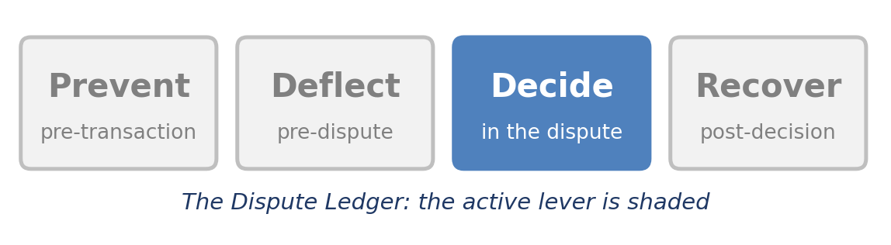
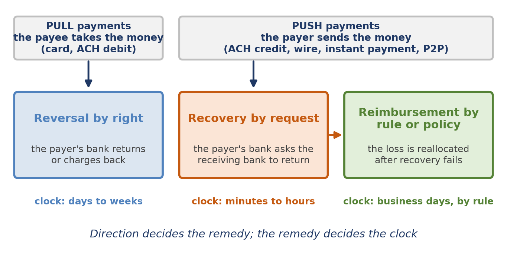
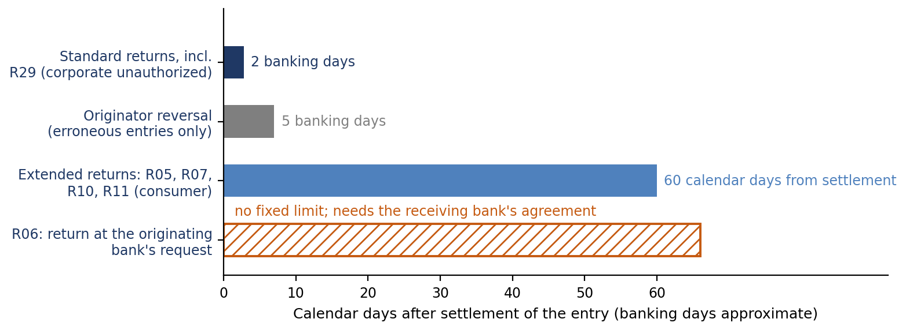
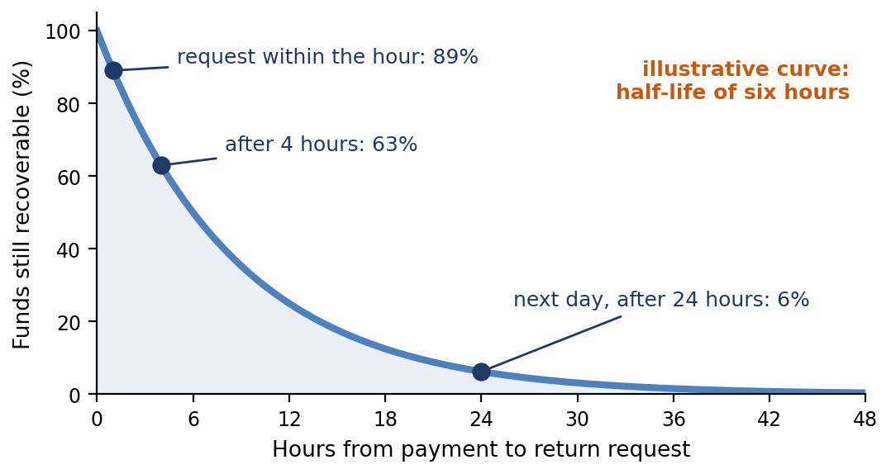
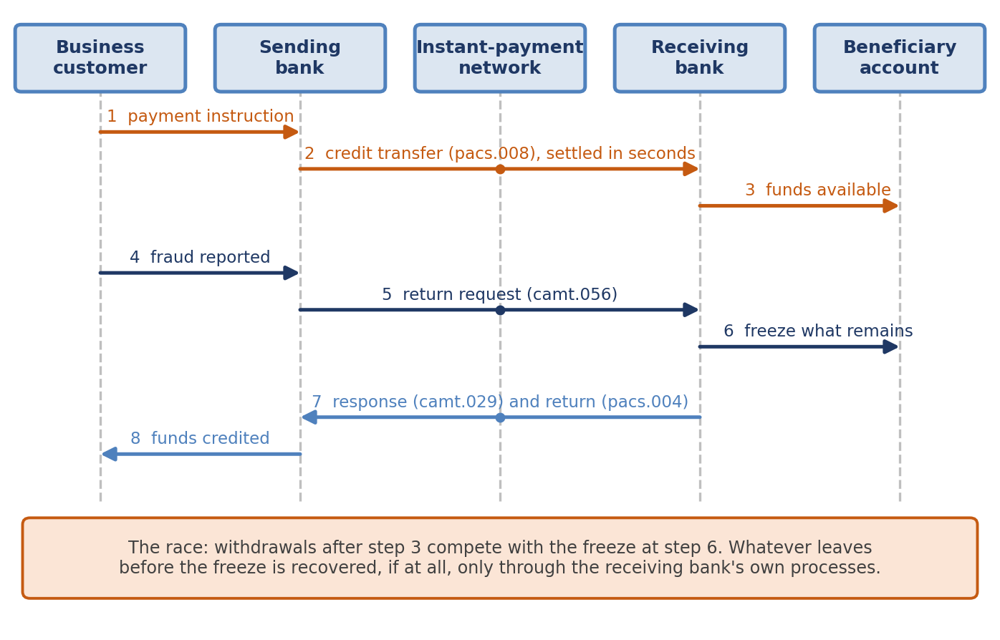
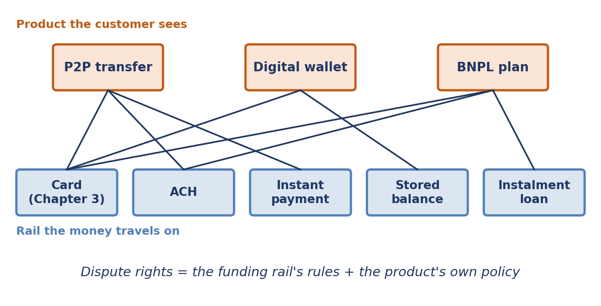
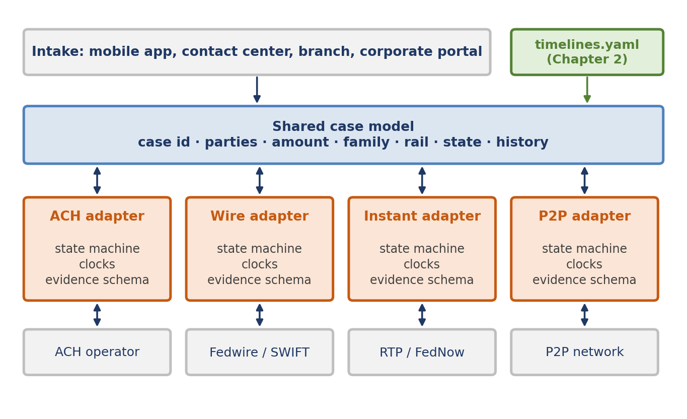
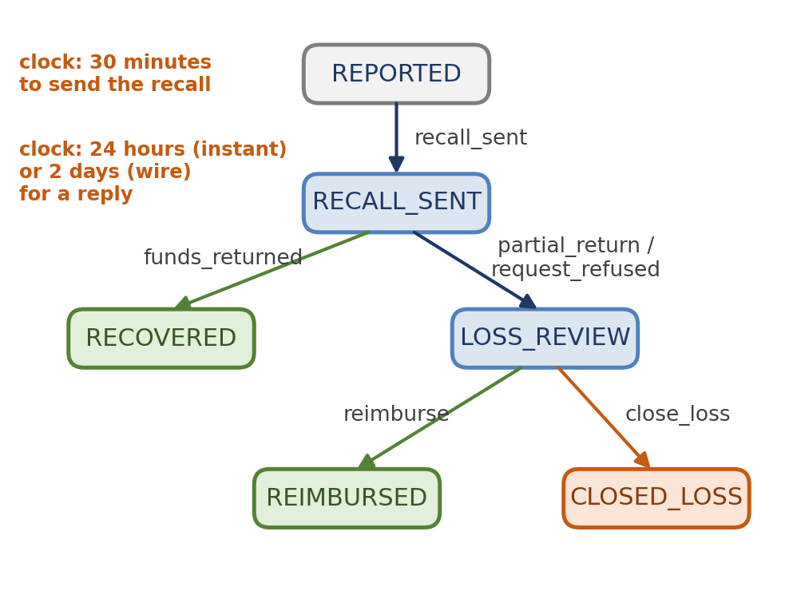

[⬅ Back to all chapters](../README.md) · [Code and data for this chapter](README.md)

# Chapter 4: Disputes Beyond Cards



*This chapter pulls the Decide lever: a claim cannot be decided until the platform knows which rail carried it and what that rail permits.*

> **Worked example.** A business customer of a regional bank receives an email that appears to come from a long-standing supplier, announcing new bank details. The accounts-payable team updates the payee record and sends the next invoice payment, an illustrative $64,000, over an instant-payment rail. The payment settles in seconds. When the genuine supplier later asks about the unpaid invoice, the customer reports the payment to its bank as fraud. The bank's dispute system offers a card-shaped form: a reason code, a merchant, a chargeback window. None of them fits. There is no chargeback on the rail, consumer regulation does not protect a business account and the funds sit at a receiving bank over which the sending bank has no authority. Whatever is recovered depends on how quickly a request reaches that bank and whether the money is still there. *This chapter answers the question: when a payment cannot be reversed, what does the platform do instead and how must the case be* *modeled* *so that it does it in minutes rather than days?*

Chapters 2 and 3 followed a card claim through its rules and its lifecycle. Cards are the rail on which dispute machinery is most complete: a reason code, a chargeback, a response window and an arbitrator. Most other rails have none of these and on them the remedy changes from a right to a request.

This is where card-shaped platforms fail. A claim on an ACH credit, a wire, an instant payment or a peer-to-peer transfer is forced into a card case model, given a card clock and worked at card speed. The case looks orderly and the money is already gone.

You will learn to tell push payments from pull payments and why the direction decides the remedy. You will see how ACH returns and requests work, why a wire recall is a race, how a return request travels on an instant-payment rail and how P2P, wallets and BNPL inherit their rights from the rails beneath them. By the end you will have built rail adapters: one shared case model with a state machine, clocks and an evidence schema for each rail.

In this chapter, we will cover the following topics:

- Push, pull and the three remedies
- ACH: returns, reversals and requests
- Wires: recall as a race against withdrawal
- Instant payments and the authorized push payment problem
- P2P, wallets and BNPL: rails built on rails
- One case model, many rails: the rail adapter pattern

## Technical requirements

Open chapter04/ in the companion repository. It contains the rail\_adapters/ package: base.py, which defines a rail profile and a case that any profile can drive and profiles.py, which declares the ACH, wire and instant-payment profiles, with a P2P profile left as an exercise. A short script, demo.py, runs three claims through them. Python 3.11 and its standard library are sufficient. The clocks mirror rules recorded in chapter02/timelines.yaml but are written here as fixed durations so that the mechanism stays visible. Every amount, duration and recovery rate in this chapter is illustrative. By the end of this chapter you will have built the fourth chapter artifact of the book.

## Push, pull and the three remedies

Every payment has a direction. In a pull payment the payee asks for the money and the payer's bank releases it, as in a card purchase or an ACH debit. In a push payment the payer instructs its own bank to send the money, as in an ACH credit, a wire, an instant payment and most P2P transfers.

Direction decides who holds the power to undo. On a pull rail the payer's bank can send the money back under the rail's rules without asking anyone, because the payee started the transaction and accepted the risk of a return. On a push rail the payer's bank started the transaction itself and has no right to take the money back from another bank; it can only ask.

Figure 4.1 shows the three remedies that follow. Reversal by right applies to pull payments. Recovery by request applies to push payments while the funds can still be found. Reimbursement by rule or policy applies when recovery fails and a regulation, a scheme or the institution's own policy moves the loss from the customer to a bank.



*Figure 4.1: Push, pull and the three remedies. The direction of the payment decides which remedy is available and how fast its clock runs.*

Table 4.1 sets the three remedies side by side. The column that matters most for design is the last: each remedy runs on a different clock and a platform that gives them one service level will be too slow for at least one of them.

| Remedy | Applies to | Who decides | What the payer's bank needs | Clock |
|---|---|---|---|---|
| Reversal by right | Card chargebacks, ACH debit returns | The rules of the rail; the payee may contest | A valid reason code and the customer's claim | Days to weeks, set by the rail |
| Recovery by request | ACH credits, wires, instant payments, P2P sends | The receiving bank, often with its account holder | The payment reference, the receiving bank and speed | Minutes to hours, set by how fast the money moves |
| Reimbursement by rule or policy | Authorized push payment scams; some P2P networks | A regulator, a scheme or the institution | Evidence of the deception and of the customer's own care | Business days, set by the rule |

*Table 4.1: The three remedies*

> **Business impact.** Reversals are an operations cost, failed recoveries are a loss that falls on the customer or the bank and reimbursement is a balance-sheet line. A dispute program that reports one loss figure across all three cannot tell which lever to fund, or which team is responsible for the result.
>
> **Under the hood.** Direction is a field on the case, not an inference from a reason code. Intake sets it from the payment record before any classification runs, because every later branch, from the clock to the evidence list, depends on it. The RailProfile you build later in this chapter makes direction its second attribute for that reason.

Pull rails are the more familiar and ACH, the oldest of the non-card rails, carries both directions on one network.

## ACH: returns, reversals and requests

ACH carries debits and credits in batches between an originating bank, acting for the originator and a receiving bank, acting for the receiver. Chapter 2 set out the rules. Here we look at the three ways money comes back and what each asks of a platform.

A return is the receiving bank sending an entry back with a reason code. It is the ACH equivalent of a chargeback and is available to the receiver's side by right. For a consumer's unauthorized debit the window is long, 60 calendar days from settlement, supported by the consumer's written statement; for a corporate account it is two banking days, which in practice means the business must notice the debit almost at once.

A reversal is the originator correcting its own mistake: a duplicate file, a wrong amount, a wrong account. It must be sent within five banking days of settlement and only for an erroneous entry as the rules define it. A reversal is not a fraud remedy, because an originator that was deceived into paying the wrong party did not make an error the rules recognize.

A request is what remains for credits. The originating bank asks the receiving bank to return a credit and the receiving bank may agree, sending it back under R06. Nothing obliges it to and it will normally check first whether the funds are still in the account. Rule changes in 2024 also let a receiving bank return an entry on its own initiative, under R17, when it believes the entry was initiated under false pretenses.

Figure 4.2 lays the windows on one axis. The asymmetry is the point: a consumer's debit has two months, a business's debit has two days and a credit has no window at all, only whatever cooperation it can obtain.



*Figure 4.2: ACH return and recovery windows. Long windows belong to consumer debits; credits have no window, only a request.*

Table 4.2 lists the return codes that dispute work relies on most often.

| Code | Meaning | Started by | Window |
|---|---|---|---|
| R05 | Unauthorized debit to a consumer account using a corporate entry type | Receiving bank, on the consumer's claim | 60 calendar days |
| R06 | Returned at the originating bank's request | Receiving bank, if it agrees | None fixed |
| R07 | Authorization revoked by the customer | Receiving bank, on the consumer's claim | 60 calendar days |
| R10 | Not authorized, or originator unknown to the receiver | Receiving bank, on the consumer's claim | 60 calendar days |
| R11 | Authorized, but not in accordance with the terms of the authorization | Receiving bank, on the consumer's claim | 60 calendar days |
| R17 | Questionable entry, including one the receiving bank believes was initiated under false pretenses | Receiving bank, on its own initiative | 2 banking days |
| R29 | Corporate customer advises the entry was not authorized | Receiving bank, on the business's claim | 2 banking days |

*Table 4.2: ACH return codes used in dispute work, as of October 2026. Confirm each entry against the current rules.*

> **Case study: a diverted payroll credit worked on a debit clock.** Described in general terms, an employer's payroll team received a request, apparently from an employee, to change the account into which the employee's salary was paid. The request came from a compromised email account and the next payroll credit went to an account controlled by a fraudster. When the employee reported the missing salary, the employer's bank logged the claim as an unauthorized ACH transaction and its system attached the 60-day window that applies to consumer debits. The case was queued accordingly. The window was irrelevant: the entry was a credit the employer had originated and the only remedy was a request to the receiving bank whose value fell with every hour. By the time the request was sent the account had been emptied. The case model had a field for the reason and none for the direction. In this chapter's design the ACH adapter separates credits from debits at intake and a push claim receives a recovery clock measured in minutes.
>
> **Business impact.** Nacha monitors originators through return rates and publishes thresholds, including 0.5 percent for unauthorized debit returns, above which an originator faces inquiry and possible enforcement. For an originator, unauthorized returns are a ratio to manage in the same way that card merchants manage dispute ratios and the Prevent lever applies: clearer authorizations, account validation and a recognizable company name on the statement.
>
> **Under the hood.** An ACH case needs the trace number, the standard entry class code, the settlement date and, for a consumer claim, the written statement. The entry class code determines whether the entry is treated as consumer or corporate and therefore which window applies; a case that does not carry it cannot compute its own deadline.

ACH credits show the push problem in slow motion. Wires show it at full speed.

## Wires: recall as a race against withdrawal

A wire moves a single, usually large, payment from the sending bank to the beneficiary's bank and becomes final once that bank accepts it. Chapter 2 named the law. Operationally, a recall is a message asking the beneficiary's bank to send the funds back and that bank normally needs either its customer's consent or its own conclusion that the account is being used for fraud.

The value of a recall falls with time, because the money does not stay where it lands. Accounts that receive fraudulent payments, often called mule accounts, are emptied quickly by onward transfers, cash withdrawals or conversion to other assets. The longer the gap between the payment and the request, the less there is to freeze.

Figure 4.3 shows the shape of the problem with an illustrative curve in which half of what remains leaves the account every six hours. The real rate varies by rail, by receiving bank and by the sophistication of the fraud; the shape does not. A request sent within the hour finds most of the money and a request sent the next day finds very little.



*Figure 4.3: The recovery curve. Under an illustrative six-hour half-life, a request sent within the hour finds 89 percent of the funds and one sent the next day finds 6 percent.*

The curve reduces to simple arithmetic. With a half-life of h hours, the share still recoverable after t hours is 0.5 raised to the power t ÷ h. For a $64,000 payment, a request after one hour has about $57,000 to work with, after four hours about $40,300 and after twenty-four hours about $4,000.

Cross-border wires add intermediaries, each of which may still hold the funds or may have passed them on. Services such as Swift gpi Stop and Recall let a sending bank broadcast a recall along the chain using the payment's unique end-to-end transaction reference (UETR), which shortens the search without changing the economics. In the United States, reporting through law-enforcement channels such as the FBI's Internet Crime Complaint Center can sometimes help freeze funds, so the case record should hold the references those channels ask for.

> **Business impact.** In a recall, minutes are worth more than analysts. Shortening the time from report to recall request from a day to an hour moves the expected recovery on the curve above from 6 percent to 89 percent without changing how well the case is worked. Few investments in the Dispute Ledger offer that ratio.
>
> **Under the hood.** A wire case needs the UETR or the network's message identifiers, the beneficiary bank, the beneficiary account and a statement from the customer, all captured at first contact. Each missing field is a delay before the recall can be sent. The adapter lists them as its evidence schema and the intake form cannot be completed until they are present.

Instant payments share the finality of wires and add something wires never had: they settle in seconds, at any hour of any day.

## Instant payments and the authorized push payment problem

Instant-payment rails, such as RTP and FedNow in the United States and Faster Payments in the UK, settle each payment individually and irrevocably within seconds, at any time. The US rails are built on ISO 20022 messages, which matters for disputes because the return request, the response and the return itself are standard messages that a platform can send and read without a person in between.

Figure 4.4 follows the worked example's payment through the rail. The payment settles (steps 1 to 3), the customer reports the fraud (step 4), the sending bank sends a return request (step 5) and the receiving bank freezes what remains and answers (steps 6 and 7). The decisive interval lies between steps 3 and 6, while the funds are available to whoever controls the beneficiary account.



*Figure 4.4: A return request on an instant-payment rail. The request asks; it does not compel. What it recovers depends on how much remains when it arrives.*

The message names follow ISO 20022: a credit transfer (pacs.008), a request to return it (camt.056), the answer to that request (camt.029) and the return payment itself (pacs.004). Network rules decide which of these each participant must support and how quickly it should respond and the repository's appendix records them by network and edition.

Most instant-payment fraud is authorized: the payer sends the money, deceived about who will receive it. This is the authorized push payment problem introduced in Chapter 1. Because the customer authorized the payment the rail sees nothing wrong and, for a business account, no consumer regulation reallocates the loss. The remedy is recovery while the money can be found and, failing that, whatever reimbursement the scheme, the regulator or the institution's policy provides.

Table 4.3 compares the recovery instruments on the push rails covered so far.

| Rail | Instrument | What the receiving bank does | What decides the outcome |
|---|---|---|---|
| ACH credit | Request for return, returned under R06 | May return, usually after checking the account | Whether funds remain |
| Domestic wire | Recall request | May return with its customer's consent or on its own fraud finding | Speed; the beneficiary's cooperation |
| Cross-border wire | Recall along the chain, for example Swift gpi Stop and Recall | Each bank in the chain searches and responds | Speed; the number of intermediaries |
| Instant payment | Return request (camt.056), answered with camt.029 and, if agreed, pacs.004 | Responds through the network; may freeze and return what remains | Speed above all; settlement is final in seconds |

*Table 4.3: Recovery instruments on push rails*

> **Business impact.** The receiving bank is the other half of every recovery. Under the UK reimbursement regime described in Chapter 2 it also funds half of each reimbursement, which gives it a direct interest in detecting mule accounts at onboarding. Where no such rule exists, recovery depends on network rules and goodwill, so the sending bank should measure response times by receiving bank and raise persistent laggards through the network.
>
> **Under the hood.** The instant adapter consumes the rail's ISO 20022 messages as events. A positive camt.029 with a pacs.004 for the full amount becomes funds\_returned, a partial amount becomes partial\_return and a negative answer becomes request\_refused. The state machine never parses free text to learn what happened, because the message types already say.

Instant payments are increasingly hidden inside products that customers do not think of as payment rails at all.

## P2P, wallets and BNPL: rails built on rails

A peer-to-peer app, a digital wallet and a buy-now-pay-later plan are products, not rails. Each moves money over one or more rails beneath it and adds its own terms on top. Figure 4.5 shows the inheritance: a P2P transfer may travel on ACH, an instant-payment rail or a debit card, a wallet may hold a tokenized card or a stored balance and a BNPL plan is an instalment loan repaid by card or ACH.



*Figure 4.5: Products on rails. A customer's dispute rights come from the rail beneath the product and from the product's own policy.*

Table 4.4 summarizes where each product's rights come from. The rule for the platform is to resolve the product to its funding rail at intake, apply that rail's adapter and add the product's policy as extra transitions rather than as a separate process.

| Product | Funding rail | Rights inherited | Product-level terms |
|---|---|---|---|
| P2P transfer from a bank app | ACH or instant payment | Regulation E for consumer accounts; no chargeback | Network rules; some P2P networks reimburse certain impersonation scams |
| P2P transfer funded by a debit card | Card | Card dispute rights on the funding transaction | The provider's user agreement |
| Wallet with a tokenized card | Card | Full card dispute rights; the token maps to the card | The wallet provider's own resolution service, if any |
| Wallet with a stored balance | The provider's ledger | Prepaid-account protections where the account qualifies | The provider's user agreement |
| BNPL plan | Instalment loan, repaid by card or ACH | Rights on each repayment's own rail | The lender's dispute and repayment-pause policy |

*Table 4.4: Where products get their dispute rights*

Composite products create a risk Chapter 3 has already met: the same loss recovered twice. A customer who disputes a BNPL purchase with the lender and also disputes a repayment with the card issuer can be credited by both. The platform prevents it the same way, by giving the claim one state across every rail it touches.

> **Business impact.** Products that sit on several rails blur ownership. The P2P team owns the app, the payments team owns the rail and the dispute team owns the claim and the customer may be told something different by each. Mapping each product to its rails is the cheapest step toward a single answer.
>
> **Under the hood.** Store the product and the funding rail as separate fields on the case. The adapter is chosen by the funding rail and the product contributes a policy layer, such as an extra reimbursement transition for a P2P network that refunds impersonation scams. Chapter 8 carries both fields into the dispute data model.

We now have four rails and a handful of products. The last task is to give them one platform without forcing them into one shape.

## One case model, many rails: the rail adapter pattern

The adapter pattern separates what every dispute shares from what each rail does differently. Every case has an identifier, parties, an amount, a family, a rail, a state and a history; each rail has its own states, clocks and evidence. Figure 4.6 shows the arrangement: intake writes to one case model, timelines.yaml supplies the rules from Chapter 2 and an adapter for each rail sits between the case and the rail's network.



*Figure 4.6: One case model, many rails. Each adapter owns its rail's state machine, clocks and evidence schema; nothing card-specific leaks into the shared model.*

Table 4.5 lists what an adapter must declare. If a rail cannot fill every row, it is not yet understood well enough to automate.

| Declaration | Purpose | Instant-payment example |
|---|---|---|
| Direction | Selects the family of remedies | push |
| States and transitions | Defines what may happen next | REPORTED, then RECALL\_SENT, then RECOVERED or LOSS\_REVIEW |
| Clocks | Sets each state's deadline and what it counts from | 30 minutes to send the recall; 24 hours for a reply |
| Evidence schema | Lists the fields a case must hold | End-to-end ID, receiving bank, beneficiary account, payer statement |

*Table 4.5: What a rail adapter declares*

Listing 4.1 is the shared part.

```python
from dataclasses import dataclass, field
from datetime import datetime

@dataclass(frozen=True)
class RailProfile:
    name: str
    direction: str              # "pull" (debit) or "push" (credit)
    transitions: dict           # (state, event) -> next state
    clocks: dict                # state -> (anchor, timedelta)
    evidence: tuple             # fields a case must hold on this rail

@dataclass
class RailCase:
    case_id: str
    profile: RailProfile
    amount: float
    settled_at: datetime
    reported_at: datetime
    state: str = "REPORTED"
    due: datetime | None = None
    history: list = field(default_factory=list)

    def __post_init__(self):
        self._set_clock(self.reported_at)
    def _set_clock(self, entered):
        anchor, span = self.profile.clocks.get(self.state, (None, None))
        base = self.settled_at if anchor == "settled" else entered
        self.due = base + span if span else None
    def apply(self, event, at):
        nxt = self.profile.transitions.get((self.state, event))
        if nxt is None:
            raise ValueError(f"{event!r} not allowed in {self.state} "
                             f"on rail {self.profile.name!r}")
        timing = "late" if self.due and at > self.due else "on_time"
        self.history.append((at, self.state, event, nxt, timing))
        self.state = nxt
        self._set_clock(at)
        return self
    def missing_evidence(self, record):
        return [f for f in self.profile.evidence if not record.get(f)]
```

*Listing 4.1: chapter04/rail\_adapters/base.py*

RailProfile is the declaration in Table 4.5, frozen so that a profile cannot change while a case is using it. Its clocks map a state to a pair: the anchor the deadline counts from, either settlement or entry into the state and the duration. RailCase holds one claim, starts in REPORTED and sets its first deadline in \_\_post\_init\_\_.

The method apply differs from the card machine of Chapter 3 in one deliberate way. A missed deadline on a card forfeits a right, so that machine moved the case to LOST. On a push rail a late recall is still worth sending, so this machine records the transition as late and lets it proceed, which turns lateness into data for measurement instead of a silent loss. The method missing\_evidence returns the fields the profile requires and the record lacks.

Listing 4.2 declares three rails with that one class.

```python
from datetime import timedelta as td
from .base import RailProfile

ACH_DEBIT = RailProfile(
    name="ach_debit", direction="pull",
    transitions={
        ("REPORTED", "return_sent"): "RETURNED",
        ("REPORTED", "claim_denied"): "CLOSED_NO_ERROR",
    },
    clocks={"REPORTED": ("settled", td(days=60))},   # consumer R10/R11
    evidence=("trace_number", "sec_code", "settlement_date",
              "written_statement"),
)

PUSH_RECOVERY = {
    ("REPORTED", "recall_sent"): "RECALL_SENT",
    ("RECALL_SENT", "funds_returned"): "RECOVERED",
    ("RECALL_SENT", "partial_return"): "LOSS_REVIEW",
    ("RECALL_SENT", "request_refused"): "LOSS_REVIEW",
    ("LOSS_REVIEW", "reimburse"): "REIMBURSED",
    ("LOSS_REVIEW", "close_loss"): "CLOSED_LOSS",
}

INSTANT = RailProfile(
    name="instant", direction="push", transitions=PUSH_RECOVERY,
    clocks={"REPORTED": ("entered", td(minutes=30)),
            "RECALL_SENT": ("entered", td(hours=24))},
    evidence=("end_to_end_id", "receiving_bank", "beneficiary_account",
              "payer_statement"),
)

WIRE = RailProfile(
    name="wire", direction="push", transitions=PUSH_RECOVERY,
    clocks={"REPORTED": ("entered", td(minutes=30)),
            "RECALL_SENT": ("entered", td(days=2))},
    evidence=("uetr", "beneficiary_bank", "beneficiary_account",
              "payer_statement"),
)
```

*Listing 4.2: chapter04/rail\_adapters/profiles.py*

ACH\_DEBIT is a pull profile: its only clock counts 60 days from settlement and a return ends the case. INSTANT and WIRE share one set of push transitions, PUSH\_RECOVERY and differ only in their clocks and evidence. That is the pattern in miniature: the shape of recovery is common to push rails, while the timing and the references are not. A P2P profile would reuse PUSH\_RECOVERY and add a transition for a network's reimbursement policy.

Listing 4.3 runs three claims and two checks.

```python
from datetime import datetime as dt
from rail_adapters.base import RailCase
from rail_adapters.profiles import ACH_DEBIT, INSTANT, WIRE

SETTLED, REPORTED = dt(2026, 3, 9, 10), dt(2026, 3, 9, 14)
runs = {
    "ach-1": (ACH_DEBIT, 420.0, dt(2026, 2, 2), dt(2026, 3, 20, 9),
              [("return_sent", dt(2026, 3, 23, 11))]),
    "rtp-1": (INSTANT, 64000.0, SETTLED, REPORTED,
              [("recall_sent", dt(2026, 3, 9, 14, 20)),
               ("partial_return", dt(2026, 3, 10, 9)),
               ("close_loss", dt(2026, 3, 12, 12))]),
    "wire-1": (WIRE, 64000.0, SETTLED, REPORTED,
               [("recall_sent", dt(2026, 3, 10, 9)),
                ("request_refused", dt(2026, 3, 11, 12))]),
}
for case_id, (profile, amount, settled, reported, events) in runs.items():
    case = RailCase(case_id, profile, amount, settled, reported)
    for event, at in events:
        case.apply(event, at)
    timing = [h[4] for h in case.history]
    print(f"{case_id:7s} {profile.direction:5s} -> {case.state:12s} {timing}")

probe = RailCase("rtp-2", INSTANT, 64000.0, SETTLED, REPORTED)
print("missing:", probe.missing_evidence(
    {"end_to_end_id": "E2E-77", "receiving_bank": "RB-021"}))
try:
    probe.apply("chargeback_received", dt(2026, 3, 9, 15))
except ValueError as err:
    print("rejected:", err)
```

*Listing 4.3: chapter04/demo.py*

Running it prints:

```python
ach-1   pull  -> RETURNED     ['on_time']
rtp-1   push  -> CLOSED_LOSS  ['on_time', 'on_time', 'on_time']
wire-1  push  -> LOSS_REVIEW  ['late', 'on_time']
missing: ['beneficiary_account', 'payer_statement']
rejected: 'chargeback_received' not allowed in REPORTED on rail 'instant'
```

Table 4.6 explains each line.

| Run | What happened | Final state | Why |
|---|---|---|---|
| ach-1 | Consumer debit reported 46 days after settlement; return sent three days later | RETURNED | Inside the 60-day window, so the return is a right |
| rtp-1 | Recall sent 20 minutes after the report; part of the funds returned the next day; the remainder closed as a loss | CLOSED\_LOSS | Every step on time; the loss is what left the account before the freeze |
| wire-1 | The same payment by wire; recall sent the next day | LOSS\_REVIEW | The recall missed its 30-minute clock and the request was refused |
| probe | An instant case holding two of its four evidence fields | Two fields missing | The recall cannot be sent until both are captured |
| probe | A chargeback event on an instant payment | Rejected | No such transition exists on a push rail |

*Table 4.6: The demonstration runs*

Operationally, the platform now refuses to treat an instant payment as a card, refuses to send a recall without the references the receiving bank needs and records every late recall as a measurable event. Figure 4.7 draws the push-rail state machine that INSTANT and WIRE share.



*Figure 4.7: The push-rail state machine. Recovery comes first; reimbursement is considered only when recovery is partial or refused.*

> **Business impact.** A new rail becomes a new profile rather than a new project. When a bank launches an instant-payment service or a P2P product, its dispute capability is a reviewed declaration of states, clocks and evidence and the shared case model, reporting and controls come with it.
>
> **Under the hood.** Keep adapters free of decisions. They define what is allowed and when; whether to reimburse a business customer is a policy decision made in LOSS\_REVIEW, by a person today and with the models of later chapters tomorrow. Chapter 9 classifies the claim that selects the adapter and Chapter 13 gives an agent the recall step.
>
> **Worked example revisited.** The business customer's claim now has a shape. It is a push payment on an instant-payment rail, so the platform selects the instant adapter rather than a card form and the first clock is 30 minutes to send the return request. The evidence schema asks for the end-to-end reference, the receiving bank, the beneficiary account and the customer's statement at first contact. On the illustrative recovery curve, a request sent within the hour could find about $57,000 of the $64,000, while a request sent the next day would find about $4,000. Whatever is not returned moves to LOSS\_REVIEW, where no consumer regulation applies and the outcome rests on the institution's policy. Chapter 5 examines the queue in which such a claim waits and why its clock must start at the customer's report.
>
> **Key principle.** *Model the rail, not the reason code.*

**What you now have**

- chapter01/disputes\_sample.csv: the synthetic issuer dataset used throughout the book
- chapter01/explore.ipynb: headline metrics, the money waterfall and the baseline Dispute Ledger
- chapter02/timelines.yaml: regulatory and network deadlines expressed as data
- chapter02/clocks.py: the loader that turns a claim into dated obligations
- chapter03/card\_state\_machine.py: the card dispute lifecycle as a table-driven state machine, with demo.py
- **chapter04/rail\_adapters/: one shared case model with ACH, wire and instant-payment profiles, with demo.py**

## Summary

In this chapter we left the card rail and separated payments by direction. Pull payments can be reversed by right; push payments can only be recovered by request and, when recovery fails, reimbursed by rule or policy. We saw that ACH offers all three mechanisms on one network, with long windows for consumer debits, two banking days for corporate ones and nothing but a request for credits. We treated wire and instant-payment recalls as a race against withdrawal, put numbers on it with the recovery curve and followed a return request through the ISO 20022 messages that carry it. We traced P2P, wallets and BNPL to the rails beneath them. Finally we built rail\_adapters/, one case model with a profile for each rail, which rejects card events on push rails and records every late recall. The lever is Decide: a claim cannot be decided correctly until it is modeled on its own rail.

With the rules, the card lifecycle and the other rails in place, the platform knows what it must do. Chapter 5 turns to the operation that has to do it: the queues, the roles and the measures that decide whether any of these clocks is met in practice.

## Questions

- Using the recovery curve with a six-hour half-life, how much of a $64,000 instant payment is recoverable if the return request is sent after 30 minutes and how much after 12 hours? What is the difference worth?
- An originator sends 400,000 consumer debits in a period and receives 2,400 returns coded R05, R07, R10, R11 or R29. Is its unauthorized return rate above the 0.5 percent threshold and which lever would you pull first?
- Write a P2P profile for profiles.py for a network that reimburses certain impersonation scams. Which transitions would you add to PUSH\_RECOVERY and which evidence fields would the profile require?
- RailCase records a late transition and lets it proceed, while the card machine in Chapter 3 moved a late case to LOST. Describe one situation on a push rail where a missed deadline should end the case and how you would express it in a profile.
- A bank proposes a single 24-hour service level for opening every fraud and dispute claim. Using Table 4.1 and Figure 4.3, explain to its operations committee what that service level would cost on push rails.

## Further reading

- Nacha Operating Rules and Guidelines, current edition
- Federal Reserve Financial Services, FedNow Service
- The Clearing House, RTP network
- Federal Reserve Financial Services, Fedwire Funds Service
- ISO 20022, message definitions catalogue
- Swift, Swift gpi and Stop and Recall
- FBI, Internet Crime Complaint Center (IC3)
- UK Payment Systems Regulator, APP scams and the reimbursement requirement
