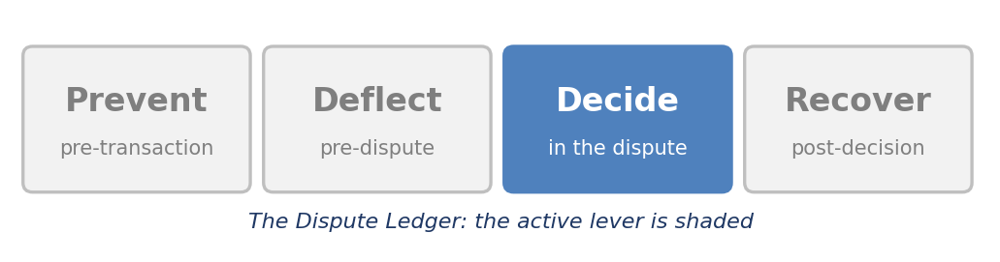
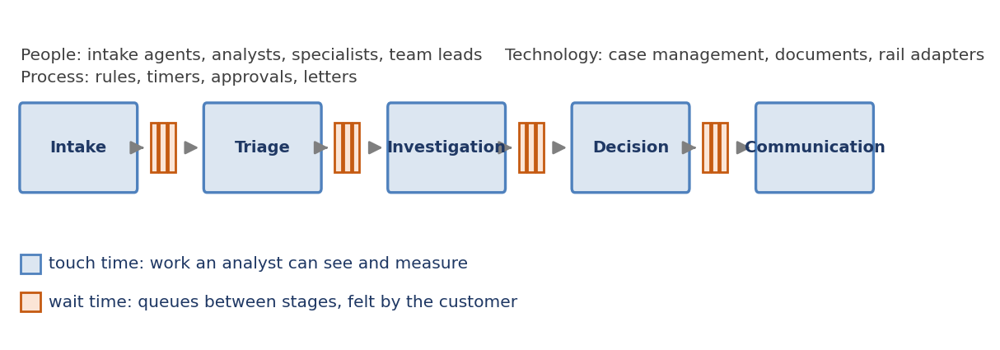
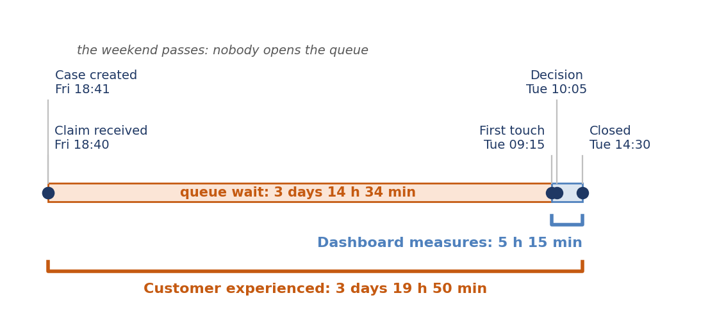
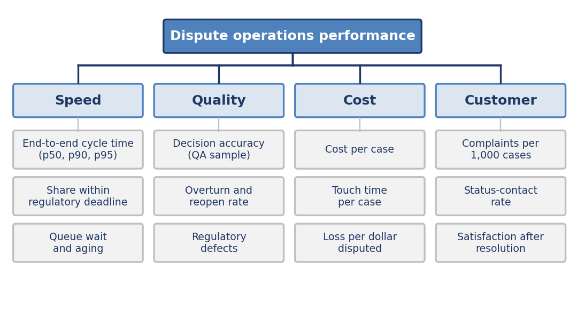
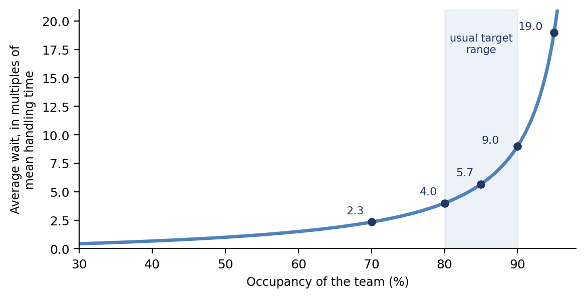
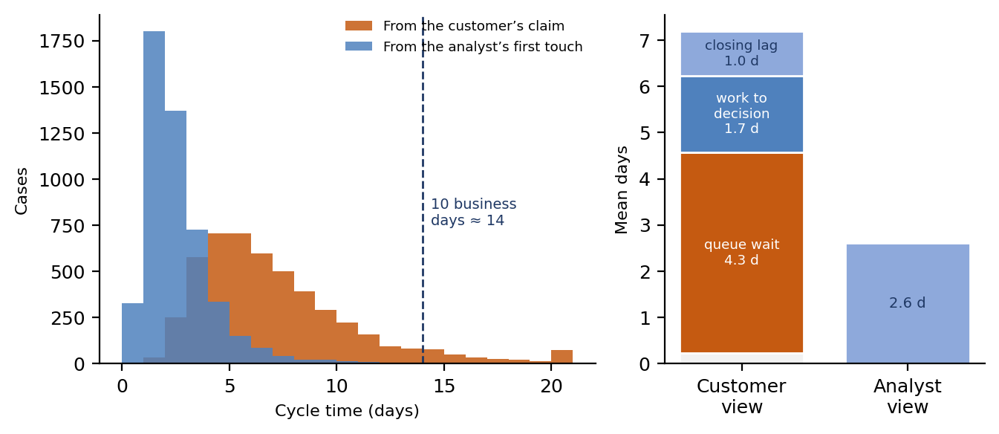

[⬅ Back to all chapters](../README.md) · [Code and data for this chapter](README.md)

# Chapter 5: Dispute Operations: People, Process, Performance

*This chapter pulls the Decide lever where it is felt most directly: in the operation that works the queue.*

**Worked example.** A cardholder reports through the mobile application at 6:40 p.m. on a Friday that a purchase was never received. The case is created a minute later and joins a shared queue that holds several thousand others. No one opens it over the weekend. An analyst picks it up at 9:15 on Tuesday morning, reaches a decision by 10:05 and the confirmation letter goes out at 2:30 that afternoon. The operations dashboard records a cycle time of 5 hours 15 minutes and shows green. The cardholder has waited 3 days 19 hours 50 minutes and the decision falls on the second of the ten business days that the regulation allows. *This chapter answers the question: which of those two numbers should an operation manage and what must it measure to know?*

Chapters 2 through 4 described the rules, the clocks and the rails. This chapter turns to the place where those rules meet people: the operation that receives the claim, works the queue and sends the letter.

Most dispute functions are run on a handful of numbers produced by their case system and most of those numbers are measured from the moment an analyst opens a case. The choice is natural, because the case system sees nothing earlier. It is also the reason an operation can look healthy while customers wait and regulatory clocks run.

You will learn how a dispute operation is organized, how to measure its cycle time from the customer’s claim, which indicators belong on a balanced scorecard, how queueing theory explains backlog, how to size a team and how quality and controls keep speed honest. By the end you will have built a KPI dashboard that reports the same cases under two definitions and you will have seen how far apart they are.

In this chapter, we will cover the following topics:

- The operating model of a dispute function
- Cycle time: measuring from the customer’s claim
- The KPI set: speed, quality, cost and customer
- Capacity, queues and staffing
- Quality, controls and the human side
- Building the KPI dashboard

## Technical requirements

Open chapter05/ in the companion repository. It contains ops\_log.csv, a synthetic operations log of about 5,000 closed cases with five timestamps per case, the channel and the amount; make\_ops\_log.py, which generates it; and ops\_kpi\_dashboard.ipynb, which reproduces every table and figure in this chapter. Python 3.11, pandas 2.x, NumPy and matplotlib are sufficient. The ten-business-day clock comes from Chapter 2. By the end of this chapter you will have built the fifth chapter artifact of the book; every number derived from the log is illustrative.

## The operating model of a dispute function

A dispute operation is made of people, process and technology and each is easier to change than to understand. The people include intake agents who take the claim, analysts who investigate and decide, specialists who handle scams and complex fraud, quality reviewers, team leads and the workforce managers who forecast demand. The process is the sequence of rules, timers, approvals and letters that turns a claim into an outcome. The technology is the case system, the document store and the rail adapters beneath them.

Figure 5.1 shows the operation as a flow. Cases move through stages and between every pair of stages sits a queue. The stages are where work is done and the queues are where time is spent.

*Figure 5.1: The dispute operation as a flow. Stages are where work is done; queues are where time is spent.*

This distinction between touch time and wait time is the most important idea in the chapter. Touch time is the work an analyst performs and it can be measured per person. Wait time is the interval a case spends in a queue and it belongs to no one. Most operations manage touch time, because it can be attributed, while customers and regulators experience elapsed time, which is mostly wait.

Institutions organize this flow in four common ways, summarized in Table 5.1. The right choice depends on volume, on how different the products are and on how tight the clocks are and many institutions combine two of them.

| **Operating model** | **Strengths** | **Weaknesses** | **Fits best when** |
|---|---|---|---|
| Centralized dispute center | Consistent decisions; specialist depth; simple reporting | Distance from product knowledge; exposed at peaks | Volume is large and products are similar |
| Product-aligned teams | Deep knowledge of each product and rail | Duplicated tooling; uneven service across products | Rails differ sharply, as in Chapter 4 |
| Tiered, with outsourced intake | Low cost at the front; elastic capacity | Handoff errors; weaker control of the first clock | Intake is high-volume and well scripted |
| Follow-the-sun | Shorter weekend and overnight waits | Coordination overhead; handover discipline required | Clocks are tight and volume is global |

*Table 5.1: Four operating models for a dispute function*

**Business impact.** The operating model sets the cost structure before any technology is chosen. A tiered model lowers the cost of a simple claim but adds a handoff and every handoff is a place where a regulatory start event can be lost. The model is therefore a decision about risk as well as about cost.

**Under the hood.** A queue is not a place but a query: the set of cases in a given state, filtered by skill and priority. The state machines of Chapters 3 and 4 make that definition exact and they let the platform answer how long a case has waited without anyone keeping a list.

With the flow in view, the next question is where to start the stopwatch.

## Cycle time: measuring from the customer’s claim

A case passes through five moments that any dispute system can record and Table 5.2 names them. The first, the moment the institution is put on notice, is the start event that Chapter 2 made the basis of every regulatory clock. The last is the moment the customer has been told and the ledger settled.

| **Timestamp** | **What it marks** | **Recorded by** | **Common error** |
|---|---|---|---|
| claim\_received\_at | The institution is put on notice, in any channel | The channel, at the moment of contact | Replaced by the case creation time |
| case\_created\_at | The case record exists | The case system | Overwritten when a case is reassigned or reopened |
| first\_touch\_at | An analyst first works the case | The case system | Triggered by auto-assignment or a supervisor’s view |
| decision\_at | The outcome is determined, including any credit | The decision service | Confused with closure |
| closed\_at | The customer is informed and the ledger is settled | Communications and ledger | Set before the letter is sent |

*Table 5.2: The five timestamps of a dispute*

These moments define four intervals. Intake lag runs from the claim to the case record, queue wait from the case record to first touch, work elapsed from first touch to decision and closing lag from decision to closure. The customer experiences all four. A dashboard built on first touch sees only the last two.

Figure 5.2 puts the worked example on a timeline. The queue wait of three days and fourteen hours is invisible to the dashboard and it is the longest interval by far.

*Figure 5.2: One claim, two stopwatches. The queue wait is invisible to a first-touch dashboard.*

**Case study: a staffing decision made on the wrong number.** Described in general terms, a card issuer’s operations dashboard reported an average cycle time of just over two days, measured from first touch. When the team asked for additional analysts, leadership declined on the grounds that the function was performing well. Customer complaints about waiting continued to rise and a later review that measured from the claim found that most of the elapsed time was queue wait, which the dashboard could not see. The analysts had been fast throughout; the function was short of capacity. The issuer replaced the first-touch metric with one measured from the claim and approved the staffing request in the next planning cycle.

**Business impact.** The metric that leadership watches decides which problems get funded. A first-touch measure rewards faster analysts and hides the shortage of analysts, while a claim-based measure shows the shortage and credits whoever fixes it. The same data can support opposite budget decisions.

**Under the hood.** Store each timestamp as a UTC value together with the institution’s local date and derive the intervals from the event history instead of overwriting a status field. Include open cases in every cycle-time report, with their age measured to the present, because closed cases alone leave out the slowest ones and understate the delay.

Once the stopwatch starts at the right place, the next question is what else belongs on the dashboard.

## The KPI set: speed, quality, cost and customer

A single indicator invites gaming, so a dispute operation needs a small set that balances speed against quality, cost and the customer’s experience. Figure 5.3 groups twelve indicators into the four families we use throughout the book. The set is deliberately short, since a dashboard with forty indicators gets read by no one.

*Figure 5.3: A KPI tree for dispute operations: twelve indicators in four families.*

Table 5.3 defines the main indicators and names the trap that most often spoils each one. Several of the traps are about where a measure starts or what it leaves out.

| **Indicator** | **Definition** | **Common trap** |
|---|---|---|
| End-to-end cycle time | Claim received to closed, at the median, 90th and 95th percentiles | Reporting the mean, which hides the tail |
| Share within the regulatory deadline | Decisions made inside the earliest applicable clock, measured from notice | Measuring from case creation |
| Queue wait and aging | Age of open cases, measured from the claim | Counting only closed cases |
| Decision accuracy | Share of sampled cases with the correct outcome and process | Review by the team lead of their own team |
| Overturn and reopen rate | Decisions changed on complaint, appeal, or review | Low only because customers did not complain |
| Cost per case | Fully loaded operating cost divided by cases closed | Leaving loss out of the picture |
| Loss per dollar disputed | Net unrecovered loss divided by disputed value | Tracked apart from cost, so trade-offs go unseen |
| Status-contact rate | Contacts asking for progress per 100 open cases | Logged as new disputes |

*Table 5.3: The main indicators, defined*

Two habits keep the set honest. Report percentiles and not averages, because a regulation applies to every case and not to the typical one; the 95th percentile tells you how bad the worst common experience is. And pair every speed measure with a quality measure, because a handle-time target alone teaches analysts to close cases early.

**Business impact.** The Dispute Ledger of Chapter 1 gives the set its purpose. Speed and quality indicators belong to the Decide lever, cost and loss let finance compare levers with one another and the customer indicators warn when an improvement in one is paid for in another.

**Under the hood.** Define each indicator once, as code, in a versioned module that both the dashboard and the board report import. When two reports disagree about cycle time, the cause is almost always two definitions and the fix is to delete one.

Indicators describe the operation. Capacity explains why it behaves as it does.

## Capacity, queues and staffing

Two results from queueing theory explain most of what goes wrong in a dispute queue. The first is Little’s Law: the average number of cases in the system equals the arrival rate multiplied by the average time each case spends there. The law needs no assumptions about the shape of the work, which makes it reliable for planning.

Take the representative issuer of Table 1.2, with 720,000 cases a year, or about 1,973 a day. If the average case takes 7 days from claim to closure, about 13,800 cases are in flight at any moment. Cutting the average to 5 days would reduce the work in progress to about 9,900 and every case taken out of the queue is a customer who is no longer waiting.

The second result concerns occupancy, the share of working time that analysts spend on cases. In a simple queue the average wait, measured in multiples of the average handling time, grows as occupancy divided by one minus occupancy. Figure 5.4 plots the curve. The shape matters more than the exact values, because real teams pool skills and so wait somewhat less, but they follow the same pattern.

*Figure 5.4: Waiting time against occupancy. Wait rises steeply above 80 percent (illustrative).*

The curve explains why a team that looks efficient at 95 percent occupancy has a long queue. Table 5.4 shows the trade for the same issuer. Assume an average touch time of 40 minutes a case and 1,600 productive hours a year for each analyst after leave, training and breaks. The 720,000 cases then need 480,000 hours of work and the number of analysts depends on the occupancy you are willing to run.

| **Target occupancy** | **Analysts needed** | **Average wait (multiples of handling time)** |
|---|---|---|
| 75% | 400 | 3.0 |
| 85% | 353 | 5.7 |
| 95% | 316 | 19.0 |

*Table 5.4: Staffing against occupancy (illustrative: 40-minute touch time, 1,600 productive hours)*

The 37 analysts between 85 and 95 percent buy a more than threefold reduction in waiting. Whether that is worth the cost is a business decision, but it should be made from this table and not from the belief that an idle analyst is a wasted one.

Backlogs grow quietly. If arrivals exceed capacity by 5 percent, say 2,100 cases a day against 2,000, the backlog grows by 100 cases a day and reaches 2,100 after a 21-business-day month, a full day of extra arrivals that will not clear until capacity exceeds demand. Seasonal peaks make this the normal condition at some institutions and Chapter 14 returns to designing for them.

Finally, the order in which cases are worked matters as much as how many are worked. First in, first out serves the case that has waited longest, which is not always the case closest to its deadline. A case that arrived later but has two business days left should be worked before one that arrived earlier with nine and the due dates from Chapter 2 make that ordering possible. Chapter 9 predicts which cases are at risk of breaching.

**Business impact.** Capacity is a choice made visible in the length of the queue. Running hot saves salary and costs customers, regulators’ patience and eventually the savings, since a long queue generates its own status calls and complaints.

**Under the hood.** Compute a priority score for every open case from its time remaining to the earliest deadline and its expected remaining work, using the due dates held in the timelines catalogue. Sort the queue by that score and the first case in line becomes the one most in need of attention, not the one that arrived first.

Capacity determines how fast cases move. Quality determines whether they are decided correctly.

## Quality, controls and the human side

Speed without accuracy only moves errors faster, so every operation needs a quality program built on sampling. A reviewer who is independent of the team re-examines a sample of decided cases and records whether the outcome, the clock, the documentation and the communication were correct. The sample is stratified, so that high-value cases, new analysts and borderline outcomes are over-represented and reviewers meet regularly to calibrate their judgments against one another.

The size of the sample follows a standard formula: n = z² × p(1 − p) ÷ e², where p is the expected error rate and e is the margin of error. With an expected error rate of 10 percent, a margin of three percentage points and 95 percent confidence, the formula gives 385 cases per period. Tighter margins need many more.

Table 5.5 lists the error types a review should record. Classifying errors, instead of counting them, shows what to fix: a wrong outcome calls for training, a wrong clock for a system change and a control breach for a conversation with compliance.

| **Error type** | **Example** | **Why it matters** |
|---|---|---|
| Wrong outcome | A valid claim denied, or an invalid one credited | Direct loss or customer harm |
| Wrong clock | The timer starts at case creation, not at notice | Regulatory exposure (Chapter 2) |
| Missing documentation | Evidence not retained for a later representment | Lost recovery (Chapter 3) |
| Wrong communication | A letter cites the wrong reason or date | Complaints and rework |
| Control breach | An approval above the analyst’s limit is skipped | Audit finding |

*Table 5.5: An error taxonomy for quality review*

Controls sit alongside quality review. An authority matrix limits the credit each role may grant, a second person approves anything above the limit, provisional credits are reconciled to the ledger each day and access to customer data follows the minimum needed for the role. These are routine in a bank and they matter more in a dispute operation because money moves on the strength of a decision made in minutes.

The human side is easy to neglect. Analysts handle claims from people who have lost money and some of those people have been deceived by criminals. The work carries an emotional load that speed targets do not recognize and attrition is costly because every departure removes capacity that takes weeks to rebuild. Publishing only speed rankings, or ranking analysts by handle time, produces fast closure and poor decisions.

There is also a reason to care about quality data beyond quality itself. The reviews you record now will become the labeled examples on which the models of Chapters 9 and 10 are trained and a model learns whatever mistakes its labels contain. Consistent review today is cheaper than cleaning the labels later.

**Business impact.** Quality failures are expensive in a way that dashboards of speed do not show. A wrong clock becomes a regulatory finding, a missing document becomes a lost recovery and a wrong outcome becomes a complaint, so a modest investment in review prevents costs that arrive later and larger.

**Under the hood.** Store each review as a structured record linked to the case, the decision, the analyst and the rule version, not as a row in a spreadsheet. A structured record can be queried for patterns, fed back into training and produced for an examiner without reconstruction.

Now we can put the measures into code and see what the two definitions of cycle time reveal.

## Building the KPI dashboard

The companion log holds one row for each closed case, with the five timestamps of Table 5.2. Listing 5.1 loads it and derives the four intervals and the two cycle times: the analyst’s, from first touch to closure and the customer’s, from claim to closure.

import numpy as np

import pandas as pd

TIMES = \["claim\_received\_at", "case\_created\_at", "first\_touch\_at", "decision\_at", "closed\_at"\]

log = pd.read\_csv("ops\_log.csv", parse\_dates=TIMES)

def days(start, end):

return (log\[end\] - log\[start\]).dt.total\_seconds() / 86400

log\["intake\_lag"\] = days("claim\_received\_at", "case\_created\_at")

log\["queue\_wait"\] = days("case\_created\_at", "first\_touch\_at")

log\["work\_elapsed"\] = days("first\_touch\_at", "decision\_at")

log\["closing\_lag"\] = days("decision\_at", "closed\_at")

log\["analyst\_cycle"\] = days("first\_touch\_at", "closed\_at")

log\["claim\_cycle"\] = days("claim\_received\_at", "closed\_at")

*Listing 5.1: chapter05/**ops\_kpi\_dashboard.ipynb**, first cell*

The function days converts the difference between two timestamp columns into fractional days. Each of the next four lines computes one interval from adjacent timestamps and the last two lines compute the two cycle times. Because every column is derived from the original timestamps, none is stored and the definitions can change without touching the data.

Listing 5.2 turns the intervals into indicators. It finds the due date for each case by adding ten business days to the date of the claim, which matches the business-day count of Chapter 2 and it flags decisions made after that date.

# second notebook cell; Listing 5.1 has already run

def pctiles(series):

return series.quantile(\[0.5, 0.9, 0.95\]).round(1).tolist()

received = log\["claim\_received\_at"\].dt.normalize().values.astype("datetime64\[D\]")

log\["due\_date"\] = pd.to\_datetime(np.busday\_offset(received, 10, roll="backward"))

log\["breached"\] = log\["decision\_at"\].dt.normalize() \> log\["due\_date"\]

report = pd.DataFrame({"percentile": \["p50", "p90", "p95"\],

"analyst\_view": pctiles(log\["analyst\_cycle"\]),

"claim\_view": pctiles(log\["claim\_cycle"\])})

print(report.to\_string(index=False))

print("share past the 10-business-day mark:", round(log\["breached"\].mean(), 3))

*Listing 5.2: chapter05/**ops\_kpi\_dashboard.ipynb**, second cell*

The function pctiles returns the median, 90th and 95th percentiles of a column. The call to np.busday\_offset with roll set to backward reproduces the Chapter 2 count for any start date, including weekends, which is why the flag in the next lines agrees with deadlines.py. The report compares the two definitions of cycle time side by side. Table 5.6 shows what it produces on the companion log.

| **Indicator** | **Analyst view** | **Claim view** |
|---|---|---|
| Median cycle time | 2.2 days | 6.3 days |
| 90th percentile | 4.5 days | 11.8 days |
| 95th percentile | 5.7 days | 14.8 days |
| Decisions after 10 business days | Cannot be computed | 4.7% |
| Mean queue wait | Not visible | 4.3 days (60% of the mean cycle) |

*Table 5.6: Headline indicators under two definitions (illustrative, from the synthetic log)*

The two views disagree on every row. The analyst view puts the 95th percentile under six days, while customers at the same percentile waited almost fifteen. More tellingly, the analyst view cannot express the regulatory measure at all, because it does not hold the start event and so it can never show that 4.7 percent of decisions came after the tenth business day.

Figure 5.5 shows the same result as a picture. The left panel overlays the two distributions and the right panel splits the average customer’s wait into its four intervals. Queue wait accounts for 60 percent of the average cycle and it is the interval the analyst view omits.

*Figure 5.5: The dashboard on the synthetic log. Queue wait accounts for 60 percent of the customer’s average cycle.*

Two further findings come from the same data. Claims taken by telephone or in a branch reach the case system about 13 to 14 hours after the customer made them, on average, while application claims arrive at once; this is the intake lag of Chapter 2’s case study, now measured. And for claims received in the final three weeks of the log, when queue waits were heavier, 6.7 percent of decisions came after the deadline against 4.0 percent earlier.

The module is deliberately simple. It uses closed cases only, so it understates delay and the surge-period figure is therefore a floor. It treats weekends as the only non-business days and ignores holidays. The exercises add open cases and an institution holiday calendar.

**Business impact.** Once the dashboard shows queue wait, the conversation changes from how fast analysts are to how long customers wait and why. That is the conversation that unlocks staffing, triage and automation budgets and it can be had only with the right start event.

**Under the hood.** In production the dashboard reads the same event history as the case system, refreshes daily and alerts on the age of open cases rather than the average of closed ones. Chapter 8 builds the case record that makes this possible and Chapter 14 describes the pipeline that feeds it.

**Worked example revisited.** The Friday claim from the opening now has two measures and they mean different things. The analyst did the work in 5 hours 15 minutes and that is a fair statement about the analyst. The customer waited 3 days 19 hours 50 minutes, two of the ten business days had gone before anyone looked and that is the statement the operation should manage. The queue, not the analyst, was the bottleneck and the dashboard of Listing 5.2 can now say so. Chapter 6 turns from the queue to the claim itself and asks when a customer’s repeated disputes are a pattern.

**Key principle.** *Measure cycle time from the customer’s claim, not the analyst’s first touch.*

**What you now have**

- **chapter01/disputes\_sample.csv**: the synthetic issuer dataset used throughout the book
- **chapter01/explore.ipynb**: headline metrics, the money waterfall and the baseline Dispute Ledger
- **chapter02/timelines.yaml**: regulatory and network deadlines expressed as data
- **chapter02/deadlines.py**: the module that turns a claim’s start events into due dates
- **chapter03/card\_state\_machine.py**: the card dispute lifecycle as a table-driven state machine
- **chapter04/rail\_adapters/**: state machines, timers and evidence schemas for ACH, wire, RTP and P2P
- **chapter05/ops\_kpi\_dashboard.ipynb**: the KPI dashboard that reports cycle time under two definitions, with ops\_log.csv and make\_ops\_log.py

## Summary

In this chapter we described a dispute operation as a flow of stages and queues and separated touch time from wait time. We defined five timestamps and four intervals and showed why cycle time must be measured from the customer’s claim. We built a balanced set of indicators across speed, quality, cost and customer and used Little’s Law and the occupancy curve to explain backlog and to size a team. We looked at quality review, controls and the human side of the work and we built a dashboard that reports the same cases under two definitions and shows the gap between them.

Chapter 6 turns from the operation to the claim. It asks how an issuer should respond when a cardholder files repeated not-received disputes and introduces the Prevent lever alongside Decide.

## Questions

- Using the 720,000 cases a year in Table 1.2 and a 365-day year, how many fewer cases are in flight if the average time from claim to closure falls from 7 days to 5 days?
- With an expected error rate of 10 percent and 95 percent confidence, how many cases must a quality review sample to estimate the error rate within plus or minus 2 percentage points, instead of 3?
- Why must a cycle-time report include open cases and how would you compute the age of a case that has not yet closed?
- Name two system events that must not be recorded as first\_touch\_at and explain how each would distort the queue-wait interval.
- Leadership asks the operation to cut average handle time by 15 percent to save cost. Which paired indicators would you add to the target and what would you propose to manage instead?

## Further reading

- J. D. C. Little, “A Proof for the Queuing Formula: L = λW,” Operations Research 9, no. 3 (1961)
- Donald G. Reinertsen, The Principles of Product Development Flow (Celeritas Publishing, 2009)
- Beyer, Jones, Petoff and Murphy, “Monitoring Distributed Systems,” in Site Reliability Engineering (Google)
- NumPy documentation, numpy.busday\_offset
- pandas user guide, Time series and date functionality
