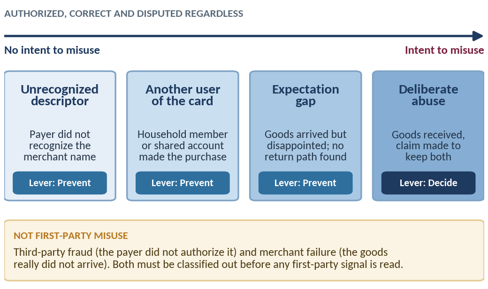
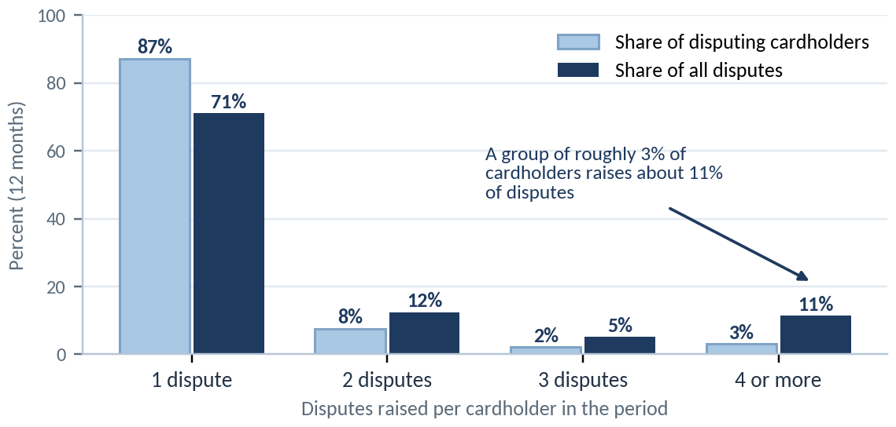
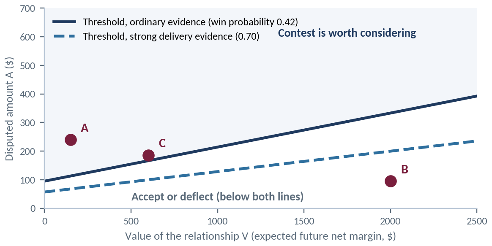
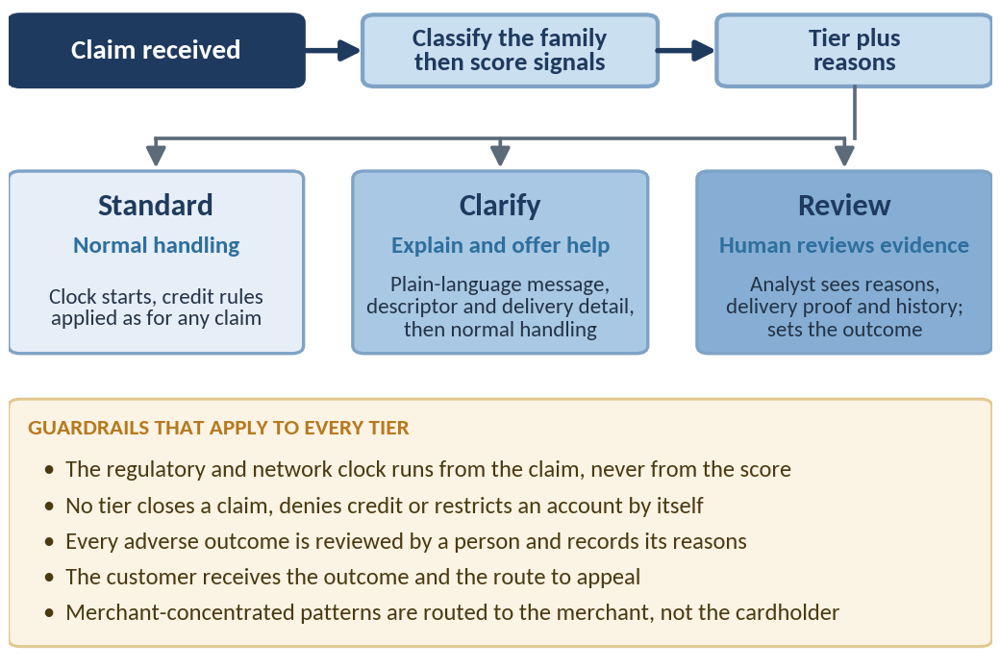
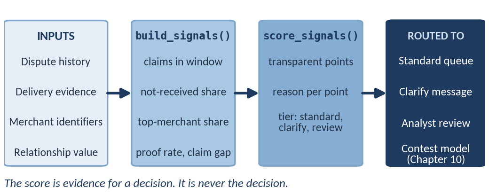

[⬅ Back to all chapters](../README.md) · [Code and data for this chapter](README.md)

# Chapter 6: Friendly Fraud and First-Party Misuse

*This chapter pulls two levers of the Dispute Ledger: Prevent and Decide.*

> **Worked example.** An issuer’s monitoring job surfaces a cardholder who has raised four not-received claims against four different online merchants over a short period. Each claim, viewed alone, is routine: the amounts are modest, the cardholder is in good standing and the claim window is open. Three of the four merchants hold delivery confirmations that match the address on file.
>
> The issuer must acknowledge each claim, honor its timelines and decide how to treat a pattern that could be third-party fraud, a genuine run of delivery failures, or a customer who has learned that disputing is easier than returning. Acting too softly rewards the behavior; acting too hard harms a customer who may be telling the truth. *This chapter answers the question: when a customer’s disputes begin to look like a habit, what should the issuer do and what must it never do?*

Every dispute function eventually meets the customer who disputes too often. The temptation is to treat that customer as a fraudster and the remedy as a rule: three claims in ninety days, deny the fourth. Chapter 1 showed why the instinct is costly: 38% of the representative issuer’s cases (illustrative) are first-party misuse, which no authorization-time control stops.

This chapter takes a more careful position. First-party misuse is a behavior with several causes, only one of which is intent and the response to each cause differs. Some causes are cured before the dispute exists, by clearer descriptors, delivery confirmation and a return path that is easier to find than the dispute button. Only the remainder reach the Decide lever, where the institution must weigh the cost of contesting a claim against the value of the relationship it puts at risk.

By the end of the chapter you will be able to tell first-party misuse from the claims that resemble it, read the signals that separate a pattern from coincidence, apply a contest threshold that includes relationship value and build the safeguards that keep treatment fair. We cover the following topics:

- What first-party misuse is and is not
- Signals of repeated disputes
- Weighing the cost of contesting against the value of the relationship
- Fair treatment and customer harm
- Building first-party signals

## Technical requirements

Open chapter06/ in the companion repository. It extends the synthetic dataset of Chapter 1 with four columns (card\_id, merchant\_id, reason and delivery\_confirmed) and contains first\_party\_signals.py, the artifact of this chapter. Python 3.11 and pandas 2.x are sufficient and no cloud account is needed.

Every figure and table is illustrative and derived from the synthetic data unless a named source is given.

## What first-party misuse is and is not

The term *friendly fraud* is common and unhelpful. It implies a harmless act, which it is not and it groups together behaviors that call for opposite responses. We prefer **first-party misuse**: a dispute raised by the payer on a transaction that the payer authorized and that was fulfilled as agreed.

### Four behaviors that look alike

Figure 6.1 arranges the behaviors that fall under the definition along an axis of intent. Three of the four involve no intent to misuse. A payer who fails to recognize a merchant descriptor, a household member who used the card without telling the owner and a customer disappointed by a purchase with no obvious route to return it are all disputing in good faith, even though the claim is wrong.

**Figure 6.1:** Four behaviors inside first-party misuse. Only the last involves intent and only the last is a Decide problem.

Table 6.1 pairs each behavior with its evidence and the right first response. The first three cost less to cure than to contest: a clearer descriptor or a visible return button removes the claim at source, which is the Prevent lever in its purest form.

| **Behavior** | **Evidence that points to it** | **Right first response** | **Lever** |
|---|---|---|---|
| **Unrecognized descriptor** | Descriptor differs from the trading name; claim follows the statement date; often a first claim | Show order and merchant detail; fix the descriptor at source | Prevent |
| **Another user of the card** | Delivery address and device match the household; several users on the account | Ask and explain; offer authorized-user controls | Prevent |
| **Expectation gap** | Goods delivered; no contact with the merchant; no return attempt | Point to the merchant and the return path before the claim proceeds | Prevent |
| **Deliberate abuse** | Repeated claims across merchants; delivery proof held; short gaps between claims | Human review; contest on expected value | Decide |

**Table 6.1:** Behaviors inside first-party misuse, with evidence and first response (illustrative)

### What it is not

Two lookalikes must be removed before any first-party signal is read. **Third-party fraud** appears as a burst of claims on one card after a compromise, often with new devices or addresses. **Merchant failure** appears as many customers of one merchant reporting the same problem, because the goods really did not arrive.

A cardholder with four claims in a month may therefore be a victim of a compromised card or a customer of a failing merchant. Treating either as first-party misuse is the costliest error in this chapter, so classification always comes first.

> **Business impact.** Mislabeling is expensive in both directions. Treating real fraud as misuse leaves a victim unprotected and invites regulatory findings, while treating misuse as real fraud pays claims that should have been contested. First-party cases are also the family where the cheapest remedy often sits outside the dispute function, in the descriptors, receipts and return paths owned by product and merchant teams.
>
> **Under the hood.** The family label produced by the classifier in Chapter 9 gates everything here. The first-party score is computed only for claims classified as authorized and correct; the other families are routed away before any signal is read. Keeping the label and the score in separate columns lets you audit each one independently.

Knowing what first-party misuse is tells us what to look for. The next section examines the signals that separate a pattern from a coincidence.

## Signals of repeated disputes

A repeated dispute is a fact; a pattern is an inference. The signals in this section are measurements that make the inference defensible and none of them is conclusive alone.

### Frequency, concentration and shape

Figure 6.2 shows the shape that most issuers observe. Most disputing cardholders raise a single claim, while a small group raises many. In the illustrative data, about 3% of disputing cardholders account for 11% of all disputes.

**Figure 6.2:** Concentration of disputes by cardholder over twelve months (illustrative). A small group raises a disproportionate share of claims.

Volume alone does not identify misuse, because victims of a compromise and customers of a failing merchant also appear in the right-hand bars. The shape of the history is more informative than the count: how the claims are spaced, how many cite the same reason and how widely they are spread across merchants.

### The signal catalogue

Table 6.2 lists the five signals we compute in this chapter. Each is paired with the innocent explanation that must be ruled out, which is the part most often omitted when a signal is turned into a rule. Relationship signals such as tenure and margin are deliberately absent, because they inform how to treat a customer, not whether a pattern exists.

| **Signal** | **What it measures** | **Points toward misuse when** | **Innocent explanation to rule out** |
|---|---|---|---|
| **Claims in window** | Count of claims in the last 90 days | Three or more | Card compromise; a billing error repeated across statements |
| **Not-received share** | Share of claims with the reason *not received* | High, with delivery confirmed | Carrier failure; merchant failure |
| **Top-merchant share** | Share of claims at the most-disputed merchant | Low: claims spread across merchants | High share suggests a merchant problem, not a customer pattern |
| **Proof rate** | Share of claims where the merchant holds delivery confirmation | High | Confirmation to a wrong or neighboring address |
| **Claim gap** | Median days between consecutive claims | Short | A burst after a compromise |

**Table 6.2:** The five signals used in this chapter and the explanations that must be excluded

### Signals are evidence, not verdicts

We combine the signals with explicit points rather than a trained model and every point carries a reason that a reviewer can read. An examiner, a customer and an analyst can all follow a points table and it gives a baseline against which the models of Chapter 9 must later prove their worth. Patterns also drift as customers learn what triggers review, so thresholds are reviewed on a schedule.

> **Business impact.** A pattern signal does not need to be right every time to be valuable; it needs to route attention. A score that sends a small share of claims to an analyst with reasons attached changes review cost modestly and it is far easier to defend than a score that attempts to decide the outcome.
>
> **Under the hood.** Signals are computed over a rolling window anchored to an as-of date, so the same function serves a live claim and a historical backtest. The anchor prevents leakage: a signal that uses claims opened after the decision date looks excellent in testing and fails in production.

Signals tell us whether a pattern exists. They do not tell us whether the pattern is worth contesting, which depends on money.

## Weighing the cost of contesting against the value of the relationship

To **contest** a first-party claim is to challenge it rather than accept it at face value. The issuer reviews the evidence and, where it shows that the goods were received, declines to leave the credit in place; the merchant answers with representment. Contesting is neither free nor neutral, because it consumes handling effort and may cost the institution a customer.

### The contest threshold

Let A be the disputed amount, p the probability that the contest succeeds and c the cost of contesting, including handling and network fees. Let q be the added probability that the customer leaves because the claim was contested and V the value of the relationship. Accepting the claim costs A. Contesting costs the following in expectation:

*Accept:   expected cost = A*

*Contest:   expected cost = (1 −* *p)·**A + c +* *q·V*

*Contest only if*   *p·A* *\> c +* *q·**V**,*   *that* *is,*   *A \> (c +* *q·V**) / p*

Figure 6.3 plots the threshold using illustrative inputs: c = $40, q = 0.05 and p = 0.42, the win rate from Table 1.2. The threshold rises with V. For a customer with no future value, a claim above about $95 is worth contesting; for a customer worth $2,000, only claims above about $333 are. Strong delivery evidence raises p to 0.70 and lowers both thresholds, so the quality of evidence and the value of the customer pull in opposite directions.

**Figure 6.3:** Contest threshold as a function of relationship value (illustrative). Points A, B and C are the cardholders in Table 6.3.

### Estimating relationship value

V is the expected future net margin of the customer: interchange, interest and fees, less the cost to serve, over the remaining expected life, discounted. It does not need to be precise: bands such as low, medium and high, supplied by finance as in Chapter 7, are enough to move a decision across the line.

| **Cardholder** | **Claim A** | **V** | **Threshold p = 0.42** | **Threshold p = 0.70** | **Treatment** |
|---|---|---|---|---|---|
| **A: new, low margin** | $240 | $150 | $113 | $68 | Above both lines: review, then contest |
| **B: long-tenured, high margin** | $95 | $2,000 | $333 | $200 | Below both lines: accept and clarify |
| **C: established, mid margin** | $186 | $600 | $167 | $100 | Close to the line: analyst decides |

**Table 6.3:** Three cardholders against the contest threshold (illustrative; c = $40, q = 0.05)

Cardholder C is the instructive case. The claim exceeds the threshold by about $19, which is within the error of the inputs, so the decision belongs to a person. A threshold is a way to focus judgment, not to remove it.

> **Case study: a policy that contested every repeat claimant.** A mid-sized issuer, alarmed by rising first-party claims, adopted a rule that any cardholder with three or more claims in a quarter would have further claims contested automatically. Contest volume rose and recoveries rose with it and for a few months the rule looked successful. A later review found that many flagged cardholders were long-tenured, high-margin customers whose heavy use of subscriptions and marketplaces simply produced more claims and that a handful of merchants with confusing descriptors explained many of the rest. Complaints rose and attrition in the flagged group exceeded that of comparable customers. The rule had priced the claim and ignored the relationship. The redesign adopted the three tiers of this chapter, applied the threshold with a value for V and sent descriptor-driven claims to the product team to fix at source.
>
> **Business impact.** The threshold turns an argument about policy into a set of inputs about money. Finance owns V, dispute operations owns c and p and the product owner owns q. Each owner can challenge only the number they own, which keeps the debate on evidence.
>
> **Under the hood.** The function contest\_threshold is a single line by design. The difficulty lies in the inputs: p must come from outcome data on comparable claims and q from observed attrition after contested and accepted claims. Chapter 10 replaces the constants with a win-probability model and extends the rule into the full fight-or-accept decision.

A threshold that favors the institution creates a risk we have not yet priced, which is harm to the customer who is telling the truth.

## Fair treatment and customer harm

Every first-party system has two failure modes. It can miss misuse, which costs money. It can also accuse a customer who did nothing wrong, which costs money, trust and, in regulated products, a great deal more.

### Where harm comes from

Four mechanisms account for most customer harm in first-party programs:

- **False accusation.** A pattern explained by a compromised card or a failing merchant is treated as misuse.
- **Uneven effect.** Heavy users of subscriptions and marketplaces, customers with unfamiliar descriptors and households sharing a card generate more claims for reasons unrelated to intent.
- **Process harm.** Credit is delayed, no explanation is given and no route to appeal exists.
- **Feedback loops.** Customers who are contested more often disengage and then score as riskier on the next review.

### Guardrails as design constraints

The rules that govern timelines and consumer protection are covered in Chapters 2 and 15. Here we express them as constraints the design must satisfy. The clock for each claim is set by the rail and the product and a consumer’s protection does not depend on a score.

Figure 6.4 shows the treatment we recommend. Claims are classified, scored and routed to one of three tiers and five guardrails apply to every tier without exception.

**Figure 6.4:** Three tiers of treatment and the five guardrails that apply to all of them.

Table 6.4 turns each guardrail into a design response and names where it is enforced, so that a reviewer can check the control instead of reading a policy.

| **Constraint** | **Design response** | **Enforced in** |
|---|---|---|
| **The clock runs from the claim** | Timers start at intake and never wait for a score | Case state machine (Chapter 3) |
| **A score is not a decision** | No tier closes a claim, denies credit or restricts an account | Routing rules |
| **Adverse outcomes are explained** | Reason strings are stored with the case and sent in plain language | Audit trail (Chapter 15) |
| **A person is accountable** | The review tier requires analyst sign-off on any adverse outcome | Operations (Chapter 5) |
| **Outcomes are monitored for disparity** | Tier rates are reviewed each quarter by tenure, product and channel | Model governance (Chapter 15) |
| **The customer can appeal** | An appeal opens a new review by a different analyst | Operations |

**Table 6.4:** Guardrails expressed as design constraints

> **Business impact.** Fairness is also cost control. Wrongly contested claims produce complaints, escalations and supervisory attention that cost more than the claims themselves. A tier rate monitored by segment is an early warning that the program is drifting, well before an examiner sees it.
>
> **Under the hood.** Monitoring needs the same data foundation as scoring. Store the tier, reasons, reviewer and outcome of every case, then compare outcome rates across segments. Where a signal such as proof rate behaves differently across segments, investigate its data source before adjusting a threshold. Chapter 8 specifies the case record that carries these fields.

With the signals, the threshold and the guardrails defined, we can now build them.

## Building first-party signals

The artifact of this chapter, first\_party\_signals.py, has two jobs: turn a dispute history into per-cardholder signals as of a date and turn those signals into a tier with reasons. Figure 6.5 shows the flow from inputs to routing.

**Figure 6.5:** The signal pipeline. The output is a tier and its reasons, routed to a queue, never an automatic decision.

### Computing the signals

> import pandas as pd
>
> def build\_signals(disputes, as\_of, window\_days=90):
>
> end = pd.Timestamp(as\_of)
>
> start = end - pd.Timedelta(days=window\_days)
>
> mask = (disputes\["opened\_at"\] \> start) & (disputes\["opened\_at"\] \<= end)
>
> g = disputes\[mask\].groupby("card\_id")
>
> share = lambda s: s.value\_counts(normalize=True).iloc\[0\]
>
> gap = lambda s: s.sort\_values().diff().dt.days.median()
>
> return pd.DataFrame({
>
> "claims": g.size(),
>
> "not\_received\_share": g\["reason"\].apply(
>
> lambda s: (s == "not\_received").mean()),
>
> "top\_merchant\_share": g\["merchant\_id"\].agg(share),
>
> "proof\_rate": g\["delivery\_confirmed"\].mean(),
>
> "median\_gap\_days": g\["opened\_at"\].apply(gap),
>
> })

The function selects the claims opened inside the window, groups them by card and returns one row per cardholder. Lines 4 to 6 build the window from the as-of date and line 7 groups the claims by card. Lines 8 and 9 define two small helpers, the share held by the most frequent merchant and the median gap between claims. Lines 10 to 17 assemble the table and lines 11 to 16 compute the five signals of Table 6.2, one per column. Operationally, this replaces a manual search of a cardholder’s history with a table an analyst can sort.

### Scoring with reasons

> def score\_signals(f):
>
> rows = \[\]
>
> for card, r in f.iterrows():
>
> pts, why = 0, \[\]
>
> if r.claims \>= 4:
>
> pts += 3; why.append("4+ claims in window")
>
> elif r.claims \>= 3:
>
> pts += 2; why.append("3 claims in window")
>
> if r.claims \>= 3 and r.not\_received\_share \>= 0.75:
>
> pts += 1; why.append("mostly not-received")
>
> if r.proof\_rate \>= 0.6:
>
> pts += 2; why.append("delivery confirmed on most")
>
> if r.median\_gap\_days \<= 14:
>
> pts += 1; why.append("claims close together")
>
> if r.top\_merchant\_share \> 0.5:
>
> pts -= 2; why.append("concentrated at one merchant")
>
> rows.append((max(pts, 0), "; ".join(why)))
>
> out = f.assign(points=\[p for p, \_ in rows\],
>
> reasons=\[w for \_, w in rows\])
>
> out\["tier"\] = pd.cut(out\["points"\], \[-1, 2, 4, 99\],
>
> labels=\["standard", "clarify", "review"\])
>
> return out

The function adds points for each signal and appends a reason to a list as it does so. Lines 5 to 8 score frequency, with four claims earning more than three. Lines 9 to 14 add the not-received share, proof rate and claim gap. Lines 15 and 16 subtract points for concentration at one merchant, because that pattern points to the merchant. The remaining lines floor the score at zero, attach the reasons and map points to a tier. Operationally, each tier maps to a queue and the reasons travel with the case.

The threshold from the previous section is a separate, small function:

> def contest\_threshold(p\_win, cost, attrition, value):
>
> return (cost + attrition \* value) / p\_win

It returns the claim amount above which contesting is worth considering. Chapter 10 calls it from the full fight-or-accept rule.

### Reading the output

Table 6.5 shows three rows produced by the code on the synthetic data. Read them against the signal catalogue: the first card is routed to review, the second to clarify and the third stays in the standard queue.

| **Card** | **Claims** | **Not received** | **Top merchant** | **Proof rate** | **Gap (days)** | **Points** | **Tier** |
|---|---|---|---|---|---|---|---|
| **c741** | 6 | 0.83 | 0.17 | 0.67 | 6.0 | 7 | review |
| **c2677** | 3 | 1.00 | 0.33 | 0.33 | 6.5 | 4 | clarify |
| **c3578** | 2 | 0.50 | 0.50 | 1.00 | 57.0 | 2 | standard |

**Table 6.5:** Sample output of the signal pipeline (illustrative, synthetic data)

The first card has six claims across many merchants, delivery proof on two thirds of them and a short gap between claims. The second has three claims, all not received, but proof is held on only one, so the issuer clarifies before it concludes anything, since a carrier failure is plausible. The third has delivery proof on every claim, yet scores only two points, because proof alone never triggers action.

### The worked example, revisited

Return to the cardholder with four not-received claims across four merchants. build\_signals reports four claims, a high not-received share, no merchant concentration and delivery confirmed on three of four and score\_signals assigns the review tier with its reasons. The clock and treatment of each claim under its own timeline are unchanged.

An analyst reads the reasons, checks whether the delivery confirmations match the address and whether the card shows signs of compromise and looks up V. If compromise is excluded, the analyst contests the claims whose evidence is strong and whose amount exceeds the threshold and accepts the rest. The customer receives a plain-language outcome and a route to appeal and no account is closed by the score.

> **KEY PRINCIPLE**
>
> **The cost of contesting a claim must be weighed against the value of the relationship.**

### What you now have

The repository now holds disputes\_sample.csv and explore.ipynb (Chapter 1), timelines.yaml (Chapter 2), card\_state\_machine.py (Chapter 3), rail\_adapters/ (Chapter 4), ops\_kpi\_dashboard.ipynb (Chapter 5) and, new in this chapter, **\`first\_party\_signals.py\`**, which produces per-cardholder signals, a tier with reasons and the contest threshold.

## Summary

In this chapter we separated first-party misuse from the claims that resemble it and showed that three of its four forms involve no intent and are cured at source by the Prevent lever. We defined five signals that distinguish a pattern from a coincidence, each paired with the innocent explanation to exclude. We then derived the contest threshold, A \> (c + qV) / p and used it to show how relationship value and evidence quality move the decision in opposite directions.

We set out the guardrails that keep the program fair: the clock runs from the claim, a score is never a decision, adverse outcomes are explained and reviewed by a person and outcomes are monitored by segment. Finally, we built first\_party\_signals.py, which turns a dispute history into a tier with reasons. The chapter pulled the Prevent and Decide levers of the Dispute Ledger.

Chapter 7 steps back from the individual claim and builds the business case for the whole program: the total cost of disputes and the share addressable by each lever, including the work we have just done.

## Questions

- **Numeric.** A claim of $120 is contested with a win probability of 0.50, a contest cost of $30, an attrition risk of 0.04 and a relationship value of $500. Compute the threshold and the expected benefit of contesting. Should the issuer contest?
- **Design.** Design a rule that sends a merchant-concentrated pattern to the merchant team instead of the cardholder review queue. Which fields must the case record hold for the rule to work?
- **Business.** Finance proposes using a single average V for all cardholders to simplify the threshold. What happens to the treatment of cardholders such as A and B in Figure 6.3?
- Why does build\_signals anchor every calculation to an as-of date? Describe what fails in testing and in production if it does not.
- Choose two guardrails from Table 6.4. For each, describe what a customer or an examiner would observe if the guardrail were missing.

## Further reading

- Visa, *Compelling Evidence 3.0* provisions in the current Visa Core Rules and Mastercard, *Chargeback Guide* (consult current editions, as rule details change).
- Mastercard, *First-Party Trust* program announcement: https://www.mastercard.com/ca/en/news-and-trends/press/2025/june/first-party-trust-countering-friendly-fraud.html
- Consumer Financial Protection Bureau, Regulation E, 12 CFR Part 1005, with official interpretations: https://www.consumerfinance.gov/rules-policy/regulations/1005/
- Consumer Financial Protection Bureau, Regulation Z, 12 CFR Part 1026: https://www.consumerfinance.gov/rules-policy/regulations/1026/
- Consumer Financial Protection Bureau, Circular 2022-03, *Adverse action notification requirements in connection with credit decisions based on complex algorithms*, read by analogy for the principle of specific reasons.
- NIST, *Artificial Intelligence Risk Management Framework (AI RMF 1.0)*, NIST AI 100-1: https://www.nist.gov/itl/ai-risk-management-framework
- Companion repository, chapter06/README, for the dataset extension and the signal notebook.
