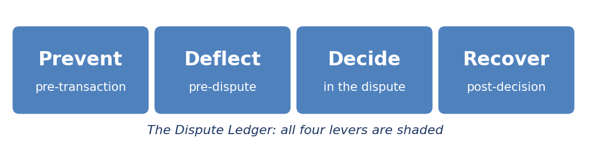
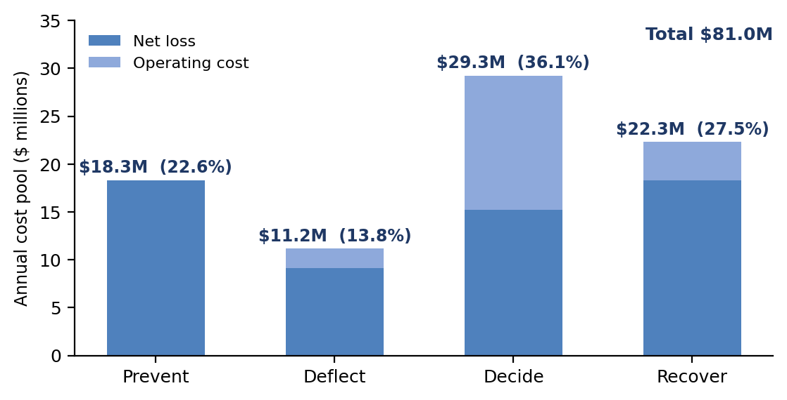
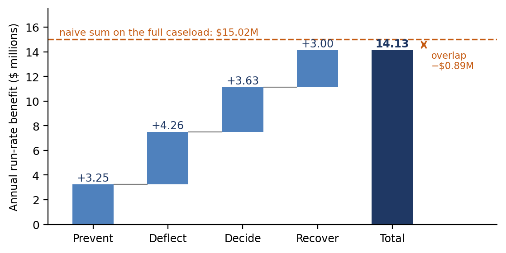
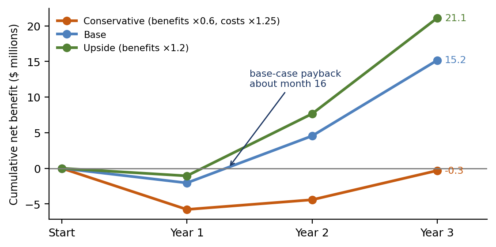
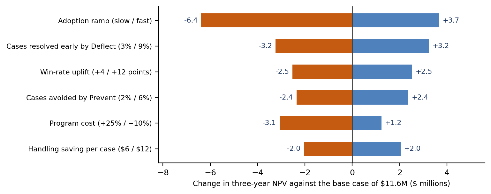

[⬅ Back to all chapters](../README.md) · [Code and data for this chapter](README.md)

# Chapter 7: The Business Case for Dispute Transformation

*This chapter pulls all four levers at once, because a business case must add them up without counting any dollar twice.*

**Worked example.** The finance function at the representative issuer asks two questions. What do disputes cost the institution in total, and how much of that can the proposed transformation program realistically remove, lever by lever? Operations quotes its $20 million budget. The fraud team quotes $61 million of net loss. Customer experience has a complaint count but no dollar figure, and no one can say who owns the sum. The program proposal lists nine initiatives, each with its own business case, and their claimed benefits add up to $38 million a year. Finance sees that figure is 47 percent of the combined cost, and it does not believe it. *This chapter answers the question: how do you assemble one cost figure, attach every initiative to a lever, and build a benefit estimate that finance will sign?*

Chapters 1 through 6 built the vocabulary, the rules, the rails, and the operation. This chapter spends them. A transformation program is funded by people who read spreadsheets, and the spreadsheet is judged less on its optimism than on whether every line can be traced to a source and a lever.

The difficulty is rarely arithmetic. It is that dispute cost is spread across three budgets, that each initiative is sponsored by a different team, and that benefits quoted separately overlap when they are added. A business case that handles these three problems is persuasive, and one that ignores them is usually rejected at the first question.

You will learn how to assemble the total cost of disputes, allocate it to the four levers, size the share a program can address, and set that benefit against a realistic cost and a range of risks. You will also learn how to present the result to a finance committee. By the end you will have built business\_case.xlsx, a five-sheet model whose every figure traces to Table 1.2 or to a labeled assumption.

In this chapter, we will cover the following topics:

- The total cost of disputes
- Mapping cost to the four levers
- Sizing the addressable share
- Benefits, costs, and risk
- Building the business case model
- Presenting the case to finance

## Technical requirements

Open chapter07/ in the companion repository. It contains business\_case.xlsx, a workbook with five sheets (Summary, Inputs, Levers, Costs, and Scenarios), and business\_case.py, the same lever logic in twenty lines of Python, used to test the workbook. Excel or LibreOffice opens the workbook, and Python 3.11 runs the script. Every input comes from Table 1.2 or is marked as an assumption. By the end of this chapter you will have built the seventh chapter artifact of the book; all assumptions are illustrative and must be replaced with your own data before use.

## The total cost of disputes

Chapter 1 observed that dispute cost falls into three budgets, which is why no one funds the remedy. The first task of a business case is therefore to assemble a single figure that finance accepts as the baseline. Table 7.1 lists the four buckets and where each one sits in a typical institution.

| **Bucket** | **What it contains** | **Where it sits today** | **Representative issuer** |
|---|---|---|---|
| Direct loss | Chargebacks and scam reimbursements that were not recovered | Fraud and finance | $61 million a year |
| Operating cost | Staff, systems, and network fees | Operations | $20 million a year |
| Regulatory cost | Remediation programs, examination findings, and engineering effort | Compliance | Not quantified in Table 1.2 |
| Customer cost | Attrition after a poor experience and revenue lost to false declines | Marketing and product | Not quantified in Table 1.2 |

*Table 7.1: The four cost buckets*

The quantified total for the representative issuer is $81 million: $61 million of net loss and $20 million of operating cost. The $20 million is consistent with Table 1.2’s 720,000 cases at an average handling cost of $28, which gives $20.2 million. The two unquantified buckets are real, and we leave them out deliberately. A baseline that finance can verify is worth more than a larger one it cannot.

Three disciplines keep the baseline credible. Take each figure from a ledger that someone other than the program team owns, so that it can be audited. Count each dollar once, which means that the handling cost of a case that ends in a loss belongs to operations and the loss itself to the direct-loss bucket. And name the person who signs the baseline, because a number without an owner is revised whenever it becomes inconvenient.

The distinction between cost of disputes and cost per dispute also matters. A cost per case of $28 sounds small, and multiplied by 720,000 it is $20 million before a single dollar of loss. Merchants often report a fully loaded cost of two to three times the transaction value, as Chapter 1 noted, so the picture is different on the other side of the table, and a business case should say whose cost it is describing.

**Business impact.** A single agreed figure changes the conversation. While the cost is split across three budgets, each owner can argue that the problem belongs to someone else. Once there is one number with one signatory, the program can be judged as a use of the institution’s money and not of a department’s.

**Under the hood.** Build the baseline from queries against the finance ledger, the fraud reporting system, and the operations cost center, and store the queries with the result. When finance asks where a number came from, the answer should be a query it can rerun. Chapter 8 builds the case record that makes this possible for case-level figures.

With one number in hand, the next step is to divide it by lever.

## Mapping cost to the four levers

Chapter 1 stated that every dollar of dispute cost can be addressed by exactly one of four levers. The rule for allocating a dollar is to ask where in the dispute timeline it could first have been saved. A loss that a clearer descriptor would have prevented belongs to Prevent, even if it was eventually written off at Recover.

Table 7.2 shows an illustrative allocation for the representative issuer. Net loss is allocated by the share of loss that each lever could first address, and operating cost by the stage of the operation where it is spent. The shares are assumptions, set out in the Inputs sheet, and Chapter 1’s baseline Ledger cell produces the data-driven equivalent that should replace them.

| **Lever** | **Net loss ($M)** | **Operating cost ($M)** | **Cost pool ($M)** | **Share of $81M** |
|---|---|---|---|---|
| Prevent | 18.30 | 0.00 | 18.30 | 22.6% |
| Deflect | 9.15 | 2.00 | 11.15 | 13.8% |
| Decide | 15.25 | 14.00 | 29.25 | 36.1% |
| Recover | 18.30 | 4.00 | 22.30 | 27.5% |
| Total | 61.00 | 20.00 | 81.00 | 100.0% |

*Table 7.2: Allocation of the cost pool to levers (illustrative)*

Figure 7.1 shows the same allocation graphically. Decide holds the largest pool because most operating cost is spent while cases are being worked, while Prevent and Recover hold the largest losses. The allocation is not a forecast of savings; it is a map of where the money sits, and it shows the maximum that a lever could address.

*Figure 7.1: The $81 million cost pool by lever. Decide holds the largest pool; Prevent and Recover hold the largest losses.*

The allocation also exposes which initiatives belong together. A proposal to tune a fraud model and a proposal to improve descriptors both pull Prevent, and their benefits compete for the same pool. A proposal to automate case summaries and one to classify claims both pull Decide, and both act on the same handling cost.

**Business impact.** The allocation tells a finance committee where the money is, and therefore where to look first. In this example, the lever with the largest pool is not the lever with the largest loss, since Decide is mostly operating cost, which means its improvement shows up as cost per case and not as loss.

**Under the hood.** Keep the allocation shares as inputs, one cell each, and have every downstream formula reference them. When an examiner or auditor asks how the split was derived, the model can show the assumption and its source. Check that the shares in each column sum to 100 percent, and make the workbook say so.

The pool is the ceiling. The next question is how much of it a program can reach.

## Sizing the addressable share

A common error is to estimate benefit as a percentage of the pool, such as “we will cut Decide cost by 20 percent.” A percentage has no mechanism behind it and cannot be challenged. The sounder method is driver-based: for each lever, state how many cases are affected and what each affected case saves.

Table 7.3 applies that method to the representative issuer. The levers are applied in the order of the dispute timeline, so that each works on the caseload that remains after the lever before it. That ordering is what prevents the double counting we return to in the case study.

| **Lever** | **Cases affected** | **Saving per affected case** | **Benefit** | **Basis** |
|---|---|---|---|---|
| Prevent | 4% of 720,000 = 28,800 cases avoided | $28 handling plus $84.72 average loss = $112.72 | $3.25M | Assumption |
| Deflect | 6% of the remaining 691,200 = 41,472 resolved early | $18 handling saving plus $84.72 average loss = $102.72 | $4.26M | Assumption |
| Decide | 62% of the remaining 649,728 = 402,831 on the new path | $9 handling saving ($28 to $19) | $3.63M | Chapter 1 example |
| Recover | Win rate up 8 points on 201,416 contested cases = 16,113 extra wins | $186 recovered per win | $3.00M | Chapter 1 question |
| Total |   |   | $14.13M |   |

*Table 7.3: Driver-based benefit by lever, in timeline order (illustrative)*

The average loss per case, $84.72, is the $61 million of net loss divided by 720,000 cases. It is a blunt assumption, since the cases that Prevent avoids may be cheaper or dearer than average, and the workbook lets you replace it with a figure by case type. The Decide and Recover drivers reuse the examples from Chapter 1 so that the arithmetic can be traced across chapters.

Figure 7.2 shows the four benefits as a waterfall. Added naively, with each lever applied to the full 720,000 cases, the total would be $15.02 million. Sequencing removes $0.89 million of overlap, because a case that is never raised cannot also be handled faster or contested, and the total falls to $14.13 million.

*Figure 7.2: Annual benefit by lever. Applying levers in timeline order removes $0.89 million of overlap.*

Table 7.4 divides each lever’s benefit by its pool. The capture rate is the honest measure of ambition, and it varies a great deal. Deflect captures 38 percent of its pool, as the earlier chapters would predict, since the earlier the conversation the cheaper the saving. Decide captures only 12 percent despite holding the largest pool, because we counted only the efficiency gain and gave no credit for better decisions.

| **Lever** | **Cost pool ($M)** | **Benefit ($M)** | **Share of pool captured** |
|---|---|---|---|
| Prevent | 18.30 | 3.25 | 17.7% |
| Deflect | 11.15 | 4.26 | 38.2% |
| Decide | 29.25 | 3.63 | 12.4% |
| Recover | 22.30 | 3.00 | 13.4% |
| Total | 81.00 | 14.13 | 17.4% |

*Table 7.4: Addressable share by lever (illustrative)*

**Case study: the business case that counted the same dollar twice.** Described in general terms, a card issuer’s program team submitted nine initiatives, each sponsored by a different function and each with its own benefit estimate. Taken together they claimed benefits close to half of the institution’s total dispute cost. The finance committee asked the team to show how a single case could be both avoided by a fraud model and handled faster by an automated decision, and the team could not. After the initiatives were attached to levers and applied in sequence, the claimed benefit fell by about a third. The program was approved at the lower figure, and finance later cited its credibility as the reason the team was trusted with the second phase.

**Business impact.** A smaller figure that survives scrutiny is worth more than a larger one that does not. The capture rates in Table 7.4 also give finance a quick test of plausibility: a lever that claims to remove most of its pool needs an extraordinary reason.

**Under the hood.** Compute each lever’s cases from the output of the lever before it, as the Levers sheet does, instead of from the original caseload. Then add a check that no lever’s benefit exceeds its pool, and show the overlap removed as its own line so that the reader can see the correction.

A benefit is only half a business case. The other half is what it costs to get there.

## Benefits, costs, and risk

The costs of a dispute transformation fall into four categories. Platform and integration covers building the case orchestration and connecting the sources. Data and models covers the foundation of Chapter 8 and the models of Chapters 9 and 10. Run covers cloud, tooling, and the monitoring that keeps models safe. Change and training covers the people who must use the result.

The representative issuer’s illustrative cost is $7.0 million in the first year, $4.0 million in the second, and $3.5 million in the third, or $14.5 million in total. Platform spending is concentrated in the first year, and run cost grows as adoption widens. These are placeholders, not quotations, and the Costs sheet marks every line as an assumption.

Benefits do not arrive at full run-rate on day one. The model assumes adoption of 35 percent in the first year, 75 percent in the second, and 100 percent in the third, so the first year runs at a loss. Table 7.5 shows the base case.

| **$ millions** | **Year 1** | **Year 2** | **Year 3** | **Total** |
|---|---|---|---|---|
| Benefit | 4.95 | 10.60 | 14.13 | 29.67 |
| Cost | 7.00 | 4.00 | 3.50 | 14.50 |
| Net | (2.05) | 6.60 | 10.63 | 15.17 |
| Cumulative net | (2.05) | 4.54 | 15.17 |   |

*Table 7.5: The base case over three years (illustrative)*

The base case pays back in about 16 months and returns a net of $15.2 million over three years, a net present value of $11.6 million at a 10 percent discount rate. Those figures are only as good as their assumptions, so the model runs three scenarios, summarized in Table 7.6 and plotted in Figure 7.3.

| **Scenario** | **Assumptions** | **Three-year net ($M)** | **NPV ($M)** | **Payback** |
|---|---|---|---|---|
| Conservative | Benefits at 60% of base; costs 25% higher | (0.32) | (1.05) | Beyond year 3 |
| Base | As in Table 7.5 | 15.17 | 11.57 | About 16 months |
| Upside | Benefits 20% above base | 21.11 | 16.34 | About 13 months |

*Table 7.6: Three scenarios (illustrative)*

*Figure 7.3: Cumulative net benefit under three scenarios. The base case pays back in about 16 months.*

The conservative scenario deserves attention. It does not pay back within three years, and a committee will notice. The right response is not to hide it but to show what would have to be true for it to occur and how the program’s stage gates, described in the next section, would detect it early.

The risks fall into four groups. Adoption risk is that analysts and merchants do not use the new tools as planned. Model risk is that classification and outcome models underperform, which Chapters 9 and 10 address. Data risk is that the sources of Chapter 8 are less clean than assumed. Regulatory risk is that an automated decision cannot be explained, the subject of Chapter 15.

**Business impact.** Savings in handling cost become real only when the staffing plan changes. If analysts are faster but the team is the same size, the benefit appears as shorter queues, which Chapter 5 showed is valuable, but it does not appear in the budget. A business case should say which of the two it is claiming.

**Under the hood.** Keep benefit and cost on separate rows and make every scenario a pair of multipliers over the base. A reader can then change one multiplier and see the whole three-year picture move, and an auditor can verify that the scenarios differ only where stated. Use the spreadsheet’s own NPV function so that the discounting convention is visible.

With the arithmetic in place, we can build the model.

## Building the business case model

The workbook has five sheets. Inputs holds every assumption in its own labeled cell, with inputs in blue and key assumptions highlighted. Levers applies the four drivers in order. Costs holds the three-year cost by category. Scenarios builds the three cases, and Summary pulls the headline figures together. Table 7.7 maps the sheets and shows one representative formula from each.

| **Sheet** | **Purpose** | **Representative formula** |
|---|---|---|
| Inputs | Every assumption, with its source or note | Values only; blue text for inputs, yellow fill for key assumptions |
| Levers | Benefit by lever, in timeline order | Cases avoided: =B4\*Inputs!B12; saving per case: =Inputs!B5+Inputs!B6/Inputs!B4 |
| Costs | Program cost by category and year | Yearly total: =SUM(B4:B7) |
| Scenarios | Three cases over three years | NPV: =NPV(Inputs!$B$17,B21:D21) |
| Summary | Pool, benefit, and capture by lever | Share captured: =IF(D4=0,0,E4/D4) |

*Table 7.7: The sheets of business\_case.xlsx*

A spreadsheet is easy to get wrong silently, so we test it against an independent calculation. Listing 7.1 implements the same lever logic in Python. It applies the levers in order, passing the remaining caseload from one to the next, and returns the benefit of each.

N0, COST\_CASE, LOSS\_CASE, AMOUNT = 720\_000, 28.0, 61e6 / 720\_000, 186.0

def run\_levers(avoid=0.04, deflect=0.06, decide\_share=0.62, decide\_saving=9.0,

contested=0.31, win\_from=0.42, win\_to=0.50, deflect\_cost=10.0):

out, n = {}, N0

avoided = n \* avoid                                   # Prevent: cases never raised

out\["Prevent"\] = avoided \* (COST\_CASE + LOSS\_CASE)

n -= avoided

resolved = n \* deflect                                # Deflect: resolved informally

out\["Deflect"\] = resolved \* (COST\_CASE - deflect\_cost + LOSS\_CASE)

n -= resolved

out\["Decide"\] = n \* decide\_share \* decide\_saving      # Decide: cheaper handling

out\["Recover"\] = n \* contested \* (win\_to - win\_from) \* AMOUNT

return out

if \_\_name\_\_ == "\_\_main\_\_":

benefits = run\_levers()

for lever, value in benefits.items():

print(f"{lever:8s} ${value:,.0f}")

print(f"Total    ${sum(benefits.values()):,.0f}")

*Listing 7.1: chapter07/business\_case.py*

The first line defines the starting caseload, the handling cost, the average loss per case, and the average amount. The function run\_levers takes the assumptions as parameters with the defaults of Table 7.3. After each lever it reduces the caseload n, so that Deflect works on what Prevent left, and Decide and Recover on what Deflect left. The main block prints the four benefits and their total.

Running the script gives $3,246,400 for Prevent, $4,260,096 for Deflect, $3,625,482 for Decide, and $2,997,065 for Recover, a total of $14,129,044. The workbook, once recalculated, produces the same four figures to the dollar, which is the test that the two implementations agree.

The model is deliberately simple. It treats the average loss per case as constant, ignores the two unquantified cost buckets, and applies one adoption ramp to all levers. The exercises add a case-type breakdown and lever-specific ramps.

**Business impact.** A model that finance can open, change an input in, and watch recalculate earns more trust than a deck of conclusions. The color convention and the Inputs sheet make it clear what can be changed, and the independent test shows that the logic does what the chapter says it does.

**Under the hood.** Keep inputs, calculations, and results on separate sheets, and never type a result as a number. Recalculate after every change, check for formula errors, and compare a few cells to an independent calculation. A clean recalculation shows that the formulas evaluate, not that they are right.

The model is built. The remaining task is to put it in front of the people who decide.

## Presenting the case to finance

A finance committee asks the same five questions of any program. What is the baseline, and who signs it? Which lever does each initiative pull? What are we assuming? What if we are wrong? And how will we know? A good presentation answers them in that order, and each answer comes from a part of the model.

The fourth question is answered by sensitivity analysis. Figure 7.4 varies one assumption at a time and shows the effect on the three-year net present value. The largest swing is not a model assumption at all: a slow adoption ramp costs $6.4 million of value, more than any change in win rate, handling saving, or avoided cases.

*Figure 7.4: Sensitivity of three-year NPV. Adoption speed matters more than any single model assumption.*

That result is a useful finding for a technical audience. The risk to the program is delivery and adoption more than the accuracy of any model, and it suggests where to spend management attention. It also argues for funding the program in stages and not in one commitment.

The fifth question is answered by stage gates. Each lever is funded in turn, and the money for the next stage is released when the previous one shows its result against a baseline measured as in Chapter 5, from the customer’s claim. Table 7.8 shows the charter that every initiative should carry. If a line cannot be filled in, the initiative is not ready.

| **Field** | **Question it answers** | **Example: a Deflect pilot** |
|---|---|---|
| Lever | Which of the four does it pull? | Deflect |
| Metric and baseline | What is measured, from which start event? | Share of cases resolved before a formal dispute, measured from the claim, baseline from the operations log |
| Owner | Who is accountable for the result? | Head of dispute operations |
| Run-rate benefit | What is it worth a year at full adoption? | $4.26M, from Table 7.3 |
| Cost | What does it cost, by year? | As allocated in the Costs sheet |
| Gate | What evidence releases the next funding? | At least half of the assumed early-resolution rate (3% of pilot cases) within 90 days |

*Table 7.8: A program charter for each initiative (illustrative)*

The charter is the practical form of this chapter’s principle. An initiative with no lever has no pool to draw its benefit from, no baseline to measure it against, and no owner to answer for it. It is a technology purchase described as a program.

**Business impact.** Staged funding converts a large uncertain commitment into a series of small ones, each with evidence behind it. Finance is more willing to approve a program it can stop, and a team that can show early results is more likely to be funded for the next stage.

**Under the hood.** Store the charter fields as structured data alongside the model, with the lever as a required field. Then a report of every initiative by lever, owner, and gate status is a query, and the program’s portfolio can be reviewed against the pool each quarter.

**Worked example revisited.** The finance function now has its answer. Disputes cost the representative issuer $81 million a year in loss and operating cost, split across the four levers as in Table 7.2. The nine initiatives, attached to levers and applied in order, deliver $14.13 million a year at full adoption, 17 percent of the pool, not the $38 million first claimed. The program costs $14.5 million over three years and pays back in about 16 months in the base case, and the conservative case shows what would have to go wrong for it not to. Chapter 8 builds the data foundation on which the whole program depends.

**Key principle.** *A program that cannot name its lever is not a program.*

**What you now have**

- **chapter01/disputes\_sample.csv**: the synthetic issuer dataset used throughout the book
- **chapter01/explore.ipynb**: headline metrics, the money waterfall, and the baseline Dispute Ledger
- **chapter02/timelines.yaml**: regulatory and network deadlines expressed as data
- **chapter02/deadlines.py**: the module that turns a claim’s start events into due dates
- **chapter03/card\_state\_machine.py**: the card dispute lifecycle as a table-driven state machine
- **chapter04/rail\_adapters/**: state machines, timers, and evidence schemas for ACH, wire, RTP, and P2P
- **chapter05/ops\_kpi\_dashboard.ipynb**: the KPI dashboard that reports cycle time under two definitions
- **chapter06/first\_party\_signals.py**: the first-party misuse signals
- **chapter07/business\_case.xlsx**: the five-sheet business case model, with business\_case.py as its independent test

## Summary

In this chapter we assembled the total cost of disputes into one figure with an owner, allocated it to the four levers of the Dispute Ledger, and sized the share each lever can address using drivers, not percentages. We applied the levers in timeline order to avoid counting the same dollar twice, set the benefit against a realistic three-year cost, and tested it with three scenarios and a sensitivity analysis. We built business\_case.xlsx and checked it against an independent calculation, and we turned the result into a staged funding charter that names the lever for every initiative.

Chapter 8 turns from the case for the program to the foundation beneath it. It builds the dispute data foundation, a single case record assembled from authorization, clearing, customer, and merchant data, on which every model in Part III depends.

## Questions

- Using Table 7.3’s method, recompute the Recover benefit if the win rate rises from 42 percent to 48 percent, instead of 50 percent, on the contested cases remaining after Prevent and Deflect.
- The base case has a net of $10.63 million in Year 3. What is its present value at a 10 percent discount rate?
- Why must the levers be applied in timeline order? Describe the error that results if Decide is calculated on the full 720,000 cases.
- Which two assumptions in Table 7.3 would you ask the issuer’s own data to replace first, and why?
- The conservative scenario does not pay back within three years. What changes to scope or stage gates would you propose, and how would you show their effect in the workbook?

## Further reading 343

- Douglas W. Hubbard, How to Measure Anything: Finding the Value of Intangibles in Business (Wiley, 3rd edition, 2014)
- Sam L. Savage, The Flaw of Averages: Why We Underestimate Risk in the Face of Uncertainty (Wiley, 2009)
- Richard A. Brealey, Stewart C. Myers, and Franklin Allen, Principles of Corporate Finance (McGraw-Hill)
- Robert S. Kaplan and David P. Norton, The Balanced Scorecard: Translating Strategy into Action (Harvard Business School Press, 1996)
- openpyxl documentation: reading and writing Excel files with formulas
