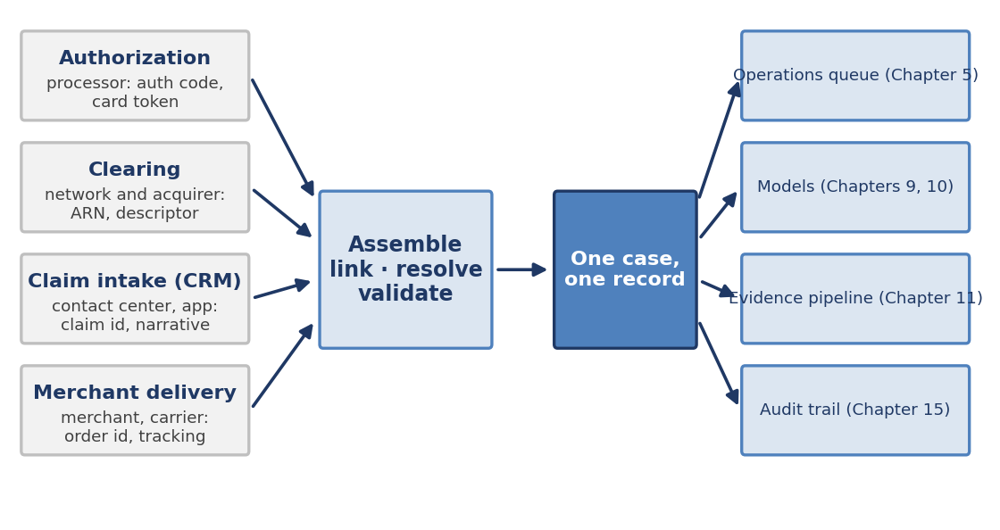
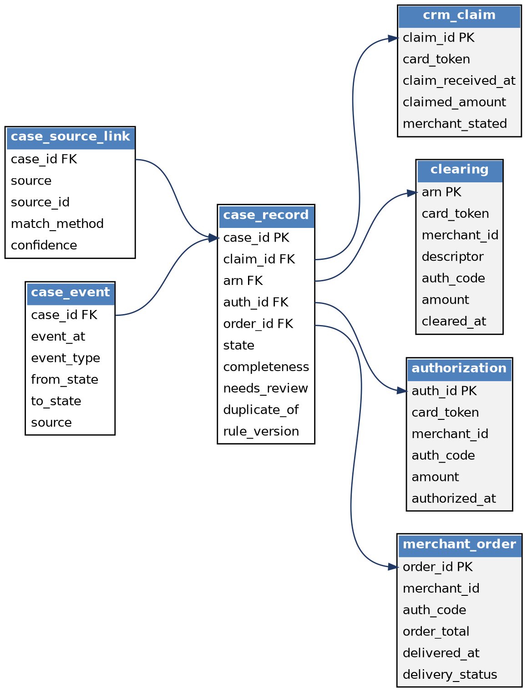
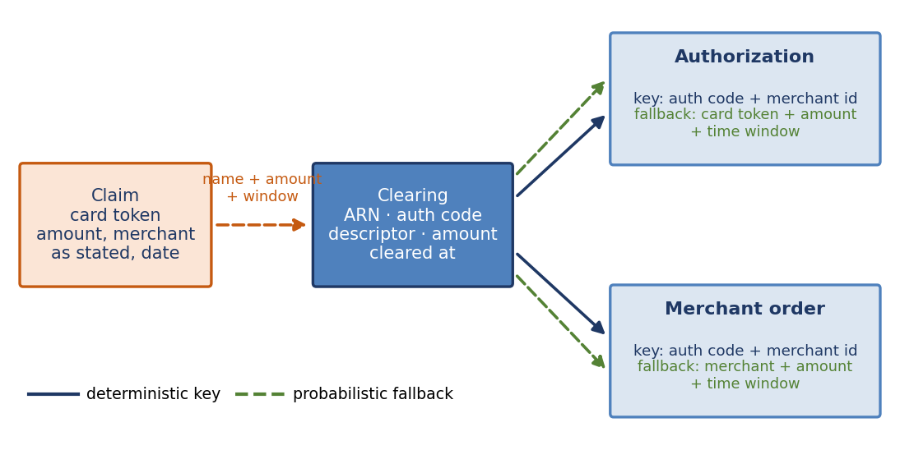
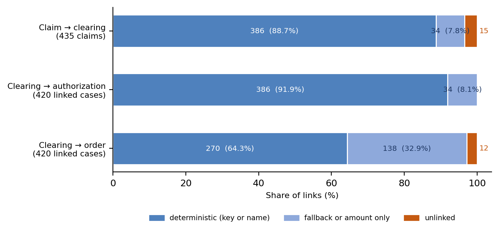

[⬅ Back to all chapters](../README.md) · [Code and data for this chapter](README.md)

# Chapter 8: The Dispute Data Foundation

*This chapter pulls the Decide lever at its root: no decision can be better than the record it is made from.*

**Worked example.** A cardholder reports through the mobile application, at 11:31 on 20 March, that a $127.11 purchase from “Granite” never arrived. The claim reaches the institution as a card token, an amount, and a merchant name typed by the customer. Four systems each hold a piece of what happened. The processor authorized the purchase on 1 March, the network’s clearing file shows a charge on 3 March under the descriptor GRANITETOYS*5274, the claims system holds the customer’s report, and the merchant’s order system shows the parcel shipped on 5 March and delivered on 11 March. No single key links all four, and the customer’s “Granite” matches no descriptor exactly.* This chapter answers the question: how do you assemble one trustworthy record from these sources, and how sure can you be of each link?\*

The earlier chapters assumed a case that already knew its facts. Chapter 2 started its clocks from the claim, Chapter 3 followed a chargeback through its states, and Chapter 5 measured the operation from the customer’s first contact. Each of them needed data that someone had to bring together, and this chapter is where that work is done.

Dispute data is hard because it is born in systems that were never designed to meet. The authorization system knows the card and the approval code, the clearing system knows the reference number the network assigned, the claims system knows what the customer said, and the merchant knows what was shipped. Each uses its own identifiers, its own clock, and its own idea of what an amount is.

You will learn what each source knows and when, why a dispute platform needs exactly one record for each case, how to link records that share no common key, and how to measure and record the quality of every link. By the end you will have built dispute\_schema.sql and assemble\_case.py, which assemble 435 claims from four synthetic feeds and report how reliable each link is.

In this chapter, we will cover the following topics:

- Sources of dispute data
- One case, one record
- Keys, identity, and entity resolution
- Data quality and lineage
- Building the case record

## Technical requirements

Open chapter08/ in the companion repository. It contains dispute\_schema.sql, the database schema; assemble\_case.py, with its helpers linking.py and store.py, which assemble the case records; and make\_sources.py, which generates four synthetic feeds (authorization.csv, clearing.csv, crm\_claim.csv, and merchant\_order.csv) and a truth file used to score the links. Python 3.11, pandas 2.x, and the standard library’s sqlite3 module are sufficient, so no database server is needed. By the end of this chapter you will have built the eighth chapter artifact of the book; all data are synthetic.

## Sources of dispute data

A dispute case draws on at least four sources, and Figure 8.1 shows how they converge. Each source is owned by a different part of the institution or by a different institution altogether, which determines when its data arrives and how far it can be trusted.

z

*Figure 8.1: Four sources, one record. The assembly step links, resolves, and validates before anything downstream reads the case.*

Table 8.1 describes the sources in turn. Authorization data arrives first, in real time, and carries the approval code. Clearing data arrives days later and carries the acquirer reference number, which the network uses to identify the transaction in every later dispute step. The claim arrives whenever the customer chooses to contact the institution, and the merchant’s delivery data arrives from outside the institution’s control, if it arrives at all.

| **Source** | **Owner** | **What it knows** | **Key it carries** | **Typical gap** |
|---|---|---|---|---|
| Authorization | Issuer’s processor | Card, merchant, amount, approval code, time of approval | Authorization code | Amount may differ from the final charge |
| Clearing | Network and acquirer | Final amount, merchant descriptor, settlement date | Acquirer reference number (ARN) | Authorization code often missing |
| Claim intake | Contact center and application | What the customer says, when, and through which channel | Claim identifier | Merchant named in free text |
| Merchant delivery | Merchant and carrier | Order, shipment, and delivery status | Order identifier | Authorization code often not stored |

*Table 8.1: The four sources of dispute data*

Other sources join later, among them fraud scores, prior disputes by the same customer, and network alerts, and the same principles apply to them. We begin with four because they are the minimum needed to answer the question every dispute turns on: what was bought, what was charged, what the customer says, and what the merchant did.

**Business impact.** Dispute outcomes depend on facts that sit in different places. An analyst who has to open four systems to answer one question spends most of the handling time on retrieval, which is part of the $28 per case of Table 1.2. A platform that assembles the facts once removes that effort from every case.

**Under the hood.** Land each feed unchanged in its own table before doing anything else, and add only a load timestamp. The source tables are the evidence of what each system said, and they let you replay the assembly later if a rule changes or an examiner asks. Never transform a source in place.

With the sources identified, the next question is how many records a dispute should have.

## One case, one record

Most institutions have more than one record of the same dispute. The contact center keeps one, the fraud team another, the chargeback team a third, and the finance team a ledger entry. Each is correct for its own purpose, and none of them can answer a question that spans two. The principle of this chapter is that a dispute has exactly one case record, and every source is linked to it.

The record has five parts, summarized in Table 8.2. It has an identity, the case identifier and the rail. It has links to the source records, held as keys. It has a state, from the state machines of Chapters 3 and 4. It carries quality indicators, completeness and a review flag. And it carries provenance: how each link was made, how confident the rule was, and which version of the rules made it.

| **Part** | **Fields** | **Why it exists** |
|---|---|---|
| Identity | case\_id, rail, claim\_received\_at | Starts the regulatory clock from the claim, as in Chapters 2 and 5 |
| Links | claim\_id, arn, auth\_id, order\_id | Joins the case to what each source knows, without copying it |
| State | state, plus the case\_event history | Holds where the case is; the history shows how it got there |
| Quality | completeness, needs\_review, duplicate\_of | Tells downstream consumers how far to trust the record |
| Provenance | case\_source\_link: method, confidence; rule\_version | Lets any link be explained, challenged, and replayed |

*Table 8.2: Anatomy of the case record*

Figure 8.2 shows the schema as a diagram. The four source tables sit on the right, exactly as received. The case record in the middle holds only keys and indicators, and two supporting tables record the provenance of each link and the history of events on the case.

*Figure 8.2: The case schema. The case record holds keys and indicators; the source tables keep the facts exactly as received.*

Three rules govern the record. Never drop a claim: even if no source can be linked, the case exists, because the customer’s notice has started a clock. Never overwrite: state changes are appended to the event history, not written over a status field, as Chapters 3 and 5 recommended. And always record provenance: a link without a method and a confidence is an assertion, not evidence.

**Business impact.** A single record gives every function the same answer to the same question. Operations, finance, and compliance stop reconciling their versions of the case and start working from one, and the audit trail has a single place to begin.

**Under the hood.** Store keys in the case record and facts in the source tables, and join them when needed. Copying facts into the case record creates a second version that drifts from the first. A view that joins the case to its sources gives analysts a flat row without creating a second copy.

A record of links is only as good as the links, and making them is harder than it looks.

## Keys, identity, and entity resolution

The ideal link is a shared key: two records carry the same identifier, and a join connects them. In dispute data the shared keys are incomplete. The claim carries a card token, an amount, and a merchant name that the customer typed. The clearing record carries the acquirer reference number and the descriptor. The authorization and the merchant’s order carry the authorization code, when they carry it at all.

Figure 8.3 shows the chain. The claim must be linked to a clearing record without any shared identifier, and so it relies on a fuzzy match. The clearing record is then linked to the authorization and to the merchant’s order on the authorization code and merchant, with a fallback for the many records where the code is missing.

*Figure 8.3: Join keys and fallbacks. Every link is attempted by key first and by a probabilistic fallback second.*

Table 8.3 summarizes the rules. Every link is attempted deterministically first and by a fallback second, and every link records which of the two produced it. The claim-to-clearing link is the most delicate, because customers describe merchants in unpredictable ways.

| **Link** | **First attempt** | **Fallback** | **Review flag** |
|---|---|---|---|
| Claim to clearing | Same card token, amount within 10%, within 120 days, and descriptor similar to the stated name (score 0.6 or above) | Exactly one candidate on card token, amount, and window | Two near-equal candidates, or none |
| Clearing to authorization | Authorization code and merchant | Card token, merchant, amount within 1%, within 4 days | None; low risk |
| Clearing to order | Authorization code and merchant | Merchant, amount within 1%, within 4 days | None; the order is evidence, not identity |

*Table 8.3: Linking rules*

Three details decide whether the links are trustworthy. Names are normalized before comparison, lower-cased and stripped of digits and punctuation, so that “Granite” can match GRANITETOYS\*5274. Candidates are restricted by card token, amount, and time window, which keeps the fuzzy comparison to a handful of records. And ambiguity is detected and not hidden: two candidates with near-equal scores, as happens when a customer has a monthly subscription, send the case to a human.

A fourth detail is a trap. In pandas, a join on a column that contains missing values matches missing to missing, so every clearing record without an authorization code is linked to every order without one. In the synthetic data this produces 8,084 rows where the correct join produces 1,893, more than four times as many. The code therefore never joins on a null key.

Entity resolution has two kinds of error. A false link attaches the wrong transaction to a claim, and a missed link leaves a claim unlinked. A false link is usually worse, since it puts the wrong delivery record in front of an analyst, so the rules are tuned to prefer sending a case to review over guessing.

**Business impact.** The cost of a wrong link falls on the customer and the institution together. A cardholder denied because the system looked at the wrong order, or an analyst arguing with a merchant about a delivery that belongs to another customer, are failures of data rather than of judgment.

**Under the hood.** Keep the matching rules in one module with named thresholds, and version them. When a rule changes, rerun the assembly on the same source tables and compare the results. A threshold that cannot be tested against labeled examples is a guess, and the truth file in this chapter’s data exists to make the test possible.

Links can be made well or badly, and the only way to know which is to measure.

## Data quality and lineage

Data quality is not a single property. Five dimensions cover most of what goes wrong in dispute data. Completeness asks whether the expected values are present. Validity asks whether they obey the rules of the domain. Consistency asks whether two sources that should agree do agree. Uniqueness asks whether anything is counted twice. Timeliness asks whether the data is fresh enough for the decision.

Each dimension becomes a query that runs after every assembly, and Table 8.4 shows the results on the synthetic feeds. The checks are deliberately simple, and each one found something. Six clearing records are dated before their own authorizations, an impossible order of events that points to a clock or a feed error. Nine percent of clearing records lack an authorization code, and thirty percent of merchant orders do. Eleven percent of linked claims state an amount that differs from the cleared amount by more than one percent.

| **Dimension** | **Rule** | **Result on the synthetic feeds** | **Action** |
|---|---|---|---|
| Completeness | Cases with clearing, authorization, and order all linked | 408 of 435 cases (93.8%) | Report; review the rest |
| Completeness | Clearing records with an authorization code | 2,730 of 3,000 (91.0%) | Fallback links used |
| Completeness | Merchant orders with an authorization code | 2,091 of 3,000 (69.7%) | Ask merchants to supply it |
| Validity | Clearing time not earlier than authorization time | 6 records violate the rule | Quarantine and investigate |
| Consistency | Claimed amount within 1% of cleared amount | 47 of 420 linked claims differ (11.2%) | Flag; do not block the link |
| Uniqueness | One live case for each ARN | 0 violations; 15 duplicate claims linked to a first case | Enforced by a unique index |

*Table 8.4: Quality rules and results (synthetic data)*

Lineage is the other half of trust. For every field that reaches a model or an examiner, the platform should be able to say which source supplied it, when, through which rule, and under which version. The case\_source\_link table holds this for each link, so that a delivery date on a case can be traced to an order record and to the rule that connected it.

**Case study: the model trained onmislinkedrecords.** Described in general terms, an issuer built its first outcome model on a case table assembled with a single loose join between claims and orders. About one case in ten had been linked to another customer’s order of similar value, so its delivery features were wrong. The model performed well in development, where the errors were spread evenly, and poorly in production, where it was applied to cases that had been linked more carefully. The team rebuilt the table with scored links, trained only on high-confidence ones, and kept the low-confidence cases for human review. The lesson was that a model learns whatever its data contains, including the mistakes.

**Business impact.** Quality indicators let the institution decide how much automation each case can bear. A fully linked, high-confidence case can be handled automatically, while an ambiguous one goes to a person. Without the indicators, the only choices are to trust every record or to trust none.

**Under the hood.** Run the quality queries as part of every load and store the results over time. A rate that drifts, such as the share of orders without an authorization code rising from 30 to 40 percent, is an early warning of a change in a source system, and it is far cheaper to find in a dashboard than in a failed model.

We now have the design, and the next step is to build it.

## Building the case record

The schema comes first. Listing 8.1 shows the case tables; the four source tables above them mirror the feeds exactly. The unique index in the listing is a partial one: it permits only one live case for each acquirer reference number, while allowing duplicate claims to point to the case they repeat.

-- Case tables: one record per claim, with provenance for every link

CREATE TABLE case\_record (

case\_id TEXT PRIMARY KEY,

rail TEXT NOT NULL DEFAULT 'card',

state TEXT NOT NULL DEFAULT 'CLAIM\_RECEIVED',

claim\_id TEXT NOT NULL REFERENCES crm\_claim(claim\_id),

arn TEXT REFERENCES clearing(arn),

auth\_id TEXT REFERENCES authorization(auth\_id),

order\_id TEXT REFERENCES merchant\_order(order\_id),

claim\_received\_at TEXT NOT NULL,

completeness INTEGER NOT NULL CHECK (completeness BETWEEN 0 AND 3),

needs\_review INTEGER NOT NULL DEFAULT 0,

duplicate\_of TEXT REFERENCES case\_record(case\_id),

rule\_version TEXT NOT NULL);

CREATE UNIQUE INDEX one\_case\_per\_arn ON case\_record(arn)

WHERE arn IS NOT NULL AND duplicate\_of IS NULL;

CREATE TABLE case\_source\_link (

case\_id TEXT NOT NULL REFERENCES case\_record(case\_id), source TEXT NOT NULL,

source\_id TEXT, match\_method TEXT NOT NULL, confidence REAL NOT NULL,

linked\_at TEXT NOT NULL, PRIMARY KEY (case\_id, source));

CREATE TABLE case\_event (

case\_id TEXT NOT NULL REFERENCES case\_record(case\_id), event\_at TEXT NOT NULL,

event\_type TEXT NOT NULL, from\_state TEXT, to\_state TEXT, source TEXT NOT NULL);

*Listing 8.1: chapter08/**dispute\_schema.sql* *(case tables)*

Listing 8.2 holds the linking rules. The function link\_claim returns the best clearing record for a claim, the method that found it, a score, and a flag for ambiguity. The function match links a clearing record to an authorization or an order, trying the authorization code first and the fallback second.

import difflib

import pandas as pd

def norm(text):

return "".join(ch for ch in str(text).lower() if ch.isalpha())

def similar(a, b):

return difflib.SequenceMatcher(None, norm(a), norm(b)).ratio()

def link\_claim(claim, clearing, window\_days=120, min\_sim=0.6):

near = clearing\[(clearing.card\_token == claim.card\_token)

& ((clearing.amount - claim.claimed\_amount).abs() \<= 0.10 \* claim.claimed\_amount)

& (clearing.cleared\_at \<= claim.claim\_received\_at)

& (clearing.cleared\_at \>= claim.claim\_received\_at - pd.Timedelta(days=window\_days))\]

scored = sorted(((similar(claim.merchant\_stated, d.descriptor), d.cleared\_at, d.arn)

for d in near.itertuples()), reverse=True)

if scored and scored\[0\]\[0\] \>= min\_sim:

close = len(scored) \> 1 and scored\[0\]\[0\] - scored\[1\]\[0\] \< 0.05

return scored\[0\]\[2\], "name", round(scored\[0\]\[0\], 2), close

if len(scored) == 1:

return scored\[0\]\[2\], "amount\_only", 0.30, False

return None, "none", 0.0, False

def match(clr, pool, id\_col, amt\_col, ts\_col, days=4, tol=0.01):

if pd.notna(clr.auth\_code):                       # never join on a null key

hit = pool\[(pool.auth\_code == clr.auth\_code)

& (pool.merchant\_id == clr.merchant\_id)\]

if len(hit) == 1:

return hit.iloc\[0\]\[id\_col\], "key", 1.0

cand = pool\[(pool.merchant\_id == clr.merchant\_id)

& ((pool\[amt\_col\] - clr.amount).abs() \<= tol \* clr.amount)

& (pool\[ts\_col\] \<= clr.cleared\_at)

& (pool\[ts\_col\] \>= clr.cleared\_at - pd.Timedelta(days=days))\]

if "card\_token" in pool.columns:

cand = cand\[cand.card\_token == clr.card\_token\]

if len(cand):

best = (clr.cleared\_at - cand\[ts\_col\]).abs().idxmin()

return cand.loc\[best, id\_col\], "fuzzy", 0.7

return None, "none", 0.0

*Listing 8.2: chapter08/linking.py*

The first two functions normalize and compare names. In link\_claim, the filter restricts candidates to the same card, a similar amount, and a plausible time window, and the sorted scores pick the best. A score of 0.6 or above is a name match, a single candidate with no good name is an amount-only match, and anything else is unlinked. In match, the check on auth\_code is what prevents the null-key trap described earlier.

Listing 8.3 assembles the cases. For each claim, in order of arrival, it creates a case, links the claim to a clearing record, and for each linked clearing record looks for the matching authorization and order. Every link is written with its method and confidence.

import pandas as pd

from linking import link\_claim, match

from store import load\_sources, save

# (source table, id column, amount column, timestamp column)

SECONDARY = \[("authorization", "auth\_id", "amount", "authorized\_at"),

("merchant\_order", "order\_id", "order\_total", "ordered\_at")\]

def assemble(src, rule\_version="link-rules-1.0"):

clearing = src\["clearing"\].set\_index("arn", drop=False)

cases, links, first\_for = \[\], \[\], {}

for n, claim in enumerate(src\["crm\_claim"\].sort\_values("claim\_received\_at").itertuples(), 1):

case\_id = f"CASE{n:05d}"

arn, how, conf, close = link\_claim(claim, src\["clearing"\])

links.append((case\_id, "crm\_claim", claim.claim\_id, "key", 1.0))

row = dict(case\_id=case\_id, claim\_id=claim.claim\_id, arn=arn,

auth\_id=None, order\_id=None, completeness=int(arn is not None),

claim\_received\_at=claim.claim\_received\_at,

needs\_review=int(close or arn is None),

duplicate\_of=first\_for.get(arn) if arn else None,

rule\_version=rule\_version)

if arn:

first\_for.setdefault(arn, case\_id)

links.append((case\_id, "clearing", arn, how, conf))

clr = next(clearing.loc\[\[arn\]\].itertuples())

for table, col, amt, ts in SECONDARY:

found, how2, conf2 = match(clr, src\[table\], col, amt, ts)

row\[col\] = found

row\["completeness"\] += found is not None

links.append((case\_id, table, found, how2, conf2))

cases.append(row)

names = \["case\_id", "source", "source\_id", "match\_method", "confidence"\]

return pd.DataFrame(cases), pd.DataFrame(links, columns=names)

if \_\_name\_\_ == "\_\_main\_\_":

src = load\_sources()

cases, links = assemble(src)

save(src, cases, links)

print(len(cases), "cases;", cases.completeness.value\_counts().sort\_index().to\_dict())

*Listing 8.3: chapter08/assemble\_case.py*

The dictionary built for each claim becomes one row of case\_record, and the links accumulate in a second table. The completeness count adds one for each linked source, and needs\_review is set when a link is ambiguous or absent. The helper store.py writes the source tables and the case tables to SQLite, converting dates to text and missing values to nulls along the way.

Running the script on the synthetic feeds produces 435 cases. Table 8.5 and Figure 8.4 show how each link was made. Of the 435 claims, 420 were linked to a clearing record, 386 by name and 34 by amount alone, and 15 could not be linked. Of those 420, every one found its authorization, 386 by code and 34 by fallback, and 408 found an order, 270 by code and 138 by fallback.

| **Link** | **Linked** | **By key or name** | **By fallback** | **Unlinked** | **Accuracy of links made** |
|---|---|---|---|---|---|
| Claim to clearing | 420 of 435 | 386 | 34 | 15 | 98.8% (415 of 420) |
| Clearing to authorization | 420 of 420 | 386 | 34 | 0 | 100% |
| Clearing to order | 408 of 420 | 270 | 138 | 12 | 100% |

*Table 8.5: How each link was made (synthetic data, scored against a truth file)*

*Figure 8.4: How each link was made. Deterministic links dominate, and fallbacks carry the rest (synthetic data).*

The accuracy figures come from the truth file that the generator writes alongside the feeds. Five of the 420 claim links were wrong, which is 98.8 percent precision, and 415 of the 427 claims that could be linked were linked correctly, or 97.2 percent. All five wrong links were among the 39 cases flagged for review, which consist of 24 ambiguous matches and the 15 unlinked claims. No wrong link reached an analyst unflagged.

The result is easier than reality in two respects: the synthetic merchant names are distinct, and the fallback links happen to be perfect. Real descriptors are messier, and real fallbacks make errors. The point of the method is to measure and not to assume, so these figures should be recomputed on your own data.

Finally, the assembled record can be inspected. Table 8.6 shows the four linked records for the worked example, and the provenance behind each link. The delivery record shows a delivery on 11 March, nine days before the customer’s claim, and that is a fact the analyst and the merchant can both see without opening four systems.

| **Source** | **Record** | **Method** | **Confidence** |
|---|---|---|---|
| Claim | C00001, app, 20 March 11:31, $127.11, “Granite” | Key | 1.00 |
| Clearing | ARN ending 7365, GRANITETOYS\*5274, $127.11, 3 March | Name | 0.78 |
| Authorization | A02839, code 5006F2, 1 March 08:39 | Key | 1.00 |
| Merchant order | O02839, shipped 5 March, delivered 11 March | Fallback | 0.70 |

*Table 8.6: The assembled record for CASE00103, with provenance*

The assembly is deliberately small. It processes claims one at a time, uses one network’s identifiers, and reads files and not live feeds. The exercises extend it to second chargebacks, to the rail identifiers of Chapter 4, and to incremental loads.

**Business impact.** The assembled record changes what an analyst does first. Instead of searching four systems, the analyst starts from a case that already shows what was charged, what the customer says, and what the merchant recorded, together with an honest indication of how sure the platform is of each link.

**Under the hood.** In production the assembly runs as a streaming job that updates the case as each source arrives, and each update is an event on the case. Chapter 14 describes the pipeline, and Chapter 15 describes how the provenance supports an examiner’s question about why a decision was taken.

**Worked example revisited.** The claim for “Granite” is now a case with an identity, four linked records, and a record of how each link was made. The claim links to the clearing record by name with a score of 0.78, to the authorization by code, and to the order by fallback, and the order shows delivery nine days before the claim. Whether the cardholder received the parcel is a question for Chapters 9 through 12. What this chapter ensures is that the question can be asked of one record, and that its answer can be traced to its sources. Chapter 9 builds the first model that reads this record.

**Key principle.** *One case, one record, every source.*

**What you now have**

- **chapter01/disputes\_sample.csv**: the synthetic issuer dataset used throughout the book
- **chapter01/explore.ipynb**: headline metrics, the money waterfall, and the baseline Dispute Ledger
- **chapter02/timelines.yaml**: regulatory and network deadlines expressed as data
- **chapter02/deadlines.py**: the module that turns a claim’s start events into due dates
- **chapter03/card\_state\_machine.py**: the card dispute lifecycle as a table-driven state machine
- **chapter04/rail\_adapters/**: state machines, timers, and evidence schemas for ACH, wire, RTP, and P2P
- **chapter05/ops\_kpi\_dashboard.ipynb**: the KPI dashboard that reports cycle time under two definitions
- **chapter06/first\_party\_signals.py**: the first-party misuse signals
- **chapter07/business\_case.xlsx**: the five-sheet business case model
- **chapter08/dispute\_schema.sql** and **assemble\_case.py**: the case schema and the assembly of one record from four sources

## Summary

In this chapter we identified the four sources of dispute data and what each knows and when it arrives. We set out the principle of one case and one record, with links held as keys, state held as an event history, and provenance held for every link. We linked records that share no common key, using deterministic joins first and probabilistic fallbacks second, and we saw why a null key must never be joined. We measured data quality across five dimensions, and built dispute\_schema.sql and assemble\_case.py, which assembled 435 claims, linked 420 of them, and sent every uncertain case to review.

Chapter 9 puts the record to work. It builds a classifier that assigns each incoming claim a family, a priority, and a risk of missing its deadline, using only what is known when the claim arrives.

## Questions

- In Table 8.5, 408 of the 420 linked cases found an order. Of those 408, what share found it by authorization code and what share by fallback?
- Using Table 8.4, how many merchant orders in the synthetic feed lack an authorization code, and what share of orders is that?
- Explain why joining clearing records to orders on a column that contains nulls produced 8,084 rows against 1,893. How would you detect this error in a production pipeline?
- The linking rules use an amount tolerance of 10 percent for claims and 1 percent for authorizations and orders. Why are they different, and what happens to precision if the claim tolerance is raised to 20 percent?
- A customer has a monthly subscription for the same amount from the same merchant, and disputes one month. What does the linking code do, and what should an analyst see?

## Further reading

- Peter Christen, Data Matching: Concepts and Techniques for Record Linkage, Entity Resolution, and Duplicate Detection (Springer, 2012)
- Ivan P. Fellegi and Alan B. Sunter, “A Theory for Record Linkage,” Journal of the American Statistical Association 64, no. 328 (1969)
- Martin Kleppmann, Designing Data-Intensive Applications (O’Reilly, 2017)
- SQLite documentation, partial indexes
- pandas user guide, merge, join, concatenate and compare
