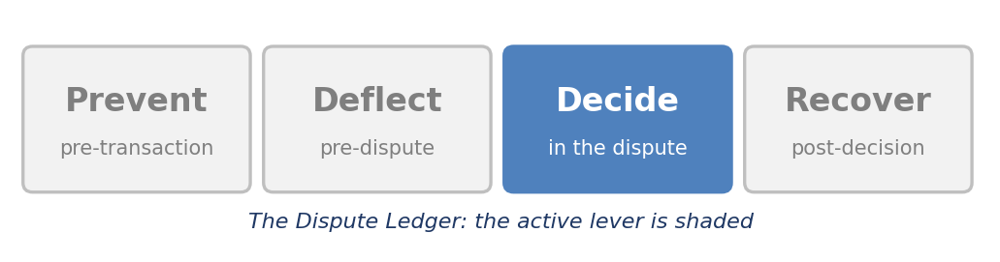
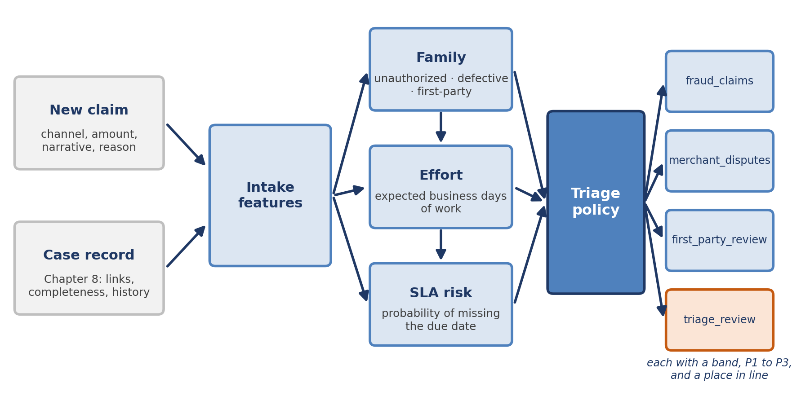
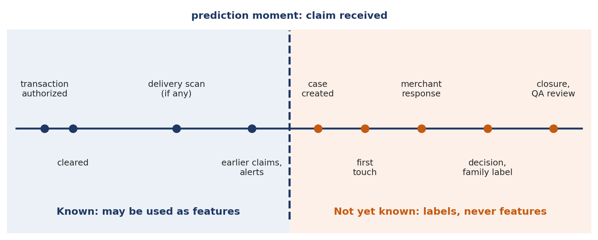
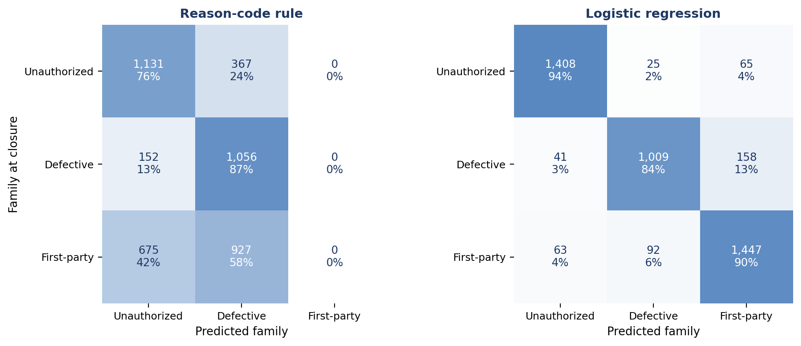
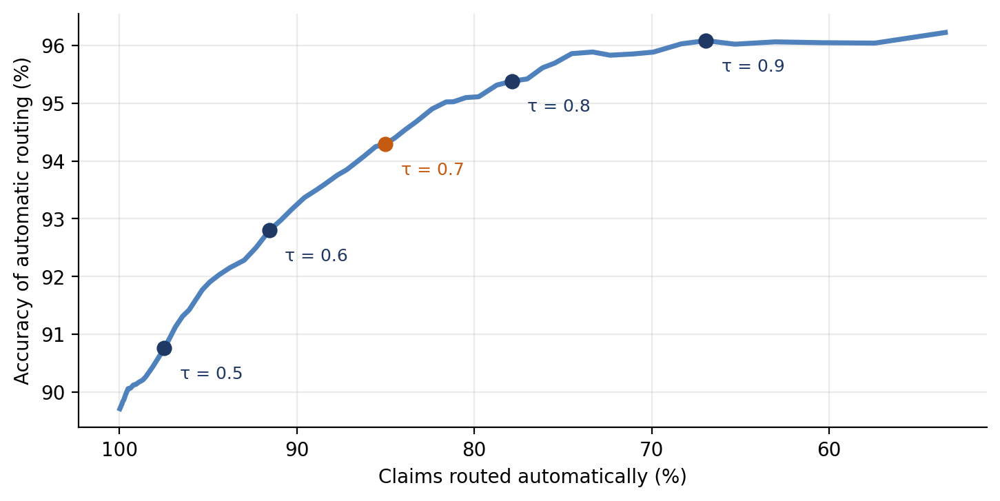
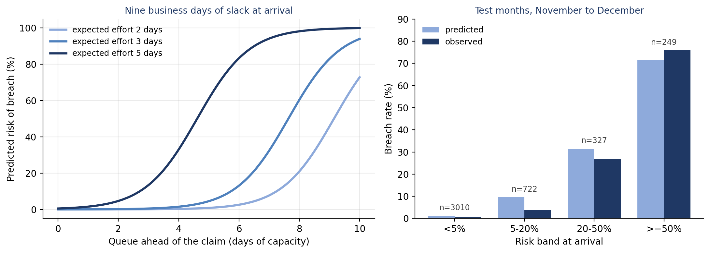
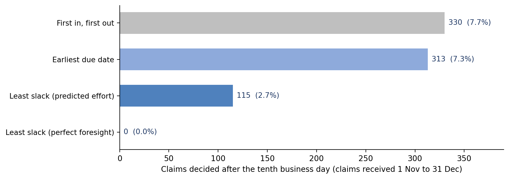
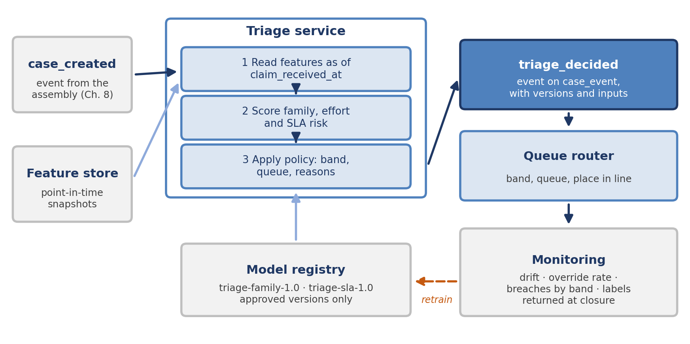

[⬅ Back to all chapters](../README.md) · [Code and data for this chapter](README.md)

# Chapter 9: ML for Classification and Triage



*This chapter pulls the Decide lever at the front door: where a claim is sent, and how soon, decides much of what happens to it.*

> **Worked example.** At 16:05 on a Thursday in December, a debit cardholder files a claim in the mobile application for a $249.00 purchase from an online electronics merchant, made nineteen days earlier. Nothing in the reason menu fits, so the cardholder chooses Other and types: “The order never arrived, the merchant will not respond, and I do not recognise the name on my statement.” The assembly of Chapter 8 links the claim to its clearing and authorization records but finds no merchant order. The new case joins a shared queue behind 487 others, five and a half days of the team’s capacity, and the ten-business-day clock is already running. *This chapter answers the question: what kind of claim is this, how urgently must it be worked, and how far should the platform trust its own answer?*

Chapter 8 assembled one record for each claim. This chapter reads that record at the moment the claim arrives and makes the first decisions about it: which family it belongs to, which team should own it and where it should stand in line. These are triage decisions, and at most institutions they are made today by a reason code chosen from a menu and by the order in which claims happened to arrive.

Both are weak guides. The reason menu is completed by a customer or an agent under time pressure, and in this chapter’s synthetic data one claim in five is coded Other. Arrival order ignores the fact that claims differ in how much work they need and how much time they have left, so a queue worked first in, first out misses deadlines that it could have met. Machine learning helps with both problems, provided it is framed as support for a routing decision and never as a verdict on the customer.

You will learn how to frame triage as a set of separate predictions and a policy that combines them, how to build labels and features that respect the moment of prediction, how to train a family classifier and judge it against the rules it replaces, how to estimate the risk that a claim will miss its deadline and turn that risk into a priority, and how to serve the result as a service that records every decision. By the end you will have built triage\_service.py, which classifies a claim, scores its deadline risk, assigns a priority band and routes it to a queue, with reasons for each.

In this chapter, we will cover the following topics:

- Framing classification and triage
- Labels and features
- Training and evaluating the classifier
- Priority and SLA risk
- Serving the triage service

## Technical requirements

Open chapter09/ in the companion repository. It contains make\_triage\_data.py, which generates claims\_closed.csv, a synthetic year of 24,000 closed card claims holding the fields known at intake and the outcomes recorded at closure; queue\_sim.py, which replays a dispute queue one business day at a time; features.py, train\_classifier.py, priority.py and sla\_risk.py, which build the models; and triage\_service.py with demo\_request.py, which serve them and call the service. Python 3.11, pandas 2.x, scikit-learn 1.4 or later, FastAPI and Uvicorn are sufficient, and no GPU or cloud account is needed. The ten-business-day clock comes from Chapter 2 and the case record from Chapter 8. By the end of this chapter you will have built the ninth chapter artifact of the book; all data are synthetic and every result is illustrative.

## Framing classification and triage

Triage is borrowed from emergency medicine, where it means sorting patients by need before treating any of them. A dispute operation does the same with claims. Before anyone investigates, the platform must answer three questions: what kind of claim this is, how urgently it must be worked and who should work it. The first two are predictions. The third is a decision that uses them.

Keeping the predictions apart from the decision is the most important design choice in this chapter. A model that predicts a family can be measured against the family recorded at closure. A model that predicts the risk of missing a deadline can be measured against the deadlines that were met or missed. A routing policy, by contrast, encodes the institution’s preferences: how much uncertainty it will accept before a person looks, which claims are always urgent and which queues exist. Folding those preferences into a single model makes both the predictions and the preferences impossible to audit.

Figure 9.1 shows the arrangement. The new claim and its case record supply the intake features. Three estimates are made from them: the family, the expected effort and the risk of missing the due date. The triage policy combines the estimates with explicit rules and sends the claim to one of four queues, each with a priority band and a place in line.



*Figure 9.1: Triage at the front door. Three estimates feed one policy, and the policy, not a model, routes the claim.*

Table 9.1 sets out the decisions that triage makes, who uses each output and what a wrong answer costs. The costs are not symmetric, and that asymmetry shapes every later choice in the chapter.

| Decision | Output | Used by | Cost of a wrong answer |
|---|---|---|---|
| Family | Unauthorized, defective or first-party, with probabilities | Routing, the evidence list, the treatment of the customer | A fraud victim treated as a suspect; a merchant dispute sent to the fraud team |
| Effort | Expected business days of work | Queue ordering, staffing forecasts | Long cases started too late to finish |
| SLA risk | Probability of a decision after the due date | Priority bands, alerts | A breach that could have been prevented |
| Route | Queue, band and reasons | Team leads, analysts | Rework, handoffs and lost days on the clock |

*Table 9.1: The decisions triage makes*

The family decides more than the queue. As Chapters 2 and 6 showed, an unauthorized claim carries obligations that a merchant dispute does not, and a first-party pattern calls for the safeguards of Chapter 6. A claim placed in the wrong family starts down the wrong path, and every day it spends there is a day taken from its clock.

Rules are the natural first answer, and every institution has them: the reason code chosen at intake maps to a family, and the family maps to a queue. The trouble is that the reason menu records what the customer says happened, while the family records what did happen, and the two often differ. No customer selects first-party misuse from a menu, so the rule can never produce that family, although it is the largest of the three. Chapter 6 built a points table to catch repeated first-party patterns, and it remains useful, but most first-party claims are a customer’s first and look like any other claim on the day they arrive.

> **Business impact.** Triage is where small errors become large ones. A claim sent to the wrong team waits in that team’s queue, is rerouted and waits again, and the waiting falls on the customer and on the regulatory clock. Every point of routing accuracy is a set of handoffs that never happen.
>
> **Under the hood.** Treat each output as a separate artifact with its own version, owner and metric. The family model, the effort table, the SLA-risk model and the routing policy change at different speeds and for different reasons, and the decision record must name the version of each that produced a route.

With the decisions framed, the next step is to decide what the models learn from and what they are allowed to look at.

## Labels and features

A supervised model learns from examples whose answers are known. For triage the examples are closed claims, and the answers are what each claim turned out to be. Both halves need care: the labels because people produce them under operational pressure, and the features because they must be limited to what was known when the claim arrived.

### Where labels come from

The family label is the classification an analyst records at decision, confirmed or corrected by quality review. Chapter 5 recommended storing reviews as structured records, and this is where that advice pays off. Table 9.2 lists the label for each triage target, where it comes from and how far it can be trusted.

| Target | Label | Source | Known weaknesses |
|---|---|---|---|
| Family | Family at closure | Analyst decision and QA review (Chapter 5) | Analysts disagree; a policy change shifts the definition |
| Effort | Business days from first touch to decision | Case event history (Chapters 3 and 8) | Includes time spent waiting for merchants and customers |
| SLA breach | Decision after the due date | Event history and the Chapter 2 clock | Depends on the queue at the time, not only on the claim |
| Route quality | Claim moved to another queue | Queue transfer events | Transfers are logged inconsistently at many institutions |

*Table 9.2: Label sources and their reliability*

Three problems recur. Labels are noisy: two analysts reading the same file will sometimes disagree, and the generator for this chapter reassigns the label of one claim in twenty at random to reflect that. Labels move: a change in policy, such as treating an unrecognized descriptor as first-party rather than unauthorized, changes the meaning of the label from a given date, and data from before the change teaches the old policy. And labels are selected: only closed claims have them, so a model trained during a backlog learns mostly from the quick cases that closed first. The defenses are to store the policy version with each label, to train on complete periods and to measure how often analysts agree, which sets a ceiling on any model’s accuracy.

### The prediction moment

A feature is admissible only if its value was known at the moment the prediction is made. For triage that moment is the receipt of the claim. Figure 9.2 places the events of a dispute on a timeline around it. Everything to the left of the line may be used. Everything to the right, including the merchant’s response, the analyst’s first touch and the family label itself, is the future, and a model that sees it in training will look excellent in testing and fail in production.



*Figure 9.2: The prediction moment. Features come only from the left of the line; labels come from the right.*

The rule is easy to state and easy to break. A column called provisional\_credit\_issued looks like a property of the claim, but it is set by the analyst after the family is known, so it carries the label. A delivery status refreshed every night contains scans that arrived after the claim did. The safest defense is structural: register every column with the moment it becomes known, and make the code refuse to build a feature set that contains a late column. Listing 9.1 does exactly that.

> **Case study: the feature that knew the answer.** Described in general terms, an issuer trained a family classifier on its case table and reached accuracy above 98 percent in validation. The most important feature turned out to be a queue identifier. The table held the queue each case occupied when it closed, not when it arrived, and cases were moved to the fraud queue once an analyst had confirmed fraud, so the model had learned to read the analyst’s decision back from the queue. In production, where every new claim sat in the intake queue, its accuracy fell to roughly that of the reason-code rule it was meant to replace. The team rebuilt the training set from point-in-time snapshots, accepted a lower validation score and kept that model in production.

### The feature catalogue

Table 9.3 lists the intake features used in this chapter, grouped by where they come from. Every one is available on receipt, either from the claim itself or from the case record that Chapter 8 assembles as the claim arrives.

| Group | Features | Source | What they help separate |
|---|---|---|---|
| Claim | channel, amount, intake\_reason, narrative | Intake | Fraud language from merchant complaints |
| Transaction | card\_present, three\_ds, device\_known, recurring, mcc\_group, days\_since\_txn | Authorization and clearing (Chapter 8) | Authenticated, familiar purchases from compromised ones |
| Customer | tenure\_months, prior\_disputes\_12m, security\_alert\_7d | Customer history (Chapter 6) | Patterns from first claims; account takeover |
| Linkage | delivery\_status, link\_completeness, needs\_review | Case record (Chapter 8) | Goods delivered from goods missing; uncertain records |

*Table 9.3: Intake features, all known when the claim is received*

The narrative deserves a special mention. It is the only place where the customer describes the problem in their own words, and it holds more information than the menu choice. It also holds personal data, so names, card numbers and addresses must be redacted before it is stored as a feature, and it must be protected by the same access controls as the rest of the case. We turn it into features with TF-IDF weights over words and pairs of words, which is simple, fast and explainable. Chapter 12 returns to the narrative with language models.

Listing 9.1 shows the feature module that both training and serving import.

```python
import numpy as np
from sklearn.compose import ColumnTransformer
from sklearn.feature_extraction.text import TfidfVectorizer
from sklearn.pipeline import make_pipeline
from sklearn.preprocessing import (FunctionTransformer, OneHotEncoder,
                                   StandardScaler)

# Every column, and the moment it becomes known
AVAILABLE_AT = {
    "channel": "intake", "product": "intake", "amount": "intake",
    "intake_reason": "intake", "narrative": "intake", "mcc_group": "intake",
    "card_present": "intake", "three_ds": "intake", "device_known": "intake",
    "recurring": "intake", "security_alert_7d": "intake",
    "days_since_txn": "intake", "tenure_months": "intake",
    "prior_disputes_12m": "intake", "delivery_status": "intake",
    "link_completeness": "intake", "needs_review": "intake",
    "first_touch_on": "investigation", "work_days": "decision",
    "decided_on": "decision", "family": "decision", "breached": "decision",
}
CATEGORICAL = ["channel", "product", "intake_reason", "mcc_group",
               "delivery_status"]
FLAGS = ["card_present", "three_ds", "device_known", "recurring",
         "security_alert_7d", "needs_review"]
NUMERIC = ["amount", "days_since_txn", "tenure_months", "prior_disputes_12m",
           "link_completeness"]
TEXT = "narrative"
STOP = ["a", "an", "and", "the", "my", "i", "it", "on", "of", "to", "was",
        "this", "is", "but"]                # "not" is kept on purpose

def intake_view(df, columns=CATEGORICAL + FLAGS + NUMERIC + [TEXT]):
    late = [c for c in columns if AVAILABLE_AT.get(c) != "intake"]
    if late:
        raise ValueError(f"not known at intake: {late}")
    return df[columns]

def preprocessor():
    return ColumnTransformer([
        ("cat", OneHotEncoder(handle_unknown="ignore"), CATEGORICAL),
        ("flag", OneHotEncoder(drop="if_binary"), FLAGS),
        ("num", make_pipeline(
            FunctionTransformer(np.log1p, feature_names_out="one-to-one"),
            StandardScaler()), NUMERIC),
        ("text", TfidfVectorizer(ngram_range=(1, 2), min_df=5,
                                 stop_words=STOP, sublinear_tf=True), TEXT),
    ])
```

*Listing 9.1: chapter09/features.py*

The dictionary AVAILABLE\_AT records when each column becomes known, and intake\_view refuses any column that is not known at intake, so a late feature fails loudly when the model is trained instead of silently once it is live. The function preprocessor turns the four groups into one matrix: categories become indicator columns, flags become single indicators, amounts and counts are log-transformed and standardized because they are heavily skewed, and the narrative becomes TF-IDF weights. The short stop list removes filler words but deliberately keeps not, because “did not make” and “will not respond” mean something quite different from their positive forms.

> **Business impact.** Point-in-time discipline is what turns a validation score into a forecast. A model whose features leak will be approved on the strength of a number it can never reproduce, and the cost is discovered only after the old process has been switched off.
>
> **Under the hood.** Keep feature definitions in one module that training and serving share. When training reads a column from a warehouse table and serving computes the same column from a live record, the two drift apart and the model meets data in production that it never saw in training. A feature store with point-in-time joins solves this at scale; at the scale of this chapter, a shared module does.

With labels and features defined, we can train the classifier and find out whether it is better than the rules.

## Training and evaluating the classifier

### Splitting by time

Claims arrive in time order and the model will be used on future claims, so it must be judged on claims that arrived after the ones it learned from. A random split mixes December claims into training and lets the model learn seasonal patterns it could not have known in advance. We train on January to August (15,731 claims), keep September and October (3,961) for choosing settings and test on November and December (4,308), which include the holiday surge. The test months are used once, at the end. Across the year the families divide much as they did in Table 1.2: 38 percent first-party, 34 percent unauthorized and 28 percent defective.

### Baselines first

A model is worth deploying only if it beats what is already there, so we build two baselines. The reason-code rule maps the intake menu to a family: fraud and not recognized go to unauthorized, and everything else to defective. The second baseline adds a simplified form of the first-party points of Chapter 6: a claim from a customer with two or more disputes in the past year, on goods confirmed as delivered, is called first-party.

We then train two models on the same features. Logistic regression is the production candidate, because its coefficients can be read and each prediction can be broken down into the contributions of its inputs. Gradient-boosted trees are the challenger, because they capture interactions between features without being told about them. Listing 9.2 shows the core of the training script.

```python
FAMILIES = ["unauthorized", "defective", "first_party"]
COST = np.array([[0, 60, 150],      # true unauthorized predicted as each family
                 [35, 0, 80],       # true defective
                 [45, 25, 0]])      # true first-party (illustrative dollars)
REASON_RULE = {"fraud": "unauthorized", "not_recognized": "unauthorized"}

df = pd.read_csv("claims_closed.csv", parse_dates=["claim_received_at"])
when = df.claim_received_at
train = df[when < "2025-09-01"]
valid = df[(when >= "2025-09-01") & (when < "2025-11-01")]
test = df[when >= "2025-11-01"]

def reason_rule(d):
    return d.intake_reason.map(REASON_RULE).fillna("defective")

def rule_plus_points(d):
    pred = reason_rule(d).copy()
    pattern = (d.prior_disputes_12m >= 2) & (d.delivery_status == "confirmed")
    pred[pattern & (d.intake_reason != "fraud")] = "first_party"
    return pred

def report(name, y, pred):
    cm = confusion_matrix(y, pred, labels=FAMILIES)
    recall = recall_score(y, pred, labels=FAMILIES, average=None)
    return {"model": name, "accuracy": accuracy_score(y, pred),
            "macro_f1": f1_score(y, pred, average="macro"),
            "recall": dict(zip(FAMILIES, recall)),
            "cost_per_1000": (cm * COST).sum() / len(y) * 1000,
            "confusion": cm.tolist()}

logit = make_pipeline(preprocessor(), LogisticRegression(C=2.0, max_iter=3000))
logit.fit(intake_view(train), train.family)

boost = make_pipeline(preprocessor(), HistGradientBoostingClassifier(
    max_iter=300, learning_rate=0.06, random_state=9))
boost.set_params(columntransformer__sparse_threshold=0,
                 columntransformer__text__max_features=300)
boost.fit(intake_view(train), train.family)

X_test, y_test = intake_view(test), test.family
results = [report("Reason-code rule", y_test, reason_rule(test)),
           report("Rule + first-party points", y_test, rule_plus_points(test)),
           report("Logistic regression", y_test, logit.predict(X_test)),
           report("Gradient-boosted trees", y_test, boost.predict(X_test))]
```

*Listing 9.2: chapter09/train\_classifier.py (core)*

COST holds an illustrative dollar cost for each kind of error, discussed below. The split uses the receipt timestamp, never a random draw. The function report computes accuracy; macro F1, which averages the F1 scores of the three families so that the smallest family counts as much as the largest; the recall of each family; and the expected cost of errors per thousand claims. The two pipelines share the preprocessor of Listing 9.1. The boosted model needs a dense matrix, so its text vocabulary is capped at 300 terms.

### Reading the results

Table 9.4 compares the four approaches on the test months.

| Approach | Accuracy | Macro F1 | Recall, unauth. | Recall, defective | Recall, first-party | Cost per 1,000 claims |
|---|---|---|---|---|---|---|
| Reason-code rule | 50.8% | 0.42 | 75.5% | 87.4% | 0.0% | $18,777 |
| Rule + first-party points | 53.0% | 0.47 | 75.3% | 86.3% | 7.2% | $18,377 |
| Logistic regression | 89.7% | 0.90 | 94.0% | 83.5% | 90.3% | $7,071 |
| Gradient-boosted trees | 89.6% | 0.89 | 93.8% | 83.2% | 90.6% | $7,293 |

*Table 9.4: Four classifiers on the test months (4,308 claims, synthetic data)*

The rule fails where one would expect. It cannot recognize first-party misuse at all, so the 1,602 first-party claims in the test months, the largest family, are scattered between the other two. The points table recovers only 7 percent of them, because it was designed to catch repeated behavior and most first-party claims in any month come from customers with no history. Both learned models do far better, and they are almost indistinguishable. When a simple model matches a complex one, the simple one wins: it is cheaper to run, easier to explain and easier to defend before an examiner.

Figure 9.3 shows where the remaining errors fall.



*Figure 9.3: Where the errors fall. The rule never predicts first-party misuse; the model’s largest confusion is between defective and first-party claims.*

The model’s largest confusion is between defective and first-party claims: 158 defective claims were predicted first-party and 92 first-party claims were predicted defective. After fraud, this is the boundary that matters most, because it separates a customer let down by a merchant from one who was not. It is also genuinely hard, since a customer who did not receive goods and one who says so falsely use the same words. Sixty-five unauthorized claims, 4.3 percent of that family, were predicted first-party, and these are the errors that the routing policy must guard against hardest.

### Accuracy is not the target

Accuracy counts every error equally, and triage errors are not equal. Table 9.5 assigns an illustrative cost to each kind. The figures combine wasted handling, delayed recovery and the risk of harm to a customer; your own should come from the business case of Chapter 7.

| Family at closure | Predicted unauthorized | Predicted defective | Predicted first-party |
|---|---|---|---|
| Unauthorized | – | $60 | $150 |
| Defective | $35 | – | $80 |
| First-party | $45 | $25 | – |

*Table 9.5: Illustrative cost of a misroute, per claim*

The heaviest cost sits where a fraud victim is treated as a suspect, which Chapter 6 called the costliest error in first-party work. Weighted this way, the logistic regression costs $7,071 per thousand claims against $18,777 for the reason-code rule, a reduction of about 62 percent. At the 720,000 claims a year of the representative issuer in Table 1.2, and with the caution that these are synthetic results priced with illustrative costs, the difference is of the order of $8 million a year in avoidable rework and harm.

### What the model relies on

Table 9.6 shows what each group of features contributes, measured by removing the group and training again.

| Features used | Accuracy | Macro F1 |
|---|---|---|
| All features | 89.7% | 0.895 |
| Without the narrative | 77.5% | 0.768 |
| Narrative only | 85.5% | 0.854 |
| Without intake\_reason | 89.6% | 0.894 |
| Without customer history | 88.8% | 0.886 |
| Without linkage (Chapter 8) | 89.1% | 0.889 |

*Table 9.6: What each feature group adds (logistic regression, test months)*

Two findings stand out. The narrative is by far the most informative input, and it is free: the customer has already written it. And the intake reason adds almost nothing once the narrative is present, which shows that the menu is a lossy summary of what the customer wrote. That is no reason to remove the menu, which helps customers and agents describe the problem, but it is a reason not to route on the menu alone. Real narratives are messier than the synthetic ones, which draw on a limited vocabulary, so the margins will be smaller; the order of the groups is the more durable lesson.

### Knowing when not to decide

A classifier returns a probability for each family, and the highest is its prediction. When even the highest probability is low, the model is saying that the claim is ambiguous, and the right response is to send it to a person rather than to guess. Listing 9.3 measures what that costs.

```python
# abstention: route the least confident claims to a person
proba = logit.predict_proba(X_test)
conf, pred = proba.max(axis=1), logit.classes_[proba.argmax(axis=1)]
right = pred == y_test.to_numpy()
curve = []
for tau in np.round(np.arange(0.34, 0.96, 0.01), 2):
    auto = conf >= tau                         # confident enough to route
    curve.append({"tau": float(tau), "coverage": float(auto.mean()),
                  "accuracy": float(right[auto].mean())})
```

*Listing 9.3: chapter09/train\_classifier.py (abstention)*

For each threshold τ, the loop keeps the claims whose top probability reaches it and records the share of claims kept, called coverage, and the accuracy among them. Table 9.7 and Figure 9.4 show the trade.

| Threshold τ | Routed automatically | Accuracy of automatic routes | Sent to triage review |
|---|---|---|---|
| 0.5 | 97.5% | 90.8% | 2.5% |
| 0.6 | 91.6% | 92.8% | 8.4% |
| 0.7 | 85.0% | 94.3% | 15.0% |
| 0.8 | 77.9% | 95.4% | 22.1% |
| 0.9 | 66.9% | 96.1% | 33.1% |

*Table 9.7: Coverage against accuracy as the confidence threshold rises (test months)*



*Figure 9.4: Coverage against accuracy. Each step up in the threshold buys accuracy with claims sent to people.*

We set the threshold at 0.70. Eighty-five percent of claims are routed automatically with 94.3 percent accuracy, and the most ambiguous fifteen percent go to a small triage review team. Beyond 0.8 the curve flattens: accuracy barely rises while the review queue grows quickly, because the errors that remain are largely label noise that no threshold can remove. The threshold is a policy setting, owned by operations and reviewed every quarter, not a model parameter.

Two cautions apply. First, a threshold assumes that the probabilities mean what they say: a model that reports 0.9 should be right about nine times in ten. Checking and correcting this is calibration, and Chapter 10 treats it in full, because outcome prediction depends on it even more than triage does. Second, accuracy can differ between groups of customers even when the overall figure is good. Before deployment, compare recall by channel, by product and by every segment that your fair-treatment policy names; Chapter 15 sets out how.

> **Business impact.** A model that routes 85 percent of claims correctly and admits uncertainty about the rest is worth more than one that routes every claim with 90 percent accuracy. The review team handles the claims that would have been rerouted anyway, and does so before the clock has run for days.
>
> **Under the hood.** Store the full probability vector with each decision, not only the winning family. The probabilities let you change the threshold later and replay its effect on past claims, let monitoring see confidence fall before accuracy does, and give Chapter 10 the inputs it needs.

The classifier tells us what a claim is. The next question is how soon it must be worked.

## Priority and SLA risk

Chapter 5 showed that first in, first out serves the claim that has waited longest, which is not always the claim closest to breaching, and recommended ordering the queue by time remaining and expected work. Both parts need an estimate. Time remaining comes from the clock of Chapter 2. Expected work depends on what kind of claim it is, which the classifier has just predicted.

### Expected effort

Effort is the number of business days from first touch to decision. It depends on the family and on the evidence already in hand. Table 9.8 shows the averages from the training months. A defective claim with no linked delivery record needs the merchant to be contacted and takes three times as long as one whose record is already in hand, and a claim flagged for review by the assembly of Chapter 8 takes about two days longer in every family.

| Family | Delivery record in hand | In hand, flagged for review | Record missing or unlinked | Missing, flagged for review |
|---|---|---|---|---|
| Defective | 1.5 | 3.5 | 4.5 | 6.5 |
| First-party | 2.5 | 4.5 | 2.5 | 4.4 |
| Unauthorized | 2.5 | 4.5 | 2.5 | 4.5 |

*Table 9.8: Average effort in business days (training months, synthetic data)*

At intake the family is not known, only its probabilities, so the expected effort is the average of the table’s entries weighted by those probabilities. A claim that the classifier is unsure about receives an effort estimate that reflects the uncertainty.

### The risk of breaching

The SLA-risk model predicts the probability that a claim will be decided after its due date. It uses three inputs, each known at intake: the slack, which is the number of business days between the claim’s arrival in the queue and its due date; the queue ahead of it, measured in days of the team’s capacity; and the expected effort. A logistic regression on these three inputs is enough, and its coefficients have the signs one would expect: each day of slack lowers the risk, and each day of queue or of effort raises it, with effort weighted most heavily.

Figure 9.5 shows how the model behaves and how far it can be trusted. The left panel holds the slack at nine business days and varies the queue for three levels of effort: a five-day claim reaches even odds of breaching behind about four and a half days of queue, while a two-day claim tolerates more than nine. The right panel groups the test claims by predicted risk and compares predicted with observed breach rates.



*Figure 9.5: SLA risk. Left, predicted risk against the queue for three levels of effort. Right, predicted and observed breach rates by risk band (test months).*

On the test months the model ranks claims well, with an area under the ROC curve of 0.93, and the ten percent of claims it ranks riskiest contain 76 percent of the breaches. Its probabilities are close to the observed rates in the highest band and overstate the risk in the 5 to 20 percent band, where 722 claims had an average predicted rate of 9.6 percent against an observed 3.9 percent. For setting priority bands that error is tolerable. For reporting expected breaches to a regulator or a board it is not, and the model would first need recalibrating, as Chapter 10 describes.

### From risk to priority

A priority band is the policy’s translation of the estimates into an instruction. Table 9.9 sets out three bands. Each combines a threshold on SLA risk with rules that do not depend on any model: an unauthorized claim with a recent security alert is urgent because the account may still be compromised, and a large unauthorized claim is placed above standard work whatever its deadline. Your institution will add rules of its own, for example for customers identified as vulnerable, and those rules belong in the policy, never in the model.

| Band | Rule | Claims | Breaches under first in, first out | Target first touch |
|---|---|---|---|---|
| P1 | SLA risk of 50% or more, or predicted unauthorized with a security alert in the last 7 days | 484 (11.2%) | 197 | Same business day |
| P2 | SLA risk of 20% to 50%, or predicted unauthorized and $1,000 or more | 357 (8.3%) | 84 | Within two business days |
| P3 | All other claims | 3,467 (80.5%) | 49 | In order of least slack |

*Table 9.9: Priority bands on the test months*

The bands concentrate the problem. One claim in five is placed in P1 or P2, and those claims account for 281 of the 330 breaches that occurred in the test months under first in, first out.

### Ordering the queue

Within a team’s queue, claims are worked in order of least slack: the business days remaining before the due date, less the expected effort. A claim with ten days left and five days of work has five days of slack; a claim with six days left and one day of work also has five, and the two are equally urgent. Listing 9.4 shows the module that computes the inputs and applies the policy.

```python
import numpy as np
import pandas as pd
from queue_sim import CLOCK_DAYS, DAILY_STARTS, as_day

FAMILIES = ["unauthorized", "defective", "first_party"]
SLA_FEATURES = ["slack_days", "queue_days", "expected_work"]
QUEUE = {"unauthorized": "fraud_claims", "defective": "merchant_disputes",
         "first_party": "first_party_review"}
MIN_CONFIDENCE = 0.70          # below this the claim goes to triage_review

def expected_work(d, p, effort):
    """Business days of effort, averaged over the family probabilities."""
    contact = d.delivery_status.isin(["not_found", "no_link"])
    keys = list(zip(contact, d.needs_review.astype(bool)))
    return sum(p[f].to_numpy() * effort[f].reindex(keys).to_numpy()
               for f in FAMILIES)

def sla_frame(d, p, effort):
    created = d.case_created_at
    late = (created.dt.hour >= 17).astype(int)      # after 17:00: next day
    avail = np.busday_offset(as_day(created), late, roll="forward")
    due = np.busday_offset(as_day(d.claim_received_at), CLOCK_DAYS,
                           roll="backward")
    return pd.DataFrame({"slack_days": np.busday_count(avail, due),
                         "queue_days": d.queue_depth / DAILY_STARTS,
                         "expected_work": expected_work(d, p, effort)},
                        index=d.index)

def band(risk, family, amount, security_alert):
    if risk >= 0.5 or (family == "unauthorized" and security_alert):
        return "P1"
    if risk >= 0.2 or (family == "unauthorized" and amount >= 1000):
        return "P2"
    return "P3"

def route(family, confidence):
    return QUEUE[family] if confidence >= MIN_CONFIDENCE else "triage_review"
```

*Listing 9.4: chapter09/priority.py*

The function expected\_work looks up the effort table for each family, using whether the delivery record is missing and whether the case is flagged for review, and weights the entries by the family probabilities. The function sla\_frame computes the three model inputs with the same business-day arithmetic as Chapter 5, so that the due date the model sees is the due date the dashboard reports. The functions band and route are the policy. They are plain functions, short enough to read aloud in a review meeting, and every threshold in them is a named value that can be changed without retraining anything.

To find out what the ordering is worth, sla\_risk.py replays the year’s queue with queue\_sim.py. Each business day the team starts as many claims as its capacity allows, which varies with leave, summer holidays and overtime, and each claim then takes its actual effort to decide. Until 31 October the queue is worked first in, first out, as it historically was. From 1 November, with the backlog as it then stood, it is worked under each of four policies. Table 9.10 and Figure 9.6 show the results for claims received in November and December.

| Policy | Breaches | Breach rate | Unauthorized claims breached | 95th percentile wait (days) |
|---|---|---|---|---|
| First in, first out | 330 | 7.7% | 75 | 10 |
| Earliest due date | 313 | 7.3% | 66 | 10 |
| Least slack (predicted effort) | 115 | 2.7% | 25 | 11 |
| Least slack (perfect foresight) | 0 | 0.0% | 0 | 11 |

*Table 9.10: Replaying November and December under four ordering policies (4,308 claims)*



*Figure 9.6: Breaches under four ordering policies. Predicted effort removes about two thirds of the breaches that first in, first out produces.*

Ordering by due date alone barely helps. Every claim in this queue carries the same ten-business-day clock, so the due-date order is almost the arrival order, and the claims that breach are not the ones that arrived earliest but the ones that need the most work. Ordering by least slack with the predicted effort removes 215 of the 330 breaches, about 65 percent, with the same staff and the same arrivals. The perfect-foresight row marks the ceiling: had effort been known exactly, every deadline in the period could have been met. The gap between 115 and zero is the value of better effort prediction, and a sound target for later work.

The improvement is not free. The 95th-percentile wait rises by a day, because short claims with plenty of slack now wait while long claims are started first. Under a regulatory clock that is the right trade, but it should be made openly: the customer with a simple claim waits a little longer so that the customer with a complex claim is answered on time.

> **Business impact.** Breaches are the most expensive outcome a dispute queue produces, because each one is a potential regulatory finding and a customer who waited too long. Removing two thirds of them without new staff turns the models of this book from an efficiency gain into a compliance control.
>
> **Under the hood.** A replay is the cheapest honest test of a priority policy. It needs only the event history of Chapter 8, a capacity profile and the policy itself, and it runs in seconds. Run it over several historical periods, including a surge, before switching policies, and keep it beside the policy so that any proposed change can be tested in the same way.

The models and the policy now exist. The last step is to put them in front of real claims.

## Serving the triage service

A triage model is useful only if it acts at the moment a claim arrives, so it must run as a service. Figure 9.7 shows where the service sits. The assembly of Chapter 8 emits a case\_created event. The triage service reads the claim’s features as of the moment of receipt, scores the family, the effort and the SLA risk, applies the policy and writes a triage\_decided event to the case history. The queue router acts on that event, and monitoring reads every event.



*Figure 9.7: Serving triage. The service writes a decision event; the router acts on it and monitoring closes the loop.*

Listing 9.5 shows the service.

```python
from datetime import datetime
import joblib
import numpy as np
import pandas as pd
from fastapi import FastAPI
from pydantic import BaseModel
from features import intake_view
from priority import band, route, sla_frame

FAMILY = joblib.load("triage_model.joblib")
SLA = joblib.load("sla_model.joblib")
app = FastAPI(title="triage")

class Claim(BaseModel):
    claim_id: str
    claim_received_at: datetime
    case_created_at: datetime
    channel: str
    product: str
    amount: float
    intake_reason: str
    narrative: str
    mcc_group: str
    card_present: bool
    three_ds: bool
    device_known: bool
    recurring: bool
    security_alert_7d: bool
    days_since_txn: int
    tenure_months: int
    prior_disputes_12m: int
    delivery_status: str
    link_completeness: int
    needs_review: bool
    queue_depth: int

def reasons(model, row, family, k=3):
    """The k input columns that pushed hardest towards the chosen family."""
    pre, clf = model.steps[0][1], model.steps[-1][1]
    weights = clf.coef_[list(clf.classes_).index(family)]
    contrib = pre.transform(row).toarray()[0] * weights
    total = {}
    for name, c in zip(pre.get_feature_names_out(), contrib):
        group, value = name.split("__")
        column = "narrative" if group == "text" else next(
            col for col in row.columns if value.startswith(col))
        total[column] = total.get(column, 0.0) + c
    top = sorted(total, key=total.get, reverse=True)[:k]
    return {col: round(total[col], 2) for col in top if total[col] > 0}

@app.post("/triage")
def triage(claim: Claim):
    row = pd.DataFrame([claim.model_dump()])
    model = FAMILY["family"]
    p = pd.DataFrame(model.predict_proba(intake_view(row)), columns=model.classes_)
    family, confidence = p.iloc[0].idxmax(), float(p.iloc[0].max())
    risk = float(SLA["sla"].predict_proba(sla_frame(row, p, SLA["effort"]))[0, 1])
    return {"claim_id": claim.claim_id,
            "family": family, "confidence": round(confidence, 2),
            "probabilities": p.iloc[0].round(2).to_dict(),
            "reasons": reasons(model, intake_view(row), family),
            "sla_risk": round(risk, 2),
            "priority": band(risk, family, claim.amount, claim.security_alert_7d),
            "queue": route(family, confidence),
            "model_versions": [FAMILY["version"], SLA["version"]]}
```

*Listing 9.5: chapter09/triage\_service.py*

The two model bundles are loaded once, when the service starts, each with its version. The Claim class defines the request: every field is one of the intake features of Table 9.3, together with the queue depth that the router reports, and a request that omits a field or sends the wrong type is rejected before any model runs. The function reasons multiplies the claim’s features by the coefficients of the chosen family, adds the contributions up by input column and returns the three columns that pushed hardest towards that family. The endpoint scores the family, computes the SLA inputs and risk with the functions of Listing 9.4, and returns the family with its probabilities and reasons, the risk, the band, the queue and the model versions.

Run the service with uvicorn triage\_service:app, or call it from a test as demo\_request.py does. Table 9.11 shows the response for the claim in the worked example.

| Field | Value | What it means |
|---|---|---|
| family | defective, confidence 0.89 | First-party 0.10, unauthorized 0.01 |
| reasons | narrative +1.57; prior\_disputes\_12m +0.13; mcc\_group +0.05 | The customer’s own words dominate |
| sla\_risk | 0.22 | Ten business days of slack, 5.5 days of queue, 4.3 days of expected effort |
| priority | P2 | Risk between 20 and 50 percent |
| queue | merchant\_disputes | Confidence is above the 0.70 threshold |
| model\_versions | triage-family-1.0, triage-sla-1.0 | Recorded with the decision |

*Table 9.11: The triage decision for the worked example*

### Rules for running it

Five rules keep the service safe:

- **The service routes; it never decides.** Its output selects a queue and a place in line. It does not deny a claim, delay provisional credit or change the clock, which is set by the rail and the product, as Chapter 2 established.
- **Every decision is an event.** The triage\_decided event records the inputs, the probabilities, the reasons, the policy outcome and the version of every model and rule, so that any route can be explained and replayed. Chapter 15 builds the audit trail on these events.
- **Failure is safe and visible.** If the service is unavailable, the router falls back to the reason-code rule and marks the claim for re-triage instead of leaving it unrouted, because the clock does not wait for a model.
- **People can override.** An analyst who moves a claim to another queue records why, and the override rate by queue and by reason is a first-class metric.
- **New versions earn their place.** A new model runs in shadow, scoring every claim without acting, until its decisions have been compared with the live model’s over several weeks of traffic. It then serves a small share of claims before it serves them all.

### Monitoring

Three kinds of signal show that the service is degrading, and each arrives at a different speed. Input drift is visible at once: if the share of claims arriving by telephone doubles, or a new merchant category appears, the features have moved away from the training data, and a population stability index on each feature will show it. Confidence drift is visible within days: if the share of claims sent to triage review rises from 15 to 25 percent, the model is meeting claims it does not recognize. Outcome drift is visible only at closure, when the labels arrive: accuracy by family, breach rates by band and the override rate. A retraining schedule driven only by outcome drift will always be weeks late, so alert on all three.

> **Business impact.** The service turns a model into an operating control. Team leads see each claim’s band and reasons, compliance sees every route with its versions, and operations can change a threshold or a band rule in an afternoon instead of a release cycle.
>
> **Under the hood.** Keep the service stateless, and keep the policy in code under version control, separate from the model files. Scale the service horizontally behind the event stream. Scoring a logistic regression takes well under a millisecond, so the cost of each decision is dominated by the feature lookup, not by the model. Chapter 14 describes the platform the service runs on.
>
> **Worked example revisited.** The $249 claim now has a family, a priority and reasons for both. The classifier places it in the defective family with probability 0.89. Its phrases pull in two directions, “the merchant will not respond” towards a merchant dispute and “never arrived” and “I do not recognise the name on my statement” towards first-party misuse, while an authenticated purchase on a known device by a customer with no earlier disputes keeps it well clear of the unauthorized family. With ten business days of slack, five and a half days of queue ahead and about four days of expected work, because the merchant must be contacted, its risk of breaching is 0.22, which places it in P2. Under first in, first out it would have started behind 487 other claims with a quarter of a day to spare; in P2 it is due to be started within two business days, and the merchant team receives it with the reasons attached. The model has not decided whether the cardholder is owed $249. Chapter 10 builds the model that estimates how that question is likely to be answered.
>
> **Key principle.** *Triage routes the claim; it never decides it.*

## Summary

In this chapter we framed triage as three predictions, family, effort and SLA risk, combined by a routing policy that stays separate from the models. We built labels from closed claims and features limited to what is known when a claim arrives, and enforced that limit in code. We trained a logistic regression that classified 89.7 percent of test claims correctly, against 50.8 percent for the reason-code rule, matched a gradient-boosted challenger and cut the illustrative cost of misrouting by about 62 percent; with a confidence threshold of 0.70 it routes 85 percent of claims automatically and sends the rest to people. We estimated expected effort and the risk of missing the ten-business-day clock, turned them into priority bands and showed in a replay that ordering by least slack removed about two thirds of the breaches that first in, first out produced. Finally, we served the models as triage\_service.py, which records every decision as an event with its reasons and versions.

Chapter 10 moves from where a claim goes to how it is likely to end. It predicts the probability of winning a contested claim, calibrates that probability and turns it into a decision to contest or accept.

## Questions

- Using Table 9.7, how many of the 4,308 test claims go to triage review at a threshold of 0.70, and about how many of the automatically routed claims would you expect to be routed wrongly?
- In Figure 9.3 the model predicts 65 unauthorized claims as first-party. Using Table 9.5, what do these errors cost per thousand test claims, and what change to the routing policy, not the model, would reduce the harm they cause?
- A colleague proposes adding first\_touch\_on to the features because it raises validation accuracy. Using Figure 9.2, explain why the proposal must be refused and how intake\_view enforces the refusal.
- In Table 9.10, ordering by earliest due date removed 17 of 330 breaches while least slack removed 215. Explain the difference, and describe a queue in which earliest due date would perform much better than it does here.
- Over three weeks the share of claims sent to triage review rises from 15 to 24 percent while accuracy on closed claims is unchanged. Give three possible causes and the check you would run for each.

## Further reading

- Christopher M. Bishop, Pattern Recognition and Machine Learning (Springer, 2006), chapter 4, “Linear Models for Classification”
- Shachar Kaufman, Saharon Rosset, Claudia Perlich and Ori Stitelman, “Leakage in Data Mining: Formulation, Detection, and Avoidance,” ACM Transactions on Knowledge Discovery from Data 6, no. 4 (2012)
- C. K. Chow, “On Optimum Recognition Error and Reject Tradeoff,” IEEE Transactions on Information Theory 16, no. 1 (1970)
- Michael L. Pinedo, Scheduling: Theory, Algorithms, and Systems (Springer, current edition)
- D. Sculley and others, “Hidden Technical Debt in Machine Learning Systems,” Advances in Neural Information Processing Systems 28 (2015)
- scikit-learn user guide, “Column Transformer with Mixed Types” and “Text feature extraction”
- FastAPI documentation, “Request Body” and “Testing”
