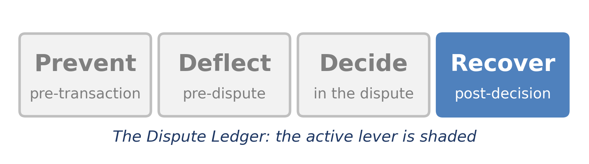
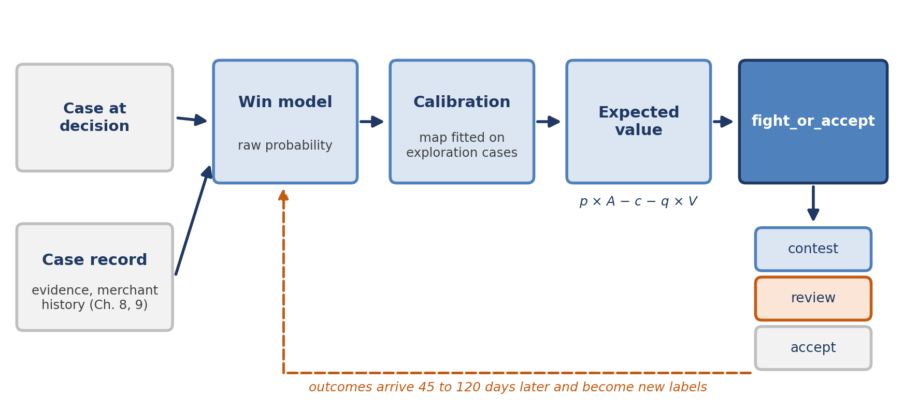
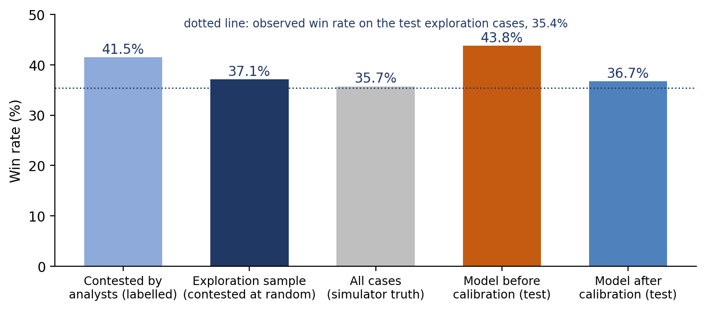
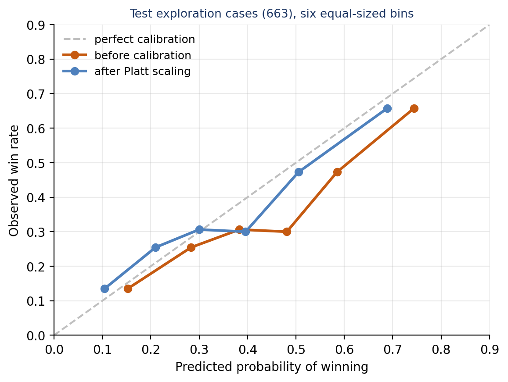
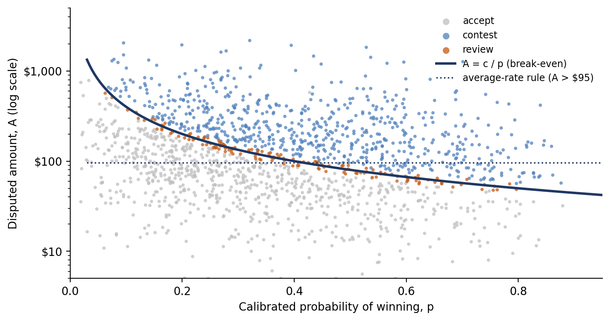
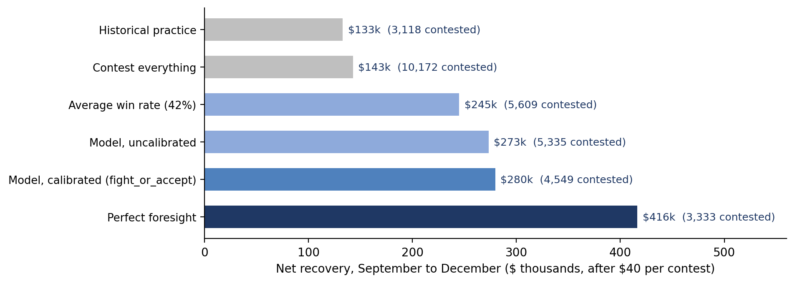
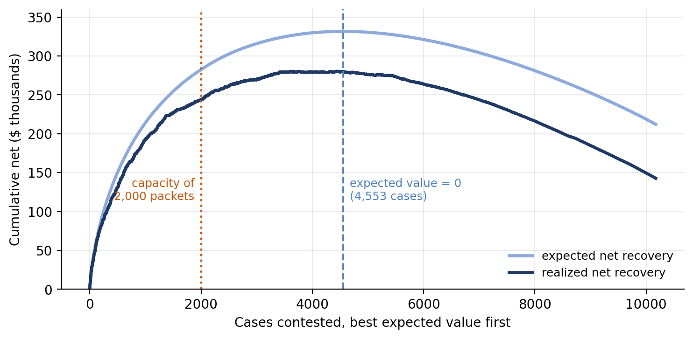
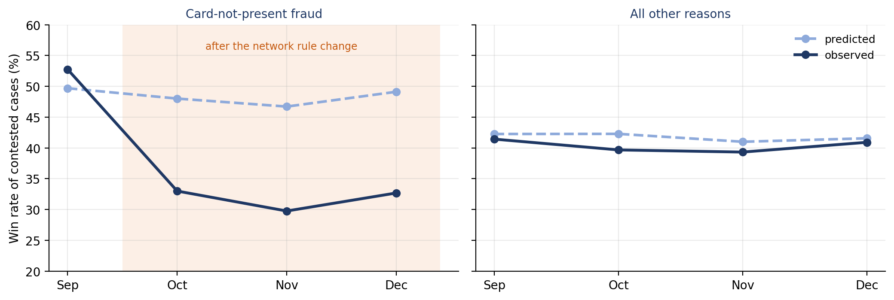

[⬅ Back to all chapters](../README.md) · [Code and data for this chapter](README.md)

# Chapter 10: Outcome Prediction and Recovery Optimization



*This chapter pulls the Recover lever: it decides which claims are worth contesting, and how much each one is worth.*

> **Worked example.** The $249 claim that Chapter 9 routed to the merchant disputes team has now been worked. The cardholder received provisional credit within the regulatory window, as Chapter 2 requires. The merchant, which had ignored the cardholder, answered the issuer’s inquiry within a day with a carrier tracking number that shows delivery to the billing address, without a signature. The merchant’s history shows that it answers about six chargebacks in ten and wins about half of the cases it answers. The issuer must now decide whether to pursue the $249 through the network process or to absorb the loss. The average win rate of 42 percent in Table 1.2 says contest, since 0.42 × $249 is $104.58 against a cost of about $40. *This chapter answers the question: what is the probability of winning this particular case, how far can that number be trusted, and what should the institution do with it?*

Chapters 8 and 9 built the record and sent each claim to the right team at the right time. This chapter turns to the end of the lifecycle, where money that has already moved is either recovered or written off. Chapter 3 showed that contesting pays when the probability of winning clears a break-even point, and Chapter 6 extended the same arithmetic to include the value of the customer relationship. Both used a single average probability. Here we replace the average with an estimate for each case.

An estimate is useful only if it is honest. A model that says 60 percent should be right about six times in ten, or every expected-value calculation built on it will be wrong in the same direction. Dispute outcomes make honesty harder than usual, because the institution only learns the outcome of the cases it chose to contest, and it chose them for reasons that are rarely written down.

You will learn how to define and predict a win, why the labels available for training are biased and how to correct for it, how to calibrate a probability and turn it into an expected value, how to build contest-or-accept rules that respect capacity and regulation, and how to test and monitor the model once it is live. By the end you will have built fight\_or\_accept.py, which returns a decision, the expected value behind it and the reason for every case.

In this chapter, we will cover the following topics:

- Predicting the probability of winning
- Calibration and expected value
- Contest-or-accept decision rules
- Testing and monitoring the model
- Building fight\_or\_accept

## Technical requirements

Open chapter10/ in the companion repository. It contains make\_outcome\_data.py, which generates contest\_history.csv, a synthetic year of 30,000 recovery decisions in which 31 percent of cases were contested and a random exploration sample of 6 percent was contested regardless of judgment; outcome\_features.py, calibration.py and train\_outcome.py, which build and calibrate the win model; fight\_or\_accept.py, the decision module; policy\_eval.py, which replays the last four months under competing policies; and worked\_example.py. Python 3.11, pandas 2.x and scikit-learn 1.4 or later are sufficient. The contest threshold comes from Chapter 6 and the first-party score from Chapters 6 and 9. By the end of this chapter you will have built the tenth chapter artifact of the book; all data are synthetic and every result is illustrative.

## Predicting the probability of winning

Figure 10.1 shows the decision this chapter automates. A worked case and its record feed a model that estimates the raw probability of winning. A calibration map corrects that probability, an expected-value calculation prices it, and fight\_or\_accept turns the price into one of three decisions. Months later the outcomes arrive and become the labels from which the next model learns.



*Figure 10.1: The recovery decision. Each stage can be tested on its own, and the outcomes that return months later train the next version.*

### What counts as a win

A win sounds obvious until it has to be written as a label. A card dispute can end at several stages, and the same case can look won at one stage and lost at the next. Table 10.1 fixes the definition used in this chapter, from the issuer’s seat as in Table 1.2. The same machinery serves a merchant deciding whether to answer a chargeback, as in Chapter 3, with the label reversed.

| Where the case ends | What happened | Label |
|---|---|---|
| Chargeback stands | The merchant does not respond within its time limit or accepts the chargeback | Won |
| Representment accepted | The merchant responds with evidence and the issuer accepts it | Lost |
| Pre-arbitration | The issuer challenges the response and the merchant accepts | Won |
| Arbitration | The network rules for one side; the loser also pays the filing fee | Won or lost as ruled |
| Missed deadline | The issuer fails to act within a network time limit | Lost, never excluded |
| Still open | No final outcome yet | Not a label: wait |

*Table 10.1: What counts as a win (issuer’s seat)*

Two rules in the table prevent quiet errors. A case lost because the institution missed a deadline is a loss, not a data problem, and removing it makes the model optimistic about exactly the cases the operation handles worst. And an open case is not a loss. Final outcomes arrive 45 to 120 days after the decision, so a training set that counts open cases as losses will be most pessimistic about the most recent months. Train only on cohorts whose cases have closed.

### Who gets a label

The harder problem is that only contested cases have outcomes. An accepted case is never tested, so nobody knows whether it would have been won. The contested cases are not a random sample: analysts chose them, and they chose the ones they felt good about, often for reasons visible in a telephone call or a document but never recorded as data. A model trained on those cases learns the win rate of cases that analysts liked, and then applies it to every case.

The synthetic history reproduces this. Its contested cases won 41.5 percent of the time, close to the 42 percent of Table 1.2. To see the bias, the generator also contested a random exploration sample of 6 percent of all cases, whatever the analysts thought, and those cases won only 37.1 percent of the time. Figure 10.2 shows the gap, and what it does to a model trained only on the analysts’ choices.



*Figure 10.2: Who gets a label. Cases chosen by analysts win more often than cases chosen at random, and a model trained on them inherits the optimism.*

An exploration sample is the cheapest reliable defense. A small, random share of cases is contested regardless of the model or the analyst, and its outcomes give an unbiased view of what contesting achieves. It costs money, because some of those contests are expected to lose, and it must be governed like any other control: a fixed share, chosen by a random draw that nobody can influence, recorded on the case. In the synthetic data the sample earned an average of $22.59 per case after costs, so it paid for itself, but even a sample that loses a little is usually the cheapest way to buy an honest number.

### Features at the moment of decision

The prediction moment for recovery is later than for triage. Chapter 9 predicted at the receipt of the claim; here the case has been investigated, the merchant may have responded and the evidence is in hand. Table 10.2 lists the features, all known when the contest decision is made.

| Group | Features | Typical effect on the issuer’s chance of winning |
|---|---|---|
| Claim | reason, amount, network, mcc\_group | Duplicates and credits not processed win most often; goods not as described least |
| Liability | liability\_shift, ce3\_eligible | An authenticated purchase or compelling evidence of earlier undisputed use shifts a fraud claim to the merchant’s favor |
| Merchant evidence | merchant\_tracking, merchant\_responded | Tracking lowers the chance; a signature lowers it sharply |
| Merchant history | merchant\_rep\_rate, merchant\_win\_rate | Merchants that answer and win often keep doing so |
| Timing and record | days\_to\_file, evidence\_completeness | Late filing loses; a complete record (Chapter 8) helps |
| Customer | first\_party\_score, prior\_disputes\_12m | First-party patterns (Chapter 6) favor the merchant |

*Table 10.2: Features known when the contest decision is made*

Listing 10.1 shows the feature module. It follows the pattern of Chapter 9: every column is registered with the moment it becomes known, and the view used for training and scoring refuses anything later. The registry also names the columns that only the simulator knows, so that they can never be used by accident.

```python
import numpy as np
from sklearn.compose import ColumnTransformer
from sklearn.pipeline import make_pipeline
from sklearn.preprocessing import (FunctionTransformer, OneHotEncoder,
                                   StandardScaler)

# Every column, and the moment it becomes known
AVAILABLE_AT = {
    "amount": "decision", "network": "decision", "reason": "decision",
    "mcc_group": "decision", "liability_shift": "decision",
    "ce3_eligible": "decision",
    "merchant_tracking": "decision", "merchant_responded": "decision",
    "merchant_rep_rate": "decision", "merchant_win_rate": "decision",
    "days_to_file": "decision", "evidence_completeness": "decision",
    "first_party_score": "decision", "prior_disputes_12m": "decision",
    "contested": "decision", "exploration": "decision",
    "won": "outcome", "won_if_contested": "simulator", "p_true": "simulator",
}
CATEGORICAL = ["network", "reason", "mcc_group", "merchant_tracking"]
FLAGS = ["liability_shift", "ce3_eligible", "merchant_responded"]
NUMERIC = ["amount", "merchant_rep_rate", "merchant_win_rate", "days_to_file",
           "evidence_completeness", "first_party_score", "prior_disputes_12m"]
FEATURES = CATEGORICAL + FLAGS + NUMERIC

def decision_view(df, columns=FEATURES):
    late = [c for c in columns if AVAILABLE_AT.get(c) != "decision"]
    if late:
        raise ValueError(f"not known when the contest is decided: {late}")
    return df[columns]

def preprocessor(dense=False):
    return ColumnTransformer([
        ("cat", OneHotEncoder(handle_unknown="ignore"), CATEGORICAL),
        ("flag", OneHotEncoder(drop="if_binary"), FLAGS),
        ("num", make_pipeline(
            FunctionTransformer(np.log1p, feature_names_out="one-to-one"),
            StandardScaler()), NUMERIC),
    ], sparse_threshold=0 if dense else 0.3)
```

*Listing 10.1: chapter10/outcome\_features.py*

The moment called decision covers everything available when the analyst or the rule decides. The moment called outcome covers the label, and simulator covers the two columns that exist only because the data are synthetic: the true probability and the outcome each case would have had if contested. Amounts, rates and counts are log-transformed and standardized, as in Chapter 9.

### Training the model

Listing 10.2 shows how the data are divided and the models trained. The split is by time again: decisions from January to August are used for learning and decisions from September to December for testing. Within the learning months, the analysts’ contested cases train the models and the exploration cases are held back for calibration, a role explained in the next section.

```python
df = pd.read_csv("contest_history.csv", parse_dates=["decided_at"])
early = df.decided_at < "2025-09-01"
train = df[early & df.contested & ~df.exploration]   # many labels, biased
calib = df[early & df.exploration]                   # few labels, unbiased
test = df[~early & df.contested]                     # September to December
test_x = df[~early & df.exploration]                 # unbiased test labels

models = {
    "Logistic regression": make_pipeline(
        preprocessor(), LogisticRegression(C=1.0, max_iter=2000)),
    "Gradient-boosted trees": make_pipeline(
        preprocessor(dense=True), HistGradientBoostingClassifier(
            max_iter=250, learning_rate=0.05, max_leaf_nodes=15,
            l2_regularization=1.0, random_state=10)),
}
```

*Listing 10.2: chapter10/train\_outcome.py (data and models)*

The four data sets have distinct jobs. train holds 4,906 contested cases whose labels are plentiful but biased. calib holds 1,171 exploration cases whose labels are few but unbiased. test holds 3,118 contested cases from the last four months, used to measure how well the models rank cases, and test\_x holds the 663 exploration cases from the same months, used to measure whether the probabilities are right. As in Chapter 9, logistic regression is the candidate and gradient-boosted trees the challenger.

Table 10.3 reports the results. The area under the ROC curve, or AUC, measures ranking: the chance that a randomly chosen won case scores higher than a randomly chosen lost one. The Brier score and log loss measure the accuracy of the probabilities themselves, and lower is better. The expected calibration error, or ECE, is the average gap between predicted and observed win rates across probability bins.

| Model | AUC | Brier | Log loss | ECE | Mean predicted | Observed |
|---|---|---|---|---|---|---|
| Logistic regression | 0.749 | 0.209 | 0.604 | 0.087 | 43.8% | 35.4% |
| + Platt scaling | 0.749 | 0.202 | 0.588 | 0.051 | 36.7% | 35.4% |
| + isotonic regression | 0.745 | 0.203 | 0.643 | 0.044 | 36.7% | 35.4% |
| Gradient-boosted trees | 0.733 | 0.214 | 0.614 | 0.090 | 44.1% | 35.4% |
| + Platt scaling | 0.733 | 0.204 | 0.594 | 0.032 | 37.2% | 35.4% |
| + isotonic regression | 0.730 | 0.203 | 0.594 | 0.044 | 37.1% | 35.4% |

*Table 10.3: Discrimination and calibration on the test months (AUC on 3,118 contested cases; other measures on 663 exploration cases)*

Two results matter. Logistic regression ranks cases slightly better than the boosted trees, with an AUC of 0.749 against 0.733, so it remains the candidate, for the reasons of cost and explanation given in Chapter 9. And both models, before calibration, predict a win rate of about 44 percent for a population that wins 35 percent of the time. That gap is the bias of Figure 10.2, learned faithfully from the analysts’ choices.

An AUC of 0.75 is modest, and that is realistic. The outcome of a contest depends on things the issuer never sees, such as how diligent the merchant’s back office is this month. The model does not need to be certain to be useful; it needs to be better than an average and honest about its uncertainty, which is the subject of the next section.

> **Business impact.** Every case contested costs handling time and fees, and every case accepted writes off money that might have been recovered. A probability per case lets the institution spend its contesting effort where it returns most, instead of spreading it evenly across claims of very different strength.
>
> **Under the hood.** Name a flag after the rule it represents. An early version of this chapter’s data had a column called three\_ds that was true only for fraud claims, because 3-D Secure shifts liability only there. A not-received claim on an authenticated purchase was then scored as if liability had shifted, and its probability collapsed. Renaming the column liability\_shift made its meaning, and the mistake, obvious.

The model ranks cases reasonably well, but its probabilities are too high. Before they can price a decision, they must be corrected.

## Calibration and expected value

A probability is calibrated when, among all the cases given a probability of 30 percent, about 30 percent are won. Ranking and calibration are different properties. A model can rank perfectly and still report probabilities that are all ten points too high, and for a contest decision that error is expensive. On the test months the uncalibrated model overstates the win rate by 8.4 points, and on an average claim of $185 that overstates the expected recovery by about $15.60 per case, enough to push many cases across the break-even line.

### Seeing the error

A reliability diagram makes calibration visible. The test cases are sorted by predicted probability and divided into bins of equal size, and each bin’s average prediction is plotted against its observed win rate. A calibrated model lies on the diagonal. Figure 10.3 shows the model before and after correction.



*Figure 10.3: Reliability on the test exploration cases. Before calibration every bin lies to the right of the diagonal; afterwards the bins straddle it.*

With 663 test cases in six bins, each point rests on about 110 cases, so a deviation of a few points is noise. The pattern before calibration is not noise: every bin is predicted higher than it turned out.

### Correcting the error

Calibration fits a second, small model that maps raw probabilities to corrected ones. Two methods are common, and Table 10.4 compares them.

| Method | What it fits | Data it needs | Strength | Risk |
|---|---|---|---|---|
| Platt scaling | A slope and a shift on the log-odds | Hundreds of cases | Stable, smooth, easy to explain | Cannot fix a bend in the curve |
| Isotonic regression | Any curve that never decreases | Thousands of cases | Fixes any monotone distortion | Steps and overfitting on small samples |

*Table 10.4: Two calibration methods*

Both methods bring the average prediction to within two points of the observed rate in Table 10.3. Platt scaling gives the better log loss for logistic regression, 0.588 against 0.643, because 1,171 calibration cases are too few for isotonic regression to fit a flexible curve without steps. We use Platt scaling. Its fitted map has a slope of 1.06 and a shift of −0.34 on the log-odds, which says the model ranked well but was uniformly optimistic: exactly the signature of the selection bias.

The most important choice is not the method but the data. The calibration map is fitted on the exploration cases, not on the analysts’ choices, because only the exploration cases show what happens when a case is contested regardless of anyone’s judgment. The model learns to rank from the many biased labels and learns its level from the few unbiased ones. Listing 10.3 shows the module.

```python
import numpy as np
from sklearn.isotonic import IsotonicRegression
from sklearn.linear_model import LogisticRegression

def logit(p):
    p = np.clip(p, 1e-4, 1 - 1e-4)
    return np.log(p / (1 - p)).reshape(-1, 1)

class Calibrated:
    """A trained model plus a calibration map fitted on unbiased cases."""

    def __init__(self, model, method="platt"):
        self.model, self.method = model, method

    def fit(self, X, y):
        raw = self.model.predict_proba(X)[:, 1]
        if self.method == "platt":               # two numbers: slope, shift
            self.map = LogisticRegression(C=1e6).fit(logit(raw), y)
        else:                                      # any monotone curve
            self.map = IsotonicRegression(out_of_bounds="clip").fit(raw, y)
        return self

    def predict_proba(self, X):
        raw = self.model.predict_proba(X)[:, 1]
        if self.method == "platt":
            return self.map.predict_proba(logit(raw))[:, 1]
        return self.map.predict(raw)

def expected_calibration_error(y, p, bins=10):
    """Mean gap between predicted and observed win rates, by bin size."""
    edges = np.linspace(0, 1, bins + 1)
    idx = np.clip(np.digitize(p, edges) - 1, 0, bins - 1)
    return sum(abs(p[idx == b].mean() - y[idx == b].mean()) * (idx == b).mean()
               for b in range(bins) if (idx == b).any())
```

*Listing 10.3: chapter10/calibration.py*

The class Calibrated wraps a trained model. The method fit scores the calibration cases with the model and fits either a one-input logistic regression on the log-odds, which is Platt scaling, or an isotonic regression on the raw probabilities. The method predict\_proba applies the same map to new cases, so the rest of the code never sees an uncalibrated number. The function expected\_calibration\_error computes the ECE of Table 10.3.

### From probability to expected value

With a calibrated probability p, the expected value of contesting a case of amount A at cost c is the expected recovery less the cost:

**Expected value = p × A − c − q × V**

The last term is Chapter 6’s relationship cost: q is the added chance that the customer leaves because the claim was contested and V is the value of the relationship. It applies only when contesting challenges the cardholder, as on the first-party path. When the issuer pursues a merchant for a loss it has already absorbed, the cardholder is not involved and the term is zero. Contesting pays when the expected value is positive, which is the same condition as Chapter 6’s threshold, A \> (c + qV) / p, now evaluated with a probability that belongs to the case.

An expected value is right on average, not in each case. A single case with p = 0.4 is either won or lost, and the decision will look wrong six times in ten. What makes expected value the right basis is volume: across thousands of decisions a month, the averages are what the institution actually receives, provided the probabilities are calibrated.

> **Business impact.** Calibration converts a model from a ranking tool into a pricing tool. Finance can read an expected value as money, and operations can compare a contest against any other use of an analyst’s hour. Neither comparison is possible with a score that is merely higher for better cases.
>
> **Under the hood.** Keep the model and its calibration map as one artifact with one version, as Calibrated does, so that a retrained model can never be deployed with a map fitted to its predecessor. Refit the map whenever the model changes, and check it whenever the exploration sample has accumulated a few hundred new outcomes.

With a probability that can be trusted and a price for each case, we can write the rules.

## Contest-or-accept decision rules

The core rule is simple: contest when the expected value is positive and accept otherwise. Figure 10.4 draws it for the test months. Each point is a case, placed by its calibrated probability and its amount, and the curve A = c / p is the break-even line for c = $40. Cases above the curve are contested and cases below are accepted. The dotted line is the rule that an average win rate of 42 percent implies: contest everything above $95, whatever its probability.



*Figure 10.4: The decision map. The break-even curve bends with the probability; the average-rate rule does not.*

The figure shows where the average-rate rule goes wrong in both directions. To the left, it contests large claims with little chance of success, such as authenticated fraud or not-received claims answered with a signature. To the right, it accepts small claims that are very likely to be won, such as duplicate charges. The model’s rule contests an $80 duplicate with a probability of 0.7 and accepts a $300 claim with a probability of 0.1.

### Three refinements

A rule that only compares expected value with zero is too blunt for an operation. Three refinements make it workable, and Table 10.5 summarizes the complete rule.

- **A review band.** When the expected value is within $5 of zero, the decision is too close to call and goes to an analyst, as Chapter 6 recommended for the cardholder near its line. In the test months that is 897 of 10,172 cases, or 8.8 percent.
- **Hard constraints.** A case past the network time limit for filing cannot be contested at any probability. The rule accepts it and says why. Nine test cases were in that position.
- **Capacity.** A team can prepare only so many contest packets. When positive-value cases exceed capacity, contest the best first, ranked by expected value or, where effort differs by reason, by expected value per hour of work.

| Condition | Decision | Reason recorded |
|---|---|---|
| Filing would be past the network time limit | Accept | past the time limit |
| Expected value within $5 of zero | Review | too close to call |
| Expected value positive, within capacity | Contest | expected value and its amount |
| Expected value positive, beyond capacity | Accept | below the capacity cut |
| Expected value negative | Accept | expected value and its amount |

*Table 10.5: The contest-or-accept rule, in order of precedence*

### Guardrails

The recovery decision is a decision about money between institutions, and it must stay that way. The cardholder’s provisional credit, the investigation clock and the final answer to the cardholder are governed by the rules of Chapter 2 and never by the expected value of a recovery. An issuer that accepts a loss has not decided anything about the customer, and an issuer that contests has not accused one. Where contesting does challenge the cardholder, on the first-party path, the relationship term enters the expected value and the safeguards of Chapter 6 apply in full: a person decides any adverse outcome, the customer receives an explanation and a route to appeal, and outcomes are monitored by segment.

### What the rule is worth

To compare rules fairly, policy\_eval.py replays the four test months under each one. Because the data are synthetic, the simulator knows the outcome of every case, so any policy’s choices can be scored. A real institution cannot do this, and the last column of Table 10.6 shows what it can do instead: estimate each policy’s value from the exploration sample alone, by asking what the policy would have chosen for each randomly contested case and averaging what those cases actually returned.

| Policy | Contested | Win rate | Recovered | Cost | Net | Exploration estimate |
|---|---|---|---|---|---|---|
| Historical practice | 3,118 | 37.9% | $257,603 | $124,720 | $132,883 | n/a |
| Contest everything | 10,172 | 32.8% | $549,603 | $406,880 | $142,723 | $190,259 |
| Average win rate (42%) | 5,609 | 30.6% | $469,363 | $224,360 | $245,003 | $277,174 |
| Model, uncalibrated | 5,335 | 37.7% | $486,598 | $213,400 | $273,198 | $296,967 |
| Model, calibrated | 4,549 | 39.6% | $461,667 | $181,960 | $279,707 | $309,054 |
| Perfect foresight | 3,333 | 100% | $549,603 | $133,320 | $416,283 | $452,920 |

*Table 10.6: Four months of recovery decisions under six policies (10,172 cases, synthetic data)*



*Figure 10.5: Net recovery by policy. The calibrated model earns the most of any practical policy while contesting fewer cases than the average-rate rule or the uncalibrated model.*

The historical practice, in which analysts contested about three cases in ten by judgment, earned $132,883 net. Contesting everything earned little more, because the fees on hopeless cases cancel most of the extra recoveries. The average-rate rule did far better, $245,003, simply by refusing small claims. The calibrated model earned $279,707, more than twice the historical figure, and it did so by contesting 4,549 cases, 786 fewer than the uncalibrated model, with a higher win rate. Calibration added $6,509 of net recovery and removed 15 percent of the contest workload.

The exploration estimates are noisy, since they rest on 663 cases, and here they run high by between 9 and 33 percent. They rank the policies in exactly the same order as the full replay, however, and the ranking is what a decision between policies needs. Chapter 7 valued the Recover lever through the win rate alone; this replay suggests that choosing which cases to contest is worth at least as much, and the business case should be revisited with the institution’s own exploration data.

Figure 10.6 shows what happens when capacity is short. Cases are contested in order of expected value, and the two curves show the cumulative net recovery that the model expected and the one that was realized.



*Figure 10.6: The ranking curve. Most of the value sits in the best cases, and contesting beyond the zero point destroys value.*

The realized curve rises steeply and then flattens. The 2,000 best cases return $243,972, which is 87 percent of the net from all 4,553 positive-value cases, and the best 3,000 return 96 percent. Beyond the zero point the curve falls, because every additional contest is expected to cost more than it recovers. The gap between the two curves, $51,851 at the zero point, is the subject of the next section.

> **Business impact.** The rule turns recovery from a volume activity into a portfolio. A team that contests the right 4,500 cases recovers more than one that contests all 10,000, and when staff are short the ranking says exactly which cases to let go.
>
> **Under the hood.** Keep every number in the rule as a named setting: the contest cost, the review margin, the time limit and the capacity. Cost and time limit come from network rules and fee schedules and change with them; the margin and capacity are operating choices. None of them should require retraining the model.

## Testing and monitoring the model

A recovery model is harder to supervise than the triage model of Chapter 9, because its outcomes arrive months after its decisions. A mistake made in October may not show in the outcomes until January, by which time thousands of decisions have been made with it. Testing before release and monitoring after it must both be designed around that delay.

### Before release

Five tests should pass before a recovery model makes a decision. The model must beat the current rule on a time-based split, as in Table 10.3. Its probabilities must be calibrated on unbiased cases from a period it was not trained on. A replay such as Table 10.6 must show that its policy earns more than the current one, with the exploration estimate agreeing on the order. The decision rules must be tested directly, with cases built to sit past the time limit, inside the review band and beyond capacity, as worked\_example.py does. And the results must be broken down by reason, network and merchant category, because a model that is right on average can be wrong for a whole segment.

The first release should run as a challenger. The current rule keeps deciding while the model scores every case, and a share of cases is decided by the model so that its outcomes can be compared with the incumbent’s. The exploration sample continues throughout, since it is the only source of unbiased outcomes for every future version.

### After release

Figure 10.7 shows why monitoring by segment matters. On 1 October the synthetic network changed a rule in a way that strengthened merchants’ defenses against card-not-present fraud claims. None of the model’s features captured the change. The calibrated policy was run forward from September, and the figure compares the predicted and observed win rates of the cases it contested, month by month.



*Figure 10.7: Monitoring by segment. After the rule change, card-not-present fraud wins fall about 16 points below the predictions, which do not move.*

For all other reasons the predictions stay within about 3 points of the observed rates. For card-not-present fraud the observed rate falls from 52.8 percent in September to between 30 and 33 percent from October, while the model continues to predict 47 to 49 percent. The 842 fraud cases contested after the change account for $39,388 of the $51,851 by which realized recovery fell short of expectation: 19 percent of the contests produced 76 percent of the shortfall. Overall accuracy hides this; a segment view shows it at once.

The delay in outcomes means the gap would have been seen in December at the earliest. Faster signals help. The share of fraud chargebacks that merchants answer rises within days of a rule change, long before the final outcomes arrive, and a change in the network’s rules is itself an event that should trigger a review of every segment it touches. Table 10.7 sets out a monitoring plan that combines fast and slow signals.

| Signal | Arrives | Example threshold | Response |
|---|---|---|---|
| Network rule or fee change | On publication | Any change touching a reason code | Review affected segments; widen the review band for them |
| Input drift | Daily | Population stability index above 0.2 on any feature | Investigate the source; check the feature pipeline |
| Merchant response rate | Within days | A rise of 10 points in a segment | Early warning of falling win rates |
| Calibration by segment | 45 to 120 days | Gap above 8 points on 200 or more outcomes | Refit the calibration map for the segment; retrain if it persists |
| Exploration sample | 45 to 120 days | Policy ranking changes | Re-run the replay; reconsider the champion |

*Table 10.7: A monitoring plan for the recovery model*

> **Business impact.** Monitoring protects the value the model creates. A rule change that goes unnoticed for a quarter turns a profitable segment into a loss-making one while the dashboard still shows a good overall win rate.
>
> **Under the hood.** Store the calibrated probability, the expected value and the model version on every decision. When outcomes arrive, they can then be joined back to exactly what was predicted, and the calibration check in Table 10.7 becomes a query rather than a reconstruction. Chapter 15 builds the model card and audit trail on these records.

The pieces are now in place: a model, its calibration, a rule and a plan for watching both. The last step assembles them into one module.

## Building fight\_or\_accept

Listing 10.4 shows the decision module. It takes a batch of cases and returns, for each, the calibrated probability, the expected value, the threshold amount above which contesting would pay, the decision and the reason.

```python
import joblib
import numpy as np
import pandas as pd
from outcome_features import decision_view

CONTEST_COST = 40.0       # handling plus network fees, as in Chapter 6
REVIEW_MARGIN = 5.0       # |expected value| below this goes to an analyst
TIME_LIMIT_DAYS = 120     # network time limit for filing (illustrative)
MODEL = joblib.load("outcome_logistic_platt.joblib")
VERSION = "outcome-1.0"

def contest_threshold(p_win, cost, attrition=0.0, value=0.0):
    """Chapter 6: contesting pays when A > (c + qV) / p."""
    return (cost + attrition * value) / max(p_win, 1e-6)

def fight_or_accept(cases, attrition=0.0, value=0.0, capacity=None):
    """Contest, accept or review each case, with the numbers behind it.

    attrition and value apply only when contesting challenges the
    cardholder (Chapter 6); recovery from a merchant leaves them at 0.
    """
    p = MODEL.predict_proba(decision_view(cases))
    ev = p * cases.amount - CONTEST_COST - attrition * value
    out = pd.DataFrame({
        "p_win": p.round(3),
        "expected_value": ev.round(2),
        "threshold": [round(contest_threshold(x, CONTEST_COST, attrition,
                                              value), 2) for x in p],
    }, index=cases.index)

    out["decision"] = np.where(ev > 0, "contest", "accept")
    out["reason"] = out.expected_value.map("expected value ${:,.2f}".format)
    close = ev.abs() < REVIEW_MARGIN
    out.loc[close, ["decision", "reason"]] = ["review", "too close to call"]
    late = cases.days_to_file > TIME_LIMIT_DAYS
    out.loc[late, ["decision", "reason"]] = ["accept", "past the time limit"]

    if capacity is not None:                  # best expected value first
        best = out[out.decision == "contest"].expected_value
        cut = best.rank(ascending=False) > capacity
        out.loc[cut[cut].index, ["decision", "reason"]] = [
            "accept", "below the capacity cut"]
    out["model_version"] = VERSION
    return out
```

*Listing 10.4: chapter10/fight\_or\_accept.py*

The constants at the top are the settings of Table 10.5, each named and commented. The function contest\_threshold is Chapter 6’s formula, kept here so that the threshold is reported alongside the decision. The function fight\_or\_accept scores the cases with the calibrated model, computes the expected value with the relationship term for the first-party path, and applies the rules in order of precedence: the provisional decision from the sign of the expected value, then the review band, then the time limit, and finally the capacity cut, which accepts the lowest-value contests when there are more than the team can prepare. Every decision carries the model version.

Listing 10.5 shows the heart of the replay that produced Table 10.6. Each policy is a Boolean array saying which cases it contests. The loop scores each policy with the simulator’s outcomes and, separately, estimates its value from the exploration cases alone.

```python
policies = {
    "Historical practice": window.contested.to_numpy(),
    "Contest everything": np.ones(len(window), bool),
    "Average win rate (42%)": (0.42 * window.amount > CONTEST_COST).to_numpy(),
    "Model, uncalibrated": (p_raw * window.amount > CONTEST_COST).to_numpy(),
    "Model, calibrated (fight_or_accept)":
        ((decided.decision != "accept") & (decided.expected_value > 0)).to_numpy(),
    "Perfect foresight": window.won_if_contested.to_numpy(),
}
x = window.exploration.to_numpy()
gain = np.where(window.won_if_contested, window.amount, 0.0) - CONTEST_COST
rows = []
for name, contest in policies.items():
    won = contest & window.won_if_contested.to_numpy()
    recovered = window.amount.to_numpy()[won].sum()
    cost = contest.sum() * CONTEST_COST
    estimate = (contest[x] * gain[x]).mean() * len(window)   # exploration only
    if name == "Historical practice":       # exploration cases were part of it
        estimate = float("nan")
    rows.append({"policy": name, "contested": int(contest.sum()),
                 "win_rate": float(won.sum() / max(contest.sum(), 1)),
                 "recovered": float(recovered), "cost": float(cost),
                 "net": float(recovered - cost),
                 "explore_estimate": float(estimate)})
```

*Listing 10.5: chapter10/policy\_eval.py (the replay)*

The variable gain holds what contesting each case actually returns: the amount if won, less the cost either way. The estimate multiplies each exploration case’s gain by whether the policy would have contested it, averages, and scales to the number of cases. Because the exploration cases were chosen at random, that average is an unbiased estimate of the policy’s value per case, which is why it needs no simulator.

Finally, worked\_example.py runs fight\_or\_accept on four cases. Table 10.8 shows the results.

| Case | Amount | p\_win | Expected value | Threshold | Decision |
|---|---|---|---|---|---|
| Worked example: not received, tracking, merchant answered | $249.00 | 0.167 | $1.63 | $239.26 | Review |
| Same claim, merchant silent and no tracking | $249.00 | 0.640 | $119.29 | $62.53 | Contest |
| Card-not-present fraud with liability shift | $62.40 | 0.211 | −$26.83 | $189.55 | Accept |
| Duplicate charge, travel merchant | $1,180.00 | 0.680 | $762.50 | $58.82 | Contest |

*Table 10.8: fight\_or\_accept on four cases*

The second row is the worked example’s claim as it would have looked if the merchant had stayed silent: the probability rises from 0.17 to 0.64 and the case becomes a clear contest. The difference between the two rows is the value of the merchant’s evidence, and it is the kind of comparison an analyst can explain to a colleague in one sentence. The fraud claim is small and its liability has shifted to the issuer, so it is accepted. The duplicate charge is large and strong, so it is contested without review.

> **Worked example revisited.** The $249 claim now has a price. The calibrated model gives the issuer a 16.7 percent chance of winning, because the merchant answered with tracking, answers most chargebacks and wins about half of them. The expected value of contesting is $1.63, against $64.58 under the average win rate, and the threshold for this probability is $239.26, just below the amount at stake. The case is too close to call and goes to an analyst, who checks whether the tracking shows delivery to the cardholder’s address and whether the carrier can confirm it. Had contesting meant challenging the cardholder, with an attrition risk of 5 percent on a relationship worth $600, the expected value would have been −$28.37 and the answer would have been to accept. The average said fight; the case says look closer. Chapter 11 builds the evidence pipeline that reads the tracking record and makes that check automatic.
>
> **Key principle.** *Contest on expected value, with a probability you have checked.*

## Summary

In this chapter we defined a win at each stage of a card dispute and saw that only contested cases have outcomes, chosen by analysts in ways that make the labels optimistic. We trained a win model on the many biased labels and calibrated it on a small random exploration sample, which brought its average prediction from 43.8 percent to 36.7 percent against an observed 35.4 percent. We turned calibrated probabilities into expected values with Chapter 6’s formula, built a contest-or-accept rule with a review band, hard constraints and a capacity cut, and showed in a four-month replay that it more than doubled the net recovery of historical practice while contesting fewer cases than the average-rate rule or the uncalibrated model. We tested the model before release and monitored it by segment after, catching a network rule change that caused three quarters of the shortfall in one segment. Finally, we built fight\_or\_accept.py, which returns a decision, its expected value and its reason for every case.

Chapter 11 turns to the evidence that decides these contests. It extracts facts from proof of delivery and order records, scores whether the evidence is sufficient, and builds the pipeline that would have answered the worked example’s question without an analyst.

## Questions

- A case of $150 has a calibrated win probability of 0.30 and a contest cost of $40. What is the expected value, and what is the threshold amount for this probability? What decision does Table 10.5 give?
- The uncalibrated model overstates the win rate by 8.4 points. For a case of $185 with a true probability of 0.20, what expected value would each version of the model report, and which decision would each make?
- Explain why the calibration map is fitted on exploration cases rather than on the analysts’ contested cases. What would happen to Figure 10.3 if it were fitted on the contested cases?
- Using Figure 10.6, a team can prepare only 2,500 contest packets in the four months. Which cases should it contest, and roughly how much net recovery would it give up compared with no limit?
- After the rule change in Figure 10.7, what three actions from Table 10.7 would you take, in what order, and how would you know when the segment’s calibration had recovered?

## Further reading

- John C. Platt, “Probabilistic Outputs for Support Vector Machines and Comparisons to Regularized Likelihood Methods,” in Advances in Large Margin Classifiers (MIT Press, 1999)
- Bianca Zadrozny and Charles Elkan, “Transforming Classifier Scores into Accurate Multiclass Probability Estimates,” Proceedings of KDD (2002)
- Alexandru Niculescu-Mizil and Rich Caruana, “Predicting Good Probabilities with Supervised Learning,” Proceedings of ICML (2005)
- Glenn W. Brier, “Verification of Forecasts Expressed in Terms of Probability,” Monthly Weather Review 78, no. 1 (1950)
- Charles Elkan, “The Foundations of Cost-Sensitive Learning,” Proceedings of IJCAI (2001)
- Léon Bottou and others, “Counterfactual Reasoning and Learning Systems: The Example of Computational Advertising,” Journal of Machine Learning Research 14 (2013)
- scikit-learn user guide, “Probability calibration”
- Visa Core Rules and Mastercard Chargeback Guide, current editions, for time limits and arbitration fees
