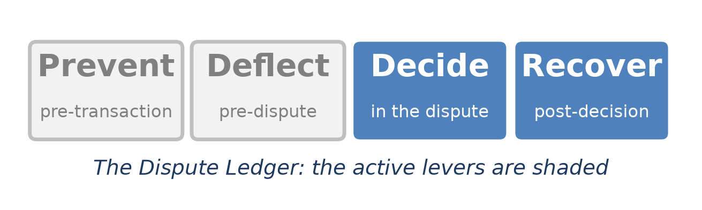
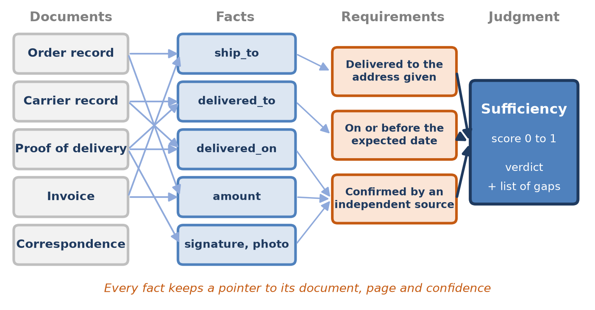
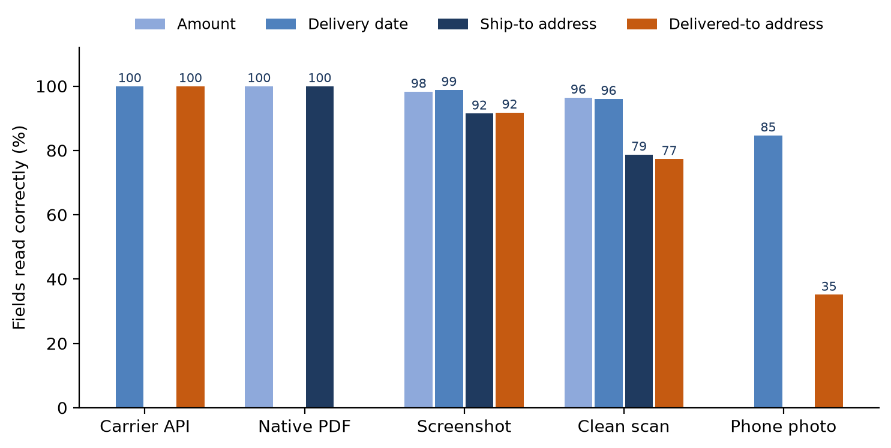
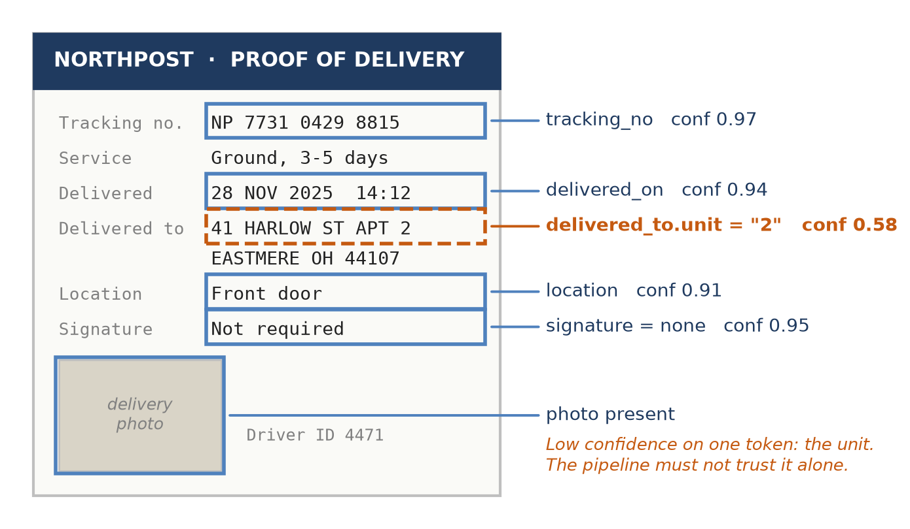
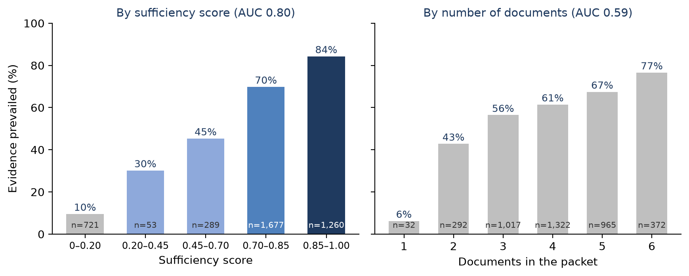
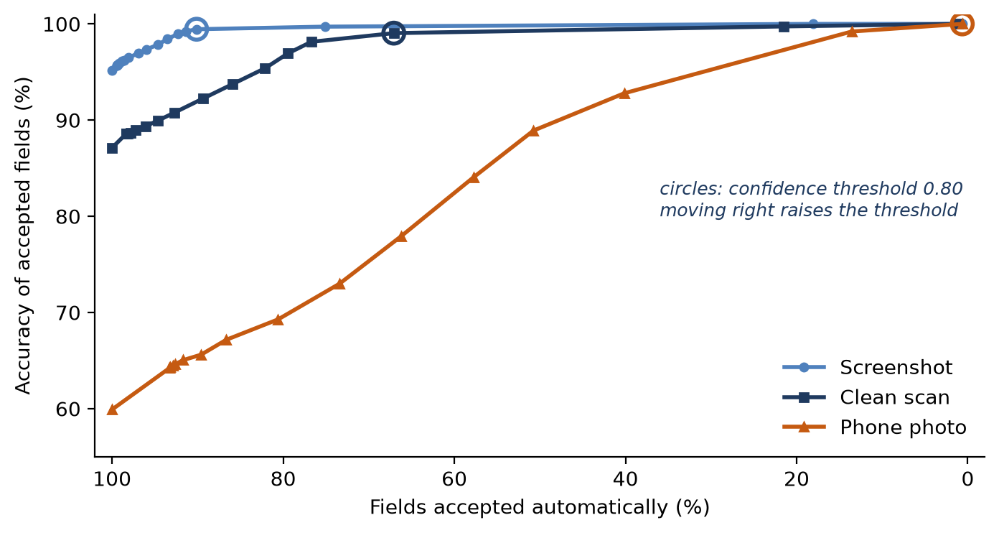
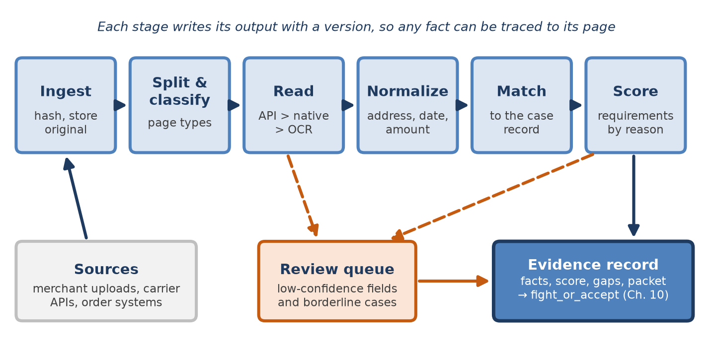

[⬅ Back to all chapters](../README.md) · [Code and data for this chapter](README.md)

# Chapter 11: Document Intelligence and Evidence Automation



*This chapter pulls the Decide and Recover levers: it reads the documents on which both the decision and the contest depend.*

> **Worked example.** The $249 claim that Chapter 10 priced now sits in the review band, with an expected value of only $1.63, too close to call. The merchant says its tracking shows delivery to the billing address. The analyst who picks up the case has been asked one question: does the merchant’s evidence show delivery to the cardholder’s address, and can the carrier confirm it? The merchant’s response contains three files. The first is an order confirmation exported as a PDF. The second is a carrier tracking number typed into the body of an email. The third is a photograph, taken on a phone, of the carrier’s proof-of-delivery slip, slightly skewed and lit by a desk lamp. The slip appears to say that the parcel was left at the front door of 41 Harlow Street, Apartment 2. The cardholder’s billing address, which is also the ship-to address on the order, is Apartment 12. Read quickly, the evidence points to a delivery to the wrong door, and the case looks worth contesting. Read carefully, it may say nothing of the kind. *This chapter answers the question: what does the evidence actually prove, how sure can the platform be of what it has read, and is it enough?*

Chapter 3 made a claim that the rest of the book has relied on: disputes are won or lost on evidence, and evidence fails far more often through capture than through argument. Chapter 8 built a case record that links a claim to its authorization, clearing and order records, and Chapter 10 used a column called evidence\_completeness as one of the features that predict a win. Nothing so far has said where that number comes from. In most operations it comes from an analyst who opens each attachment, reads it, and decides how much it is worth. That is slow, it is inconsistent from one analyst to the next, and it leaves no record of which line on which page carried the decision.

Document intelligence replaces that reading with a pipeline. The pipeline does not decide disputes. It turns a pile of files into a small set of facts, each tied to the page it came from and to a measure of how sure the platform is that it read it correctly. It then compares those facts with what the reason code requires and reports whether the evidence is sufficient and, if it is not, exactly what is missing. The same pipeline serves an issuer reading a merchant’s response and a merchant assembling one, because both are asking the same question of the same documents.

You will learn what evidence each kind of dispute needs and how to express those needs as data, how to read facts from proof of delivery and order records whatever form they arrive in, how to match those facts to the case and score their sufficiency, and how to handle the photographs, scans, screenshots and merged files that make up most real evidence. By the end you will have built evidence\_pipeline.py, which returns, for every case, its facts with their sources and confidence, a sufficiency score, a verdict and a list of gaps.

In this chapter, we will cover the following topics:

- What evidence a dispute needs
- Extracting facts from proof of delivery and order records
- Matching and sufficiency scoring
- Handling messy documents
- Building the evidence pipeline

## Technical requirements

Open chapter11/ in the companion repository. It contains make\_evidence\_data.py, which generates evidence\_packets/, a synthetic year of 4,000 not-received disputes whose merchants responded with documents. Each packet holds an order record and, depending on the merchant, a carrier record, a proof of delivery and an invoice, delivered as carrier API responses, native PDFs, screenshots, scans or phone photographs, 23,860 field readings in all. The generator simulates the character errors of optical character recognition (OCR) at rates typical of each channel, so that results are reproducible without an OCR engine. The folder also contains requirements.py, which holds the evidence rules as data; extract.py, match.py and sufficiency.py, which read, compare and score; classify\_pages.py, which labels pages by document type; evidence\_pipeline.py, which assembles them; and worked\_example.py. Python 3.11, pandas 2.x, scikit-learn 1.4 and rapidfuzz 3.x are sufficient. To run the pipeline on real files you will also need an OCR engine, such as Tesseract through pytesseract, or a cloud document service; the interfaces in extract.py are written so that either can be plugged in. The case record comes from Chapter 8 and the contest decision from Chapter 10. By the end of this chapter you will have built the eleventh chapter artifact of the book; all data are synthetic and every result is illustrative.

## What evidence a dispute needs

A packet of evidence is not judged by its weight. The reviewer at the issuer, and the analyst at the network if the case goes that far, asks a narrow question set by the reason code, and every document either helps answer it or does not. A forty-page packet that never shows where the parcel was left is weaker than a single carrier record that does. The first job of an evidence platform is therefore to know, for each kind of claim, which facts decide it.

### Evidence follows the reason code

Table 11.1 sets out the facts that carry weight for the main families of card dispute. It is a working summary for design, not a statement of any network’s rules; the exact conditions, time limits and accepted documents are set in the Visa Core Rules and the Mastercard Chargeback Guide and change from one edition to the next, as Chapter 2 showed.

| Claim | What must be shown | Decisive facts | Typical documents |
|---|---|---|---|
| Goods not received | Delivery to the address the cardholder gave, by the expected date | ship\_to, delivered\_to, delivered\_on, signature or photo | Order record, carrier record, proof of delivery |
| Services or digital goods not received | The service was provided or the content was accessed | Access times, device or IP address, account used | Usage and access logs, account activity |
| Not as described or defective | The item matched its description, or no valid return was received | Description at sale, return status, condition | Product page at sale, return log, correspondence |
| Cancelled recurring | No cancellation before the charge, and the terms were disclosed | Cancellation date, terms accepted, billing date | Terms acceptance log, account history |
| Credit not processed | The credit was issued, or none was due under the policy disclosed | Refund record, return receipt, policy at sale | Refund log, returns policy, receipts |
| Card-absent fraud (Compelling Evidence 3.0) | The purchase matches at least two earlier undisputed ones on the card | Device identifier or IP address plus a second element, prior dates | Order history, device and login records |
| Duplicate or processing error | Two separate purchases, or one already credited | Authorization codes, order identifiers, amounts | Order records, clearing data |

*Table 11.1: The facts that decide each family of card dispute*

Two features of the table shape everything that follows. First, the decisive facts are few. A not-received claim turns on four or five values, and almost all of them are dates, amounts, addresses and flags: short strings that can be read, normalized and compared. Second, the same fact often appears in several documents. The ship-to address is on the order record and the invoice; the delivered-to address is on the carrier record and the proof of delivery. Redundancy is what makes automation safe, because a fact read from two independent sources is far more trustworthy than a fact read once.

### Facts, not files

Figure 11.1 shows the model this chapter builds. Documents are sources, not evidence. Each document yields facts, each fact may be supported by more than one document, and the reason code’s requirements are written in terms of facts. The judgment at the end is a score, a verdict and a list of gaps, and every part of it can be traced back through the facts to a page.



*Figure 11.1: From documents to a judgment. Requirements are written against facts, so a missing or weak document shows up as a named gap rather than a lower impression.*

Separating facts from files changes what the platform stores. A conventional case system stores attachments and, at best, a free-text note from the analyst. An evidence platform stores a fact table: one row for each fact on each case, with its value, the document and page it came from, the channel through which it was read, the confidence of the reading, and the version of the extractor that produced it. The attachments remain, unchanged and hashed, because the reviewer at the issuer or network will want to see them; but the decisions are made on the facts.

### Requirements as data

Chapter 2 turned the regulatory clocks into data so that a rule change became a configuration change rather than a code change. Evidence requirements deserve the same treatment, because the networks revise them regularly; Chapter 2 noted that the Compelling Evidence 3.0 rules dated 18 April 2026 widen the pool of qualifying prior transactions for disputes processed from 24 October 2026. Listing 11.1 holds the requirements for a not-received claim as a versioned rule set with an effective date.

```python
from dataclasses import dataclass
from datetime import date

@dataclass(frozen=True)
class Requirement:
    fact: str       # the fact that must be shown
    weight: float   # its share of the sufficiency score
    check: str      # the function in match.py that tests it
    gap: str        # what to ask for when the check fails

NOT_RECEIVED = {
    "version": "nr-2025.2",
    "effective": date(2025, 4, 1),
    "requirements": [
        Requirement("delivered_to", 0.45, "address_match",
                    "proof of delivery to the address the cardholder gave"),
        Requirement("amount", 0.10, "amount_match",
                    "order record showing the disputed amount"),
        Requirement("delivered_on", 0.20, "on_time",
                    "carrier record with a delivery date"),
        Requirement("attested", 0.15, "signature_or_photo",
                    "signature or delivery photograph"),
        Requirement("independent", 0.10, "from_carrier",
                    "the carrier's own record, not a copy"),
    ],
    "veto": {"address_contradicted": 0.20},   # caps the score
    "verdict": {"sufficient": 0.70, "borderline": 0.45},
}

def rules_for(reason, opened_on, rule_sets):
    """The rule set in force when the case was opened, not today's."""
    live = [r for r in rule_sets[reason] if r["effective"] <= opened_on]
    return max(live, key=lambda r: r["effective"])
```

*Listing 11.1: chapter11/requirements.py*

Each requirement names the fact it concerns, its weight in the score, the function that tests it and the request to make when the test fails. The weights express judgment about what reviewers rely on, and an institution should set them from its own outcomes, as the section on sufficiency scoring shows. The veto expresses a different kind of rule: a contradiction, such as a carrier record showing delivery to a different street, is not offset by strength elsewhere. The function rules\_for selects the rule set by the date the case was opened, so that a case is always judged by the rules that applied to it, even after the rules change.

> **Business impact.** A requirement table makes the evidence standard visible to everyone who touches a case. Merchants know what to send, analysts know what to look for, and a manager can see which requirement fails most often and fix its cause upstream, usually at fulfillment.
>
> **Under the hood.** Store the rule-set version on every evidence record. When a network changes its standard, cases opened before the effective date keep their old verdicts and cases opened after it are scored afresh, and an auditor can see which rules each verdict used.

With the requirements fixed as data, the next task is to fill in the facts.

## Extracting facts from proof of delivery and order records

Extraction runs in four steps. The pipeline decides what kind of document each page is, reads the text and layout of the page, finds the fields it needs, and normalizes each value into a canonical form that can be compared. Each step can fail in its own way, and each records how confident it is.

### Where the documents come from

The same fact can reach the platform through very different channels, and the channel matters more than any model. Table 11.2 lists the documents that support a not-received claim and the forms they usually take.

| Document | Usual forms | Key facts | Typical failure |
|---|---|---|---|
| Order record | Order system export, native PDF, screenshot | Order identifier, amount, ship-to, bill-to, order date | Screenshot cropped above the address |
| Carrier record | Carrier API response, tracking-page screenshot | Tracking number, status, delivered-on, delivered-to, location | Screenshot shows the status but not the address |
| Proof of delivery | Carrier PDF, scan, phone photograph | Signature or photo, delivered-to, time, driver | Photographed at an angle; the unit is unreadable |
| Invoice or receipt | Native PDF, scan | Amount, items, ship-to | Tax or shipping line read as the total |
| Correspondence | Email export, chat transcript | Dates, promises, admissions | Threads merged into one file without dates |

*Table 11.2: Documents behind a not-received claim*

The channels form a natural order of trust. A carrier API response is structured data from the party that delivered the parcel, and reading it involves no recognition at all. A native PDF carries its text as characters, so it can be read exactly, though its layout must still be interpreted. A screenshot is an image of text rendered by a computer, clean but cropped to whatever the person chose to capture. A scan adds the imperfections of paper. A phone photograph adds skew, glare, shadow and blur. Figure 11.2 shows what those differences mean in the synthetic data.



*Figure 11.2: Fields read correctly, by channel. Amounts and dates survive poor images far better than addresses do.*

Across all 23,860 readings, 94.1 percent of fields were read correctly, but the average hides a steep gradient. API responses and native PDFs were read without error. Screenshots lost about 5 percent of fields, clean scans 13 percent and phone photographs 40 percent. The pattern by field is as important as the pattern by channel. Amounts and dates are short and constrained, so even a photograph yields the right delivery date 85 percent of the time. Addresses are long, mix letters and digits, and contain the one token that decides many not-received disputes, the unit number. From phone photographs, the delivered-to address was read correctly only 35 percent of the time.

### Classifying the pages

Before a field can be found, the pipeline must know what kind of page it is looking at. Merchants frequently send one PDF containing an invoice, two pages of tracking history and an email thread, and the same words, such as order, total and delivered, appear on all of them. classify\_pages.py trains a page classifier on character n-grams, sequences of three to five characters, which tolerate OCR errors better than whole words because a single wrong character spoils a word but only a few of its n-grams. On 1,000 test pages across six document types it labels 95.4 percent correctly, falling to 93.7 percent on phone photographs. When the classifier is less than 60 percent sure, which happens on 7.7 percent of pages, the page is sent for a person to label, and accuracy on the remainder rises to 97.8 percent. A wrongly labeled page does less harm than it seems, because the extractor for an invoice will simply fail to find a delivery date on a tracking page, but it costs a fallback and sometimes a review.

### Reading the fields

Figure 11.3 shows a proof of delivery as the extractor sees it. Each field the pipeline needs is located on the page, read, and given a confidence. Most of the fields on this slip read cleanly. One token does not: the unit number in the delivered-to address, which the OCR engine reads as 2 with a confidence of 0.58.



*Figure 11.3: A proof of delivery as the extractor reads it, redrawn for legibility. Every field carries a confidence, and the weakest token in the address is the one that matters.*

Confidence comes from the recognition engine. OCR engines report a confidence for each character or word, and a field is only as reliable as its weakest part, so extract.py takes the minimum over the characters of a field rather than the average. A street name read with high confidence does not compensate for a unit number that was guessed. Listing 11.2 shows the core of the module: the record each reading produces, the normalizer for addresses and the readers for amounts and dates.

```python
import re
from dataclasses import dataclass

UNIT = re.compile(r",?\s*(?:\b(?:APT|APARTMENT|UNIT|STE|SUITE)\b|#)\s*\.?\s*([0-9A-Z]+)",
                  re.I)
SUFFIX = {"STREET": "ST", "AVENUE": "AVE", "ROAD": "RD", "LANE": "LN", "DRIVE": "DR"}
DIGITS = str.maketrans("OlSBZ", "01582")     # common OCR confusions, digits only

@dataclass
class Fact:
    name: str
    value: object
    confidence: float     # weakest character in the field
    doc_id: str
    page: int
    channel: str          # api, native, screenshot, clean_scan, photo
    extractor: str = "extract-1.3"

def field_confidence(char_conf):
    return min(char_conf) if char_conf else 0.0

def normalize_address(raw):
    s = raw.upper().replace(".", " ")
    unit, m = "", UNIT.search(s)
    if m:
        unit, s = m.group(1), s[:m.start()] + s[m.end():]
    words = [SUFFIX.get(w, w) for w in s.split(",")[0].split()]
    zip5 = re.search(r"\b(\d{5})\b", s)
    return {"number": words[0] if words else "", "street": " ".join(words[1:]),
            "unit": unit, "zip": zip5.group(1) if zip5 else ""}

def read_amount(text):
    m = re.search(r"\$\s*([0-9OlSBZ,]+\.[0-9OlSBZ]{2})", text)
    if not m:
        return None
    return round(float(m.group(1).replace(",", "").translate(DIGITS)) * 100)  # cents

def repair_date_digits(text):
    """Fix OCR confusions inside numeric tokens only, so 'Oct' stays 'Oct'."""
    return re.sub(r"[0-9OlSBZ]{2,4}(?=[/\-\s]|$)",
                  lambda m: m.group(0).translate(DIGITS), text)
```

*Listing 11.2: chapter11/extract.py (records and normalizers)*

The class Fact is the unit of everything downstream: a name, a value, a confidence, the document, page and channel it came from, and the version of the extractor. The function normalize\_address pulls the unit out with a pattern, standardizes the street suffix and takes the five-digit ZIP code, so that 41 Harlow Street, Apt 12 and 41 HARLOW ST #12 become the same four components. The function read\_amount repairs the characters OCR most often confuses with digits, but only inside the matched number, and returns the amount in cents, because amounts compared as floating-point numbers eventually disagree by a fraction of a cent. The function repair\_date\_digits applies the same repair to dates, again only inside numeric tokens.

> **Under the hood.** Both restrictions in Listing 11.2 were learned the hard way while writing this chapter. The first version of the unit pattern lacked the word boundaries \b, so STE, the abbreviation for suite, matched inside STERLING, and every address on Sterling Lane lost its street name. The first version of the date repair translated every letter O to a zero, which turned Oct into 0ct and made every October date unreadable. Together the two bugs cut accuracy on carrier API responses, which contain no recognition errors at all, from 100 to 92 percent. Test the normalizers on clean data before measuring anything on noisy data.

### Normalizing the values

Normalization is where most of the real engineering lives, because the same fact is written differently by every merchant, carrier and system. Table 11.3 gives the rules for the fields of a not-received claim.

| Fact | Forms seen | Canonical form | Rule |
|---|---|---|---|
| Address | 41 Harlow Street, Apt 12; 41 HARLOW ST #12; 41 Harlow St, Unit 12 | Number, street with standard suffix, unit, ZIP | Unit taken by a word-bounded pattern; suffixes from the postal standard |
| Date and time | 11/28/2025; 28 Nov 2025; 2025-11-28T14:12 | ISO 8601 with the carrier’s time zone | Parse by source format; repair digits only inside numbers |
| Amount | $249.00; 249,00 USD; USD 249 | Integer minor units and a currency code | Never compare floats; take the currency from the document |
| Tracking number | NP 7731 0429 8815; np773104298815 | Upper case, no spaces, with carrier | Validate the check digit where the carrier publishes one |
| Attestation | Signed by J. OKAFOR; Not required; blank | signed, photo, none | Not required is not a signature |

*Table 11.3: Canonical forms for the facts of a not-received claim*

Two rules in the table prevent quiet errors. A date must be parsed with the format its source uses, because 03/04/2025 is March in one system and April in another, and a delivery date read in the wrong month will pass every check. And a signature field that says Not required must be normalized as none, not as present: the words are on the line where a signature would be, and a careless extractor will treat them as one.

> **Business impact.** Extraction turns a reviewer’s reading time into a few seconds of computation, but only for the channels that can be read reliably. The cheapest improvement is rarely a better model; it is persuading merchants and carriers to send structured records instead of pictures of them.

The pipeline can now produce facts with their sources and confidence. The next step is to decide what they prove.

## Matching and sufficiency scoring

A fact proves something only in relation to the case. A delivered-to address is evidence of delivery only if it matches the address the cardholder gave; a delivery date is evidence only if it falls before the expected date and before the claim. Matching compares each fact with the case record of Chapter 8, and sufficiency scoring combines the comparisons into a judgment.

### Matching facts to the case

Most comparisons are simple. Amounts must agree to the cent in the same currency. Dates are compared with windows: delivered on or before the expected date plus a small tolerance, and before the cardholder’s claim. Order identifiers and tracking numbers must match exactly after normalization. Addresses are the exception, and they decide most not-received cases, so match.py compares them component by component, as Listing 11.3 shows.

```python
from rapidfuzz import fuzz

def address_match(found, given):
    """Compare a delivered-to address with the ship-to address on the order."""
    if not found or not given:
        return 0.0, "missing"
    number = found["number"] == given["number"]
    street = fuzz.ratio(found["street"], given["street"]) / 100
    zip5 = found["zip"] == given["zip"]
    unit = found["unit"] == given["unit"]
    score = 0.30 * number + 0.30 * street + 0.25 * zip5 + 0.15 * unit
    if number and street > 0.85 and zip5:
        return round(score, 3), "match" if unit else "unit_differs"
    return round(score, 3), "no_match"

def amount_match(found_cents, case_cents, currency, case_currency):
    return currency == case_currency and found_cents == case_cents

def on_time(delivered_on, expected_on, claimed_on, grace_days=3):
    return (delivered_on <= expected_on + grace_days) and (delivered_on < claimed_on)
```

*Listing 11.3: chapter11/match.py*

The function address\_match returns both a score and a verdict, because they serve different purposes. The score is useful for ranking and for monitoring; on 1,500 test pairs, the same address printed in two styles and read from a clean scan scored 0.96 on average, while two addresses drawn at random scored 0.16. The verdict is what the requirement uses, and it distinguishes three situations that a single similarity score would blur. A match means the parcel went to the address given. A differing unit means it went to the right building and possibly the wrong door, which in a block of flats is a different customer. No match means the evidence contradicts the merchant’s case. The street name is compared with a fuzzy ratio, to tolerate abbreviations and small reading errors, but the house number, unit and ZIP code must agree exactly, because a fuzzy match between 12 and 2 is precisely the error the pipeline must not make.

### Scoring sufficiency

Sufficiency combines the requirement checks into one number between 0 and 1. Table 11.4 sets out the scoring for a not-received claim, using the weights of Listing 11.1.

| Requirement | Weight | Full credit | Partial credit | Gap reported |
|---|---|---|---|---|
| Delivered to the address given | 0.45 | Address verdict is match | 0.10 if only the unit differs | Unit differs, or address does not match |
| Amount and order agree | 0.10 | Order record shows the disputed amount | None | No order record for the amount |
| Delivered on time | 0.20 | On or before the expected date plus three days | 0.05 if later | Delivered after the expected date |
| Delivery attested | 0.15 | Signature | 0.10 for a delivery photograph | No signature or photograph |
| Independent source | 0.10 | Record retrieved from the carrier | None | Carrier record not confirmed |
| Contradiction (veto) |   |   | Score capped at 0.20 | Delivery address contradicts the order |

*Table 11.4: Sufficiency scoring for a not-received claim*

A score of 0.70 or more is sufficient, between 0.45 and 0.70 borderline, and below 0.45 insufficient. The thresholds and weights in the table are a starting point drawn from what reviewers ask for, and they are deliberately simple. A linear score with a veto can be read aloud to a merchant, an auditor or a cardholder, which matters more here than a small gain in accuracy, because the score will be quoted back to people who have to act on it. Listing 11.4 shows the scoring function.

```python
from match import address_match, on_time
from requirements import NOT_RECEIVED as R

def sufficiency(facts, case, rules=R):
    score, gaps = 0.0, []
    if facts.get("delivered_to") is None:
        return 0.0, ["no delivery confirmation"], "insufficient"
    _, verdict = address_match(facts["delivered_to"], facts.get("ship_to"))
    if verdict == "match":
        score += 0.45
    elif verdict == "unit_differs":
        score += 0.10; gaps.append("unit differs")
    else:
        gaps.append("delivery address does not match")
    if facts.get("amount") == case.amount_cents:
        score += 0.10
    else:
        gaps.append("no order record for the amount")
    if facts.get("delivered_on") is None:
        gaps.append("no delivery date")
    elif on_time(facts["delivered_on"], case.expected_on, case.claimed_on):
        score += 0.20
    else:
        score += 0.05; gaps.append("delivered after expected date")
    attested = facts.get("attested")
    score += {"signed": 0.15, "photo": 0.10}.get(attested, 0.0)
    if attested not in ("signed", "photo"):
        gaps.append("no signature or photograph")
    if facts.get("delivered_to_channel") == "api":
        score += 0.10
    if verdict == "no_match":
        score = min(score, rules["veto"]["address_contradicted"])
    cut = rules["verdict"]
    label = ("sufficient" if score >= cut["sufficient"] else
             "borderline" if score >= cut["borderline"] else "insufficient")
    return round(score, 2), gaps, label
```

*Listing 11.4: chapter11/sufficiency.py*

The function walks the requirements in order, adding each weight that is met and recording a gap for each that is not. The gaps are written in the language of a request, so that they can be sent to a merchant or shown to an analyst without translation. The veto is applied last, so that a contradiction caps the score whatever else the packet contains.

### Does the score mean anything?

A score is only worth computing if it predicts what reviewers decide. In the synthetic year, the merchant’s evidence prevailed in 61.2 percent of the 4,000 cases. Figure 11.4 shows how often it prevailed in each band of the sufficiency score, and compares the score with the measure most operations actually use, the number of documents in the packet.



*Figure 11.4: How often the evidence prevailed, by sufficiency score and by number of documents. The score separates strong packets from weak ones; the document count barely does.*

The sufficiency score separates the cases well. Packets scored below 0.20 prevailed 10 percent of the time and packets scored above 0.85 prevailed 84 percent of the time, and the rate rises steadily in between. Its area under the ROC curve is 0.80. The number of documents does much worse, with an AUC of 0.59. More documents are associated with slightly better outcomes, because merchants that keep good records tend to send more of them, but a six-document packet can still lack the one fact that matters, and a two-document packet consisting of an order record and a carrier API response can be decisive.

This is where the score joins the rest of the platform. Chapter 10’s outcome model used evidence\_completeness as a feature, and in most institutions that column is an analyst’s rating or a count of attachments. Replacing it with the sufficiency score gives the model a measure that is consistent from case to case, available as soon as the documents arrive, and explained by a list of gaps. The weights themselves should be revisited as outcomes accumulate, using the exploration sample of Chapter 10 so that the outcomes are not biased by which cases the institution chose to contest.

> **Business impact.** A sufficiency score with named gaps lets a merchant fix a packet before it is sent and lets an issuer decide quickly whether a response is worth challenging. Both sides stop paying for contests whose outcome was visible in the documents.
>
> **Under the hood.** Keep the verdict of address\_match on the evidence record, not just the score. When a network reviewer disagrees with the platform, the first question is always which address components agreed, and a stored verdict answers it without rerunning anything.

The scores in Figure 11.4 were computed by a pipeline that knew when not to trust what it read. The next section explains how.

## Handling messy documents

Real evidence is untidy. It arrives as photographs of slips on kitchen tables, as screenshots cropped just above the line that matters, as fifty-page PDFs that merge an invoice with a month of emails, and occasionally as documents that have been edited. A pipeline that is accurate on clean files and silent about the rest will make its worst mistakes on exactly the cases that most need a careful reading. Table 11.5 lists the common problems and how to deal with each.

| Problem | How it shows | How to detect it | Remedy |
|---|---|---|---|
| Phone photograph | Skew, glare, shadow, blur | Low mean confidence; skew angle of text lines | Deskew and dewarp; prefer another source |
| Rotated page | OCR returns nonsense | Low share of dictionary words | Read at each 90-degree turn; keep the best |
| Many documents in one file | Invoice, tracking and emails merged | Page class changes between pages | Split by page class before extraction |
| Cropped screenshot | The needed field is absent | Required field missing on a page of the right type | Ask the source system, not the merchant |
| Handwriting | Signatures, notes on slips | Handwriting detector; very low confidence | Record presence only; do not read the name |
| Duplicates and versions | The same invoice twice, once edited | Content hash; near-duplicate text | Keep both; flag the differences |
| Altered document | Mismatched fonts; metadata newer than the event | Metadata checks; disagreement with the source | Never decide on one document; corroborate |

*Table 11.5: Messy documents and what to do about them*

### Confidence and abstention

The single most effective defense against messy documents is to let the pipeline abstain. Every field reading carries a confidence. Below a threshold the reading is not used, and the pipeline either finds the same fact in another document or asks a person. This trades coverage, the share of fields accepted automatically, for accuracy among the fields accepted. Figure 11.5 draws that trade for the three image channels.



*Figure 11.5: Accuracy against coverage as the confidence threshold rises. The circles mark the threshold of 0.80 used by the pipeline.*

The curves show why one threshold can serve all channels. At 0.80, screenshots keep 90 percent of their fields at 99.4 percent accuracy and clean scans keep 67 percent at 99.0 percent. Phone photographs keep almost nothing: their confidence rarely reaches 0.80, so nearly all of their fields fall back to another source or to a person. That is the right outcome, not a failure. A phone photograph read without a gate would be wrong four times in ten, and over all channels the threshold accepts 85.6 percent of field readings at 99.8 percent accuracy. The threshold should be set, like the review band of Chapter 10, from the cost of each kind of error and the capacity to review, and it can differ by fact: a wrong unit number costs more than a wrong delivery time.

### The fallback chain

Abstention is only useful if there is somewhere to fall back to. For each fact, evidence\_pipeline.py tries its sources in order of trust: the carrier’s API, then native documents, then screenshots, then scans, then photographs, accepting the first reading above the threshold. When no reading passes, the fact goes to a person, who sees the page, the region the extractor read and its proposed value. The most valuable step in the chain is often one that adds a source rather than reading one better. A tracking number, even one typed into an email, lets the platform request the carrier’s own record, and that record is structured, complete and independent of the merchant.

Table 11.6 compares two pipelines on the same 4,000 packets. The first accepts the best available reading of each fact whatever its confidence, which is how a naive integration of an OCR service behaves. The second applies the 0.80 threshold with the fallback chain.

| Measure | Accept every reading | Confidence gate at 0.80 |
|---|---|---|
| Cases with at least one wrong fact | 236 (5.9%) | 16 (0.4%) |
| Wrong facts used in scoring | 240 | 16 |
| Cases sent to a person | 39 (1.0%) | 408 (10.2%) |
| Facts reviewed by a person | 39 | 550 |
| Cases scored without a person | 3,961 (99.0%) | 3,592 (89.8%) |
| Sufficient evidence judged not sufficient | 141 | 11 |
| Insufficient evidence judged sufficient | 1 | 0 |
| Score identical to a perfect reading | 96.2% | 99.7% |

*Table 11.6: Two pipelines on 4,000 not-received packets (synthetic data)*

The naive pipeline looks more efficient, scoring 99 percent of cases without a person, but it uses a wrong fact in one case in seventeen, and its errors are not random. Recognition errors almost always break a match rather than create one, because a misread unit number rarely turns into the right one by chance. So the naive pipeline judged 141 packets with sufficient evidence to be insufficient, and only one the other way. For an issuer that means contesting cases it will lose; for a merchant it means failing to contest cases it would have won. The gated pipeline sends a person 550 facts across 408 cases and in return reduces the wrongly weakened packets from 141 to 11.

### Authenticity

Some documents are wrong because they have been changed. Detecting forgery is a specialist field, but three cheap controls catch most of what a dispute operation sees. Hash every file on arrival and keep the original, so that the document reviewed is provably the document received. Check the metadata, because a proof of delivery created three days after the chargeback deserves a question. And prefer facts that are confirmed by a source the submitter does not control. A carrier record retrieved from the carrier cannot be edited by the merchant, and a carrier record that disagrees with the merchant’s copy of it is itself evidence.

> **Business impact.** Abstention moves effort from every case to the few that need it. A reviewer who checks 550 flagged fields does less work than one who reads 4,000 packets, and makes fewer mistakes, because each task is narrow and comes with the page already open at the right place.
>
> **Under the hood.** Never let a person’s correction overwrite the extractor’s reading. Store both, with who made the correction and when. Corrections are the best training data the platform will ever have, and the gap between the two readings is the measure of how well the extractor is doing.

Each piece of the pipeline is now in place. The last step is to assemble them.

## Building the evidence pipeline

Figure 11.6 shows the complete pipeline. Files arrive from merchant uploads, carrier APIs and order systems and are hashed and stored unchanged. Pages are split and classified, fields are read through the fallback chain, normalized, matched to the case and scored against the requirements in force. Low-confidence fields and borderline verdicts go to a review queue, and everything ends in an evidence record that Chapter 10’s fight\_or\_accept reads and that Chapter 12 will use to draft the written response.



*Figure 11.6: The evidence pipeline. Low-confidence readings and borderline verdicts are the only work that reaches a person.*

Listing 11.5 shows the orchestration. It assumes that the documents have already been classified and read into Fact records, and it concentrates on the decisions: which reading to trust, when to ask a person, and what to store.

```python
from sufficiency import sufficiency
from requirements import rules_for, RULE_SETS

TRUST = {"api": 0, "native": 1, "screenshot": 2, "clean_scan": 3, "photo": 4}
GATE = 0.80
VERSION = "evidence-1.0"

def choose(readings, gate=GATE):
    """Best channel first; the first reading above the gate wins."""
    for f in sorted(readings, key=lambda f: TRUST[f.channel]):
        if f.value is not None and f.confidence >= gate:
            return f, "auto"
    return None, "review"

def build_evidence(case, readings_by_fact, review):
    rules = rules_for(case.reason, case.opened_on, RULE_SETS)
    chosen, trail = {}, []
    for name, readings in readings_by_fact.items():
        fact, how = choose(readings)
        if how == "review":
            fact = review(case, name, readings)        # a person confirms the value
        chosen[name] = fact.value
        trail.append({"fact": name, "value": fact.value, "doc": fact.doc_id,
                      "page": fact.page, "channel": fact.channel,
                      "confidence": fact.confidence, "how": how})
        if name == "delivered_to":
            chosen["delivered_to_channel"] = fact.channel
    score, gaps, verdict = sufficiency(chosen, case, rules)
    return {"case_id": case.case_id, "facts": trail, "score": score,
            "verdict": verdict, "gaps": gaps, "rules": rules["version"],
            "needs_review": verdict == "borderline", "pipeline": VERSION}
```

*Listing 11.5: chapter11/evidence\_pipeline.py*

The function choose implements the fallback chain: readings are sorted by the trust of their channel and the first one above the gate is accepted. The function build\_evidence selects the rule set in force for the case, chooses a reading for each fact or asks a person through the review callback, keeps a trail of where every value came from, and scores the result. The evidence record it returns holds the facts with their sources, the score, the verdict, the gaps, the rule-set version and the pipeline version, which is everything an auditor, a reviewer or a later model needs.

### What the pipeline is worth

The value of the pipeline is mostly time, and time depends on assumptions that each operation must replace with its own. Table 11.7 sets out an illustrative comparison for the 4,000 packets, assuming 20 minutes for an analyst to assemble and read a packet by hand, one minute to confirm and release a case the pipeline has scored, three minutes for each flagged fact and ten minutes for each borderline case.

| Activity | Manual reading | Pipeline |
|---|---|---|
| Assemble and read every packet | 4,000 × 20 min = 1,333.3 h | None |
| Confirm and release scored cases | None | 3,592 × 1 min = 59.9 h |
| Review flagged facts | None | 550 × 3 min = 27.5 h |
| Review borderline verdicts | Included above | 185 × 10 min = 30.8 h |
| **Total** | **1,333.3 h** | **118.2 h** |

*Table 11.7: Analyst time for 4,000 packets (illustrative assumptions)*

Under these assumptions the pipeline removes about nine-tenths of the reading effort. The assumptions are generous to manual reading in one respect, since they ignore the variation between analysts, and generous to the pipeline in another, since they ignore the effort to build and maintain it. The more durable benefit is consistency: two cases with the same documents receive the same score, and every score comes with its reasons.

### Testing and monitoring

The pipeline should be tested at three levels. The normalizers need unit tests on clean data, including awkward but legitimate inputs such as street names that contain unit abbreviations, which is how the bugs described earlier were found. The extractors need a labeled set of real documents from each channel, refreshed as merchants and carriers change their formats, with accuracy reported by channel and by field as in Figure 11.2. And the whole pipeline needs the comparison of Table 11.6 against a perfect reading, which in production means a sample of cases read in full by experienced analysts.

Once live, three measures give early warning. The share of fields falling below the gate, by channel and by merchant, rises within hours when a carrier changes its layout. The rate at which reviewers correct accepted values, sampled at random, measures whether the gate is still in the right place. And the rate at which evidence prevails by sufficiency band, which arrives weeks later, tells whether the weights of Table 11.4 still reflect what reviewers decide.

> **Business impact.** The evidence record is reused at every later stage: it prices the contest in Chapter 10, it supplies the facts for the drafted response in Chapter 12 and it forms the audit trail of Chapter 15. Building it once, well, is cheaper than reading the same documents three times.
>
> **Under the hood.** Version the extractor, the rule set and the pipeline separately and store all three on every evidence record. A change to any one of them can change a verdict, and an investigation months later needs to know which.

Finally, worked\_example.py runs the pipeline on the $249 claim. Table 11.8 shows the evidence record.

| Fact | Value | Source | Confidence | Status |
|---|---|---|---|---|
| ship\_to | 41 HARLOW ST, unit 12, 44107 | Order confirmation, native PDF, page 1 | 1.00 | Accepted; equals billing address |
| amount | $249.00 | Order confirmation, native PDF, page 1 | 1.00 | Matches the claim |
| delivered\_to (first reading) | 41 HARLOW ST, unit 2, 44107 | Proof of delivery, phone photograph | 0.58 | Below the gate; not used |
| delivered\_to | 41 HARLOW ST, unit 12, 44107 | Carrier record, retrieved by tracking number | 1.00 | Accepted; matches ship\_to |
| delivered\_on | 28 Nov 2025, 14:12 | Carrier record | 1.00 | On time; expected 29 Nov |
| attested | Photograph; no signature required | Proof of delivery, phone photograph | 0.95 | Photograph present |
| **Judgment** | **Score 0.95, sufficient** | **Rule set nr-2025.2** |   | **No gaps** |

*Table 11.8: The evidence record for the $249 claim*

The first reading of the delivered-to address came from the photograph and said unit 2, with a confidence of 0.58. The gate rejected it, and the fallback chain did what an experienced analyst would do: it used the tracking number in the merchant’s email to retrieve the carrier’s own record, which says unit 12. Had the photograph been trusted, the address verdict would have been unit\_differs, the score would have been 0.50, borderline, with the gap unit differs, and the case would have looked like a misdelivery.

> **Worked example revisited.** The analyst’s question from Chapter 10 now has an answer, and it took no analyst to find it. The carrier’s own record shows delivery to 41 Harlow Street, Apartment 12, the cardholder’s billing and ship-to address, on 28 November, a day before the expected date, with a photograph and no signature required. The evidence scores 0.95 and is sufficient. The apparent unit 2 was a misreading of a skewed photograph, and a pipeline that trusted it would have sent the issuer into a $40 contest against the carrier’s own record. With the facts established, the recovery decision is to accept rather than contest. The cardholder’s claim is a separate matter, governed by Chapters 2 and 6: before any adverse decision, the issuer shares the delivery photograph and the carrier’s record with the cardholder, and a person decides. Many such parcels turn up with a neighbour or in a building’s mailroom once someone knows where to look. Chapter 12 drafts that message, and the representment summary, from this evidence record.
>
> **Key principle.** *Decide on facts you can trace to a page, and let the platform say when it is not sure.*

## Summary

In this chapter we treated evidence as a set of facts rather than a pile of files. We listed the facts that decide each family of card dispute and expressed the requirements for a not-received claim as a versioned rule set. We read those facts from order records, carrier records and proofs of delivery, and saw that the channel decides accuracy more than any model: API responses and native PDFs were read without error and phone photographs lost 40 percent of fields, most of them addresses. We normalized values into canonical forms, matched addresses component by component, and combined the checks into a sufficiency score that separated strong packets from weak ones with an AUC of 0.80, against 0.59 for a count of documents. We let the pipeline abstain below a confidence of 0.80 and fall back to more trustworthy sources, which cut cases with a wrong fact from 236 to 16 at the cost of sending 10 percent of cases to a person. Finally, we built evidence\_pipeline.py, which returns for every case its facts with their sources, a score, a verdict and its gaps.

Chapter 12 turns from reading documents to writing them. It uses generative AI, grounded in the case and evidence records built so far, to summarize a case for an analyst and to draft the representment and the customer letter, and it shows how to test that the drafts say nothing the evidence does not support.

## Questions

- A packet shows delivery to the right house number, street and ZIP code but a different unit, on the expected date, with a delivery photograph and the right amount, but the carrier record is a screenshot sent by the merchant. Using Table 11.4, what are the score and the verdict? What would they be if the unit had matched?
- In Figure 11.5, almost no fields read from phone photographs pass the gate of 0.80. A colleague proposes a gate of 0.60 for photographs only, which would accept about 58 percent of their fields at about 84 percent accuracy. What would you expect to happen to Table 11.6, and which facts would you allow it for, if any?
- The naive pipeline in Table 11.6 judged 141 sufficient packets to be insufficient and only one the other way. Explain why recognition errors are so lopsided, and what that implies for an issuer that uses the naive pipeline to decide which merchant responses to challenge.
- Give two reasons why the number of documents in a packet predicts its outcome poorly in Figure 11.4. How would you show a merchant’s operations team that sending more documents is not the remedy?
- A network changes the evidence standard for not-received claims, with an effective date next month. Describe the changes to requirements.py, and how evidence records for cases opened before and after the date should be scored and reported.

## Further reading

- Ray Smith, “An Overview of the Tesseract OCR Engine,” Proceedings of the Ninth International Conference on Document Analysis and Recognition (2007)
- Yiheng Xu and others, “LayoutLM: Pre-training of Text and Layout for Document Image Understanding,” Proceedings of KDD (2020)
- Geewook Kim and others, “OCR-free Document Understanding Transformer,” Proceedings of ECCV (2022)
- Adam W. Harley, Alex Ufkes and Konstantinos G. Derpanis, “Evaluation of Deep Convolutional Nets for Document Image Classification and Retrieval,” Proceedings of ICDAR (2015)
- Yonatan Geifman and Ran El-Yaniv, “Selective Classification for Deep Neural Networks,” Advances in Neural Information Processing Systems (2017)
- United States Postal Service, Publication 28: Postal Addressing Standards, current edition
- libpostal documentation, for statistical parsing and normalization of international addresses
- RapidFuzz documentation, for string similarity measures
- Visa Core Rules and Mastercard Chargeback Guide, current editions, for evidence requirements by reason code
