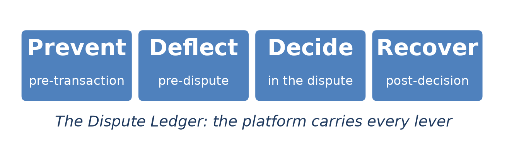
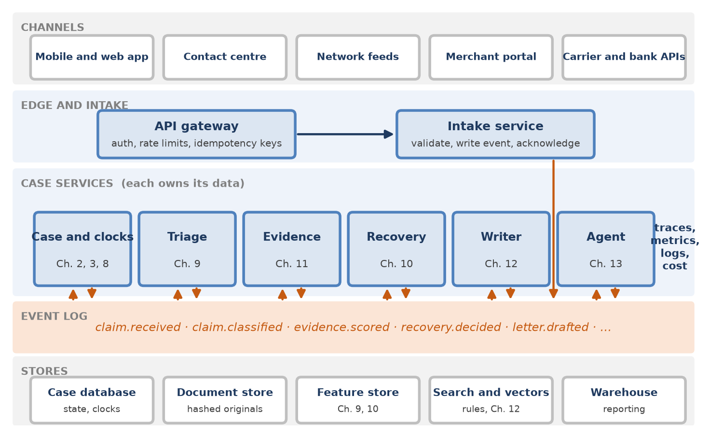
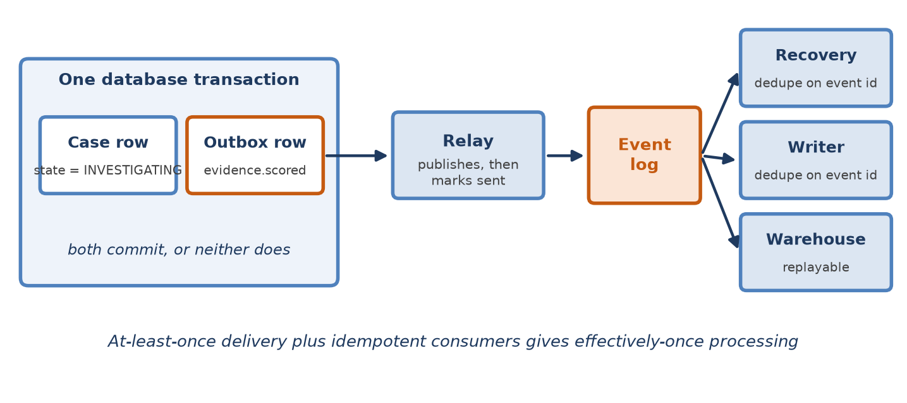
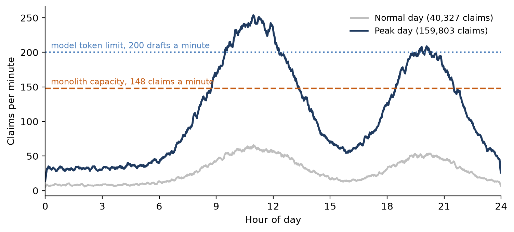
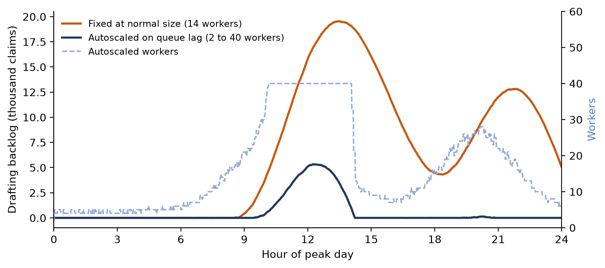
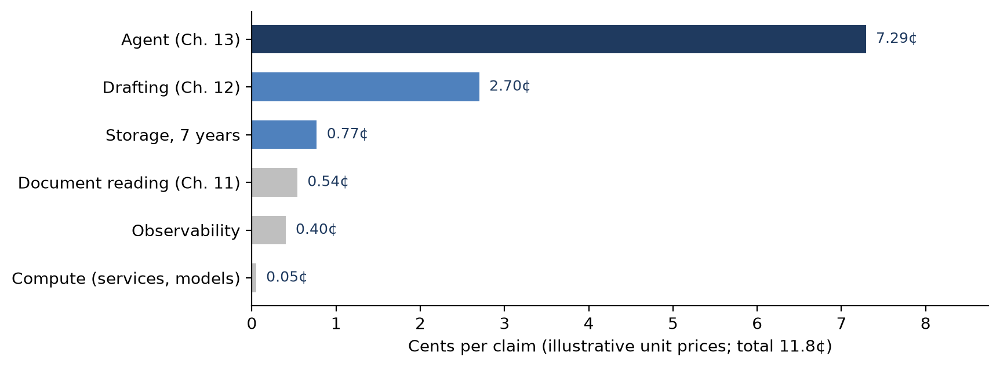
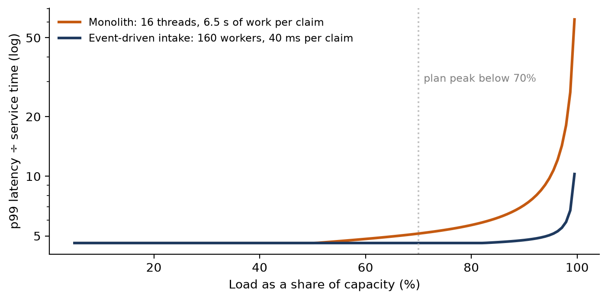

[⬅ Back to all chapters](../README.md) · [Code and data for this chapter](README.md)

# Chapter 14: Cloud-Native Dispute Platform Architecture



*This chapter carries every lever: it turns the components of the previous chapters into one platform that stays calm on the busiest day of the year.*

> **Worked example.** The pilot has gone well. The case record, the triage model, the evidence pipeline, the win model, the writer and the agent run together as one service on three virtual machines, and on a normal day of about 40,000 claims nobody notices them. The $249 claim of the earlier chapters was filed on 11 December, inside the busiest month of the year, and passed through without trouble. The operations director now asks a narrower question. On the Monday after the holiday shopping weekend, claims arrive at four times the normal rate, and they arrive in the late morning, all at once. Every claim starts a regulatory clock the moment the customer submits it. If intake slows down, customers press submit again; if it fails, they call. *This chapter answers the question: how should the dispute platform be built so that its busiest day is uneventful, and how can the institution know that before the day arrives?*

Chapters 8 to 13 built components: a case record, a classifier, a win model, an evidence pipeline, a writer and an agent. Each was demonstrated as a script or a module, run against a file of synthetic cases. A dispute platform is something else. It accepts claims from many channels at unpredictable rates, keeps every case in a correct state for months, meets deadlines measured in business days and penalized by regulators, calls external services that are slow, rate-limited and occasionally down, and keeps an auditable record of everything it did and why.

The architecture that does this well is not exotic, and most of it is a set of disciplines rather than technologies. Acknowledge a claim quickly and do the work afterwards. Record every change to a case as an event, in the same transaction as the change. Let each service own its data. Make every step safe to repeat. Bound every dependency. Measure cost per case as carefully as latency. This chapter explains each discipline, shows what it buys on a synthetic peak day, and ends with how to deploy the platform and prove its capacity before customers do.

You will learn the principles behind a cloud-native dispute platform, the services and stores of a reference design, how events and state fit together, how to design for peak volume, how to observe the platform and its cost, and how to deploy and load test it. By the end you will have built the platform’s event backbone, an idempotent consumer, an autoscaling rule, a shared token budget for model calls and a load test that replays a peak day.

In this chapter, we will cover the following topics:

- Architecture principles
- The reference platform
- Events, state and storage
- Designing for peak volume
- Observability and cost
- Deploying and load testing

## Technical requirements

Open chapter14/ in the companion repository. It contains events.py and consumer.py, the event envelope, the transactional outbox and an idempotent consumer; budget.py, a shared token budget with priority lanes; deploy/, which holds container definitions and Kubernetes manifests for the services of earlier chapters, including KEDA autoscaling rules; loadtest/, a Locust script that replays a synthetic peak day; and peak\_day.py, the simulation behind this chapter’s results. The simulation models one normal day of 40,327 claims and one peak day of 159,803, minute by minute, and compares a synchronous monolith with an event-driven design; its parameters, such as six seconds of drafting work per claim and a model provider limit of one million tokens a minute, are illustrative and are set at the top of the file. To run the platform locally you need Docker, a Kubernetes cluster such as kind or minikube, PostgreSQL 16, a Kafka-compatible event log such as Redpanda, and Python 3.11. Every major cloud provider offers managed equivalents of each, and nothing in the chapter depends on one provider. By the end of this chapter you will have built the fourteenth chapter artifact of the book; all data are synthetic and every result is illustrative.

## Architecture principles

Architecture is a set of decisions that are expensive to change later. For a dispute platform, the decisions that matter most follow from four facts established in earlier chapters: claims arrive in bursts (Chapter 5), every claim carries a regulatory clock that starts when the customer submits it (Chapter 2), a case lives for weeks or months and passes through many states (Chapter 3), and some of the work depends on external services that are slow and limited (Chapters 11 to 13). Table 14.1 states the principles that follow.

| Principle | What it means here | Why |
|---|---|---|
| Acknowledge fast, work later | Intake validates, records the claim as an event and replies in milliseconds | The clock starts at submission; a slow intake invites duplicate claims |
| State changes are events | Every transition of the case state machine emits an event, in the same transaction | Other services react without coupling; the history is the audit trail |
| Each service owns its data | No service reads another’s tables; it consumes events or calls an API | Services can change, scale and fail independently |
| Every step is safe to repeat | Idempotency keys at the edge, event identifiers at consumers, keyed tools (Ch. 13) | Networks retry; customers press submit twice |
| Deadlines are data | Clocks are stored and scanned, never held in a process’s memory | A restart must not lose a regulatory deadline |
| Every dependency is bounded | Rate limits, token budgets, timeouts and circuit breakers on every external call | A slow provider must slow one stage, not the platform |
| Everything is versioned | Models, prompts, rules, gate configuration and event schemas carry versions | Any decision can be reproduced (Ch. 15) |
| Cost is a metric | Cost per case is measured by component, alongside latency | Model calls, not servers, dominate the bill |

*Table 14.1: Architecture principles for a dispute platform*

Two of these principles cut against common practice and deserve a word. The first is that a claim is acknowledged before any real work is done on it. Many dispute systems classify the claim, look up the transaction and even request documents inside the request that the customer is waiting on, because it seems helpful to answer with a reference number and an expected outcome. Under load that design fails exactly when it matters, as the next sections show. The second is that deadlines are data. A process that sets a timer for ten business days and waits will lose the timer the next time the process is redeployed; a row in a clocks table with a due date, scanned every minute by a scheduler, cannot be lost that way.

> **Business impact.** Each principle removes a class of incident that otherwise recurs every peak season: duplicated claims, missed deadlines, a slow provider that stalls every case. Removing a class of incident is worth far more than handling each instance well.
>
> **Under the hood.** Write the principles into the definition of done for every service. A pull request that adds a synchronous external call to intake, or a timer held in memory, should fail review as surely as one that fails its tests.

The principles lead to a particular shape of platform, which the next section describes.

## The reference platform

Figure 14.1 shows the reference platform. Claims and documents arrive from channels at the top. An API gateway authenticates them, applies rate limits and enforces idempotency keys. The intake service validates each claim, writes it and a claim.received event, and replies. Below, a set of case services, each corresponding to one or more earlier chapters, consume events, do their work, write to their own stores and emit events of their own. The event log connects them. Traces, metrics, logs and cost are collected from every layer.



*Figure 14.1: The reference platform. Intake records and acknowledges; case services communicate through the event log and own their stores; observability spans every layer.*

Table 14.2 lists the case services, what each owns, the events it consumes and emits, and the signal on which it scales.

| Service | Owns | Consumes | Emits | Scales on |
|---|---|---|---|---|
| Intake | Raw claims, idempotency keys | Requests | claim.received | Request rate |
| Case and clocks | Case state, clocks (Ch. 2, 3, 8) | All case events | clock.started, clock.at\_risk, case.state\_changed | Event lag |
| Triage | Classifications (Ch. 9) | claim.received | claim.classified | Event lag |
| Evidence | Facts and scores (Ch. 11) | document.received | evidence.scored | Pages queued |
| Recovery | Contest decisions (Ch. 10) | evidence.scored, merchant.replied | recovery.decided | Event lag |
| Writer | Drafts and approvals (Ch. 12) | case.escalated, recovery.decided | letter.drafted | Lag, within the token budget |
| Agent | Runs and action logs (Ch. 13) | claim.classified, merchant.replied | agent.action\_\*, case.escalated | Lag, within the token budget |

*Table 14.2: Case services in the reference platform*

### How large should a service be?

The table divides the platform by business capability, not by technical layer, and stops there. It is tempting to go further and give every model and every tool its own service, and tempting to go the other way and keep everything in one deployable unit. Both have costs. Many small services multiply deployments, network calls and failure modes; one large service couples the scaling and release of components with very different needs. A useful test is whether two components scale on the same signal and change for the same reasons. Triage and recovery both run small models on events and could share a service; the evidence pipeline scales on pages and the writer on tokens, and they should not.

### Where the models run

The models of Chapters 9 and 10 are small. They score a case in milliseconds on an ordinary processor, so they run inside the services that use them, loaded from a model registry by version, rather than behind a separate model-serving cluster. The evidence pipeline’s optical character recognition and the language models of Chapters 12 and 13 are different: they are expensive, and they are often provided by an external service with its own limits. They sit behind a small internal gateway that applies the token budget of this chapter, records usage by case and component, and allows a provider to be changed without changing the services that call it.

> **Business impact.** Dividing by business capability lets each team own a part of the dispute lifecycle end to end: the people who own triage own its model, its service and its on-call rota. Accountability follows the architecture.
>
> **Under the hood.** Give every service its own database credentials, scoped to its own schema. A service that cannot read another’s tables cannot come to depend on them, which keeps ownership honest long after the architecture diagram has been forgotten.

The services are connected by events, and the correctness of the whole platform rests on how events and state are written.

## Events, state and storage

Chapter 3 described the case as a state machine. In the platform, each transition of that machine is a change to a row in the case database and an event that other services consume. The two must never disagree. A case moved to INVESTIGATING without an event leaves the evidence service waiting for work it will never receive; an event published without the change sends the evidence service to work on a case that is not in the state the event claims.

### The transactional outbox

The standard solution is the transactional outbox, shown in Figure 14.2. The service writes the state change and the event into its own database in one transaction, the event going into an outbox table. A relay reads the outbox, publishes each event to the log and marks it sent. If anything fails between publishing and marking, the event is published again, so consumers must tolerate duplicates.



*Figure 14.2: The transactional outbox. The state change and its event commit together; a relay publishes; consumers ignore events they have already processed.*

Listing 14.1 shows the event envelope and a state transition written with the outbox.

```python
import json
import uuid
from dataclasses import asdict, dataclass, field
from datetime import datetime, timezone

@dataclass(frozen=True)
class Event:
    type: str                         # e.g. "evidence.scored"
    case_id: str
    data: dict
    producer: str
    schema_version: int = 1
    event_id: str = field(default_factory=lambda: str(uuid.uuid4()))
    occurred_at: str = field(
        default_factory=lambda: datetime.now(timezone.utc).isoformat())

class StaleState(Exception):
    pass

def transition(conn, case_id, expected, new_state, event):
    """Change the case state and record its event in ONE transaction."""
    with conn.transaction():
        changed = conn.execute(
            "UPDATE cases SET state = %s, version = version + 1 "
            "WHERE case_id = %s AND state = %s",
            (new_state, case_id, expected)).rowcount
        if changed != 1:
            raise StaleState(f"{case_id} is no longer {expected}")
        conn.execute(
            "INSERT INTO outbox (event_id, case_id, type, payload) "
            "VALUES (%s, %s, %s, %s)",
            (event.event_id, case_id, event.type, json.dumps(asdict(event))))
```

*Listing 14.1: chapter14/events.py*

The Event carries its type, the case it concerns, its data, the service that produced it, a schema version, a unique identifier and the time it occurred. The function transition updates the case only if it is still in the expected state, which makes the state machine of Chapter 3 safe against two services acting on the same case at once, and writes the event to the outbox in the same transaction. If another service has moved the case in the meantime, StaleState is raised and nothing is written.

### Consuming events safely

Event logs deliver each event at least once. A consumer that processes an event twice may send a merchant two inquiries or file a chargeback twice, so every consumer records the identifiers of the events it has processed, in the same transaction as the work. Listing 14.2 shows the pattern, with retries and a dead-letter queue for events that keep failing.

```python
import json

MAX_ATTEMPTS = 5

class Retryable(Exception):
    """A temporary failure: a timeout, a throttled provider."""

def handle(conn, message, handler, dead_letter):
    event = json.loads(message.value)
    try:
        with conn.transaction():
            first_time = conn.execute(
                "INSERT INTO processed (consumer, event_id) VALUES (%s, %s) "
                "ON CONFLICT DO NOTHING",
                (handler.name, event["event_id"])).rowcount == 1
            if not first_time:
                return "duplicate"
            handler(conn, event)       # the work, in the same transaction
        return "ok"
    except Retryable:
        raise                          # rolled back; redelivered with backoff
    except Exception as exc:
        if message.attempts >= MAX_ATTEMPTS:
            dead_letter.publish(message, reason=repr(exc))
            return "dead_lettered"
        raise
```

*Listing 14.2: chapter14/consumer.py*

The function handle inserts the event’s identifier into a processed table and does the work in one transaction. If the identifier is already there, the event is a duplicate and is skipped. If the work fails, the transaction rolls back, the identifier is not recorded and the event is delivered again later. An event that has failed five times goes to a dead-letter queue with its reason, where a person can see it; a dead-letter queue that nobody watches is a place where claims go to miss their deadlines, so its depth is one of the alerts in Table 14.5. Work that calls an external system, such as filing a chargeback, cannot be rolled back by a database transaction, which is why the tools of Chapter 13 are themselves idempotent on a key derived from the case and the action.

### Where data lives

A dispute platform holds several kinds of data with very different shapes, access patterns and retention rules. Table 14.3 assigns each to a store.

| Data | Store | Why | Retention |
|---|---|---|---|
| Case state, clocks, decisions | Relational database | Transactions, constraints, the outbox | Life of the case, then archive |
| Events | Partitioned event log | Ordered per case, replayable, many consumers | Weeks in the log; forever in the warehouse |
| Documents | Object storage, write-once | Large, immutable, hashed (Ch. 11) | Network and regulatory periods |
| Features | Feature store | Same values in training and scoring (Ch. 9, 10) | Training windows |
| Rules and passages | Search index with metadata | Filtered retrieval (Ch. 12) | Every edition, kept |
| History and reporting | Analytical warehouse | Joins across months; dashboards (Ch. 5) | Years |

*Table 14.3: Stores in the reference platform*

Events are partitioned by case identifier, so that all the events of one case are delivered in order to any one consumer while different cases are processed in parallel. Ordering across cases is neither needed nor guaranteed. Every event is also copied to the warehouse, where it forms the history from which Chapter 5’s dashboards, Chapter 10’s training sets and Chapter 15’s audit trail are built. Because the history can be replayed, a new service, or a fixed version of an old one, can be brought up to date by reading the events from the beginning.

> **Business impact.** An event history answers questions nobody thought to ask when the system was built: how long cases waited between two states last March, or which cases a faulty model version touched. Without it, those questions need archaeology.
>
> **Under the hood.** Treat event schemas as public contracts. Add fields, never rename or remove them, and raise schema\_version when meaning changes. Consumers must ignore fields they do not know, so that producers can evolve without coordinated releases.

With events and state in place, the platform can absorb load in a way the pilot could not.

## Designing for peak volume

Dispute volume is seasonal and bursty. It rises after holiday shopping, after a large merchant fails, after a data breach, and on Monday mornings. Figure 14.3 shows the synthetic normal and peak days used in this chapter. The peak day carries four times the claims of the normal day, and its busiest minute brings 271 claims, against 82 on the normal day.



*Figure 14.3: A normal day and a peak day. The pilot’s monolith was sized at twice the normal day’s busiest minute; the peak day exceeds it for hours, and also exceeds the model provider’s token limit.*

### Why the pilot fails

The pilot handled each claim inside the request: validation, classification and a first draft for the analyst, about 6.5 seconds of work holding one of 16 threads. That gives a capacity of 148 claims a minute, twice the normal day’s busiest minute and a comfortable margin by most rules of thumb. On the normal day every claim was answered in about 6.5 seconds. On the peak day the arrival rate exceeded capacity from about nine in the morning, and the queue grew faster than it could be cleared. The median customer waited 30 minutes for intake to answer, the slowest one percent waited about two hours, and 82 percent of claims, 131,280 of them, took longer than the 30 seconds after which the mobile application gives up. Each of those customers either tried again, creating a duplicate claim with a later clock, or called the contact center.

The failure is not that the pilot was too small. Any fixed size has a day that exceeds it. The failure is that intake, which must be fast, shared its capacity with drafting, which can wait. Separating them changes the problem completely. The event-driven intake does about 40 milliseconds of work per claim: validate, write the claim and its event, reply. With 160 workers it can acknowledge 4,000 claims a second, nearly 900 times the peak day’s busiest minute, and its slowest one percent of replies stay at about 0.18 seconds. The 6.5 seconds of work still have to be done, but now they are done from a queue, where waiting a few minutes harms nobody.

### Scaling the work behind the queue

Behind the queue, the question becomes how many workers to run. Four answers were simulated for the drafting stage, which is the most expensive: a fixed pool sized for the normal day, a fixed pool sized for the peak, an autoscaled pool that adds workers when the queue grows, with new workers taking two minutes to start, and the same autoscaled pool with a priority lane for the 20 percent of claims that Chapter 9 marks as at risk of missing their deadline. Every configuration is subject to the model provider’s limit of one million tokens a minute, which at 5,000 tokens a claim allows 200 drafts a minute. Table 14.4 and Figure 14.4 report the peak day.

| Measure | Fixed, normal size | Fixed, peak size | Autoscaled | Autoscaled with priority |
|---|---|---|---|---|
| Workers | 14 | 40 | 2 to 40 | 2 to 40 |
| Drafted within 15 minutes | 23.1% | 80.7% | 80.7% | 82.5% |
| At-risk claims drafted within 15 minutes | 23.4% | 81.2% | 81.2% | 100.0% |
| Slowest 5% waited (minutes) | 137 | 26 | 26 | 32 (at-risk: under 1) |
| Largest backlog (claims) | 19,543 | 5,324 | 5,324 | 5,324 |
| Still waiting at midnight | 5,112 | 0 | 0 | 0 |
| Worker-hours | 336 | 960 | 399 | 399 |

*Table 14.4: The drafting stage on the peak day (159,803 claims, synthetic)*



*Figure 14.4: The drafting backlog through the peak day. A pool sized for normal days never catches up; the autoscaled pool follows the load, and its backlog is set by the token limit rather than by workers.*

The fixed pool sized for normal days never recovers: its backlog peaks near 20,000 claims and 5,112 are still waiting at midnight, ready to collide with the next morning. The pool sized for the peak and the autoscaled pool give identical service, because both reach the same ceiling, but the autoscaled pool uses 399 worker-hours against 960, and on a normal day it uses 96 against the fixed pool’s 336, since it shrinks to two workers overnight.

Two further findings matter more than autoscaling itself. First, the ceiling at peak is the token limit, not the number of workers. Twenty workers already draft 200 claims a minute, so the autoscaler’s climb to 40 bought nothing; capping it at 20 gave the same service with 301 worker-hours, a quarter less. The constraint to plan around is the provider’s limit, and the way to raise it is a conversation with the provider, a second provider, or fewer tokens per claim. Second, a priority lane changes who waits. Overall service barely moves, but 95 percent of at-risk claims were drafted within a minute and all within fifteen, while the other claims waited a few minutes longer. When capacity is short, someone waits; the platform should choose who, using the deadline information Chapter 9 already computes.

### Autoscaling and token budgets in practice

Listing 14.3 shows the autoscaling rule for the writer, using KEDA, which scales a Kubernetes deployment on the lag of a consumer group in the event log. The maximum is set from the token limit, not from a guess.

```python
apiVersion: keda.sh/v1alpha1
kind: ScaledObject
metadata:
  name: writer
spec:
  scaleTargetRef:
    name: writer                  # the Deployment running the Chapter 12 writer
  minReplicaCount: 2              # warm workers overnight
  maxReplicaCount: 20             # 200 drafts a minute = the token limit
  cooldownPeriod: 300             # scale in slowly
  triggers:
    - type: kafka
      metadata:
        bootstrapServers: events:9092
        consumerGroup: writer
        topic: case.escalated
        lagThreshold: "50"        # one replica per 50 claims waiting
```

*Listing 14.3: chapter14/deploy/writer-scaledobject.yaml*

The rule keeps two writers warm, adds one for every 50 claims waiting, stops at 20, and waits five minutes before removing workers so that a brief lull does not undo a scale-up that took two minutes. Workers alone do not enforce the provider’s limit, however, and several services, the writer and the agent among them, share it. Listing 14.4 shows a token budget that they share, with a priority lane.

```python
import asyncio
import time

class TokenBudget:
    """Share a provider's tokens-per-minute limit; urgent work goes first."""

    def __init__(self, tokens_per_minute):
        self.rate = tokens_per_minute / 60
        self.capacity = tokens_per_minute
        self.tokens = tokens_per_minute
        self.updated = time.monotonic()
        self.urgent_waiting = 0
        self.lock = asyncio.Lock()

    def _refill(self):
        now = time.monotonic()
        self.tokens = min(self.capacity,
                          self.tokens + (now - self.updated) * self.rate)
        self.updated = now

    async def acquire(self, tokens, urgent=False):
        if urgent:
            self.urgent_waiting += 1
        try:
            while True:
                async with self.lock:
                    self._refill()
                    may_go = urgent or self.urgent_waiting == 0
                    if may_go and self.tokens >= tokens:
                        self.tokens -= tokens
                        return
                    short = max(tokens - self.tokens, 0)
                await asyncio.sleep(max(short / self.rate, 0.05))
        finally:
            if urgent:
                self.urgent_waiting -= 1
```

*Listing 14.4: chapter14/budget.py*

TokenBudget is a token bucket that refills at the provider’s rate. A caller asks for the tokens a request will use before making it. Urgent callers go ahead whenever enough tokens are available; normal callers also wait while any urgent caller is waiting. The class shown keeps its state in one process; in the platform the same logic runs in the internal model gateway, with the bucket held in a shared store so that every replica of every service draws from one budget. Requests that would exceed the provider’s limit are held back by the platform rather than rejected by the provider, which turns errors and retries into a short, orderly wait.

> **Business impact.** The busiest day becomes a planning exercise rather than an incident. The questions are known in advance: how many tokens a minute the provider will allow, how many claims are at risk, and which work can wait until the evening.
>
> **Under the hood.** Shed load deliberately. When the drafting backlog passes a threshold, skip optional work, such as the second draft variant or a long-form summary, before the backlog grows further. Each optional step should have a switch, and the switches should be tested.

A platform that scales itself must also explain itself, which is the subject of the next section.

## Observability and cost

Observability is the ability to answer a new question about the platform’s behavior without shipping new code. For a dispute platform, most of those questions are about cases: why this claim waited, which stage is slow today, what this model version cost. The case identifier is therefore the most important field in every log line, metric label where cardinality allows, and trace.

### Tracing a case across services

A distributed trace follows a request across services. Here the unit of interest is not a request but a case, whose life spans hours or weeks and dozens of events. The platform propagates trace context inside the event envelope, so that the work triggered by an event joins the trace of the work that produced it, and tags every span with the case identifier. A case can then be viewed as one timeline: intake, triage, the merchant inquiry, the wait, the reply, the evidence scoring, the escalation and the letter. Model calls are traced with their prompt version, tokens and latency, and the agent’s gate verdicts of Chapter 13 appear as spans of their own. OpenTelemetry provides the instrumentation and the trace format in a way that does not tie the platform to one vendor.

### Service levels that mean something

Technical metrics, such as request latency, error rate, saturation and queue lag, are necessary but not sufficient. The objectives that matter to the business are about claims and deadlines. Table 14.5 lists the service level objectives the platform reports, and when each one pages someone.

| Signal | Measure | Objective | Alert when |
|---|---|---|---|
| Acknowledgement | Submission to reply | 99% under 0.5 s | Burn rate exhausts a month’s budget in a day |
| Classification | claim.received to claim.classified | 99% within 5 minutes | Lag above 5 minutes for 10 minutes |
| Clock safety | Open cases with under 2 business days left and no decision | Zero unexpected | Any case appears |
| Drafting | case.escalated to letter.drafted | 95% within 15 minutes; at-risk within 5 | At-risk lane above 5 minutes |
| Event health | Dead-letter depth; outbox age | Zero; under 1 minute | Any dead letter; outbox older than 5 minutes |
| Model behavior | Checker flags (Ch. 12), gate refusals (Ch. 13) | Within weekly baseline | Twice the baseline in an hour |
| Cost | Cost per case by component | Within budget | 20% over the trailing week |

*Table 14.5: Service level objectives and alerts*

The clock-safety objective is the most important line in the table, and it is not a latency at all. It counts the open cases whose regulatory deadline is close and on which nothing has been decided. Every other objective exists to keep that count at zero, and if it rises, no amount of good latency elsewhere matters.

### Cost per case

The cloud bill arrives by service and by resource. The business thinks in cases. The platform should therefore attribute cost to cases, using the case identifier carried by every model call, page read and stored document. Figure 14.5 shows the resulting cost per claim for the synthetic platform, using illustrative unit prices: $3 per million input tokens and $15 per million output tokens for the language model, $1.50 per thousand pages read, $0.023 per gigabyte-month of storage and $0.04 per processor-hour. Table 14.6 gives the assumptions behind each line.



*Figure 14.5: Cost per claim by component, at illustrative unit prices. Language-model tokens dominate; computing for services and the small models is almost free.*

| Component | Assumption per claim | Cost |
|---|---|---|
| Agent (Ch. 13) | 5.4 steps of 3,000 input and 300 output tokens | 7.29¢ |
| Drafting (Ch. 12) | 4,000 input and 1,000 output tokens | 2.70¢ |
| Storage | 4 MB of documents and records kept 7 years | 0.77¢ |
| Document reading (Ch. 11) | 3.6 pages | 0.54¢ |
| Observability | Logs, metrics and traces | 0.40¢ |
| Compute | Services and the models of Ch. 9 and 10 | 0.05¢ |
| **Total** |   | **11.8¢** |

*Table 14.6: Cost per claim (illustrative unit prices)*

At about twelve cents a claim, the platform costs a small fraction of a minute of analyst time, which is the comparison that matters. Within the platform, language-model tokens account for 85 percent of the cost, and the agent alone for 62 percent. That points cost control in a clear direction: fewer agent steps, smaller context packs, caching of the parts of a prompt that repeat, and smaller models for the steps that do not need large ones. The budgets of Chapter 13 are cost controls as well as safety controls. Making servers cheaper, by contrast, would save almost nothing.

> **Business impact.** Cost per case, reported beside the business case of Chapter 7, lets finance see whether automation is paying for itself month by month, and lets engineering see which component to optimize first.
>
> **Under the hood.** Keep high-cardinality identifiers, such as case and claim numbers, out of metric labels; they belong in traces and logs. A metric labelled by case identifier creates a new time series for every claim and can cost more than the platform it measures.

Knowing how the platform behaves is half the task. The other half is changing it safely and proving its capacity.

## Deploying and load testing

A dispute platform changes constantly: new rules, new model versions, new prompts, new tools, new channels. Each change must reach production without risking a case, and the platform’s capacity must be proven against the busiest day before that day arrives.

### Deploying safely

Each service is built into a container image, scanned, signed and deployed through the same pipeline, whatever its contents. Four practices make that pipeline safe for disputes. Release progressively: a new version first takes a small share of events, its error rate and service levels are compared with the old version’s, and it takes the rest only if they hold. Treat models, prompts, rules and gate configuration as releases too, through the same pipeline and with the evaluations of Chapters 9 to 13 as their tests; a new prompt is as capable of causing an incident as new code. Change databases in two steps, expand then contract: add the new column, deploy code that writes both, backfill, deploy code that reads the new one, and only then remove the old, so that every intermediate state works with every running version. And never deploy into a clock: a release that pauses consumers must keep the clock scanner running, and the clock-safety objective is checked before and after every release.

### Load testing

A load test is an experiment that answers a specific question about capacity. Table 14.7 lists the tests that a dispute platform should run before its peak season, what each simulates and what counts as passing.

| Test | Shape | Pass when |
|---|---|---|
| Peak replay | A recorded peak day, replayed at 1.5 times its rate | All objectives in Table 14.5 hold |
| Spike | Ten times the busiest minute for five minutes | Acknowledgement holds; backlog clears within an hour |
| Soak | The busiest hour, held for eight hours | No growth in memory, connections or lag |
| Dependency failure | Model provider throttled to half; carrier API down | Only affected stages slow; no dead letters; no clock at risk |
| Duplicate storm | Every claim submitted twice within a second | Exactly one case per claim |
| Reconciliation | After every test | Claims accepted = cases created = claim.received events |

*Table 14.7: The pre-peak load test plan*

The last row is the most often skipped and the most important. A load test that reports good latency but loses one claim in ten thousand has failed, and only a reconciliation of what went in against what was recorded will show it. Listing 14.5 shows the core of the Locust script that drives the peak replay.

```python
import uuid
from locust import HttpUser, LoadTestShape, between, task

class Claimant(HttpUser):
    wait_time = between(1, 3)

    @task
    def file_claim(self):
        claim = synthetic_claim()                 # from the Chapter 8 generator
        key = str(uuid.uuid4())
        with self.client.post("/api/claims", json=claim, name="file_claim",
                              headers={"Idempotency-Key": key},
                              catch_response=True) as response:
            if response.elapsed.total_seconds() > 0.5:
                response.failure("acknowledgement slower than 0.5 s")
        if claim.get("retry_twice"):              # the duplicate-storm test
            self.client.post("/api/claims", json=claim, name="file_claim_retry",
                             headers={"Idempotency-Key": key})

class PeakDay(LoadTestShape):
    """Users over time, compressed from the recorded peak day."""
    stages = [(300, 50), (900, 400), (1500, 1200), (1800, 1200), (2100, 50)]

    def tick(self):
        run_time = self.get_run_time()
        for end, users in self.stages:
            if run_time < end:
                return users, 20
        return None
```

*Listing 14.5: chapter14/loadtest/locustfile.py*

The Claimant user files synthetic claims with an idempotency key and marks any acknowledgement slower than half a second as a failure; when a claim is flagged for the duplicate storm, it is sent again with the same key, and the reconciliation afterwards must find exactly one case. PeakDay shapes the number of simulated users over time, compressing the recorded day into 35 minutes.

### Reading the results

Figure 14.6 shows the most important shape in any load test: latency against load. It compares the two intake designs, scaled so that each is drawn against its own capacity.



*Figure 14.6: Latency against load for the two designs, each relative to its own capacity. A small pool of slow workers degrades early; a large pool of fast workers stays flat until close to saturation.*

Both curves are flat at low load and climb steeply near capacity, as queueing theory predicts, but they bend at very different points. The monolith’s slowest replies grow by half between idle and 90 percent of capacity, and by more beyond. The event-driven intake, with ten times as many workers each doing a hundredth of the work, is almost unchanged at 90 percent and bends only above 99. Large pools of short tasks absorb variation that small pools of long tasks cannot. Even so, the platform should plan for its busiest minute to use less than 70 percent of any stage’s capacity, because the curve’s position moves with every change of code, data and provider, and the load test measures it only on the day it runs.

> **Business impact.** A load test turns the operations director’s question into a report: the platform held one and a half times last year’s peak, lost no claims and kept every clock safe. That report is worth having before the peak, not after.
>
> **Under the hood.** Run load tests against a copy of production built by the same pipeline, with production-sized data, and with external providers replaced by simulators that reproduce their limits and latencies. A test against an empty database or an unthrottled mock measures the wrong system.

Finally, the $249 claim can be followed through the platform as its events. Table 14.8 shows its trail.

| Time | Event | Producer | Consumed by |
|---|---|---|---|
| 16:05:02 | claim.received | Intake | Case and clocks, triage, warehouse |
| 16:05:02 | clock.started | Case and clocks | Warehouse, clock scanner |
| 16:05:03 | claim.classified | Triage (Ch. 9) | Agent, case and clocks |
| 16:06:10 | agent.action\_taken: merchant inquiry | Agent (Ch. 13) | Case and clocks, warehouse |
| 19:41:15 | merchant.replied | Intake (merchant portal) | Evidence, agent |
| 19:41:16 | agent.action\_refused: boundary | Agent (Ch. 13) | Security, warehouse |
| 19:42:02 | evidence.scored | Evidence (Ch. 11) | Recovery, agent |
| 19:42:03 | recovery.decided: accept | Recovery (Ch. 10) | Agent, case and clocks |
| 19:42:05 | case.escalated | Agent (Ch. 13) | Writer, analyst queue |
| 19:42:40 | letter.drafted | Writer (Ch. 12) | Analyst queue |
| 09:12:30 next day | letter.approved | Case and clocks | Customer channel, warehouse |

*Table 14.8: The event trail of the $249 claim*

> **Worked example revisited.** The operations director’s question now has an answer in three parts. Intake no longer does any work the customer is waiting for: it records the claim and replies in well under a second, with capacity for hundreds of times the peak day’s busiest minute, so nobody presses submit twice. The work behind it scales on the queue, is capped by the model provider’s token limit rather than by guesswork, and puts the claims closest to their deadlines first; on the simulated peak day 95 percent of at-risk claims were drafted within a minute, and nothing was left over at midnight. And the $249 claim, followed through the platform, is eleven events from submission to approved letter, each written in the same transaction as the change it records, each traceable to a service and a version. Chapter 15 builds on exactly that trail: the audit record, the model cards and the controls that let a regulator see how each decision was made.
>
> **Key principle.** *Acknowledge fast, record every change as an event, and plan capacity around the limits you do not control.*

## Summary

In this chapter we turned the components of the book into a platform. We set out principles that follow from the nature of disputes: acknowledge fast and work later, record state changes as events, let services own their data, make every step repeatable, keep deadlines as data, bound every dependency, version everything and measure cost per case. We described a reference platform of case services connected by an event log, wrote state changes and events together with a transactional outbox, and consumed them with idempotent consumers. On a synthetic peak day of 159,803 claims, a synchronous monolith sized at twice the normal peak left 82 percent of claims waiting longer than the application’s timeout, while event-driven intake answered in about 0.18 seconds; behind the queue, autoscaling matched a peak-sized pool at 42 percent of its cost, the model provider’s token limit set the ceiling, and a priority lane drafted 95 percent of at-risk claims within a minute. We built observability around cases and deadlines, found that language-model tokens are 85 percent of an illustrative twelve cents per claim, and closed with progressive deployment and a load-test plan whose most important line is reconciliation.

Chapter 15 turns to the obligations that come with all of this automation: the regulatory expectations for automated decisions, explainability, fairness and model risk management, the security of dispute data, and the audit trail and model card that tie them together.

## Questions

- The pilot’s intake was sized at twice the normal day’s busiest minute. Using Figure 14.3, at roughly what time on the peak day did it fall behind, and why does the backlog keep growing after the arrival rate falls below capacity again?
- Explain how the transactional outbox and the idempotent consumer together prevent both lost events and double processing. What would go wrong if the processed table were written after the work, in a separate transaction?
- Using Table 14.4, why did autoscaling to 40 workers give no better service than 20? What three changes could raise the ceiling, and which would you try first?
- Using Table 14.6, a product manager proposes adding a second agent pass to every claim, doubling the agent’s steps. What happens to cost per claim, and what would you want to know before agreeing?
- Design the reconciliation check for the duplicate-storm test in Table 14.7. Which three counts would you compare, from which stores, and what would each kind of mismatch tell you?

## Further reading

- Martin Kleppmann, Designing Data-Intensive Applications (O’Reilly, 2017)
- Chris Richardson, Microservices Patterns (Manning, 2018), on the transactional outbox and sagas
- Sam Newman, Building Microservices, 2nd edition (O’Reilly, 2021)
- Betsy Beyer, Chris Jones, Jennifer Petoff and Niall Richard Murphy, Site Reliability Engineering (O’Reilly, 2016), on service level objectives and error budgets
- Mor Harchol-Balter, Performance Modeling and Design of Computer Systems: Queueing Theory in Action (Cambridge University Press, 2013)
- Jay Kreps, “The Log: What Every Software Engineer Should Know About Real-Time Data’s Unifying Abstraction” (2013)
- OpenTelemetry documentation, on traces, context propagation and semantic conventions
- KEDA documentation, on scaling Kubernetes workloads from event-log lag
- Locust documentation, on custom load shapes
