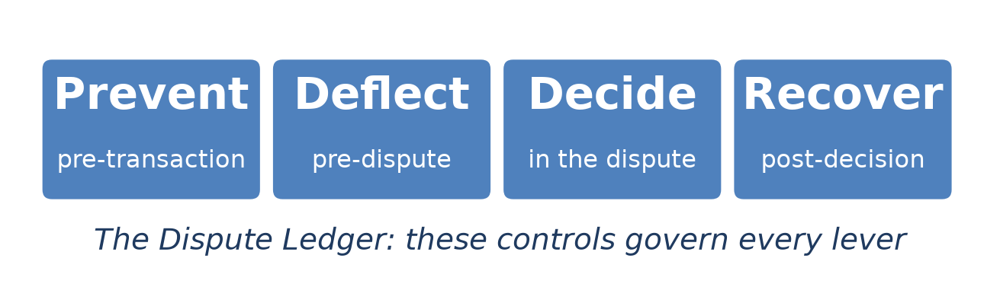
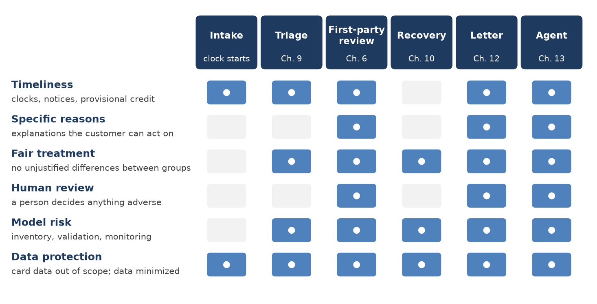
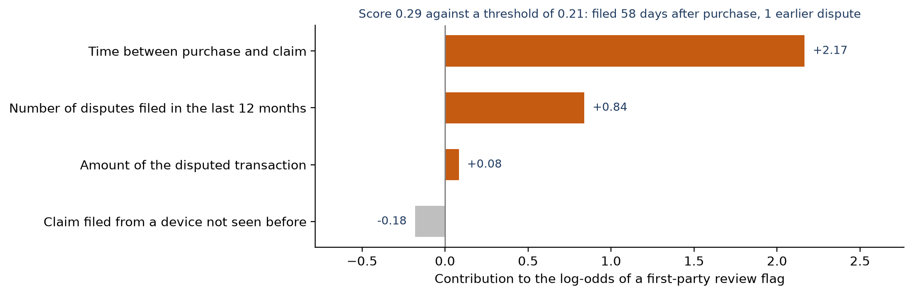
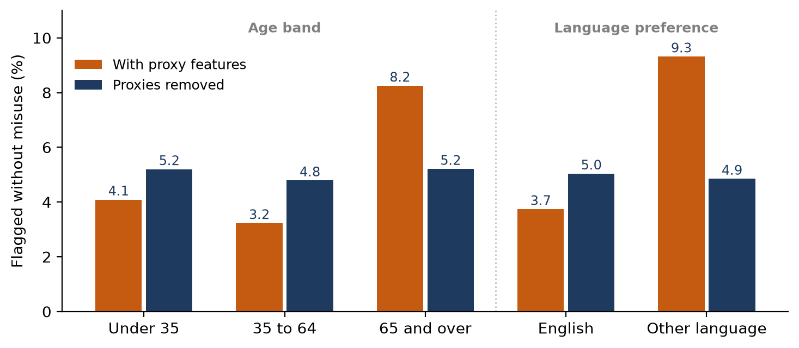
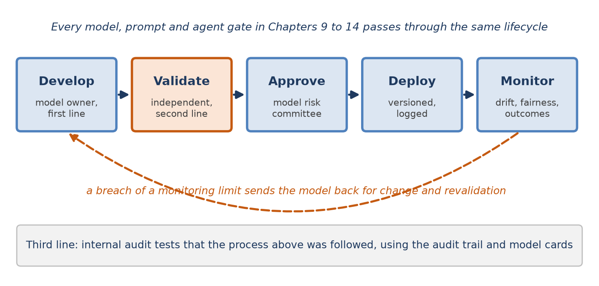
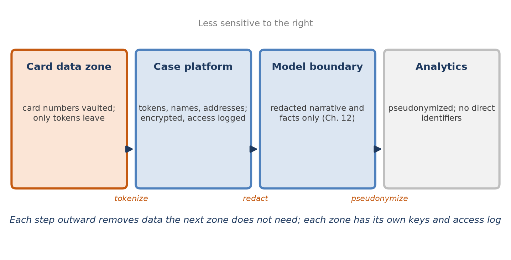
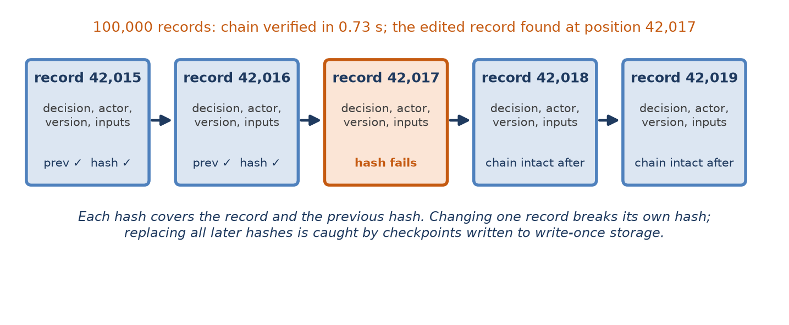

[⬅ Back to all chapters](../README.md) · [Code and data for this chapter](README.md)

# Chapter 15: Security, Compliance and Responsible AI



*This chapter governs every lever: it makes each automated decision explainable, fair, secure and provable after the fact.*

> **Worked example.** Three weeks after the letter of Chapter 12, the $249 claim has a sequel. The cardholder did not respond within the period the letter gave, an analyst concluded that no error had occurred, and the provisional credit was reversed with the notice that Chapter 2 requires. The cardholder, who is 71, has now complained to the regulator. The complaint says that the bank treated them as if they had lied, that a computer made the decision, and that older customers seem to be treated with more suspicion. The regulator asks the institution for four things within thirty days: the record of how the decision was made, the reasons given and the evidence behind them, who or what made each step, and evidence that the institution’s models do not treat older customers less favourably. *This chapter answers the question: what must a dispute platform record, measure and protect so that it can answer such a request completely, quickly and truthfully?*

The previous chapters automated a great deal. A classifier routes claims, a model prices contests, a pipeline reads evidence, a language model drafts letters and an agent takes actions within limits. Each was built with its own safeguards: calibration, review bands, citations, a policy gate. This chapter steps back and asks what the institution as a whole owes to customers, regulators, auditors and its own board for having built them.

The obligations fall into four groups. Decisions that affect customers must be timely, explained in specific terms and open to challenge. Models must not treat groups of customers differently without justification, and must be governed through a documented lifecycle of development, independent validation, approval and monitoring. Dispute data, which includes card numbers, personal details and customers’ own accounts of what happened, must be protected and kept no longer than needed. And all of this must be provable, because the moment it is needed is usually months after the decision, when the people involved have moved on.

You will learn the main regulatory expectations for automated decisions in disputes, how to explain decisions to different audiences and record them in an audit trail, how to test models for fairness and manage them as risks, and how to secure dispute data. By the end you will have built a reason-code generator, a fairness report, an improved redactor, a tamper-evident audit log and a model card for the win model of Chapter 10.

In this chapter, we will cover the following topics:

- Regulatory expectations for automated decisions
- Explainability and audit trails
- Fairness and model risk management
- Security and privacy of dispute data
- Building the audit trail and model card

## Technical requirements

Open chapter15/ in the companion repository. It contains reasons.py, which turns a model’s score into specific reasons; fairness.py, which reports outcomes and errors by customer segment; redact.py, which removes card numbers and contact details from free text; audit.py, which writes and verifies a hash-chained audit log; model\_card.yaml, the model card of Chapter 10’s win model; and governance\_demo.py, which produces this chapter’s results. The fairness analysis uses 20,000 synthetic claims with two customer attributes, an age band and a language preference, and a first-party review flag of the kind Chapter 6 described, trained in two versions. Misuse in the synthetic data is, by construction, equally common in every segment, so any difference in how often the flag is wrong is created by the model. Python 3.11, pandas 2.x and scikit-learn 1.4 are sufficient. This chapter describes regulatory requirements in general terms for engineers; it is not legal advice, rules differ by jurisdiction and change over time, and every implementation should be reviewed with the institution’s compliance and legal teams. By the end of this chapter you will have built the fifteenth chapter artifact of the book; all data are synthetic and every result is illustrative.

## Regulatory expectations for automated decisions

No single regulation governs automated dispute handling. The expectations come from several sources: the consumer protection rules for each payment rail, which Chapter 2 introduced; general rules against unfair, deceptive or abusive practices and against discrimination; supervisory guidance on the management of models; data protection and card security standards; and, increasingly, laws aimed at artificial intelligence itself. Figure 15.1 maps the main expectations onto the decision points that this book has automated.



*Figure 15.1: Expectations at each decision point. The first-party review, the customer letter and the agent carry the most obligations, because they act closest to the customer.*

### Timeliness and notice

Chapter 2 set out the clocks. Under Regulation E in the United States, an institution must investigate a debit card error claim promptly, generally within ten business days or within a longer period if it gives provisional credit, and must report the result. When it finds that no error occurred, it must give a written explanation and tell the consumer that they may request the documents on which it relied. Regulation Z sets similar acknowledgement and resolution periods for credit card billing errors. These rules do not care whether a person or a program did the work; they care that the work was done on time and that the customer was told what was found. An automated platform must therefore be able to show, for every claim, when each clock started, what was decided and when, and what notice was sent.

### Specific reasons and the right to challenge

Several bodies of rules converge on a second expectation: when a decision goes against a customer, the customer should be told the specific reasons and should have a way to challenge it. In the United States the clearest statement comes from fair lending rules, which require specific reasons for adverse action on credit and which the Consumer Financial Protection Bureau has said apply in full when the decision uses complex algorithms. A dispute decision is not a credit decision, but a dispute on a credit card account arises within an existing credit relationship, and supervisors applying the general prohibition on unfair, deceptive or abusive practices will expect a customer who loses a dispute to be able to understand why. In the European Union, the General Data Protection Regulation gives individuals rights in relation to decisions based solely on automated processing that significantly affect them, including the right to obtain human intervention, and to meaningful information about the logic involved. The United Kingdom’s Consumer Duty requires firms to deliver good outcomes for retail customers and to support their understanding.

The design of the earlier chapters already reflects this. Every decision adverse to a customer is made by a person (Chapters 6 and 13), every letter is grounded in cited facts (Chapter 12), and every model produces reasons as well as scores. This chapter adds the machinery that makes those reasons specific and the records that prove them.

### Model risk and AI-specific rules

Banking supervisors have long expected institutions to manage the risk that a model is wrong or misused. In the United States the interagency guidance on model risk management, issued by the Federal Reserve as SR 11-7 and by the Office of the Comptroller of the Currency, sets out expectations for development, independent validation, governance and ongoing monitoring, and it treats a model broadly enough to include the scoring, classification and generation components of this book. The European Union’s AI Act, adopted in 2024 and applying in stages, classifies certain uses as high-risk, including the evaluation of creditworthiness, while expressly excluding systems used to detect financial fraud from that particular category. Whether any part of a dispute platform falls within the Act’s high-risk categories is a legal question for each institution, but its emphasis on risk management, data governance, logging, human oversight and transparency matches the controls this chapter builds. Voluntary frameworks, notably the NIST AI Risk Management Framework and the ISO/IEC 42001 standard for AI management systems, organize the same ideas.

| Expectation | Typical source | What the platform must produce |
|---|---|---|
| Investigate and notify on time | Regulation E, Regulation Z (Ch. 2) | Clock events, decisions and notices with timestamps |
| Specific reasons for adverse outcomes | Fair lending rules; unfair practices; GDPR | Reason codes and cited facts for each adverse decision |
| Human intervention and challenge | GDPR; Consumer Duty; supervisory expectations | Named human decision-maker; appeal route recorded |
| No unjustified group differences | Fair lending and anti-discrimination law | Fairness reports by segment, with actions taken |
| Model governance | SR 11-7 and OCC guidance; AI Act; NIST AI RMF | Inventory, validation reports, approvals, monitoring, model cards |
| Protect card and personal data | PCI DSS; GLBA; GDPR | Data inventory, tokenization, redaction, access logs, retention |

*Table 15.1: Expectations and what the platform must produce*

> **Business impact.** Regulatory findings in disputes rarely arise because a rule was unknown. They arise because the institution cannot show that it followed the rule, case by case. Evidence produced as a by-product of normal operation is far cheaper than evidence reconstructed under deadline.
>
> **Under the hood.** Map every control to the requirement it serves in a register kept as data, as Chapter 2 did for clocks. When a rule changes, the register shows which controls, models and reports are affected.

Every expectation in Table 15.1 depends on being able to say what happened and why. That is the subject of the next section.

## Explainability and audit trails

An explanation is an answer to a question someone actually asks. The customer asks why they lost. The analyst asks what in this case drove the score. The model validator asks how the model behaves across all cases. The auditor asks whether the process was followed. The regulator asks all of these at once. Table 15.2 matches each audience to the explanation it needs.

| Audience | Question | What answers it | Built in |
|---|---|---|---|
| Customer | Why did I lose, and what can I do? | Specific reasons in plain language; how to respond or appeal | Ch. 12, 15 |
| Analyst | What drove this score? | Reason codes, cited evidence, the agent’s action log | Ch. 9–13, 15 |
| Model validator | How does the model behave overall? | Coefficients, performance by segment, calibration, stability | Ch. 9, 10, 15 |
| Auditor | Was the process followed? | Tamper-evident audit trail, approvals, versions | Ch. 14, 15 |
| Regulator | Was the customer treated fairly and lawfully? | All of the above, for one case and for the portfolio | This chapter |

*Table 15.2: Explanations by audience*

### Reason codes

The models of Chapters 9 and 10 are logistic regressions, chosen partly because their scores can be decomposed exactly. A logistic regression’s log-odds is a sum of terms, one per feature, so each feature’s contribution to a particular case can be computed as its coefficient multiplied by how far the case’s value lies from the average. Figure 15.2 shows the decomposition for a typical claim flagged for first-party review in this chapter’s synthetic data.



*Figure 15.2: Reason codes for one flagged claim. The time between purchase and claim, and one earlier dispute, account for nearly all of the score; the device pushes slightly the other way.*

The claim was filed 58 days after the purchase and the customer had one earlier dispute in the year; together those two facts lifted the score from the average to 0.29, above the threshold of 0.21. Listing 15.1 turns contributions into reasons. It reports only factors that pushed the score up, because a reason for an adverse outcome must be a reason for it, and it maps each feature to text that a customer can understand and act on.

```python
import numpy as np

REASON_TEXT = {
    "days_to_file": "The claim was made {value:.0f} days after the purchase",
    "prior_disputes_12m": "{value:.0f} other disputes were made in the last 12 months",
    "amount": "The amount of the transaction",
    "new_device": "The claim was made from a device not used before on the account",
}

def reason_codes(model, scaler, features, row, k=3, floor=0.10):
    """Specific reasons that raised this case's score, largest first."""
    x = scaler.transform(row[features].astype(float).to_numpy().reshape(1, -1))[0]
    contrib = x * model.coef_[0]                   # exact for a logistic model
    ranked = sorted(zip(features, contrib), key=lambda kv: -kv[1])
    return [{"feature": f, "contribution": round(float(c), 3),
             "text": REASON_TEXT[f].format(value=row[f])}
            for f, c in ranked[:k] if c >= floor]
```

*Listing 15.1: chapter15/reasons.py*

The function reason\_codes standardizes the case as the model did, multiplies by the coefficients, ranks the contributions, and returns at most three reasons that each moved the log-odds by at least 0.1. For more complex models, such as the boosted trees that Chapter 10 tested as a challenger, contributions can be estimated with Shapley-value methods, at the cost of an approximation that must itself be validated. For the language model of Chapter 12, the explanation is not a decomposition but a citation: each sentence names the fact it relies on. For the agent of Chapter 13, it is the action log. Each kind of component explains itself in the form that is truthful for that component.

### The audit trail

Reasons explain a decision. The audit trail proves what the decision was, when it was made, by whom or by what, with which version of which model and rule, and on which inputs. Chapter 14 built the event trail of each case; the audit trail is the subset of it that records decisions and approvals, made tamper-evident and kept for the period that regulation and the institution’s policy require. Table 15.3 lists what each record holds.

| Field | Example | Why it matters |
|---|---|---|
| Case and decision | C-2025-118204, recovery.decided: accept | Which decision, on which case |
| Actor | Model outcome-1.0, or analyst A-0417 | Whether a person or a program decided |
| Versions | Model, calibration, rule set, prompt, gate configuration | Reproducing the decision later |
| Inputs | Feature values or a hash of the context pack | What the decision was based on |
| Output and reasons | Score 0.17, decision, reason codes | What was decided and why |
| Time and clock | Timestamp; business day 6 of 10 | Timeliness |
| Chain fields | Previous hash and this record’s hash | Evidence that nothing was altered |

*Table 15.3: What an audit record holds*

The last row is what makes the trail an audit trail rather than a log. A log in an ordinary database can be edited by anyone with write access, and nobody can tell afterwards. In a hash-chained log, each record’s hash covers both its own contents and the previous record’s hash, so changing any record breaks the chain from that point. Figure 15.6, later in the chapter, shows the structure and Listing 15.4 builds it.

> **Business impact.** Specific, consistent reasons reduce complaints as well as answering them. A customer told that the carrier recorded delivery to their address on a given date, with a photograph enclosed, has something to check; a customer told that the claim was declined has something to escalate.
>
> **Under the hood.** Store the reasons that were shown to the customer, not only the inputs from which they could be recomputed. A later model version, or a corrected feature, would recompute different reasons, and the record must show what the customer was actually told.

Explaining a single decision does not show that decisions are fair across customers. That needs a different kind of evidence.

## Fairness and model risk management

The cardholder in the worked example asked whether older customers are treated with more suspicion. It is a fair question to ask of any model that flags customers for review, and a model can create such a difference without ever seeing a customer’s age.

### How a model learns a difference it was never shown

The synthetic first-party review flag of this chapter was trained in two versions. The first used six features: earlier disputes, time to file, amount, a new device, the length of the customer’s written narrative, and how long the customer had used the mobile application. The last two are plausible signals; in the synthetic data, as in reality, people misusing the process tend to write less and to be newer to the channel. But they are also proxies. Customers who write in a second language write shorter narratives, and older customers have, on average, used the application for less time. Neither age nor language was a feature, and misuse was equally common in every segment. Figure 15.3 and Table 15.4 show what happened.



*Figure 15.3: How often customers who did nothing wrong were flagged, by segment. With the proxy features, older customers and those writing in another language were flagged about two and a half times as often; without them, the rates are close.*

| Measure | With proxy features | Proxies removed |
|---|---|---|
| Area under the ROC curve | 0.938 | 0.917 |
| Share of misuse flagged | 71.5% | 66.1% |
| Wrongly flagged, 35 to 64 | 3.2% | 4.8% |
| Wrongly flagged, 65 and over | 8.2% | 5.2% |
| Wrongly flagged, English | 3.7% | 5.0% |
| Wrongly flagged, other language | 9.3% | 4.9% |
| Flag-rate ratio, 65 and over to 35 to 64 | 1.67 | 1.10 |
| Flag-rate ratio, other language to English | 1.68 | 1.01 |

*Table 15.4: The first-party review flag on 8,079 test claims (synthetic data, 10% flagged)*

With the proxies, the model was the better detector, finding 71.5 percent of misuse, but customers aged 65 and over who had done nothing wrong were flagged 2.6 times as often as those aged 35 to 64, and customers writing in another language 2.5 times as often as those writing in English. Removing the two proxies brought the ratios of wrong flags to about one, at a cost of 5.4 points of detection. It also redistributed the errors: with the flag share held at ten percent, customers aged 35 to 64 were now wrongly flagged a little more often, 4.8 percent rather than 3.2. Fairness here did not reduce the total burden of review; it shared it evenly among customers who had done nothing wrong.

Which version to use is a judgment, not a calculation, and it belongs to the people accountable for the model, with compliance and legal advice, not to the data scientist alone. The judgment is easier when it is informed by numbers like these and documented in the model card. Three points usually decide it. A flag leads to review by a person, not to an adverse outcome, which limits the harm of a wrong flag but does not remove it, since review is friction and a sense of being suspected. The proxy features are not needed for the model to work well. And a difference of this size across age bands is exactly what a complaint, a supervisor or a court would ask about.

### Measuring fairness in practice

Most institutions do not hold protected characteristics such as race or national origin for card customers, and may be restricted in collecting them. Fairness testing therefore relies on characteristics the institution does hold lawfully, such as age, on proxies estimated for testing only, such as the Bayesian methods that combine surname and geography used in fair lending analysis, and on operational segments, such as channel and language preference. Listing 15.2 produces the report behind Table 15.4.

```python
import pandas as pd

def fairness_report(df, segment, reference, flag="flag", truth="misuse", min_n=200):
    """Flag rates and error rates by segment, with ratios to a reference group."""
    rows = []
    for name, g in df.groupby(segment):
        rows.append({
            "segment": name, "n": len(g),
            "flag_rate": g[flag].mean(),
            "wrongly_flagged": g.loc[~g[truth], flag].mean(),    # false positive rate
            "misuse_found": g.loc[g[truth], flag].mean(),        # true positive rate
        })
    out = pd.DataFrame(rows).set_index("segment")
    ref = out.loc[reference]
    out["flag_ratio"] = out.flag_rate / ref.flag_rate
    out["error_ratio"] = out.wrongly_flagged / ref.wrongly_flagged
    out["enough_data"] = out.n >= min_n
    return out.round(3)
```

*Listing 15.2: chapter15/fairness.py*

The function fairness\_report computes, for each segment, how often the model flags, how often it flags customers who did nothing wrong, and how much misuse it finds, and expresses the first two as ratios to a reference segment. A flag-rate ratio far from one is the traditional disparate-impact screen; an error-rate ratio far from one shows whether the model’s mistakes fall unevenly. Segments too small to measure reliably are marked rather than silently included. The report runs at validation and then monthly in production, because a fair model can become unfair when the population or a data source changes.

### Model risk management

Fairness testing is one part of a wider discipline. Figure 15.4 shows the lifecycle that model risk guidance expects. The model owner develops and documents the model; a validation team independent of the owner tests it, including for fairness and for use outside its design; a committee approves it for a stated use; it is deployed with its version recorded; and it is monitored against limits that, when breached, send it back for change.



*Figure 15.4: The model lifecycle and the three lines of defense. Independent validation and monitoring limits are what distinguish governed models from deployed code.*

Not every model needs the same depth of governance. Table 15.5 tiers the components of this book by the harm they could do if wrong, and sets the depth of validation accordingly. Note that the inventory includes components that are not statistical models in the narrow sense: the prompts of Chapter 12 and the gate configuration of Chapter 13 shape outcomes as much as any coefficient does, and they are governed in the same way.

| Component | What could go wrong | Tier | Validation and monitoring |
|---|---|---|---|
| First-party review flag (Ch. 6, 15) | Customers wrongly suspected, unevenly | 1 | Full validation; fairness by segment monthly; human decision required |
| Agent gate configuration (Ch. 13) | Money moved wrongly; adverse action taken | 1 | Hostile-model scenario suite on every change; refusal rates daily |
| Win model (Ch. 10) | Contests mispriced; recoveries lost | 2 | Calibration on exploration cases; segment drift monthly |
| Triage classifier (Ch. 9) | Claims misrouted; deadlines missed | 2 | Accuracy and SLA risk by segment; clock safety daily |
| Evidence pipeline (Ch. 11) | Facts misread; sufficiency misjudged | 2 | Accuracy by channel; outcome by sufficiency band |
| Writer prompts (Ch. 12) | Customers misinformed | 2 | Checker rates; human-scored sample weekly; approval of every letter |

*Table 15.5: The model inventory and its tiers*

> **Business impact.** A model that is fair by design and documented as such is an asset in a complaint or an examination. The same model, undocumented, is a liability even if it happens to be fair, because nobody can show it.
>
> **Under the hood.** Keep segment attributes used only for fairness testing out of the training data and out of the scoring path, in a separate store with tighter access. The model must not see them, and the people who can see them should be few.

Fairness and governance concern what the platform decides. Security and privacy concern what it holds.

## Security and privacy of dispute data

A dispute platform holds some of the most sensitive data a bank has: card numbers, names and addresses, transaction histories, documents, and the customer’s own description of what went wrong, which may mention health, family or finances. It also exposes new surfaces: merchants send it documents, customers type free text into it, external model providers receive parts of it, and an agent acts on it. Table 15.6 classifies the data and sets the controls.

| Data | Sensitivity | Controls |
|---|---|---|
| Card numbers | Highest; PCI DSS scope | Tokenized at the edge; never in logs, prompts, features or analytics |
| Card security data | Prohibited after authorization | Never accepted into the platform |
| Names, addresses, contacts | Personal data | Encrypted; access by role; masked in analyst views unless needed |
| Customer narrative | Personal; may hold special categories | Redacted before models and logs; original kept encrypted |
| Documents | Personal; evidential | Write-once storage, hashed, retained for the evidential period |
| Features and training data | Personal, pseudonymized | No direct identifiers; access approved per project |
| Prompts and model outputs | Personal | Contracted no-training and retention terms; region controls; logged by hash |
| Logs and traces | Operational | Case identifiers only; scanned for leaked card numbers |

*Table 15.6: Dispute data and its controls*

### Zones and boundaries

Figure 15.5 arranges the platform as zones of decreasing sensitivity. Card numbers are exchanged for tokens at the edge, inside a small card data environment, so that the case platform and everything beyond it fall outside the scope of the card security standard. The case platform holds personal data, encrypted, with access logged. Before anything crosses into a model, whether an internal model or an external provider, free text is redacted. Analytics receives pseudonymized data with no direct identifiers. Each zone has its own keys and its own access log.



*Figure 15.5: Data protection zones. Each boundary removes data the next zone does not need.*

### Redaction that works

The weakest boundary is free text, because customers type card numbers wherever they please. Chapter 12 redacted the narrative with a simple pattern that matched runs of twelve to nineteen digits. Tested on 2,000 synthetic narratives, it performed badly in both directions, as Table 15.7 shows: it missed nearly half of the card numbers, those that customers had typed with spaces or dashes, and it destroyed every sixteen-digit order number, which is evidence the evidence pipeline needs.

| Version | Rule | Card numbers removed | Order numbers destroyed |
|---|---|---|---|
| 1 (Chapter 12) | Any run of 12 to 19 digits | 53.5% of 587 | 100% of 606 |
| 2 | Digits with optional spaces or dashes, passing the card checksum | 100% | 7.1% |
| 3 | As 2, plus a card-network prefix, and not labelled as an order or reference | 100% | 0% |

*Table 15.7: Redacting card numbers from 2,000 synthetic narratives*

Version 2 recognizes the separators and applies the Luhn checksum that every card number satisfies, which removed every card number but still destroyed 7.1 percent of order numbers, since about one random number in ten passes the checksum by chance. Version 3 adds two more tests: the number must begin with a digit used by the card networks, and it must not be labelled in the text as an order, invoice, tracking or reference number. Listing 15.3 shows it.

```python
import re

CANDIDATE = re.compile(r"\b(?:\d[ -]?){12,18}\d\b")
LABELLED = re.compile(r"\b(order|invoice|tracking|reference|ref)\b\W*$", re.I)
EMAIL = re.compile(r"\b[\w.+-]+@[\w-]+\.[\w.]+\b")
PHONE = re.compile(r"(?<!\d)(?:\+?1[ .-]?)?\(?\d{3}\)?[ .-]?\d{3}[ .-]?\d{4}(?!\d)")

def luhn_ok(digits):
    total, double = 0, False
    for ch in reversed(digits):
        n = int(ch) * (2 if double else 1)
        total += n - 9 if n > 9 else n
        double = not double
    return total % 10 == 0

def redact(text):
    def card(m):
        digits = re.sub(r"\D", "", m.group())
        looks_like_card = luhn_ok(digits) and digits[0] in "3456"
        labelled = LABELLED.search(text[:m.start()][-25:])
        return "[card number]" if looks_like_card and not labelled else m.group()
    text = CANDIDATE.sub(card, text)
    return PHONE.sub("[phone]", EMAIL.sub("[email]", text))
```

*Listing 15.3: chapter15/redact.py*

The function redact finds candidate digit runs with optional separators, replaces those that pass the checksum, begin with a card prefix and are not labelled as another kind of number, and then removes email addresses and telephone numbers. The label exception is a deliberate trade, and it has a residual risk: a customer who writes ‘my reference is’ followed by their card number keeps it. That is why redaction is the second line, not the first. The first line is not collecting card numbers in free text at all, by telling customers not to type them and by tokenizing the card at the start of the claim, and the third is scanning logs and prompts continuously for anything that looks like a card number and alerting on every hit.

### Threats specific to disputes

Beyond the ordinary threats to any financial system, a dispute platform faces some of its own. Fraudsters take over accounts to file disputes and collect provisional credit, so intake must use the same authentication and device signals as payments. Merchants and customers send documents that may be forged, which Chapter 11 met with hashing, metadata checks and corroboration from systems of record. Text written by the parties can carry instructions aimed at the platform’s models, which Chapter 13 contained with a policy gate. Insiders can alter decisions or thresholds, which segregation of duties and the tamper-evident trail address: the person who changes a threshold is not the person who approves the change, and both are recorded. And external model providers receive customer data, which requires contractual terms on retention, training and location, redaction before sending, and a record of what was sent.

> **Business impact.** Tokenizing card numbers at the edge shrinks the card security assessment from the whole platform to one small service. That saves assessment cost every year and removes most of the platform from the most demanding set of controls.
>
> **Under the hood.** Test redaction with data built to break it, as Table 15.7 did: separators, line breaks, numbers next to words, and numbers that look like cards but are not. A redactor tested only on clean examples will pass its tests and fail in production.

The controls of this chapter now need a home that an auditor can inspect: the audit trail and the model card.

## Building the audit trail and model card

Two artifacts carry most of the evidence a regulator or auditor will ask for. The audit trail records each decision as it happens and proves that the record has not been changed. The model card records, for each model, what it is for, how it was built and tested, where it is weak and who is accountable for it.

### A tamper-evident audit log

Figure 15.6 shows the hash chain. Each record carries the hash of the previous record and a hash of its own contents together with that previous hash. Verifying the chain means recomputing every hash in order; the first record whose stored hash does not match is where the trail was changed.



*Figure 15.6: A hash-chained audit log. An edited record fails verification at once; a forger who rewrites every later hash is caught by checkpoints held in write-once storage.*

```python
import hashlib
import json

GENESIS = "0" * 64

def _digest(prev, record):
    body = json.dumps(record, sort_keys=True, separators=(",", ":"))
    return hashlib.sha256((prev + body).encode()).hexdigest()

class AuditLog:
    def __init__(self, store, checkpoints, every=10_000):
        self.store, self.checkpoints, self.every = store, checkpoints, every
        self.prev, self.count = store.last_hash() or GENESIS, store.count()

    def append(self, record):
        h = _digest(self.prev, record)
        self.store.write({"seq": self.count, "record": record,
                          "prev": self.prev, "hash": h})
        self.prev, self.count = h, self.count + 1
        if self.count % self.every == 0:            # anchor outside the database
            self.checkpoints.put(self.count, h)     # write-once object storage
        return h

def verify(entries, checkpoints=None):
    """Return the position of the first broken record, or None."""
    prev = GENESIS
    for i, e in enumerate(entries):
        if e["prev"] != prev or _digest(prev, e["record"]) != e["hash"]:
            return i
        if checkpoints and checkpoints.get(i + 1) not in (None, e["hash"]):
            return i
        prev = e["hash"]
    return None
```

*Listing 15.4: chapter15/audit.py*

The class AuditLog appends each record with the previous hash and its own, and every 10,000 records writes the current hash to a checkpoint in write-once storage outside the database. The function verify recomputes the chain and compares it with the checkpoints. In the companion run, 100,000 decision records were written in under a second and verified in 0.7 seconds; one record was then edited, its decision value changed to 0.999, and verification stopped at exactly that record, number 42,017. Without checkpoints, a forger with database access could recompute every hash after the edit; with them, the recomputed chain would disagree with the anchored hashes. The log proves integrity, not truth: a wrong decision recorded faithfully is still wrong, which is why the rest of this chapter exists.

### The model card

A model card is a short, structured document that travels with a model version. It was proposed in research on responsible machine learning and has become the natural place to meet the documentation expectations of model risk guidance. Listing 15.5 shows the card for the win model of Chapter 10, written as data so that it can be validated, versioned and rendered.

```python
model: outcome-win-probability
version: outcome-1.0               # the model and its Platt map, one artifact
owner: Recovery analytics; validator: Model Risk (independent)
tier: 2
intended_use: >
  Estimate the probability that the issuer wins a contested card dispute,
  for the contest-or-accept rule (fight_or_accept) and capacity ranking.
not_for: >
  Any decision about the cardholder; provisional credit; investigation
  outcomes under Regulation E or Z.
training_data: 4,906 analyst-contested cases, Jan-Aug 2025 (synthetic)
calibration_data: 1,171 randomly contested exploration cases, Jan-Aug 2025
test_results:
  auc_contested_sep_dec: 0.749
  mean_prediction_vs_observed: 36.7% vs 35.4% (663 exploration cases)
  replay_net_recovery: $279,707 vs $132,883 historical (10,172 cases)
known_limitations:
  - Labels exist only for contested cases; level fixed on exploration data
  - Card-not-present fraud segment drifted after a network rule change on
    1 Oct 2025 (predicted 47-49%, observed 30-33%); segment monitoring added
fairness: Customer attributes not used; merchant-facing decision. Reviewed.
monitoring: calibration by segment monthly; exploration share fixed at 6%
decision_settings: {contest_cost: 40, review_margin: 5, time_limit_days: 120}
approved: Model Risk Committee, 2025-12-18
```

*Listing 15.5: chapter15/model\_card.yaml*

The card states what the model is for and, as importantly, what it is not for: nothing about the cardholder may be decided with it. It records the data, the test results from Chapter 10, the known limitations, including the segment drift that Chapter 10’s monitoring found, the fairness review, the monitoring plan, the decision settings that use the model, and the approval. Table 15.8 summarizes what every card in the inventory should contain.

| Section | Content | Who relies on it |
|---|---|---|
| Identity | Name, version, owner, independent validator, tier | Everyone |
| Intended use and limits | What it decides, and what it must never be used for | Engineers, compliance |
| Data | Training, calibration and test data, with dates and known biases | Validators |
| Performance | Discrimination, calibration and business replay, by segment | Validators, owners |
| Fairness | Segments tested, results, decisions taken and why | Compliance, regulators |
| Limitations and monitoring | Known weaknesses, limits, alerts and the plan when they fire | Operations, validators |
| Approval and history | Who approved which version, when, and what changed | Auditors |

*Table 15.8: What every model card should contain*

> **Business impact.** With the trail and the cards in place, the regulator’s request in the worked example becomes a query and a few documents rather than a project. The institution answers within days, and the answer is the same one it would have given before anyone asked.
>
> **Under the hood.** Generate the card’s performance and fairness sections from the validation run rather than typing them, and fail the release if the card is missing or older than the model. Documentation written by hand drifts from the model it describes.
>
> **Worked example revisited.** The institution answered the regulator in eight days. The audit trail, verified intact, showed every step of the $249 claim: the claim and its clock, the classification, the agent’s inquiry to the merchant and its refused attempt to act on the merchant’s embedded instruction, the evidence scored 0.95 from the carrier’s own record, the letter approved by a named analyst, the cardholder’s response period, and the final finding of no error made by a person, with the notice sent on the required day. The first-party review flag had not been raised on this claim at all; the outcome rested on delivery evidence, not on suspicion of the cardholder, and the reasons given were the carrier’s record and the photograph. For the portfolio, the institution supplied the fairness report for the flag that had gone live after its proxy features were removed: customers aged 65 and over who had done nothing wrong were flagged at 5.2 percent against 4.8 percent for those aged 35 to 64, with the earlier version’s 2.6-fold gap documented in the model card as the reason for the change. The institution also offered the cardholder a review of the evidence with an analyst. Chapter 16 brings the book’s components together in case studies and looks ahead.
>
> **Key principle.** *Record every decision as it is made, explain it to whoever asks, test it for fairness before anyone complains, and protect the data behind it.*

## Summary

In this chapter we set out what an institution owes for automating disputes. We mapped the main expectations, timely investigation and notice, specific reasons and the right to challenge, fair treatment, model governance and data protection, onto the decision points the book automated. We matched explanations to their audiences and built reason codes that decompose a logistic model’s score exactly. We showed that a first-party review flag built with two plausible proxy features flagged older customers and second-language writers who had done nothing wrong about two and a half times as often as others, and that removing the proxies brought the gap close to one at a cost of five points of detection. We placed every model, prompt and gate configuration in a tiered inventory under a lifecycle of independent validation and monitoring. We classified dispute data, arranged the platform in zones, and replaced a redactor that missed half the card numbers with one that found all of them without destroying order numbers. Finally, we built a hash-chained audit log that located a single edited record among 100,000, and a model card for the win model of Chapter 10.

Chapter 16 closes the book. It follows three case studies from the field, considers how disputes will change as agents begin to buy on customers’ behalf, discusses the organizational change that automation requires, and runs the whole platform end to end.

## Questions

- Using Figure 15.2, write the specific reasons that a letter to the customer should give for the first-party review, in plain language. Which contribution would you leave out, and why?
- In Table 15.4, removing the proxy features raised the rate at which customers aged 35 to 64 were wrongly flagged. Explain why, and set out the case for and against keeping the proxies, as you would present it to a model risk committee.
- A colleague proposes adding the customer’s age to the first-party model so that the model can ‘correct for’ age. Discuss the legal, ethical and technical problems with this proposal, and what you would do instead.
- Table 15.7 shows that version 3 of the redactor keeps a card number that a customer labels as a reference. Describe two other controls that would catch it, and where in Figure 15.5 each would sit.
- An auditor finds that the audit log verifies cleanly but suspects that records were deleted from its end. Which feature of Listing 15.4 detects this, and how would you make deletion of the most recent records detectable too?

## Further reading

- Consumer Financial Protection Bureau, Regulation E, 12 CFR 1005.11, and Regulation Z, 12 CFR 1026.13, on error and billing-error resolution
- Consumer Financial Protection Bureau, Circular 2022-03, Adverse action notification requirements in connection with credit decisions based on complex algorithms (2022)
- Board of Governors of the Federal Reserve System, SR 11-7: Guidance on Model Risk Management (2011), and the corresponding OCC Bulletin 2011-12
- Regulation (EU) 2024/1689 (the Artificial Intelligence Act), and Regulation (EU) 2016/679 (the General Data Protection Regulation), Article 22
- National Institute of Standards and Technology, Artificial Intelligence Risk Management Framework (AI RMF 1.0) (2023), and ISO/IEC 42001:2023
- PCI Security Standards Council, PCI DSS v4.0.1 (2024), Requirement 3 on protecting stored account data
- Margaret Mitchell and others, “Model Cards for Model Reporting,” Proceedings of the Conference on Fairness, Accountability, and Transparency (2019)
- Solon Barocas, Moritz Hardt and Arvind Narayanan, Fairness and Machine Learning: Limitations and Opportunities (MIT Press, 2023)
- Scott M. Lundberg and Su-In Lee, “A Unified Approach to Interpreting Model Predictions,” Advances in Neural Information Processing Systems (2017)
- Bruce Schneier and John Kelsey, “Secure Audit Logs to Support Computer Forensics,” ACM Transactions on Information and System Security 2, no. 2 (1999)
