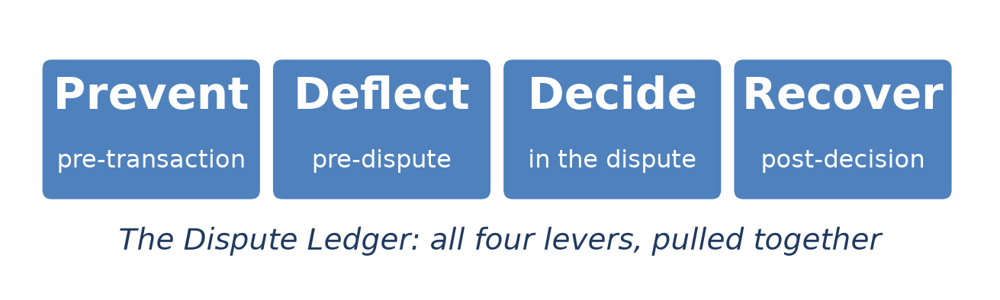
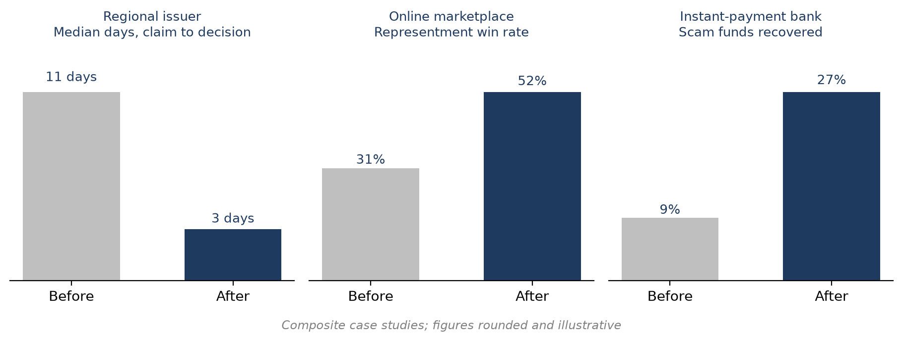
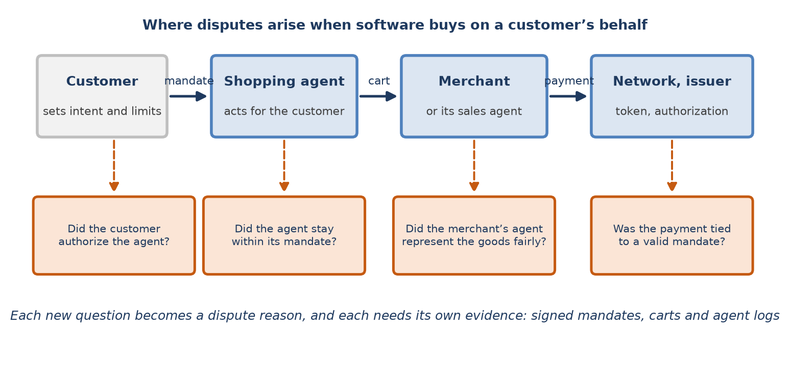
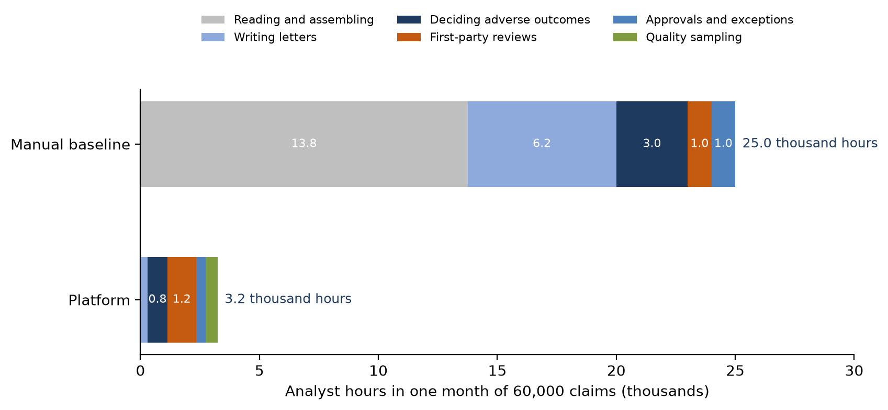
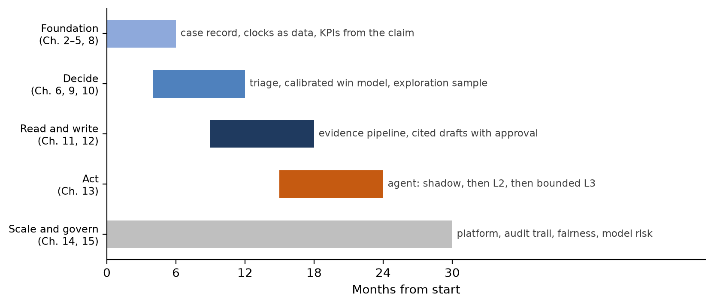
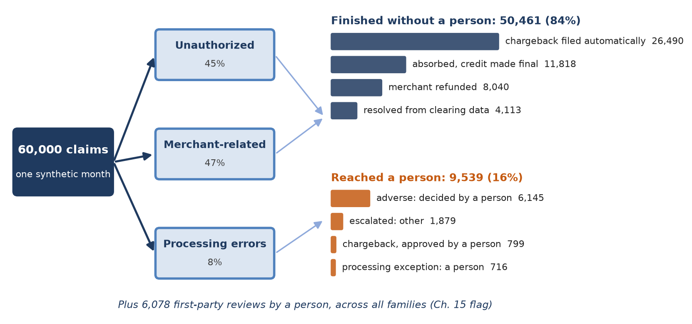
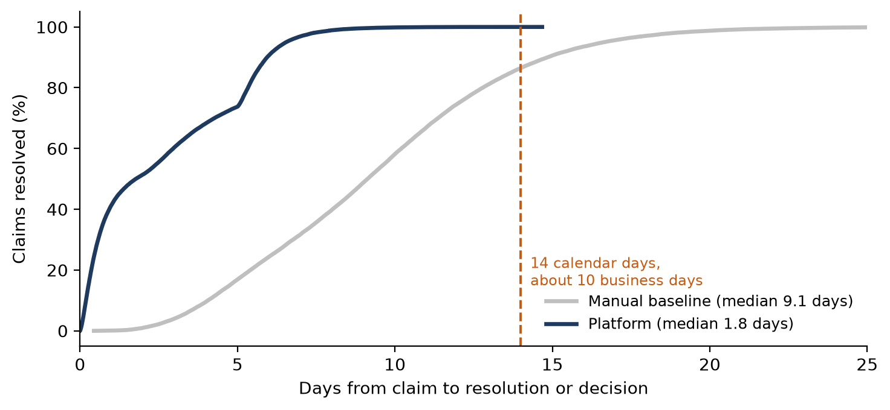

[⬅ Back to all chapters](../README.md) · [Code and data for this chapter](README.md)

# Chapter 16: Case Studies and the Future of Disputes



*This chapter pulls all four levers together: it shows what the platform changes in practice, what is changing around it, and how to get from here to there.*

> **Worked example.** The $249 claim that has run through this book began with a person: a cardholder who bought headphones, did not receive them and filed a claim in a mobile application. The next claim of its kind may begin differently. A cardholder asks an AI shopping assistant to replace a pair of headphones for no more than $150. The assistant negotiates with a merchant’s own sales agent, which offers a premium bundle with a case and an extended warranty, and the assistant buys it for $249. The cardholder sees the charge and files a claim: they never agreed to spend $249. The cardholder did authorize the assistant; the assistant did place the order; the merchant did deliver. None of the reason codes of Chapter 3 quite fits. *This chapter answers the question: what has the platform of this book achieved in practice, what will disputes look like when software buys on customers’ behalf, and how should an institution move from where it is to where it needs to be?*

The previous fifteen chapters built a dispute platform one component at a time: the rules and clocks, the lifecycle, the data foundation, the models that classify and price, the pipeline that reads evidence, the writer, the agent, the architecture that runs them and the controls that govern them. This final chapter looks at the whole. It begins with three composite case studies that show the components at work in different kinds of organization. It then looks ahead to commerce conducted by software agents, which will change what a dispute is. It considers what the platform does to the people who run disputes, sets out a roadmap for building it, and ends with a capstone: one synthetic month of claims run through every component of the book.

You will learn how the book’s components combine in practice, what new kinds of dispute agentic commerce will create and what evidence they will need, how roles and skills change when software does most of the reading and writing, how to sequence the build over two to three years, and what the platform does end to end. By the end you will have run the capstone, run\_month.py, and compared it with a manual baseline.

In this chapter, we will cover the following topics:

- Three case studies from the field
- Disputes in an agentic commerce world
- Organizational change
- The roadmap ahead
- Capstone: an end-to-end run

## Technical requirements

Open chapter16/ in the companion repository. It contains mandate.py, which checks an agent-initiated purchase against the mandate its customer signed; run\_month.py, the capstone, which generates one synthetic month of 60,000 claims, the monthly volume of the representative issuer of Chapter 5, and runs it through the components of Chapters 8 to 15 and through a manual baseline; and roadmap.yaml, the phases and exit criteria of this chapter as data. The capstone draws its parameters from earlier chapters, such as the agent’s escalation rate from Chapter 13, the first-party review rate from Chapter 15 and the cost per claim from Chapter 14, and adds a small number of new assumptions, each labelled in Table 16.5. Python 3.11, pandas 2.x and the cryptography package are sufficient. The case studies are composites: they combine patterns seen across the industry, describe no single institution, and round their figures. By the end of this chapter you will have built the sixteenth and final chapter artifact of the book; all data are synthetic and every result is illustrative.

## Three case studies from the field

Each case study below follows the same arc: a problem that the organization could describe in one sentence, a sequence of components from this book that addressed it, a result, and a lesson that was not obvious at the start. Figure 16.1 summarizes the headline result of each, and Table 16.1 sets them side by side.



*Figure 16.1: Three composite case studies. Each moved the one measure that defined its problem.*

### A regional issuer: the clock

A regional bank with a large debit card portfolio had a timeliness problem. Its investigations met the Regulation E deadlines on average, but the average hid a long tail, and an internal review found that around four claims in a hundred were decided after the deadline. Each was a potential violation, and the bank’s regulator had noticed. The operations team’s first instinct was to hire. The analysis of Chapter 5 told a different story: the analysts were not slow, the queue was. Claims waited days before anyone touched them, because work was taken in order of arrival, and the dashboard measured the analyst’s handling time rather than the customer’s wait.

The bank built in a deliberate order. It assembled the case record of Chapter 8, so that every claim had one identity linked to its authorization, clearing and order records. It moved its clocks into data, as Chapter 2 described, with a scanner that raised an alert when a case approached its deadline. It rebuilt the dashboard to measure from the customer’s claim. Only then did it deploy the triage model of Chapter 9, which put claims at risk of missing their deadlines at the front of the queue. The median time from claim to decision fell from about eleven days to about three, and late decisions fell to a few in a thousand, without new hires.

The lesson was that the model was the last and smallest step. Most of the improvement came from measuring the right thing and from data that let the bank see each claim’s deadline; the model then ranked a queue that the bank could finally see.

### An online marketplace: choosing battles

A marketplace selling on behalf of thousands of small sellers contested almost every chargeback it received and won about three in ten. Its representment team was busy and losing. The packets were assembled after the chargeback arrived, from screenshots of the order system and whatever tracking the seller could find, and many were filed with the wrong evidence for the reason code.

The marketplace started where Chapter 3 recommended: it captured delivery evidence at fulfillment, writing each shipment’s carrier record to a store keyed by order, before any dispute existed. It then deployed the evidence pipeline of Chapter 11, which scored each packet’s sufficiency against the reason code and named its gaps, and the contest rule of Chapter 10, adapted to the merchant’s seat, which declined to fight cases whose evidence could not win. Representments were drafted from the evidence record by the writer of Chapter 12. The team contested about a third fewer cases, and its win rate on the cases it did contest rose from about 31 to about 52 percent, which raised net recovery while reducing the work.

The lesson was that selectivity is a feature. The largest gain did not come from better arguments but from not making losing ones, and from evidence that existed before it was needed.

### A bank on instant payments: speed as the remedy

A bank with a growing share of instant payments faced the problem of Chapter 4: customers tricked into sending money to fraudsters reported it hours later, by which time the money had moved on. The bank’s process sent recall requests to receiving banks once an analyst had reviewed the claim, and the median time from report to recall request was about five hours. Funds recovered were about nine percent of the amounts reported.

The bank built the rail adapter of Chapter 4, so that an instant-payment scam was handled as its own kind of case with its own clock, rather than forced into a card form. It moved intake onto the event-driven design of Chapter 14, so that a report was recorded and acted on within seconds. And it gave the agent of Chapter 13 a single permitted action for these cases: send the recall request and the beneficiary details to the receiving bank, within a value limit and with every request logged, while a person reviewed the customer’s claim in parallel. The median time to the recall request fell to about twelve minutes, and the share of funds recovered roughly tripled.

The lesson was that on push rails, time is the remedy. A bounded agent that does one urgent thing immediately is worth more than a sophisticated one that does many things after a review.

| Organization | Problem | What was built | Result | Lesson |
|---|---|---|---|---|
| Regional issuer | Late decisions under Regulation E | Case record, clocks as data, claim-based KPIs, triage (Ch. 2, 5, 8, 9) | Median 11 → 3 days; late decisions to a few in a thousand | Measure the customer’s wait; the model comes last |
| Online marketplace | Contesting everything, winning 31% | Evidence at fulfillment, sufficiency scoring, contest rule, drafting (Ch. 3, 10, 11, 12) | A third fewer contests; win rate about 52% | Not fighting losing cases is the biggest gain |
| Instant-payment bank | Recall requests sent hours late | Rail adapter, event-driven intake, bounded agent (Ch. 4, 13, 14) | Five hours → twelve minutes; recoveries tripled | On push rails, speed is the remedy |

*Table 16.1: Three composite case studies*

> **Business impact.** None of the three organizations deployed the whole platform at once, and each started from a different chapter. The common pattern is to begin with the measure that defines the problem and to build the shortest path of components that moves it.
>
> **Under the hood.** In every case the data work came first: a case record, clocks as data, evidence captured at the source. Models and agents built on weak data move the wrong numbers faster.

The case studies describe disputes as they are. The next section asks how they will change.

## Disputes in an agentic commerce world

Payments have always assumed a person at the point of decision: someone who chose the goods, saw the price and pressed the button. That assumption is weakening. Customers increasingly ask software agents to find, compare and buy on their behalf, and merchants deploy agents of their own to sell, negotiate and support. In 2025 the major card networks announced programmes for payments initiated by AI agents, such as Visa Intelligent Commerce and Mastercard Agent Pay, and technology companies published open protocols, such as the Agent Payments Protocol, in which a customer’s instructions to an agent are captured as signed mandates that travel with the transaction. The details are still being settled, and the network rules for disputes on agent-initiated payments are at an early stage. The direction, however, is clear enough to plan for.

### New questions, new reasons

Figure 16.2 shows the parties to an agent-initiated purchase and the questions a dispute can now raise. The customer sets intent and limits; the shopping agent acts on them; a merchant, possibly through its own agent, offers and sells; the network and issuer authorize the payment. Each hand-off is a place where something can go wrong that no reason code of Chapter 3 describes.



*Figure 16.2: Where disputes arise in agentic commerce. Each hand-off adds a question that today’s reason codes do not ask.*

| Claim | What went wrong | Who may be responsible | Evidence that decides it |
|---|---|---|---|
| Agent exceeded its mandate | Spent more, bought outside the categories, or bought after the mandate expired | The agent provider, or a merchant that accepted an invalid mandate | Signed mandate, cart, authorization data |
| Agent misunderstood | Bought the wrong item within its limits | Often the customer and the agent provider; rarely the merchant | Customer’s instruction, agent log, product data |
| Merchant agent misrepresented | The selling agent made claims the goods did not meet | The merchant | Conversation log between agents, product page |
| Agent compromised | A fraudster controlled the agent or its credentials | As for unauthorized use today, with new liability questions | Agent and device authentication, token records |
| Not received or not as described | As today, but ordered by an agent | As today | As today (Ch. 3, 11), plus the cart |

*Table 16.2: Disputes on agent-initiated purchases*

Two features of the table matter for the platform. First, the deciding evidence is increasingly machine-generated and cryptographically signed: a mandate the customer approved, a cart the agent assembled, a log of the conversation between two agents. This is good news. Evidence of this kind is precise, and the evidence pipeline of Chapter 11 can read it exactly rather than by OCR. Second, the question of who is responsible becomes a question about which party verified what. A merchant that accepted a purchase outside a mandate it could have checked is in a different position from one that was shown a valid mandate.

### Checking a mandate

Listing 16.1 shows the check that an issuer, a merchant or a network can run on an agent-initiated purchase. It verifies the customer’s signature on the mandate and then compares the purchase with each limit the mandate sets.

```python
from dataclasses import dataclass
from datetime import datetime
from cryptography.exceptions import InvalidSignature
from cryptography.hazmat.primitives.asymmetric.ed25519 import Ed25519PublicKey

@dataclass(frozen=True)
class Mandate:
    customer_id: str
    agent_id: str
    max_total: float
    categories: frozenset
    confirm_above: float          # the customer must confirm purchases above this
    expires_at: datetime
    payload: bytes                # the exact bytes the customer signed
    signature: bytes

def check_purchase(mandate, cart, customer_key: Ed25519PublicKey):
    """Reasons an agent-initiated purchase falls outside its mandate."""
    try:
        customer_key.verify(mandate.signature, mandate.payload)
    except InvalidSignature:
        return ["the mandate's signature is not the customer's"]
    reasons = []
    if cart.agent_id != mandate.agent_id:
        reasons.append("bought by an agent the customer did not authorize")
    if cart.total > mandate.max_total:
        reasons.append(f"total {cart.total:.2f} over the limit of {mandate.max_total:.2f}")
    if cart.category not in mandate.categories:
        reasons.append(f"category '{cart.category}' not allowed")
    if cart.placed_at > mandate.expires_at:
        reasons.append("placed after the mandate expired")
    if cart.total > mandate.confirm_above and not cart.customer_confirmed:
        reasons.append("no customer confirmation where the mandate required one")
    return reasons
```

*Listing 16.1: chapter16/mandate.py*

The function check\_purchase first verifies that the mandate was signed by the customer’s key; a mandate that fails verification is no mandate at all. It then tests the agent’s identity, the amount, the category, the expiry and the confirmation requirement, and returns each failure as a reason in plain language, ready to become the reason code and the customer letter of Chapters 12 and 15. Run on 10,000 synthetic agent purchases into which faults had been injected, it found 1,412 outside their mandates: 601 over the amount allowed, 344 after expiry, 316 outside the allowed categories and 307 without a required confirmation. The value of the check is less in the counting than in the timing. Run before authorization, by the merchant or the network, it prevents the dispute; run afterwards, by the issuer, it decides it.

### What changes for the platform

Most of the platform carries over. Agent-initiated disputes are a new family for the classifier of Chapter 9 and new reason codes for the rules of Chapter 2; the rail adapter pattern of Chapter 4 accommodates a new kind of instrument; mandates and carts become new evidence types for Chapter 11; and the contest rule of Chapter 10 needs labels for outcomes that do not yet exist in any volume, which is exactly the situation the exploration sample was designed for. Two things are genuinely new. Volume will rise with the number of purchases made without a person watching, and disputes between agents may themselves be negotiated by agents. When the issuer’s agent of Chapter 13 corresponds with a merchant’s agent, both sides will need the discipline of that chapter: narrow tools, policy gates, and messages treated as data rather than instructions.

> **Business impact.** Institutions that capture and verify mandates early will be able to prevent many agentic disputes and decide the rest quickly. Those that do not will receive them as unauthorized claims with no evidence either way.
>
> **Under the hood.** Store the mandate, the cart and the agent identity on the authorization record, keyed like the order of Chapter 3, so that the evidence exists at the moment of purchase rather than being reconstructed when the customer complains.

Technology is only half of the change. The other half is the people who run disputes.

## Organizational change

A dispute operation that adopts the platform of this book changes what its people do. Figure 16.3 shows the change in the capstone month described later in the chapter: analyst time by activity, before and after.



*Figure 16.3: Analyst time by activity in one month of 60,000 claims. Reading, assembling and writing almost disappear; what remains is judgment about customers.*

Under the manual baseline, more than half of analyst time went on reading documents and assembling cases, and a quarter on writing letters. Under the platform, both almost disappear. The largest remaining activity is first-party review, in which a person decides whether a customer flagged by the model of Chapter 15 has misused the process, followed by decisions on cases where the evidence favours the merchant. In other words, what the platform leaves to people is the work that most needs judgment about customers, and that is where both the institution’s risk and its fairness obligations concentrate.

### How roles change

Table 16.3 summarizes how roles change. Some disappear into others, several new ones appear, and the skills that matter shift from processing volume to judging exceptions and supervising automation.

| Role today | Role with the platform | What changes |
|---|---|---|
| Dispute analyst | Case reviewer and decision-maker | Fewer cases, each harder; decides adverse outcomes and first-party reviews |
| Quality assurance | Sampling and output review | Reads finished runs end to end; scores drafts; feeds corrections back as labels |
| Team lead | Queue and priority manager | Manages lanes by deadline risk (Ch. 9, 14) rather than by arrival order |
| (new) | Model and prompt owner | Owns a model, prompt or rule set through its lifecycle (Ch. 15) |
| (new) | Agent supervisor | Watches refusals, escalations and alerts from the policy gate (Ch. 13) |
| (new) | Model validator, second line | Tests models independently, including for fairness |
| Operations analyst | Dispute data steward | Owns the case record, data quality and lineage (Ch. 8) |

*Table 16.3: Roles before and after*

### Making the change work

Four practices separate programmes that change an operation from those that merely install software in it. Involve analysts from the start, as labellers for the models, testers for the drafts and reviewers of the agent’s shadow runs; the people who know where the process breaks are the best source of test cases. Change the measures before the tools: a team measured on cases closed per hour will resist a platform that sends it only the hard cases, while a team measured on decisions made on time and upheld on review will welcome it. Design against automation bias, as Chapter 13 did, by asking reviewers to judge escalations rather than to approve what has already been checked, and by sampling finished work rather than every step. And be honest about capacity: the capstone shows analyst hours falling by most of their total, and an institution should decide early, and say clearly, how it will use that capacity, whether in faster resolution, in growth without hiring, in redeployment to fraud prevention or in a smaller team.

> **Business impact.** The platform’s benefits depend on people trusting it enough to stop doing its work by hand, and on their having better work to do instead. Neither happens without deliberate attention to roles, measures and communication.
>
> **Under the hood.** Make every correction an analyst makes in the platform a labelled example: an edited draft, an overturned flag, a reversed escalation. The team that uses the platform then improves it simply by doing its job.

The organization and the technology have to move together, in an order that delivers value early. That order is the roadmap.

## The roadmap ahead

The platform of this book is not built in one release. Figure 16.4 shows a sequence that the case studies and the dependencies between chapters suggest, over about two and a half years, and Table 16.4 gives each phase its exit criteria.



*Figure 16.4: A roadmap in four overlapping phases, with platform and governance work running throughout.*

| Phase | Chapters | Exit criteria |
|---|---|---|
| Foundation | 2, 3, 4, 5, 8 | Every claim has one case record; every clock is data with an alert; KPIs are measured from the customer’s claim |
| Decide | 6, 9, 10 | Triage live with deadline-risk lanes; win model calibrated on an exploration sample; first fairness report produced |
| Read and write | 11, 12 | Evidence read straight through for most packets; every draft cited and checked; approval rates monitored |
| Act | 13 | Agent run in shadow, then at L2, then at bounded L3; hostile-model scenario suite passes on every change |
| Scale and govern | 14, 15 | Peak-day load test passed; audit trail verified; model cards and inventory current; throughout |

*Table 16.4: Phases and exit criteria*

Three principles shape the sequence. Data comes first, because every later component depends on the case record and the clocks, and because, as the regional issuer found, data alone often delivers much of the benefit. Each phase delivers value on its own, so that the programme does not depend on reaching its last phase to pay for its first; Chapter 7’s business case, which applied the levers in timeline order and paid back in about sixteen months in its base case, was built on the same assumption. And autonomy comes last, after the models, the evidence and the governance on which an agent’s safety depends are already in place and trusted.

Beyond the roadmap lie developments that are visible but not yet settled: network rules for agent-initiated payments, real-time dispute exchanges between issuers and merchants that replace much of the representment cycle with data, consortium models that share first-party misuse signals across institutions under privacy-preserving controls, and supervisory expectations for AI that will become more specific. The platform of this book is designed to absorb them, because its rules are data, its components are separate services connected by events, and every decision is recorded with its reasons and versions.

> **Business impact.** A roadmap with exit criteria gives a board something to hold the programme to. ‘Agent in production’ is a date; ‘hostile-model scenario suite passes on every change’ is a standard.
>
> **Under the hood.** Keep the roadmap as data, as roadmap.yaml does, with each exit criterion linked to the query or test that proves it. Progress is then reported by running the checks rather than by asking for status.

The last step is to run the whole platform, end to end.

## Capstone: an end-to-end run

The capstone runs one synthetic month of 60,000 claims through the components of the book and through a manual baseline. Listing 16.2 shows its structure.

```python
from dispute_platform import Platform, load_month
from reporting import compare

def run_month(path="claims_month.jsonl", config="config/production-like.yaml"):
    platform = Platform.from_config(config)          # services and settings, Ch. 14
    baseline, results = [], []
    for claim in load_month(path):                   # 60,000 synthetic claims
        case = platform.intake(claim)                # record and acknowledge, Ch. 8, 14
        platform.start_clocks(case)                  # Ch. 2
        platform.classify(case)                      # family, priority, Ch. 9
        if platform.first_party_flag(case):          # Ch. 6, 15
            platform.queue_for_review(case, reasons=True)
        ending = platform.resolve(case)              # rail (Ch. 4), recovery (Ch. 10),
                                                     # evidence (Ch. 11), letters (Ch. 12),
                                                     # agent (Ch. 13)
        results.append(platform.summary(case, ending))   # days, minutes, cost
        baseline.append(platform.manual_estimate(case))
    assert platform.audit.verify() is None           # the trail is intact, Ch. 15
    return compare(baseline, results)
```

*Listing 16.2: chapter16/run\_month.py*

The function run\_month records and acknowledges each claim, starts its clocks, classifies it, sends flagged claims for first-party review with reason codes, and resolves it along the path its family and rail require, before summarizing its elapsed days, analyst minutes and cost and verifying the audit trail. Table 16.5 lists the parameters, most of them inherited from earlier chapters.

| Parameter | Value | Source |
|---|---|---|
| Claims in the month | 60,000 | Ch. 5: 720,000 a year |
| Family mix | 45% unauthorized, 47% merchant-related, 8% processing errors | Assumption |
| First-party review | 10% of claims, 12 minutes each | Ch. 15 flag; time assumed |
| Merchant-related claims finished by the agent | 71.3%; 22.1% adverse to a person; 6.5% other escalation | Ch. 13 |
| Unauthorized claims with liability on the issuer | 35%, absorbed automatically | Assumption |
| Money actions over the agent’s limit | $500 chargeback; approved by a person | Ch. 13 |
| Person-time per escalation; per letter approval | 8 minutes; 3 minutes | Ch. 12, 13 |
| Manual handling per claim | 25 minutes | Ch. 13 (illustrative) |
| Platform cost per claim; analyst cost per hour | 11.8¢; $45 | Ch. 14; assumption |

*Table 16.5: Capstone parameters*

Figure 16.5 shows where the month’s claims ended.



*Figure 16.5: Where 60,000 claims ended. Five in six finished without a person; the rest, and every first-party review, reached one.*

Of the 60,000 claims, 50,461, or 84 percent, finished without a person: chargebacks filed automatically where the recovery rule said so, credits made final where the issuer bore the liability or the amount was too small to contest, refunds confirmed in clearing, and processing errors resolved from clearing data. The other 9,539 reached a person, most of them because the evidence favoured the merchant and the outcome would be adverse to the customer. In addition, 6,078 claims across all families were flagged for first-party review. Altogether, about one claim in four was touched by a person, and each such touch was a decision rather than a chore. Table 16.6 compares the month with the manual baseline, and Figure 16.6 compares the time to resolution.

| Measure | Manual baseline | Platform |
|---|---|---|
| Analyst hours | 25,000 | 3,239 |
| Equivalent full-time analysts (140 hours a month) | 178.6 | 23.1 |
| Analyst minutes per claim | 25.0 | 3.2 |
| Handling cost per claim, including platform | $18.75 | $2.55 |
| Median days from claim to resolution or decision | 9.1 | 1.8 |
| Slowest 10% of claims (days) | 14.8 or more | 5.9 or more |
| Claims taking more than 14 calendar days | 13.5% | None |
| Claims touched by a person | 100% | 24.4% |

*Table 16.6: One month, manual baseline against the platform (synthetic data)*



*Figure 16.6: Time from claim to resolution or decision. The platform resolves most claims within two days; the step at five days is the merchant inquiry window lapsing on silent merchants.*

Analyst hours fell by seven-eighths and the median time to resolution by four-fifths, and no claim took longer than fourteen calendar days, roughly the ten business days of Regulation E’s first deadline. Two cautions apply. The capstone measures one lever, the effort and time of handling, under its own assumptions, with full adoption from the first day and no allowance for building and running the platform team. Chapter 7’s business case, which phased adoption, applied every lever in timeline order and discounted each one, remains the figure to take to a finance committee. And the step in Figure 16.6 at five days is a reminder that the platform does not control the whole timeline: a silent merchant still takes its inquiry window, and only the rules of the networks can shorten that.

Table 16.7 closes the book by listing the artifact of each chapter and the lever it pulls, all of which the capstone exercises.

| Chapter | Artifact | Lever |
|---|---|---|
| 1 | The Dispute Ledger | All |
| 2 | Rules and clocks as data (timelines.yaml) | Decide |
| 3 | The card dispute state machine | Deflect, Decide, Recover |
| 4 | Rail adapters for ACH, wires, instant payments and wallets | Decide, Recover |
| 5 | The KPI dashboard, measured from the claim | All |
| 6 | First-party signals (build\_signals) | Prevent, Decide |
| 7 | The business case model (business\_case.xlsx) | All |
| 8 | The case record | All |
| 9 | The triage service | Decide |
| 10 | fight\_or\_accept | Recover |
| 11 | The evidence pipeline | Decide, Recover |
| 12 | The summarizer and drafter | Deflect, Decide, Recover |
| 13 | The dispute agent and its policy gate | Deflect, Decide, Recover |
| 14 | The event backbone, autoscaling and load test | All |
| 15 | The audit trail, fairness report and model card | All |
| 16 | run\_month: the end-to-end capstone | All |

*Table 16.7: The book’s artifacts*

> **Business impact.** The capstone turns sixteen chapters into one comparison that an executive can read: the same month, the same claims, handled two ways. Run it again with the institution’s own volumes, mix and times, and it becomes the institution’s own case for change.
>
> **Under the hood.** Run the capstone in the deployment pipeline against every release candidate, with a fixed synthetic month. A change that moves its results, for better or worse, deserves an explanation before it reaches customers.
>
> **Worked example revisited.** The $249 purchase made by the shopping assistant runs through the platform as the month’s 60,001st claim. The issuer holds the mandate the cardholder signed: headphones and accessories, up to $150, with confirmation required above $135. The mandate check of Listing 16.1 returns two reasons in plain language: the total of $249.00 was over the limit of $150.00, and there was no customer confirmation where the mandate required one. The classifier files the claim in the new family of agent-initiated disputes, the evidence pipeline reads the mandate and the cart exactly, and the case turns on a question the network rules for agentic payments will answer: whether the merchant, which accepted a purchase that a valid mandate did not permit and could have checked, bears the loss. Under rules that place it there, the recovery rule files a chargeback within the agent’s limits, the cardholder’s credit is made final, and the letter tells the cardholder exactly why: their assistant spent more than they allowed without asking. No person needed to decide anything adverse, and the whole trail, from the signed mandate to the final credit, is in the audit log. The claim that began this book with a missing parcel ends it with a missing permission, and the same platform handles both.
>
> **Key principle.** *Build the foundation first, automate in the order of trust, and let every decision carry its evidence, its reasons and its record.*

## Summary

In this chapter we brought the book together. Three composite case studies showed the components at work: a regional issuer that met its deadlines by measuring the customer’s wait and ranking the queue, a marketplace that raised its win rate by declining to fight cases it could not win, and a bank that tripled scam recoveries by acting in minutes on a push rail. We looked ahead to agentic commerce, in which customers’ agents buy from merchants’ agents, and set out the new dispute reasons it creates and the signed mandates, carts and logs that will decide them, with a mandate check that can prevent or decide such disputes. We considered how roles change when software does most of the reading and writing, set out a roadmap in four phases with exit criteria, and ran the capstone: one synthetic month of 60,000 claims in which 84 percent finished without a person, analyst hours fell from 25,000 to about 3,200, and the median time to resolution fell from 9.1 days to 1.8.

Disputes will remain a meeting point of fraud, customer service, regulation and money movement. What changes is how much of the work a platform can do well, and how clearly it can show that it did. The aim of this book has been to make both possible: to build the platform, and to build it so that every decision it makes can be explained to the customer it affects.

## Questions

- Choose one of the three case studies and describe the shortest path of components from this book that you would build for a similar problem in your own organization. What would you measure first, and why?
- Using Table 16.2, classify a claim in which a customer’s agent bought the right item from the right merchant within its limits, but the customer says the agent should have waited for a sale. Who is responsible, and what evidence decides it?
- Extend Listing 16.1 to support a mandate that allows a fixed number of purchases per month. What must the checker know that a single cart does not tell it, and where in the platform would that information live?
- Figure 16.3 shows first-party review becoming the largest analyst activity. What does this imply for the fairness controls of Chapter 15 and for the way the review team is staffed and measured?
- Rerun the logic of Table 16.6 with your own assumptions: a different family mix, a different manual handling time and a lower agent completion rate. Which assumption changes the result most, and what would you do to measure it before committing to a business case?

## Further reading

- Visa, Visa Intelligent Commerce, programme documentation (2025 and later)
- Mastercard, Agent Pay, programme documentation (2025 and later)
- Agent Payments Protocol (AP2) specification, on intent and cart mandates for agent-initiated payments (2025)
- Ajay Agrawal, Joshua Gans and Avi Goldfarb, Power and Prediction: The Disruptive Economics of Artificial Intelligence (Harvard Business Review Press, 2022)
- Erik Brynjolfsson, Danielle Li and Lindsey R. Raymond, “Generative AI at Work,” National Bureau of Economic Research Working Paper 31161 (2023)
- John P. Kotter, Leading Change (Harvard Business Review Press, 1996, updated 2012)
- Nicole Forsgren, Jez Humble and Gene Kim, Accelerate: The Science of Lean Software and DevOps (IT Revolution, 2018)
- The companion repository, chapter16/README, for running the capstone with your own parameters
